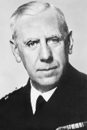

# Opposition to the Nazi Regime

## Did More People Support Than Oppose the Nazis? - Summary

From 1933 to 1945, the Nazi Party received a high level of support, and** **there was** *****conformity***** **from the German people. **Control over the distribution of information** enabled the Nazis to communicate their beliefs and ideas to society. The Nazi Party used the police forces as a tool to spread **fear **and ***censor*** opposition. Hitler placed Nazi judges in court trials to fix the outcome of legal cases. The Nazis sent many political opponents to ***concentration camps***.

Resistance came from **all areas of society**, even from inside Hitler’s armed forces. The majority of the opposition was **private**. It was incredibly dangerous to openly oppose the Nazi regime.

Both the** *****Catholic***** **and** *****Protestant**** *churches had members who opposed Nazi attempts to control Christianity. The Nazis sent many ***pastors*** and priests to concentration camps for speaking out against the Nazi Party. A section of the German Protestant community set up the **Confessing Church **in opposition to Nazi interference in the Church.

While most of Germany’s young adults attended groups such as the ***Hitler Youth*** and ***League of German Maidens***, some people hated the strictness and focus on military activities. **The Swing Youth, *****Edelweiss***** Pirates and White Rose group** demonstrated more physical, public and ***cultural**** *resistance to the Nazi regime.

1943 marked a significant turning point**.** Germany was performing poorly in the Second World War. This **increased opposition** from more areas of society.

## Was There Active Opposition to the Nazis?

> **Spec point** — `spcpt_xZjTyGsXdCMGBWfM`

## Was There Active Opposition to the Nazis?

- Even before the [Enabling Act ](https://www.savemyexams.com/igcse/history/cie/18/revision-notes/germany-1918-45/why-was-hitler-able-to-dominate-germany-by-1934/how-did-hitler-consolidate-his-power-in-1933-34/)removed political opposition, the **Nazi Party were popular**

  - Hitler won **36% **of the votes in the second **1932 presidential election**
  - The Nazi Party won **38% **of the votes in the** July 1932** **election**
- There was a high level of conformity towards Hitler and the Nazi regime after 1933:

  - **Four million **people joined the **Nazi Party **from** 1933 to 1939**
  - Hitler’s policies reduced** *****unemployment***
  - Young people joined youth groups and embraced Nazi* ****ideology***
  - The Nazis** rewarded women for getting married **and having children
  - Propaganda created a ***cult of personality***** **about** Hitler**
  - **Censorship** **banned criticism **and only promoted success
- Hitler began breaking the [Treaty of Versailles](https://www.savemyexams.com/igcse/history/cie/18/revision-notes/germany-1918-45/was-the-weimar-republic-doomed-from-the-start/the-impact-of-the-treaty-of-versailles-on-the-republic/)

  - Millions of soldiers joined the German ***Wehrmacht***** **after 1935
  - [Germany remilitiarised the Rhineland in 1936](https://www.savemyexams.com/igcse/history/cie/18/revision-notes/the-20th-century-international-relations-from-1919/was-hitlers-foreign-policy-to-blame-for-the-second-world-war/consequences-of-the-failures-of-the-league-of-nations-in-the-1930s/)
  - The Saar coalfields were returned in 1935
- There were still groups who opposed the Nazi regime:

#### Groups Who Opposed the Nazi Regime

| **Type of opposition** | **Description** |
|---|---|
| ***Trade unions*** | Hitler banned trade unions in 1933. Some trade unions operated illegally. They** encouraged workers to stay off work sick or damage factory machinery**. Some trade unions distributed leaflets that encouraged strikes |
| Political groups | The ***Social Democrats***** **campaigned against the Nazis from abroad. Some ***Communists*** and* ****left-wing*** parties met in secret and **spread pamphlets, anti-Nazi newspapers and jokes** about Hitler |
| The young | Youth groups formed in opposition to the Hitler Youth. The **Swing Youth** listened to **jazz music**,** **which Hitler had banned. The** Edelweiss Pirates** passively and violently resisted against the** Hitler Youth**. They went on **camping trips and sang folk songs**. The **White Rose group** published **anti-Nazi leaflets** |
| ***Conservatives*** | Officers like **General Ludwig Beck** secretly communicated with the British. Businessmen and upper classes met in secret in opposition to the Nazis. An example of this was the ***Kreisau Circle*** |
| The Church | After the [Concordat ](https://www.savemyexams.com/igcse/history/cie/18/revision-notes/germany-1918-45/how-effectively-did-the-nazis-control-germany-1933-45/how-did-the-nazis-deal-with-opposition/)failed, the Nazis targeted Catholic priests and shut down Catholic schools. The ***Reich Church*** was created to ‘Nazify’ the Protestant Church. **Pastor Martin Niemöller** created the** Confessing Church** against the Reich Church. **Cardinal Galen** led the Catholic opposition against the Nazi’s** *****T-4 programme***. **Pope Pius XI *****denounced***** the Nazis** as anti-Christian |
| German citizens | Some German citizens undertook small acts of opposition against the Nazis. Telling** anti-Nazi jokes** was common, even with the risk of being reported to the** *****Gestapo***. Some people **refused to do the *****straight-armed salute***** or say ‘Heil Hitler’** |

![The image features two illustrated figures of Protestant pastors:

Left: Dietrich Bonhoeffer
Bonhoeffer is shown wearing glasses and a dark suit.
The caption explains:
A Protestant pastor who helped create the Confessing Church. He was banned from preaching in 1937 by the Gestapo. He also attempted to help Jewish people escape from Germany. In 1945, Bonhoeffer was executed after being found guilty of conspiring to assassinate Hitler.

Right: Paul Schneider
Schneider is depicted in a similar dark suit but without glasses, with a serious expression.
The caption explains:
A Protestant pastor who spoke out against Goebbels and was imprisoned in 1937. He wrote letters to Protestant churches encouraging them to resist the Nazi regime. He also refused to remove his cap when the Nazi flag was hoisted. He was executed in 1939.](../../../assets/1570725c821c-31962-httpscdn-savemyexams-comuploads20250636419.png)

*An illustration showing Protestant Opposition to the Nazi Regime*

*An illustration showing Catholic Opposition to the Nazi Regime*

## Why was Most Opposition Private?

> **Spec point** — `spcpt_b9MkXDhSDFMbsHHW`

## Why was Most Opposition Private?

![Central red box with the question:
"Why was most opposition private in Nazi Germany?"

Four surrounding yellow headings explain key reasons:

The strongest opposition was eliminated

By July 1933, all political parties and trade unions were banned.

The Night of the Long Knives destroyed almost all opposition within the Nazi Party.

The media

The Nazis used censorship and propaganda to eliminate open opposition.

Fear

The Nazis operated a police state. People were watched and could face severe punishment for opposition.

Benefits of Nazi Germany

Many Germans believed that Hitler could do what he wanted as an autocratic ruler. They accepted certain actions as necessary for the recovery of Germany.](../../../assets/bf67ed5ec614-57770-httpscdn-savemyexams-comuploads202402nazi-.png)

*A concept map showing what prevented some people from openly opposing Hitler’s dictatorship*

## Opposition During the Second World War

> **Spec point** — `spcpt_ZVpfkKGmcG6MKgfG`

## Opposition During the Second World War

- Most Germans publicly supported the Second World War because:

  - They believed that **Germany was right to invade Poland in 1939**
  - The Nazis controlled information about the war
  - The Nazis harshly punished any sign of** *****dissent***
- After the failure of ***Operation Barbarossa***, **many Germans turned against the Nazi Party**

#### Opposition Within the Army

|   | **Cause** | **Impact** |
|---|---|---|
| **Admiral Canaris** | Hitler continually** ignored military advice** and invaded Poland in September 1939. Canaris feared a repeat of the failure of the ***Schlieffen Plan***. He attempted to persuade key army officials to **join in a *****coup***** against Hitler** | Canaris **delayed** the planned coup due to the war's progress. He remained in the** *****Abwehr***** until 1944 **when he was arrested and executed |
| **July 1944 Plot**  **(Operation Valkyrie)** | By the summer of 1944, many army officials lost trust in Hitler’s leadership. They believed that **killing Hitler would give Germany a better negotiating position**. On 20th July, army officer Claus von Stauffenberg **brought a briefcase containing a bomb** into the key military headquarters of Wolf’s Lair, Rastenberg | Hitler only** survived the *****assassination*** attempt because von Stauffenberg placed the briefcase behind the large wooden leg of the conference table. After the incident, Hitler ordered the **execution of 4,900 Germans** |

| “The assassination must be attempted, at any cost. Even should that fail, the attempt to seize power in the capital must be undertaken. We must prove to the world and to the future generations that the men of the German resistance movement dared to take the decisive step and to hazard their lives upon it.  Compared with this, nothing else matters.” |
|---|
| A telegram sent to von Stauffenberg from Tresckow, a key plotter in Operation Valkyrie |

*A photograph of Admiral Canaris, taken in 1940*

#### Youth Opposition

|   | **Type of opposition** | **Impact** |
|---|---|---|
| Edelweiss Pirates | The main youth opposition group in Germany. Members of the group in Cologne **killed the Gestapo chief in 1944** | In **1942**, the German state **arrested over 700 members**. In response to the murder of the Gestapo chief, 12 members were publicly hanged |
| White Rose group | Formed at **Munich University in 1943**. They publicly opposed the Nazi government through leaflets and marches | Its leaders, **Hans and Sophie Scholl**, were arrested and executed by ***guillotine*** in 1943 |

> **Worked Example**
> **Why was there some opposition to Nazi rule?**
> 
> **6 marks**
> 
> **Partial answers:**
> 
> There was some opposition to the Nazis because not all young people wanted to conform **(1)**. Some of them found the Hitler Youth too regimented. As a result, young people created alternative youth groups. An example of this was the Swing Youth. They rebelled against the Nazis by listening to jazz music **(1)**. This shows that there was opposition because the Nazis banned jazz music. This shows some opposition as young people created groups outside of what Hitler and the Nazis wanted. They actively disobeyed laws to gain more freedom** (1)**.

> **Exam Hint**
> In Paper One, ‘explain why’ questions are worth either six or ten marks. For full marks for this question, an examiner is looking for **two fully explained reasons **as to why there was some opposition to Nazi rule. Use the PEE structure in your answer:
> 
> - **P - **Make a **p**oint about the question
> - **E -** Use **e**vidence that supports the point that you have made
> - **E - E**xplain why this evidence made people oppose the Nazis. Avoid repeating the point again. Explain how this factor forced a particular group of people to rebel against the Nazi Party’s control
