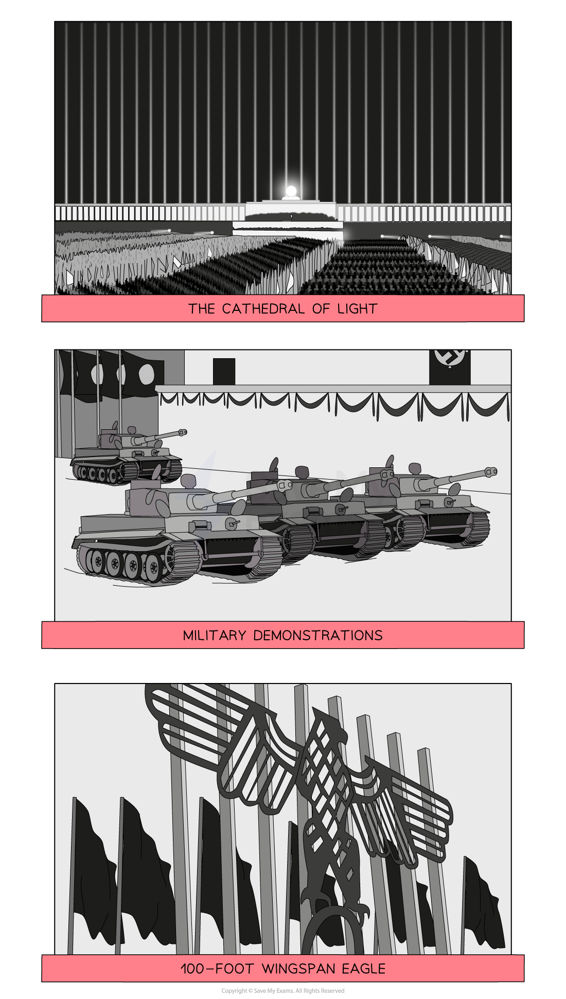

# The Use of Culture and the Mass Media

## How Did the Nazis Try to Influence German Culture? - Summary

Fear and intimidation was not enough for the Nazis to guarantee compliance with their** *****totalitarian*** regime. The Nazis - championed by **Joseph Goebbels** - used ***propaganda*** and ***censorship***** to control and influence the attitudes of the German people**.

They objected to many modern aspects of ***culture*** and ***arts***. The ***Weimar Republic*** had embraced new ideas during the [Golden Years](https://www.savemyexams.com/igcse/history/cie/18/revision-notes/germany-1918-45/was-the-weimar-republic-doomed-from-the-start/what-were-the-achievements-of-the-weimar-period/) of Germany such as the** *****Bauhaus*** movement. The Nazi Party believed in **restoring traditional values and the family structure**. These were beliefs that Goebbels could communicate through **art, film, music and literature**. Therefore, the Nazis quickly set about reforming the culture and arts sector.

In the 1930s, **newspapers and radio** were the most popular media outlets. The Nazis embraced these ***mediums*** to distribute information. Demonstrating to the German people the **power and strength of the Nazi regime** was very important. ***Rallies*** such as that at **Nuremberg **in 1934 were opportunities to present the unity and organisation of this new Nazi-led Germany. This contrasted with the disorganised and helpless Weimar Republic.

Through the ***Reich Chamber of Culture***, Goebbels ensured that occupations such as artists, musicians and authors all adhered to **strict rules and laws**. Failure to follow the regulations set out often led to** *****persecution*** and interference by the ***SS***** **or** *****Gestapo***. As a result, throughout the 1930s there was a **complete overhaul of cultural ideas**.

## Who was Joseph Goebbels?

> **Spec point** — `spcpt_z8zXQ2hF4RjH57cc`

## Who was Joseph Goebbels?

- Goebbels was a loyal member of the Nazi Party

  - His work helped gain the Nazi Party election success by 1932
- As **Minister for People’s Enlightenment and Propaganda**, Goebbels was responsible for ensuring the Nazis controlled all areas of German life:

> **blockquote**
> The best propaganda is that which works invisibly, penetrating every cell of life

![A timeline chart summarises key events in the career of Joseph Goebbels, accompanied by an illustrated portrait of him in a grey suit. The horizontal timeline spans from 1919 to 1933, with Goebbels’ name labelled along the top of the bar. Milestones are marked chronologically below the line, with associated event descriptions:

1919 – “Outraged at the passing of the Treaty of Versailles.”

1922 – “Joined the Nazi Party.”

1926 – “Regional leader (Gauleiter) of Berlin after the Bamberg Conference.”

1930 – “Head of Propaganda.”

1933 – “Minister for People’s Enlightenment and Propaganda.”](../../../assets/f8b4c6b2ccc0-35715-httpscdn-savemyexams-comuploads202402timel.png)

*A timeline of Joseph Goebbels*

## The Nazi Use of Media

> **Spec point** — `spcpt_mBMpRp72HnRYW4M7`

## The Nazi Use of Media

### Newspapers

- The Nazis told journalists what they could and could not publish
- Control of newspapers allowed the Nazis to spread their messages to the public:

  - They **controlled most newspapers by 1939**, compared to 3% in 1933
  - Around **1,600 newspapers were closed down** in 1935
- ***Der Völkischer Beobachter***  (The People’s Observer) was the official newspaper of the Nazi Party and was published daily:

  - It reached **1.1 million people** by 1941

### Radio

- Radios were an **increasingly popular** tool to communicate political messages:

  - Goebbels had relied on radio during the election years of 1932 and 1933
- After 1933, **Goebbels censored most radio stations**. Nazi-controlled stations spread propaganda

  - The Nazis insisted that employers placed radios in workplaces
- The introduction of the ***Volksempfänger*** (The People’s Receiver) in 1933 was hugely important for several reasons:

![An illustrated black radio titled “Volksempfänger” (People’s Receiver) is surrounded by factual annotations highlighting its features and significance in Nazi Germany:

Top left: “Its official name was Volksempfänger 301, which referenced when Hitler became Chancellor on the 30th January.”

Top right: “It had a short range so that foreign stations could not be picked up.”

Middle left: “It was one of the cheapest radios in all of Europe.”

Middle right: “The cheaper model cost only 35 Reichsmarks, which was equivalent to a week’s salary.”

Bottom right: “Only German radio stations were marked.”

Bottom right corner: “The People’s Receiver made up 75% of all radio sales in 1934.”](../../../assets/9f05ba4ed6b3-54245-httpscdn-savemyexams-comuploads202402the-p.png)

*What was the People’s Receiver?*

## The 1936 Berlin Olympics

- Hitler and Goebbels believed that **success in sport was essential**:

  - To “Strengthen the character of the German people”
  - To promote the Nazi belief that the ***Aryan***** race** was superior
- The **1936 Berlin Olympics** was an opportunity for Hitler to show the might of Nazi Germany:

![An illustrated image shows a central Olympic bell symbol from the 1936 Berlin Olympics, surrounded by key facts highlighting how the Nazis used the Games for propaganda:

Top left: “A ban on Black and Jewish athletes was retracted after criticism from a number of countries.”

Top right: “It featured the largest stadium in the world, which could hold 110,000 spectators.”

Middle right: “Nazi swastikas and imagery were displayed everywhere.”

Bottom right: “Leni Riefenstahl was a German director who filmed the games and footage was used for propaganda.”

Bottom left: “Germany won 38 gold medals.”

Centre bell graphic: A bell symbol displaying the Nazi eagle, Olympic rings, and the motto: Ich rufe die Jugend der Welt (“I call the youth of the world”).](../../../assets/7eae86e30091-34941-httpscdn-savemyexams-comuploads202402featu.png)

*Key features of the 1936 Berlin Olympics*

- ***Jesse Owens***** angered Hitler** and the Nazis by **winning four gold medals** and becoming the most successful athlete at the games
- ***Leni Riefenstahl*** directed the film***Olympia***, which was released in 1938 and documented the events of the 1936 Berlin Olympics

> **Worked Example**
> **Why were the 1936 Olympic Games important to Hitler? **
> 
> **6 marks**
> 
> **Final answer:** **Partial answers:**
> 
> The 1936 Berlin Olympics were important to the Nazis because it was a perfect propaganda opportunity **(1)**. A new stadium had been built in Berlin that could hold up to 110,000 spectators. The film-maker Leni Riefenstahl directed the film *Olympia*,* *which showed the scale of the event **(1)**. This created positive propaganda for the Nazis. The Olympics was an international event with many countries sending their athletes to compete. This allowed the Nazis to show the whole world how modern, strong and successful Nazi Germany was **(1)**.

> **Exam Hint**
> In Paper One, ‘explain why’ questions are worth either six or ten marks. For full marks in this question, an examiner is looking for **two fully explained reasons **as to why the 1936 Olympics were important to Hitler. Use the PEE structure in your answer:
> 
> - **P - **Make a **p**oint about the question
> - **E -** Use **e**vidence that supports the point that you have made
> - **E - E**xplain why this evidence made the Olympics important. Avoid repeating the point again. Explain how this factor caused the Nazi Party to gain an important positive outcome from hosting the event

## Nazi Rallies

> **Spec point** — `spcpt_B3c8FFrfnksvzHkb`

## Nazi Rallies

- The Nazi Party had used rallies throughout the 1920s and early 1930s
- The declaration of Hitler as ***Führer ***in 1934 allowed him to merge the identity of the Nazi Party with that of Germany:

  - **Rallies became more frequent and created a sense of unity**
  
    - They celebrated important occasions such as Hitler’s birthday
  - **They were used to advertise the strength of the German army**
  
    - This broke the military restrictions of the ***Treaty of Versailles***

### The Nuremberg Rallies

- Nuremberg is a city in the centre of Germany and was chosen to **host annual rallies from 1933 to 1938**
- Hitler’s favourite ***architect***, **Albert Speer, designed the grounds** where the rallies took place
- The 1934 Nuremberg rally had **200,000** in attendance:

  - 152 searchlights were used as pillars of light around the audience, known as the *Cathedral of Light*
  - Films like ***Triumph of the Will***** **by Leni Riefenstahl presented the strength and power of the Nazi Party at the Nuremberg rallies

*Key features of the 1934 Nuremberg Rally*

## Nazi Control of Culture and Arts

> **Spec point** — `spcpt_9cBvtDQZCY5Ngyn8`

## Nazi Control of Culture and Arts

- The Nazis objected to the Weimar Republic’s focus on modern art and culture
- They instead** favoured romantic ideas about Germany’s past**, the importance of family and strong values
- The** Reich Chamber of Culture** was set up in **1933** to make sure that all aspects of culture and the arts aligned with these Nazi beliefs
- Several Chambers formed the Reich Chamber of Culture:

| **Chamber** | **Jobs affected** |
|---|---|
| Reich Chamber of Creative Art | Architects, decorators, sculptors, painters, engravers, dealers in works of art and antiques |
| Reich Chamber of Music | Composers, performers, conductors, teachers and instrument manufacturers |
| Reich Chamber of Literature | Authors and book dealers |
| Reich Chamber of Film | Anyone involved in film production |

## Nazi Art

- All those involved in art were **required to join the Reich Chamber of Creative Art**:

  - **Those who didn’t or couldn’t join were forbidden to teach, produce or sell art**
  - Around** 42,000 artists** were accepted
- Art that did not conform with Nazi beliefs was removed:

  - ***Expressionist*** artwork produced by Picasso and Van Gogh was seen as too modern
  - **In 1936, over 12,000 paintings and sculptures were removed from galleries**
- Gestapo members would visit art studios to monitor the art being produced
- Artists were rewarded for producing art the Nazis did approve of:

  - The Greater German Art Exhibition featured 900 exhibits in 1936

## Nazi Architecture

- The Nazis **disliked the modern designs of the Bauhaus movement **during the era of the Weimar Republic
- Hitler’s favourite architect was** Albert Speer**, who designed some of Nazi Germany’s most important buildings:

  - The** *****Zeppelinfeld***, the parade ground for the Nuremberg rallies
  - Helped to add to the design of the **Berlin Olympic Stadium**
- Many buildings were** never completed** because Nazi Germany was defeated in 1945

![A central black-and-white architectural illustration of a large Nazi-era building is surrounded by annotations explaining key features of Nazi architecture. The building has a prominent swastika above its entrance, flanked by long banners and columns.

Surrounding text boxes explain the architectural symbolism:

Top left: “Monumental buildings from Ancient Greece and Rome were used as inspiration.”

Top right: “Large buildings gave an impression of power and strength.”

Middle right: “Traditional building materials like stone were used.”

Middle left: “Nazi flags were used to merge the strength of Nazi Party with that of the architecture.”

Bottom left: “Steps, pillars and arches were classical and historical architectural features.”

Bottom right: “Buildings were to be impressive, but should still be rationally built with a clear purpose.”](../../../assets/e3f3109fc289-53785-httpscdn-savemyexams-comuploads202402featu.png)

*Key features of Nazi architecture*

## Nazi Music

- The Nazis promoted music that represented **traditional aspects** of German culture

  - **Wagner, Beethovan and Bach** were liked for their focus on ***folk music***
- The Nazis censored music produced by Jewish composers

  - A monument dedicated to the composer Mendelssohn was removed in 1936
- **Jazz music was disliked because it was associated with Black people**

  - **Many jazz artists at the time were also of Jewish origins**

## Nazi Literature

- The Chamber of Culture** approved books** before they were published
- The Nazis** banned around 2,500 writers** because they did not conform to Nazi beliefs:

  - Works by Einstein and Oppenheimer were banned because of their Jewish origins
  - Lenin's work was banned because it spoke about ***Communism***, an *ideology *hated by the Nazis
- Nazis removed millions of books from libraries and universities and burned them on bonfires:

  - In **May 1933**, students in Berlin burned** 20,000 books** by anti-Nazi authors
  - Books from** 34 cities** in Germany were burned for being “unwanted”
  - Joseph Goebbels delivered a speech encouraging the burning of books to an audience of 40,000

## Nazi Cinema

- The Nazis embraced the ‘modern’ and popular technology of film
- The Nazis had to approve all film plots and foreign films underwent censorship
- ***Newsreels*** showing** Germany’s achievements** were played before the start of films
- Films like *Triumph of the Will* by Leni Riefenstahl presented the strength and power of the Nazi Party
- Films like ***Hitlerjunge Quex*** were used to spread political messages about the threat of communism
- In total, the Nazi Party made** 1,300 films**

> **Worked Example**
> **Describe how the Nazis used the mass media**
> 
> **4 marks**
> 
> **Final answer:** **Answer:**
> 
> Radios were in public places and work places so that everyone could hear Hitler’s speeches **(1)**. Newspapers like *Der Völkischer Beobachte* were used to spread support for the Nazi government **(1)**. Theatre, cinema and music were used to support Nazi values **(1)**. Books were censored or burnt** (1)**.

> **Exam Hint**
> For a ‘Describe’ question, you should aim to complete the question in **four minutes, one minute per point**. This will give you one minute to read through your answer.
