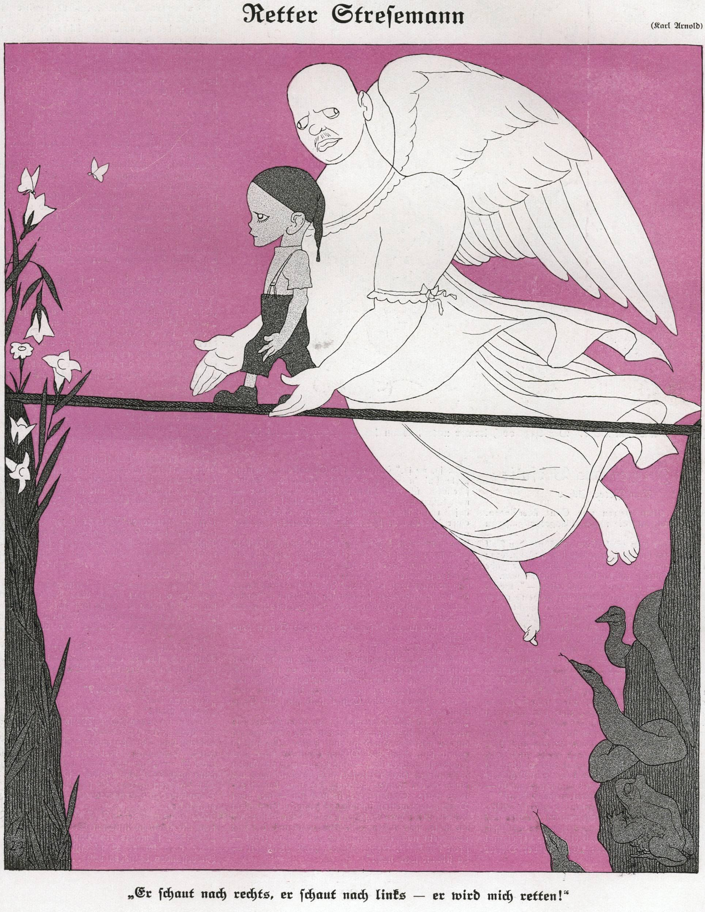

# Did the Republic Recover After 1923?

## How Important was Stresemann to the Recovery of the Weimar Republic? - Summary

When President Ebert chose **Gustav Stresemann as *****chancellor***** in August 1923**, the German economy had crashed. The French invasion of the Ruhr had caused ***hyperinflation*** and the German currency, the mark, was worthless.

Stresemann was** **chancellor from August to November 1923. He made many decisions in an attempt to save Germany's economy. He **brought *****inflation***** under control** by implementing a new currency, the **Rentenmark**. Stresemann negotiated the **Dawes (1924) and Young (1929) plans**. This reduced Germany's ***reparations*** payments to the Allies.

By** November 1923, Stresemann had lost his position as chancellor**. The ***coalition*** government broke down when the ***SPD*** decided they no longer wanted to work with Stresemann’s party, the ***DVP***. The next chancellor, Wilhelm Marx from the Centre Party, formed a coalition with the DVP and the ***DDP***. **Stresemann was appointed foreign minister **by Marx.

As foreign minister, Stresemann pursued several ***treaties ***like **Locarno and Kellogg-Briand**. He aimed to build **better relations with Europe** and restore Germany’s reputation as a world power. Stresemann succeeded in his ambitions. In 1926, the ***League of Nations***** accepted Germany **as a permanent member. In the same year, Stresemann won the** *****Nobel Peace Prize***. Stresemann ***died in office*** **on 3rd October 1929**.

Historians debate the success of Gustav Stresemann’s policies on the recovery of the ***Weimar Republic***. Some historians argue that **Stresemann saved the Republic**. They state that his policies facilitated a ‘***Golden Age***' from 1923 to 1929. Between 1924 and 1929, the public’s support of ***moderate*** parties increased. Other historians highlight that** Stresemann only delayed the failure of the Republic**. The Dawes and Young plans meant that Germany was reliant on American economic success. If the USA’s economy failed, it would trigger a ***depression*** in Germany. The **Wall Street Crash **in the USA in 1929 ultimately caused the downfall of the Weimar Republic.

*The front page of the German satirical magazine Simplicissimus in 1923. It shows Gustav Stresemann as a guardian angel of the German Michel. The caption reads: "He looks to the right, he looks to the left - he will save me!"*

| “Stresemann did German democracy a disservice. Stresemann’s Republic was kept going by foreign success and the dose of success had constantly to be increased. Far from consolidating the Republic, Stresemann gave the Germans a taste for blood which the enemies of the Republic could more easily satisfy” |
|---|
| An extract from *The Course of Germany History* by A. J. P. Taylor. It was published in 1945 |

## Economic Achievements of Gustav Stresemann

> **Spec point** — `spcpt_cbHfm7Vnw65Zj66Y`

## Economic Achievements of Gustav Stresemann

## Who was Gustav Stresemann?

- Gustav Stresemann became chancellor in August 1923

  - Stresemann was a** *****nationalist***
  - Initially, he did not like the Weimar Republic
  - After the ***assassination*** **of Rathenau**, Germany’s foreign minister, Stresemann’s opinion of the government changed
  - He established the **DVP (People’s Party)**, a moderate right political group
- As chancellor, Stresemann had three aims for Germany:

  - **Bring inflation under control**
  - **Regain Europe’s respect**
  - **Minimise the support for *****extremist***** parties**

## The Creation of the Rentenmark

- Germany’s currency, the mark, was beyond saving:

  - The largest note was **100,000,000,000,000 (100 trillion) marks**
  - The government believed there were 400.3 billion trillion marks in ***circulation***
- In November 1923, Stresemann created a** new currency** called the Rentenmark

  - **One Rentenmark was the equivalent of a trillion marks**
  - Stresemann established a new** state-owned bank** called the **Rentenbank**
  - The German public brought marks into the Rentenbank to transfer them into Rentenmarks
- The Rentenmark was a ***gold standard***** currency**

  - This means that** the value of the Rentenmark matched the price of gold**
  - European countries trusted gold standard currencies
- In August 1924, the government created the Reichsbank to control the Rentenmark

  - The government renamed the Rentenmark the **Reichsmark**
  - The new currency allowed German businesses to **trade with foreign countries**

### Dawes Plan

- The agreement of the [Dawes Plan](https://cms-staging.savemyexams.co.uk/content/courses/crs_JxDSBWHvM9FFxDCg/syllabus-versions/slbvrs_mZjN5YmNKPZ6JrpR/sections/sec_ysWTpdfwJjSWj3Qh/topics/top_MjTFQ3bXxcFQ5SNj/subtopics/sbt_7xkXfqJmBqbXcNSj/revision-note) helped Germany to economically recover

![A cartoon showing three groups reacting to the Dawes Plan, each with speech bubbles:

Extremist Parties (left): A working-class man with a hammer says, “Our country should not be paying back reparations. They are the product of a corrupt treaty!”

German Citizens (centre): A man and woman in middle-class clothing say, “The Dawes Plan will help our country become stronger. Well done Weimar government!”

Critics (right): A concerned-looking older man says, “I am worried that our economic success is dependent on American loans.”](../../../assets/4ea0be3648f0-47765-httpscdn-savemyexams-comuploads202402react.png)

*An illustration showing the various reactions to the Dawes Plan in Weimar Germany *

### Young Plan

- The Young Plan further improved Germany's economic position

![A three-column comparison chart titled "Dawes Plan vs. Young Plan," divided into Differences, Similarities, and Differences again:

Left Column – Dawes Plan Differences:

"US banks gave money to German businesses"

"Germany was in debt to the USA"

Middle Column – Similarities:

"Created anger from extremist parties"

"£50 million a year reparations"

"Improved relations with France"

"Improved trade and employment"

Right Column – Young Plan Differences:

"Total reparations reduced to £2 billion"

"Germany could lower taxes to citizens"

"Extension to 59 years to repay"](../../../assets/2261420c81ee-16052-httpscdn-savemyexams-comuploads202402young.png)

*A diagram showing a comparison between the Dawes and Young Plans*

> **Exam Hint**
> Students often get confused between the Dawes and Young plans. There are many similarities between the two plans. However, the Young Plan built upon the success of the Dawes Plan. Use the diagram above to help you identify specific features from each plan.

| **Successes** | **Weaknesses** |
|---|---|
| Stresemann ended the *passive resistance* in the Ruhr which increased Germany’s production capability | Germany’s economy was **dependent on the US economy**. In 1929, Stresemann stated that Germany was “**dancing on a volcano**”. If the USA recalled the loans or experienced a depression, the ‘volcano’ would erupt and destroy the stability of Weimar Germany |
| The Rentenmark meant that businesses could **trade** again with other countries | **Rich and poor remained divided.** Farmers particularly struggled with low prices |
| The Young Plan** lowered reparation payments**, which helped recover the economy. This increased the Allies’ confidence in Germany’s ability to pay the reparations bill | ***Unemployment*** remained at **one million ** |
| The Dawes Plan brought** foreign investment** into German industry. This eased tensions between Germany and the Allies |   |

## Foreign Policy Achievements of Gustav Stresemann

> **Spec point** — `spcpt_QR9jNYWScrtBbkQG`

## Foreign Policy Achievements of Gustav Stresemann

### The Locarno Treaties

- The [Locarno Treaties](https://www.savemyexams.com/igcse/history/cie/18/revision-notes/the-20th-century-international-relations-from-1919/to-what-extent-was-the-league-of-nations-a-success/what-was-international-diplomacy-like-in-the-1920s/) helped Germany's relationship with other countries

### Germany Joins the League of Nations

- The [League of Nations ](https://www.savemyexams.com/igcse/history/cie/18/revision-notes/the-20th-century-international-relations-from-1919/to-what-extent-was-the-league-of-nations-a-success/why-was-the-league-of-nations-created/)was a forum where countries could discuss problems before resorting to armed conflict

  - Wilson, the American President, played a leading role in the creation of the League of Nations. It was based on his ***14 Points***
  
    - The ***Treaty of Versailles*** established the League
    - The League did not formally meet until **10th January 1920**
    - For a country to join the League of Nations as a permanent member, it had to receive** two-thirds of the members’ votes**
    - A country could leave the League if it gave two years' notice
- Due to Clemenceau’s anger, the Treaty of Versailles** banned Germany** from joining the League of Nations
- As a result of the Locarno Treaties, the **League of Nations met with Stresemann** to discuss membership

  - In **September 1926, Stresemann obtained German membership** of the League
  - The League permitted Germany to sit on the League of Nations Council

### The Impacts of Joining the League of Nations

| **Positive impacts** | **Negative impacts** |
|---|---|
| Boosted German citizens’ **confidence **in the Weimar Republic | Some people** did not want anything to do with the League of Nations**. It was associated with the hated Treaty of Versailles |
| Gained support for **moderate parties** | Created anger among **extremist parties** |

### The Kellogg-Briand Pact, 1928

- **French foreign minister Aristide Briand** met with** US *****Secretary of State***** Frank B. Kellogg** to discuss further steps towards world peace

  - The USA was not in the League of Nations due to focusing on their own affairs
  - Some US politicians were ***idealists*** and wanted world peace
- On **27th August 1928**, they assembled **Germany and 61 other countries **to sign the Kellogg-Briand Pact
- The Kellogg-Briand Pact stated that **war should never be used as a means for resolving disputes** between countries

#### Impacts of the Kellogg-Briand Pact on Germany

| **Positive impacts** | **Negative impacts** |
|---|---|
| Boosted German citizens’** confidence **in the Weimar Republic | The Kellogg-Briand Pact **did not remove the military restrictions** imposed by the Treaty of Versailles. This angered extremist parties |
| The world saw Germany as a respectable and trustworthy state. They could **enter into treaties as an equal** to the other** *****signatories*** | Many Germans thought other countries would move towards** *****disarmament***. Disappointingly, the pact** did not promise this** |

### Impact on the Reichstag

- When Stresemann became chancellor in August 1923, he aimed to **reduce support for extremist parties**
- His success in financial and political affairs achieved this aim

![A bar chart showing the percentage of votes received by major German political parties in three Reichstag elections:

May 1924 (blue)

December 1924 (red)

May 1928 (purple)

Party trends:

DNVP (Nationalist right): Votes rise from May to December 1924, then fall sharply by 1928.

SPD (Moderate left): Gains steadily across all three elections.

Zentrum (Centre party): Remains fairly stable throughout.

DDP (Liberals): Slight decline over the years.

DVP (Moderate conservatives): Drops slightly in each successive election.

NSDAP (Nazi Party): Starts with a relatively high vote share in May 1924, drops in December, then falls even further by May 1928.

Key Insight:
Support for extremist parties like the Nazis declined significantly by 1928, while moderate democratic parties such as the SPD gained strength, suggesting increasing political stability in the mid-to-late 1920s.](../../../assets/72f5a1b593a4-3997-httpscdn-savemyexams-comuploads202402weimar.png)

*A graph showing the election results for the main political parties in Germany from 1924-1928*

- By October 1929, the political atmosphere in Germany had radically changed

  - There were **no political assassinations** between 1924 and 1929
  - There were **six coalition governments** in the period of 1924-1929. This was much fewer than pre-1924
  - **Friedrich Ebert died in 1925**
  
    - Throughout his presidency, Ebert could not detach his reputation from the Treaty of Versailles
  - **Paul von Hindenburg** replaced Ebert as ***president***
  
    - Hindenburg was the army chief of staff under the Kaiser
    - He was elected president at **77 years old**
    - He had strong** *****conservative***, nationalist views
    - The ***right-wing***** middle class respected Hindenburg** and, as a result, increased their support of the Weimar Republic
  - On **3rd October 1929, Stresemann died in office** of a heart attack
  
    - The Republic lost one of the most capable ministers it had
    - The Wall Street Crash occurred at the end of October

| **Successes** | **Weaknesses** |
|---|---|
| The French and Belgian soldiers left the Ruhr in 1925. Stresemann’s approach helped created a stronger relationship between Germany and France | This was not enough for nationalists. They believed that the ***Allies***** got away with unacceptable actions** |
| Politics in **Germany stabilised**. Moderate parties received more votes. In 1925, Paul von Hindenburg was elected president. This increased confidence in the Weimar Republic | **Extremist parties still had 13% of the vote**. Hindenburg was a right-wing nationalist who initially did not support the Weimar Republic |
| The Locarno Treaties, the Young Plan and Germany’s entrance into the League showed that countries** accepted Germany back into European affairs** | Nationalists criticised these actions. They were unhappy that the German government **continued to follow the Treaty of Versailles** |

> **Worked Example**
> **Why were Stresemann’s policies important for Germany?**
> 
> 6 marks
> 
> **Partial answer:**
> 
> Stresemann’s policies were important for Germany because they helped Germany recover from hyperinflation (1). The occupation of the Ruhr caused the Weimar Republic to print more money. This caused a hyperinflation crisis. In 1923, Stresemann introduced a new currency called the Rentenmark (1). The Rentenmark was incredibly important for Germany. It allowed the country to have a valuable currency respected by foreign markets. This allowed Germany to trade, helping German industries to recover (1).

> **Exam Hint**
> Ensure you write two paragraphs in PEE format about why Stresemann’s policies helped Germany to recover. Other points you could include are:
> 
> - The end of passive resistance in the Ruhr
> - The reduction of reparations due to the Dawes and Young plans
> - Securing investment from the USA
> - Helping Germany to recover its international reputation
