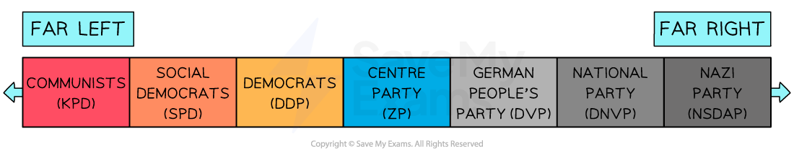

# The Impact of the Treaty of Versailles on the Republic

### Germany’s Reaction to the Treaty of Versailles - Summary

The ***Treaty*** of Versailles is often referred to as one of the** most hated treaties in history**. This is because every country that signed the agreement was **deeply unhappy with the outcome**. The ‘[Big Three’ of Britain, France and the USA ](https://www.savemyexams.com/igcse/history/cie/18/revision-notes/the-20th-century-international-relations-from-1919/was-the-treaty-of-versailles-fair/motives-and-aims-of-the-big-three-at-versailles/)met at the** Palace of Versailles in January 1919** with different intentions.

With so much difference in opinion, it is clear why the **final agreement dissatisfied every contributor **and became a** *****controversial*** treaty. The ***Allies***** **banned Germany from attending the peace talks in January 1919. While the ***Weimar Republic*** had little choice but to** sign the treaty, its terms brought anger to the German public**. The public’s hatred towards the Treaty of Versailles lasted into the 1930s. **Hitler utilised this anger **as a way to win the support of the people.

## The Terms of the Treaty of Versailles

> **Spec point** — `spcpt_7HfJwYptjbD42Kpc`

## The Terms of the Treaty of Versailles

#### The Military Terms of the Treaty of Versailles

| **Article number** | **Description of term** | **Impact on Germany** |
|---|---|---|
| 42 | The ***Rhineland***** **(an area in Western Germany that bordered France) became ***demilitarised***. Allied troops were stationed there until 1930 | Germany was not allowed to have soldiers in the Rhineland. This made them **vulnerable to an invasion** from France |
| 160 | Germany’s army was restricted to 100,000 men | Many ex-soldiers became ***unemployed*** |
| 181 | Germany’s navy was restricted t**o six battleships** and** could not produce submarines** | Germany became **weaker**. They could not develop the military technology that other countries had |
| 198 | Germany was** not allowed to have an air force** |   |

#### The Territorial Terms of the Treaty of Versailles

| **Article number** | **Description of term** | **Impact on Germany** |
|---|---|---|
| 45 | France was given the area of the **Saar**, with its coalfields, for 15 years | Germany lost **15% of their coal resources**. This affected their economy |
| 51 | **Alsace-Lorraine** became a part of France again | Germany did not have a ***buffer**** ***between themselves and France **anymore |
| 80 | ***Anschluss**** *(the union between Germany and Austria) was** forbidden** | Austria was a part of **Germany’s cultural identity**. Many Austrians considered themselves to be German |
| 87 | **Germany lost Posen and West Prussia**, which allowed the Allies to create a ‘**Polish Corridor**’. This gave Poland access to the sea | The ‘Polish Corridor’ **divided Germany into two**. Roughly one million Germans were under Polish rule |
| 199 | France and Britain ruled **all 11 of Germany’s** ***colonies*** in Africa and the Far East as ***mandates*** | **Germany’s reputation as a global power was destroyed**. They had fewer items to trade with other countries |

#### The Political and Economic Terms of the Treaty of Versailles

| **Article number** | **Description of term** | **Impact on Germany** |
|---|---|---|
| 1-26 | Germany could **not join the** [League of Nations](https://www.savemyexams.com/igcse/history/cie/18/revision-notes/the-20th-century-international-relations-from-1919/to-what-extent-was-the-league-of-nations-a-success/why-was-the-league-of-nations-created/) | Germany felt **excluded from world politics**. They were more likely to resort to violence to resolve disputes |
| 231 | The ‘**War Guilt’ Clause**. Germany had to agree that they started the First World War. The clause made Germany accept responsibility for the deaths and destruction during wartime | This clause created the **most anger among the German population**. They felt it was unfair to take all of the blame for the atrocities caused by the First World War |
| 232 | Germany would have to pay the Allies ***reparations*** as a condition of their surrender. The amount was set at **132 billion gold marks (£6.6 billion**) | This amount would be enough to ***bankrupt***** Germany,** especially, as the territorial terms reduced their ability to trade |

## Why was the Treaty of Versailles Unpopular in Germany?

> **Spec point** — `spcpt_B4YGYjXBk3MRQHFd`

## Why was the Treaty of Versailles Unpopular in Germany?

- Many Germans argued that the Weimar government **should not have signed the treaty**

  - **The Allies had not defeated the German Army in battle**
  - They believed that German politicians committed a ‘**dolchstoss**’ - or a ‘**stab in the back**’
  - Many Germans felt that the Weimar government had lied to them about the reality of *surrendering* to the Allies
  - **The politicians who signed the Treaty of Versailles were called **‘**November Criminals**’. This was because November was the month the government signed the armistice
  - Many Germans compared the acceptance of the treaty to committing a **crime against the German state**
- The terms of the Treaty of Versailles **destroyed Germany’s economy**

  - The Allies theorised that, by imposing large reparations, Germany would be unable to finance another war
  - Germany had already been **financially ruined by the First World War**. This made the Weimar government seem weak
  - From the outset, Germany **could not pay its reparations bill**.  By 1923, this created problems
  - Many Germans felt **humiliated and weaker **than the rest of Europe
  - Many ***extremist***** political groups gained wider suppor**t when they campaigned that they would ignore the Treaty of Versailles if elected
  
    - Hitler made the destruction of the Treaty of Versailles one of the main points in the** Nazi Party’s *****manifesto***

## What Does Left and Right in Politics Mean?

> **Spec point** — `spcpt_J4zCxNFTJhxwdZcJ`

## What Does Left and Right in Politics Mean?

- Germany was experiencing political chaos in 1918 due to the number of new political parties that emerged
- The political parties of Weimar Germany represented a range of left-wing and right-wing ideas

### What Does Left-Wing Mean?

- A person who has left-wing opinions believes that:

  - **The people should run the country** rather than one person or political group. Extreme left-wing groups believe that the country should not have a government at all
  - ***Capitalism*** **only harms the country**. The rich get richer and the poor become poorer. An extreme left-wing party would ban people from owning businesses or property
  - **A person can work their way up in society through hard work. **Someone with an extreme left-wing opinion would not believe in the idea of ***class***. They would see** everyone as equal**, no matter what job they did or how educated they were
  - Their nation is not better than any other country. They believe in **global** ***collaboration*** to create the best policies
- The most extreme version of the left-wing is** *****Communism***

### What Does Right-Wing Mean?

- A person who has right-wing opinions believes that:

  - The country should have **strong armed forces and an *****autocratic***** leader**
  - Businesses should be able to make **lots of money and pay less in taxes**. They value the concept of capitalism
  - The family unit is important. They believe in **upholding traditional values**
  - A person should have a **strong pride in their country**. They would make decisions based on the interests of the country rather than what’s best for an individual or group
  - They have a **strong sense of** ***national identity***. Someone with extreme right-wing beliefs does not like ***immigrants*** or people of a different ethnicity or religion to them
- The most extreme version of the right-wing is called** *****Fascism***

#### The Main Political Parties in the Weimar Republic

| **Abbreviation** | **Name in English** | **Politically left or right?** | **Support base** |
|---|---|---|---|
| SPD | Social Democrats | ***Moderate*** left | The workers and the middle classes |
| DDP | Democrats | Moderate left | The more educated middle classes |
| ZP | Centre Party | Centre (neither left or right) | Originally the party of the Catholic Church, supported by ***conservatives*** |
| DVP | People’s Party | Moderate right | The upper middle classes |
| DNVP | National Party | Right | Wealthy landowners and big businesses |
| KPD | Communist Party | Extreme left | The workers and some middle classes |
| NSDAP | Nazi Party | Extreme right | Little support until the mid-to-late 1920s |

#### Spectrum of Weimar Germany's Political Parties

*A diagram displaying the Weimar political parties on a spectrum of left-wing to right-wing*

> **Exam Hint**
> It is important to use the phrases ‘**extreme**’ and ‘**moderate**’ when describing where a political belief fits on this spectrum. It shows the examiner that you understand the **variations of political left and right**. In Weimar Germany, the SPD and the KPD were both left-wing parties. However, the KPD was more extreme-left in their beliefs than the SPD, who held the most seats in the Reichstag in 1919. You can also have parties that are** neither left nor right **as they have a mixture of both** *****ideologies***. These are called ‘**Centre**’ or ‘**Moderate**’ parties. An example in Weimar Germany was the **Zentrum** (which translates in English to the Centre Party). It held right-wing beliefs on the ***constitution*** but left-wing beliefs about social reform.

## The Spartacist Uprising

> **Spec point** — `spcpt_3XGz9sdPDkt7TJyn`

## The Spartacist Uprising

- The Spartacist Uprising was a **left-wing challenge **to the Weimar Republic
- The Spartacist League was a **German Communist group**

  - The KPD supported their cause
  - Spartacist comes from the name Spartacus, the leader of a slave revolt in Ancient Rome
  - **Rosa Luxemburg and Karl Liebknecht led the Spartacists**
- The Weimar government

  - **Sacked Emil Eichhorn, Berlin’s police chief**
  
    - **Eichhorn was popular among the workers**
- Luxemburg and Liebknecht used this to begin the uprising on** 4th January 1919**
- By 6th January, Berlin was in chaos

  - Luxemburg and Liebknecht had encouraged the workers to go on a ***general strike***
  - Over **100,000 workers protested **on the streets
  - The Spartacists had taken control of the government’s newspaper and various ***telegraph*** offices across Berlin
- Chancellor Ebert did not know what to do

  - The First World War had weakened the** *****Reichswehr ***
  - There were too many protestors on the streets
- Ebert turned to another organisation to defeat the Spartacist Uprising

  - He ordered the Reichswehr to organise ***Freikorps*** **units to fight the Spartacist Uprising**
  - The Freikorps held** extreme right-wing opinions** and hated Communists
- The Spartacist Uprising **ended on 13th January 1919**

  - The Freikorps and Reichswehr were fighting mainly unarmed Communist workers
- On** 16th January, both Luxemburg and Liebknecht were brutally killed** by the Freikorps

## Kapp Putsch

> **Spec point** — `spcpt_pBbkNbTYrmnx7xdn`

## Kapp Putsch

- The Kapp Putsch was a **right-wing challenge** to the Weimar Republic
- Learn more about the [events of the Kapp Putsch](https://www.savemyexams.com/igcse/history/cie/18/revision-notes/the-20th-century-international-relations-from-1919/was-the-treaty-of-versailles-fair/what-was-the-impact-of-the-treaty-of-versailles-on-germany/)

## The Occupation of the Ruhr

> **Spec point** — `spcpt_d5MTbTZJGjMqmMKh`

## The Occupation of the Ruhr

- The Weimar Republic was **struggling to pay the reparations from the Treaty of Versailles**

  - As a result, the **French and Belgian armies occupied the Ruhr** region of Germany
- Learn more about the [occupation of the Ruhr](https://cms-staging.savemyexams.co.uk/content/courses/crs_JxDSBWHvM9FFxDCg/syllabus-versions/slbvrs_mZjN5YmNKPZ6JrpR/sections/sec_ysWTpdfwJjSWj3Qh/topics/top_wmCpMKd4qgjG4Qy8/subtopics/sbt_Z8KZsXhTbC7JGKnr/revision-note)

## Economic Crisis and Hyperinflation in Weimar Germany

> **Spec point** — `spcpt_xQrZSGdFHxH4m48K`

## Economic Crisis and Hyperinflation in Weimar Germany

- The Occupation of the Ruhr caused an **extreme economic** ***depression*** in Germany in 1923

  - **Hyperinflation** is when prices rise rapidly and become **out of control**
- Learn more about the [hyperinflation crisis of 1923](https://www.savemyexams.com/igcse/history/cie/18/revision-notes/the-20th-century-international-relations-from-1919/was-the-treaty-of-versailles-fair/what-was-the-impact-of-the-treaty-of-versailles-on-germany/)

> **Worked Example**
> **Why did the Treaty of Versailles lead to instability in the Weimar Republic?**
> 
> **6 marks**
> 
> **Final answer:** **Partial answer:**
> 
> One reason why the Treaty of Versailles led to instability was because of how unpopular it was in Germany **(1)**. The Treaty of Versailles restricted the army to 100,000 men, with no air force and a small navy of 6 battleships **(1)**. This created instability because many ex-soldiers were left unemployed and angry. They formed the Freikorps, an armed right-wing group. They attempted to overthrow the government in 1920 in the Kapp Putsch. Their uprising caused significant instability. The government only maintained control because the workers did not support the Freikorps’ aim to bring back the Kaiser **(1)**.

> **Exam Hint**
> In Paper One, ‘explain why’ questions are worth either six or ten marks. For full marks for this question, an examiner is looking for **two fully explained reasons **why the Treaty of Versailles caused instability. Use the PEE structure in your answer:
> 
> - **P - **Make a **p**oint about the question
> - **E -** Use **e**vidence that supports the point that you have made
> - **E - E**xplain why this evidence caused instability in the Weimar Republic. Avoid repeating the point again. Explain how this factor created a serious threat to the government
