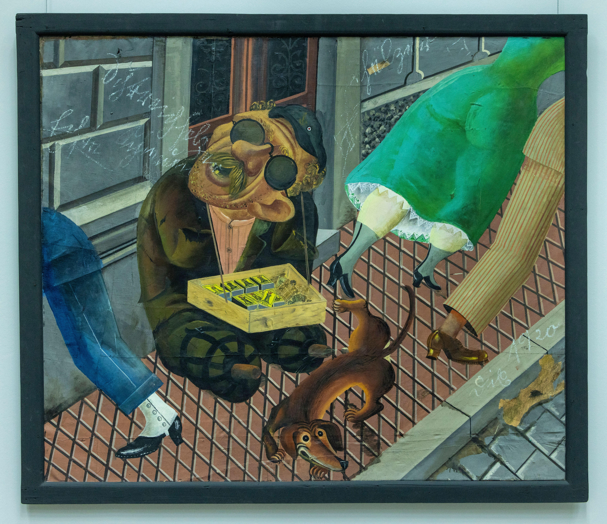
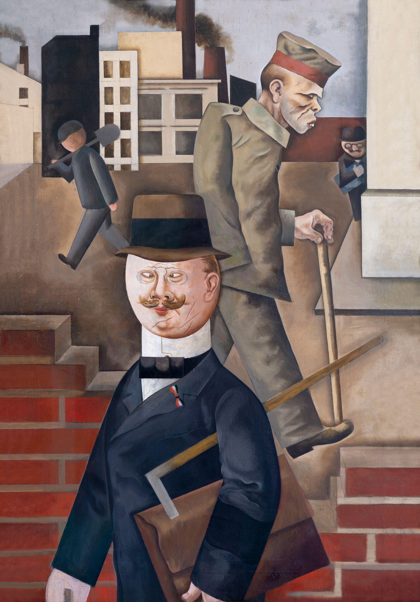
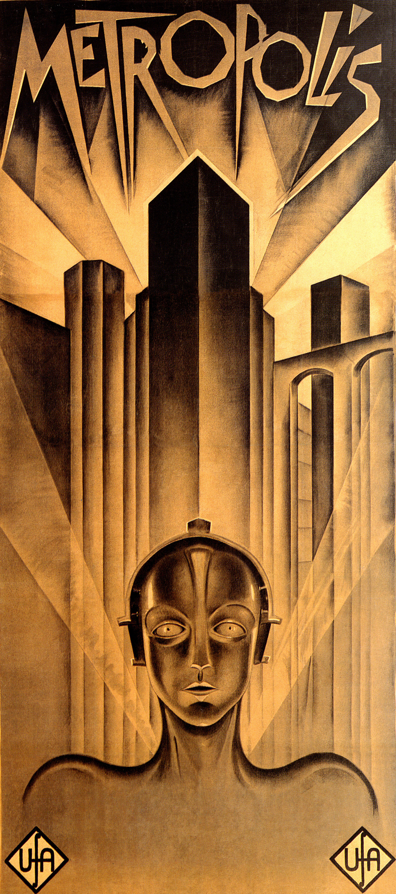
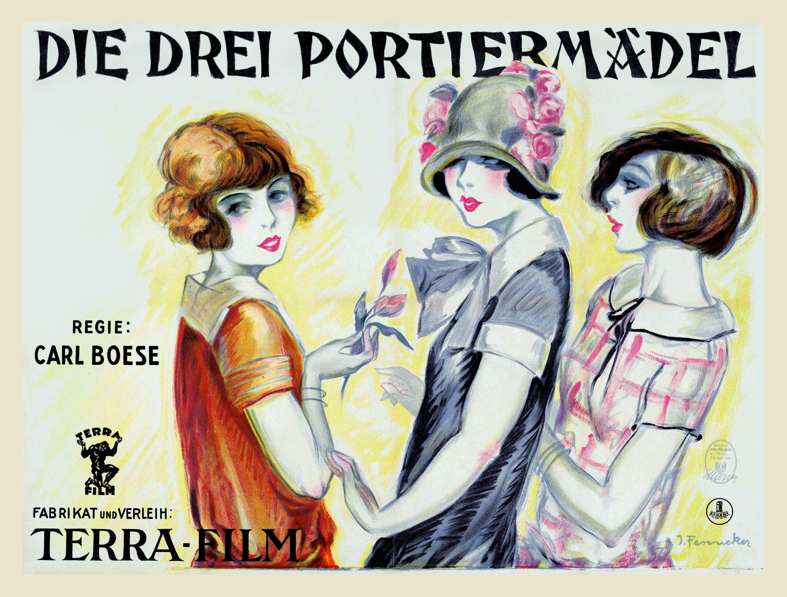

# What were the Achievements of the Weimar Period?

## Was 1924-1929 a ‘Golden Age’ for the Weimar Republic? - Summary

Historians debate the extent to which the** lives of citizens improved **under the ***Weimar Republic***.

Weimar Germany in the 1920s experienced a ‘**cultural explosion**’. The Weimar government gave **grants to artists and cultural organisations** like theatres and libraries. The government supported, rather than** ***censored*, new approaches to the ***arts***.** New technologies** such as radio and film provided German artists with **new** ***mediums*** to explore. The** experimental nature of Weimar *****culture***** **upset many** *****right-wing*** and ***extremist***** **groups. The** **arts** **of the Weimar Republic clashed with these groups’ traditional values.

The establishment of the Weimar Republic marked the beginning of the **German *****welfare state***. A welfare state is the concept that the government supports and** improves the well-being of its** ***citizens***. While the government succeeded in some areas, there was a **divide between the industrial and *****agricultural***** working classes**. Workers in towns and cities benefitted the most from the reforms. High** *****debt***, low prices and increasing taxes** damaged the *****standard of living***** in farming communities**. By 1929, the income of agricultural workers was 44% below the national average.

Weimar Germany became one of the **most advanced societies for women’s rights**. The Weimar ***Constitution*** created ***universal suffrage***. This was rare for European countries. The right to vote and opportunity to work led to the development of the ‘**New Woman**’ of the 1920s. A ‘New Woman’ was **independent, career-minded and reluctant to become a wife or mother**. They enjoyed freedoms that women of previous centuries had never experienced before.

Germany’s ***progressive*** approach to women’s rights created many enemies within the Weimar Republic. The right-wing** *****vilified*** **the ‘New Woman’ for destroying the traditional family unit**. Extremist parties like the Nazi Party campaigned to return women to their traditional role of wives and mothers.

## The 'Golden Age' of the Weimar Republic

> **Spec point** — `spcpt_64mgW3RTHcZ95QjD`

## The 'Golden Age' of the Weimar Republic

## Weimar Art

- ***Expressionism*** in Weimar Germany used ***grotesque***** or exaggerated figures **in violent scenes
- This aimed to make the **audience uncomfortable**. In doing so, the artist hoped people would begin to question the society in which they lived

  - **Otto Dix** was a famous ***New Objectivist***** **artist in Weimar Germany. One of his paintings highlighted the issues war veterans had once they returned to Germany
  - **George Grosz **painted ‘Grey Day’, which used expressionism to represent the boredom of day-to-day life
- **Weimar art horrified the *****conservative***** upper classes **and the extreme right-wing

  - Traditionally, the more educated upper classes controlled and produced Germany’s cultural output. In the Weimar Republic, the upper classes no longer held this power
  - The meanings of the artworks were unclear. **The pictures had many interpretations **
  
    - These pieces could have undermined the authority of the upper classes
  - Many **artists had strong *****left-wing***** beliefs**. This challenged the traditional ways of life valued by the right

*The right panel of Otto Dix’s work ‘Metropolis’ from 1927*

*Grey Day’ by George Grosz, 1921*

## Weimar Architecture

- In **1919**, a new form of design called ‘**Bauhaus**’ emerged

  - **Walter Gropius** founded the movement in Weimar Germany in 1919. He aimed to create a unified style that connected all types of art forms
  
    - The Bauhaus design school existed in **three German cities **between 1919 and 1933, Weimar, Berlin and Dessau
    - Lecturers at Bauhaus College included the artist **Paul Klee** and the sculptor **Oskar Schlemmer**
- ‘Bauhaus’ architecture uses ***geometric*** **shapes to create *****practical *****buildings**. The movement saw the **beauty of technology **and the use of familiar materials in different ways. For example, they constructed entire buildings using only **concrete**
- The ‘Bauhaus’ movement inspired Weimar architects such as Erich Mendelsohn

  - He designed the **Einstein Tower**, an observatory in Potsdam, to look like a rocket

*A photograph of Einstein Tower*

## Weimar Cinema

- The popularity of cinema exploded in the 1920s

  - By **1929**, there were roughly **500 cinemas** across Germany
- Germany began to compete with American film production

  - The expressionist film ***The Cabinet of Doctor Caligari *****(1920)** was one of the first horror films. The director, Robert Wiene, created the** first ‘plot twist’ ending** in cinema history

- F. W. Murnau directed the film ***Nosferatu *****(1922)**

  - It was the **world’s first vampire film**
  - Many films today use the tension methods Murnau created while filming *Nosferatu*
- **The Weimar government funded***** Metropolis (1926) ***through an organisation called** UFA**

  - It cost **5 million Reichsmarks**
  - Fritz Lang created a ***modernist***** **science-fiction film that centred on the **impact of technology** on 20th-century life
  - It was unsuccessful at the time but has influenced many modern-day films such as ***Star Wars***
- Germany produced its first talking film, or **'talkie'**, in **1930**

  - The capability to play films with sound was available in 3,800 German cinemas by 1932

*A scene from Nosferatu (1922)*

*A scene from Nosferatu (1922)*

*Maria from Metropolis (1926)*

### Weimar Nightlife

- Weimar Germany had a **thriving nightlife**. Common activities in cities like Berlin included

  - Watching ***cabaret***
  - Going to the **theatre**
  - Dancing in nightclubs
- These activities encouraged **liberal behaviour**

  - Women and men drank, smoked and had sex
  - Young Germans were very **open about their sexuality**
  
    - Gay communities formed in big cities

### Changes to Living Standards

- To improve standards of living, the Weimar government:

  - Passed the **Unemployment Insurance Act in 1927**
  
    - This money funded insurance that covered unemployment and sickness
    - **16.4 million workers had 3% of their wages diverted to the government**
    - If an insured German did not have a job or was unable to work due to poor health, the scheme paid them **60 Reichsmarks per week**
  - Created better working conditions
  
    - They lowered the hours in a working week from **50 in 1925 to 46 in 1927**
    - Workers’ **‘real’ wages rose 25%** from 1925 to 1928. This measurement considers the cost of living and inflation to calculate the actual value of a worker's wages
  - Focused on housing
  
    - The** *****Länder**** *utilised **foreign loans** to fund building projects
    - The government introduced a **rent tax of 15%** to create building associations
    - Private companies created **37,000 new homes from 1925 to 1929**. In the same period, building associations constructed 64,000 homes
  - Passed the Reich ***Pension*** Law
  
    - Over **1.3 million people (*****widows *****and ex-soldiers) **received a war-related pension
    - Weimar Germany spent roughly **40% of its *****GDP*** on this scheme

### Changes to Women

- The Weimar Republic focused on improving the life of women

  - The Weimar Constitution placed women’s right to vote into law
  
    - All women over the **age of 21 could vote** in elections. This was the same access to voting that German men had
    - **Article 109 stated that marriage was an equal legal partnership **between men and women
  - German women were active in politics
  
    - Elections usually had a **90% turnout of women voters**
    - In 1920, there were **111 women elected as party representatives **in the Reichstag
- The Weimar government had good intentions to improve women’s employment

| **Progress in women’s employment** | **Regression in women’s employment** |
|---|---|
| By 1918, the percentage of women with employment was **75%** | **By 1925, the employment rate of women had fallen to 36%**. This was roughly the same as before the First World War |
| Article 109 in the Weimar Constitution gave women the **right to access all professions **on an equal standing to men | Many **employers ignored Article 109 **and chose male candidates over women  Women in employment were paid 33% less than men doing the equivalent job |
| The ***retail sector**** *employed lots of women on a part-time basis | As soon as a woman became married, society **expected her to leave her job** to focus on the household and become a mother |
| There was an increase in women employed as **teachers and doctors** | Women **struggled to reach high-respected professions**. For example, Germany only had 36 female judges in 1933 |

- The right to vote and increased working opportunities allowed women the freedom to express themselves
- These ‘New Women’ could:

  - Buy more **revealing clothes**
  - Cut their **hair short**
  - Wear more **makeup**
  - **Smoke cigarettes and drink alcohol**
  - Be **focused more on their careers** than on becoming wives and mothers
- Companies used the image of the ‘New Woman’ to sell their products

  - This was a tactic used by **cosmetic companies**

* A German film poster from 1925 entitled Three Waiting Maids. It shows the ideal version of the ‘New Woman’*

## Criticism of the 'Golden Age'

> **Spec point** — `spcpt_87YKZfxpZhWczmFj`

## Criticism of the 'Golden Age'

- Extremists used people’s **hatred of the ‘New Woman’** to increase support for their ideals

  - Hitler blamed the ‘New Woman’ for **increasing unemployment **rates among the working class
  - He campaigned against the ‘New Woman’ and encouraged a return to **women’s traditional role** in the household
- ***Trade unions*** had a negative reaction to the presence of women in the workplace

  - **Men dominated the trade unions**
  - They believed that equality for women in the workplace would negatively affect male workers
  - They resented ‘**double earners**’. This term referred to households where the husband and wife both worked

![A cartoon-style illustration showing four different Weimar-era perspectives on women’s changing roles in society, with thought bubbles above each character.

Young woman: Says, “I feel liberated by the opportunities I have.”
Represents the progressive attitudes of young women who embraced greater freedoms and equality.

Older woman: Says, “I don’t want to change my traditional ways. Women should only be wives and mothers.”
Reflects a more conservative, traditional viewpoint resistant to social change.

Conservative man: Says, “The birth rate is falling and the divorce rate is rising! These new women are ruining our society.”
Shows fear and disapproval of changing gender norms.

Liberal man: Says, “I accept the new woman. Why shouldn’t women be equal to men?”
Indicates progressive male support for gender equality.](../../../assets/61df1486615f-40283-httpscdn-savemyexams-comuploads202402react.png)

*Illustration showing the contrasting reactions to the 'New Woman'*

- Many extremist parties opposed Weimar culture

  - Extreme left-wing parties like the ***KPD*** saw the **government's funding of culture as a waste of money**. They believed it took resources away from the people who needed financial help, for example, the workers
  - Extreme right-wing parties like the ***NSDAP***** **believed that **Weimar culture was destroying German traditions**. They argued that Weimar culture was responsible for the moral decline of German society
- The ***Wandervögel***** movement** protested against the progression of Weimar society

  - They wanted a return to traditional values

> **Worked Example**
> **Describe cultural developments in Weimar Germany**
> 
> 4 marks
> 
> **Answers:**
> 
> Weimar government gave grants to artists, which allowed the arts to grow (1). New painting styles emerged like that of George Grosz (1). In architecture, the Bauhaus style used geometric shapes to create practical buildings (1). The Weimar government funded cinema projects such as the film* Metropolis* (1).

> **Exam Hint**
> This style of question does not require you to explain your answer. The Cambridge IGCSE gives you a point for each relevant piece of information that you write in your answer. Therefore, do not spend any additional time trying to describe or explain each reason. You should aim to complete the question in four minutes, one minute per point. This will give you one minute to read through your answer.
