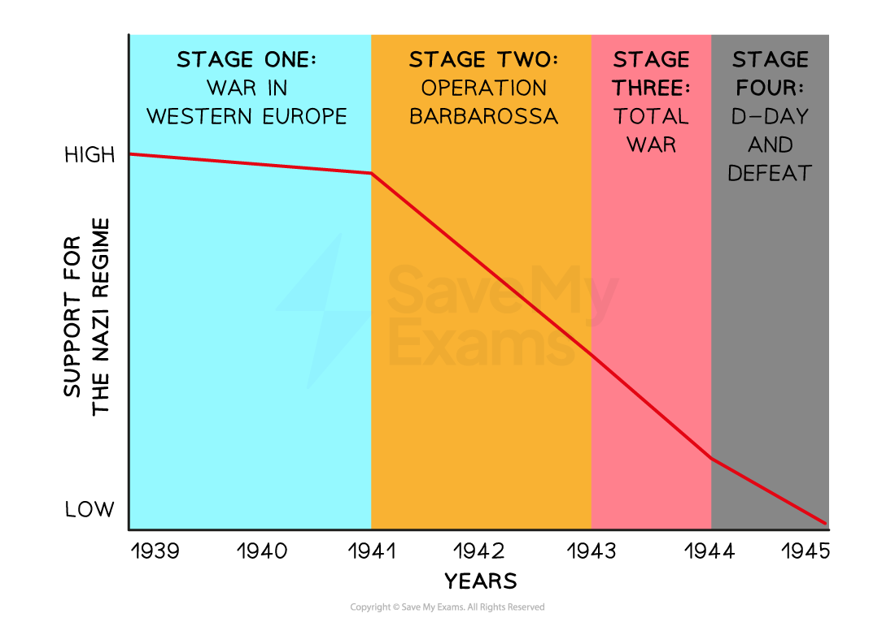

# Did the Second World War Change Life in Nazi Germany?

## How Important was the Second World War for the Collapse of Nazi Germany

| Many Germans approved of the Nazis’ actions at the outbreak of war in September 1939. Even by 1941, **support for the Nazi Party remained high**. Using ***blitzkrieg*** tactics, the German Army was able to **defeat the French in six weeks**. The Nazis had forced the British Army out of Europe. Many European countries had fallen under Nazi control.  ***Operation Barbarossa*** **was a significant turning point** for the success of the war and for public opinion. Poor German tactics and planning led to **many Germans losing faith in their government**. The defeat at the **Battle of Stalingrad** in 1942 signified that this would not be a quick war as the Germans had hoped for. By this point,** all areas of society felt the impact of war**. ***Rationing***, shortages of resources, high levels of ***casualties*** and ***aerial bombings*** angered the German public. Despite a Nazi ***propaganda*** campaign in 1943, **an increased number of Germans began to oppose** the regime.  By 1944, Germany faced a war on ***two fronts*** that it could not win. By April 1945, Hitler and Goebbels committed suicide and Germany ***surrendered**** *to the ***Allied***** **forces. Many historians debate about** if Nazi Germany would have collapsed without the Second World War**. Some historians state that **Germany’s economy was failing by 1939**, causing discontent with the German public. They argue that Hitler sped up plans to invade Poland to win back public support. Other historians claim that the Nazi Party had strong support before the war. It was only the impact of ***total war *****that weakened the regime and decreased support**. |
|---|

## Changes to the Economy

> **Spec point** — `spcpt_KvBzZ6Gfvb8FQb9S`

## Changes to the Economy

- In **1936**, Hitler fired [Dr Schacht](https://www.savemyexams.com/igcse/history/cie/18/revision-notes/germany-1918-45/what-was-it-like-to-live-in-nazi-germany/who-benefitted-from-nazi-rule/) and placed** Hermann Goering as Minister of the Economy**

  - Hitler wanted a more radical economic policy
- Hitler had four main objectives for the economy:

  - To achieve ***autarky***
  
    - Autarky would mean a ***blockade*** would not destroy Germany’s economy or food supply. This happened during the First World War
  - To **increase farming output**
  - To** increase *****rearmament***
  - To implement** more government control **on industry
- The** Four Year Plan began in 1936** and lasted until 1939. Goering:

  - Established the ***Reich Food Estate*** to guarantee prices for farmers
  - Increased ***ersatz***** goods**. The Nazis used:
  
    - Coal to make rubber
    - Acorns to make coffee
  - The government set **production targets for industry**
  
    - The government controlled the production of iron** *****ore***, coal mining, steel and armament factories
    - Goering created the **Hermann Goering Works** which were industrial centres for ***heavy industry***
  - Used **enslaved labour** from
  
    - People in ***concentration camps***
    - People from **newly-occupied German territories**
- The Four Year Plan faced **criticism**

  - Many Nazi members did not believe that Goering was the right man for the job
  
    - He had **no experience in economics**, unlike Schacht
  - **Business leaders did not support the plan**
  
    - Excessive rearmament decreased Germany’s ***standard of living***
    - This is called a ‘***guns, not butter***’ economic approach

> **Worked Example**
> **What was the Four-Year Plan?**
> 
> **4 marks**
> 
> **Final answer:** **Answer:**
> 
> Goering oversaw the plan **(1)**. It focused industries on rearmament **(1)**. Hitler wanted Germany to achieve autarky** (1)**. The government set production targets for industry **(1)**.

> **Exam Hint**
> This style of question does not require you to explain your answer. The Cambridge IGCSE gives you a point for each relevant piece of information that you write in your answer.

### The Nazi War Economy

- Many historians argue that the Nazi economy was a **significant weakness** in the Second World War. This is because

  - **Germany had not achieved autarky**
  
    - By 1939, Germany still imported one-third of its raw materials
  - The economy was not designed for war
  
    - Only by **1942 **had **Albert Speer**, the new Minister of Armaments and War Production, switched Germany to a** *****war economy***
  - Germany’s economy could not support the war effort
  
    - Germany had **shortages in fuel, coal and food**. It did not have enough workers to make enough products
    - Germany relied on** *****plundering***** from occupied countries** to supply their citizens with resources
    - During Operation Barbarossa, Germany did not have enough supplies. This meant that they could not use *blitzkrieg* tactics properly against the ***USSR***
    - **Battles reduced their war supplies**
  - The government **relied on enslaved labour **in ***ghettos*** and concentration camps
  
    - By 1944, **one-quarter of Germany's workforce** was enslaved

> **Exam Hint**
> Students often find it hard to understand economics. Try to remember that the Nazis focused their whole economy on rearmament. When the war began in 1939, the Nazis had underfunded key industries like food production. As a result, people experienced shortages and the economy collapsed. Albert Speer made improvements to the economy in 1943 but, by this stage of the war, it was too late to make a significant difference.

## Support During the War

> **Spec point** — `spcpt_HvdYHmBn2PXG8Cm5`

## Support During the War

*A graph showing levels of popular support for the Nazi party between 1939 and 1945*

| **Stage of the Second World War** | **Reason for the increase in support for the Nazi Party** | **Reason for the decrease in support for the Nazi Party** |
|---|---|---|
| One | - Germany defeated France quickly - German citizens had **access to new goods** - **Generous rations **meant that two-fifths of workers ate better than before the war | - **Rationing extended to more products** - Development of ***black markets**** *in many towns and cities |
| Two |   | - **Unsuccessful invasion of the USSR**. German soldiers withdrew after the Battle of Stalingrad - **Britain began to bomb Germany **causing high casualties and a drop in the standard of living |
| Three | - Goebbels produced **propaganda to increase support** for the war effort - ***SS**** *members gained a lot of income from **selling goods created in concentration camps** | - Germans made to support ‘Total War’ campaign - **Women forced to work** - Britain’s bombing of Germany increased. **Children began to move to the countryside** - The government **stopped entertainment and luxury objects** |
| Four |   | - Hitler created the **Volkssturm **(“people’s storm”). It was a ***Home Guard*** of ***conscripted**** *young and elderly men. It** failed in battle** - Allied forces landed in Europe and pushed for Berlin, causing devastation - A **bombing raid in Dresden** in February 1945 caused **150,000 *****civilian***** casualties** - Hitler and Goebbels committed suicide, marking the **end of the Nazi regime** |

> **Worked Example**
> **Why did life in Germany change during the war years?**
> 
> **6 marks**
> 
> **Final answer:** **Partial answer:**
> 
> Life in Germany changed because of the intensive bombing by the Allies **(1)**. In February 1945, the Allies bombed the city of Dresden causing 150,000 civilian casualties **(1)**. This changed people’s lives because it destroyed people’s homes and made some people homeless. The loss of family members in the bombings would have an enormous effect on people’s lives **(1)**.

> **Exam Hint**
> In Paper One, ‘explain why’ questions are worth either six or ten marks. For full marks in this question, an examiner is looking for **two fully explained reasons **as to why life changed for people during the Second World War. Use the PEE structure in your answer:
> 
> - **P - **Make a **p**oint about the question
> - **E -** Use **e**vidence that supports the point that you have made
> - **E - E**xplain why this evidence made life in Germany change. Avoid repeating the point again. Explain how this factor caused significant difficulties for people living in Germany
> 
> You could also approach this question by focusing on two key groups, for example, women and children. You would need to explain a factor that changed the lives of each group.

## How Did the Second World War Impact Germans?

> **Spec point** — `spcpt_VfC4xWDMR264FgN3`

## How Did the Second World War Impact Germans?

- The German experience of war **affected people differently** depending on their gender, age and ethnicity

| **Group** | **Impacts of the Second World War** |
|---|---|
| Women | In 1944, the government forced women to **contribute to war work**. Life on the ***Home Front***** **was incredibly difficult. Women died from **aerial bombings and suffered poor living conditions** from rationing and shortages |
| Jewish people | Initially, the Nazis placed Jewish people into **ghettos** where thousands died of starvation or illness. ****Einsatzgruppen**** killed millions more Jewish people. By 1942, the Nazis gained over **three million Jewish people from Poland**. The ***Final Solution***** created *****extermination camps***. At** Auschwitz-Birkenau **alone, over **1.1 million people were gassed** and their bodies burnt. In some areas of Eastern Europe, the Nazis murdered all Jewish people. Other countries ***collaborated*** with the Nazis by sending their Jewish communities to the death camps. Roughly **six million Jewish people **died during the ***Holocaust*** |
| Young people | The Second World War affected young people differently. The ***indoctrinated*** ***Hitler Youth*** enthusiastically helped with the war effort. They helped **put out fires **after British aerial bombings. However, youth opposition groups expanded. Some young people** hid** ‘**enemies of the state**’ to protect them from harm. The Nazis forced other young people to help the war effort. **The Volkssturm enlisted children as young as 12 in 1945** |
| Polish people | The Nazis treated Polish people poorly. They ***confiscated***** their property** and attempted to ‘Germanise’ them. Many Polish people ended up in **concentration camps as** ***prisoners of war (POWs)***. The Nazis used them for forced labour and many Poles died from exhaustion or ill-health |
