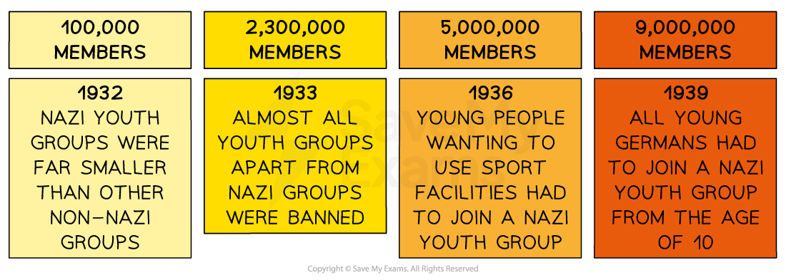
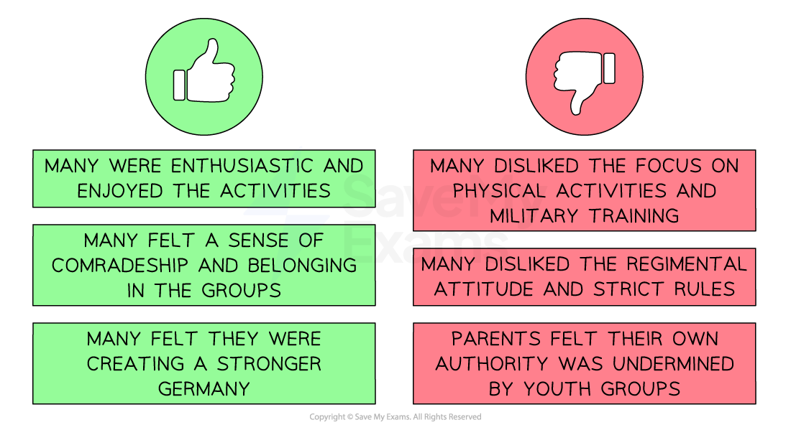

# How Did Young People React to the Nazi Regime?

## Education and Youth in Nazi Germany - Summary

Hitler and the Nazi Party made many changes which affected Germany’s young people. Nazi policies targeted both the establishment of **youth groups as well as children’s education**. These organisations aimed to ***indoctrinate*** young people with **radical, Nazi ideas**.

By 1933, boys and girls in Germany were only allowed to join one of the available Nazi youth groups. For male teenagers, membership in the** Hitler Youth** was focused on **physical and military training**. Hitler wanted to create an **army for the future** to ensure the protection of Nazi Germany. Teenage girls were encouraged to join the **League of German Maidens**, where they would develop skills such as **cooking and *****needlework***. While they were also expected to take part in physical activities, this was more to ensure they would be capable mothers and **produce healthy children**.

Education in schools was also directed towards Nazi beliefs. The Nazis created lessons in ***eugenics***. There was a** focus on PE**, especially for the boys. Girls would learn about the importance of marrying ‘pure’ German men. The ***curriculum*** **was tightly controlled** and all teachers were expected to join the** Nazi Teachers' League**.

## Nazi Beliefs Towards the Young

> **Spec point** — `spcpt_xFF4Qj2FmpWtkfHT`

## Nazi Beliefs Towards the Young

- Hitler and the Nazis wanted to create a ***Third Reich*** that would last a thousand years
- Hitler was aware that** adults in Nazi Germany had mixed opinions** of the Nazi Party

  - Adults were more difficult to influence and change than the young
- Control of the youth and future generations would ensure that the** Nazi Party would always have public support**
- The Nazis had some key beliefs towards the young:

![An infographic showing Nazi expectations of boys and girls under their regime:

Top Half:

Left (Boy Image): A young boy with light brown hair in a jumper.

Box beneath him:
BOYS
"All boys should be brought up fit and healthy to support Germany’s economy and fight in wars."

Right (Girl Image): A young girl with blonde hair in a plait.

Box beneath her:
GIRLS
"All girls should be brought up fit and healthy so they could be good wives and healthy mothers."

Bottom Half:

Pink Box (First):
SUPPORT THE NAZI PARTY
"All young people should be supporters of the Nazi Party who saw Hitler as a father-figure."

Pink Box (Second):
SUPPORT GERMANY
"All young people should be proud Germans who support a free, independent Germany."](../../../assets/02afdc9e365e-26449-httpscdn-savemyexams-comuploads202402nazi-.png)

*Nazi key beliefs about the young*

## The Hitler Youth and the League of German Maidens

> **Spec point** — `spcpt_JPHc4Rtf53vghDXf`

## The Hitler Youth and the League of German Maidens

- The Nazis made several changes during the 1930s to **boost the membership numbers** of the Nazi youth groups:

*How was membership of Nazi youth groups increased?*

- There were separate youth groups for boys and girls of different ages:

Types of Nazi Youth Groups

| **Age** | **Male group** | **Female group** |
|---|---|---|
| 6-10 | Pimpfe |   |
| 10-14 | German Young People | Young Maidens |
| 14-18 | Hitler Youth | League of German Maidens |

## The Hitler Youth

- ***Baldur von Schirach*** was the Hitler Youth leader
- Boys aged **14 **could join the Hitler Youth
- At age **18**, boys became **members of the Nazi Party** and worked or joined the armed forces
- Training was split into **four distinct areas**:

![An infographic displaying the different aspects of Nazi youth training using both icons and color-coded boxes:

Top:

Image of a pistol

Yellow Box — MILITARY TRAINING

Map-reading and signalling

Small-arms shooting

Specialist training for areas of the army (naval, gliding, flying, motor)

Middle (Blue Box):

CHARACTER TRAINING (with image of a metal bucket full of blue stones)

Embrace competition and be ruthless

Build resilience through harsh punishments and tough training

Must be willing to give their life to protect Hitler

Middle (Green Box):

PHYSICAL TRAINING (with image of a green tent)

Camping and hiking expeditions

Regional and national sports events

Bottom (Red Box):

POLITICAL TRAINING (with image of a report or official paper)

Oath of loyalty to Hitler

Reporting disloyal Germans

Learning about Nazi ideas](../../../assets/b273f4ccedb2-47614-httpscdn-savemyexams-comuploads202402train.png)

*Training for the Hitler Youth*

## The League of German Maidens

- The Bund Deutscher Mädel or League of German Maidens (BDM) was the **female equivalent of the Hitler Youth**
- They shared some similarities with the Hitler Youth, but the emphasis was on training girls to be **good wives and mothers**:

![Left Side (Green – Positive Reactions to Nazi Youth Groups):
Green thumbs-up icon at the top

"Many were enthusiastic and enjoyed the activities"

"Many felt a sense of comradeship and belonging in the groups"

"Many felt they were creating a stronger Germany"

Right Side (Red – Negative Reactions to Nazi Youth Groups):
Red thumbs-down icon at the top

"Many disliked the focus on physical activities and military training"

"Many disliked the regimental attitude and strict rules"

"Parents felt their own authority was undermined by youth groups"](../../../assets/7e91f9c1a98a-1658-httpscdn-savemyexams-comuploads202402impact.png)

*How popular were the Nazi youth groups?*

- Activities focused on the ‘**three Ks**’

  - *Kinder *(Children)
  - *Kirche* (Church)
  - *Küche* (Cooking)

- In 1938, the Nais created a  sub-group of the BDM called the ‘**Faith and Beauty Society**.’ Its members were girls aged **17-21**:

  - The Nazis were concerned that members of the BDM would **forget their teachings** when they left the group at the age of 18
  - The ‘Faith and Beauty Society’ served as a way for women to **receive further education** until they were old enough to join the ***National Socialist Women's League***

> **Worked Example**
> **What was the League of German Maidens (BDM)?**
> 
> **4 marks**
> 
> **Final answer:** **Answer:**
> 
> It was a young movement like the Hitler Youth **(1)**. It was for girls between the ages of 14 and 18 **(1)**. Girls were taught about the 3 K’s to prepare them for their role as mothers and wives **(1)**. Girls learnt about racial hygiene **(1)**.

> **Exam Hint**
> This question in Paper One requires you to state information you know about the League of German Maidens. The Cambridge IGCSE gives you **a point for each relevant piece of information** that you write. Therefore, do not spend any additional time trying to describe or explain each reason.

## The Impact of Youth Groups

- Although membership reached** nine million by 1939**, it did not mean that all members enjoyed being in a Nazi youth group:

*How popular were the Nazi youth groups?*

## Education in Nazi Germany

> **Spec point** — `spcpt_Htr5rm5zPCJbdyvt`

## Education in Nazi Germany

- Alongside attendance of one of the Nazi youth groups, children were still required to attend school for education
- Hitler knew that control of children’s education would allow him to **create a generation of Nazis loyal to him **
- ***Bernhard Rust***** **was made** Education Minister** in 1934 and made several changes to teachers and schools

### Teachers

- Those not loyal to the Nazi regime were **sacked**

  - Rust sacked over **180 teachers in *****Prussia***
- They swore an** *****oath**** ***of loyalty to Hitler **and joined the Nazi Teachers’ League

  - Membership of the Nazi Party was also** *****compulsory***
- They attended political education courses outlining key Nazi ideas

  - Around **200,000 teachers had attended courses** by 1939
- Teachers had responsibilities at school to:

  - Teach students the ***Nazi salute***
  - Begin and end each lesson with ‘**Heil Hitler**’
  - Place posters, Nazi flags and a **picture of Hitler **in each classroom

### Curriculum

- Boys and girls were educated separately
- The Nazis took control of the curriculum so that they could influence children’s beliefs:

![A two-section infographic comparing traditional subjects and new subjects taught in Nazi Germany.

Top Section – Traditional Subjects (Green books):
Maths: “War and society incorporated in the learning”

History: “Blamed Jewish people for Germany’s problems”

PE (Physical Education): “Number of lessons was doubled to create strong children”

Bottom Section – New Subjects (Orange books):
Eugenics: “Classified races and learnt about superiority of Aryans”

Domestic Science: “Girls learned to sew, cook and organise their home”](../../../assets/b7d9cffa718c-14303-httpscdn-savemyexams-comuploads202402nazi-.png)

*The school curriculum in Nazi Germany*

- After 1935, the Nazis had to **approve all textbooks**

  - All books contained pictures of Hitler
  - ***Mein Kampf***** **became a **compulsory text**
  - Events like the First World War were reworded to **blame Jewish people** and the ***November Criminals***

- ***Napolas*** **were schools for the most ‘gifted’ and racially pure children**:

  - ***SS***** **members replaced the traditional teachers
  - The emphasis was on sport and physical training
  - Students went on to **join the SS or police services**
  - By **1939**, there were **16 Napolas schools**

> **Worked Example**
> **Why were young people important to the Nazis? **
> 
> **6 marks**
> 
> **Final answer:** **Partial answer:**
> 
> Young people were important to the Nazis because Hitler wanted girls to become wives and mothers **(1)**. The Nazis wanted girls to be physically fit to increase their chances of producing healthy children. They also taught them about racial hygiene **(1)**. This made girls important to the Nazis. If the Nazis could win the girls’ support, they would raise healthy children that were indoctrinated with Nazi ideas. This would secure support for the Nazi Party for generations to come **(1)**.

> **Exam Hint**
> In Paper One, ‘explain why’ questions are worth either six or ten marks. For full marks in this question, an examiner is looking for **two fully explained reasons **as to why young people were important to the Nazis. Use the PEE structure in your answer:
> 
> - **P - **Make a **p**oint about the question
> - **E -** Use **e**vidence that supports the point that you have made
> - **E - E**xplain why this evidence made young people important. Avoid repeating the point again. Explain how this factor meant that the Nazis needed their support
