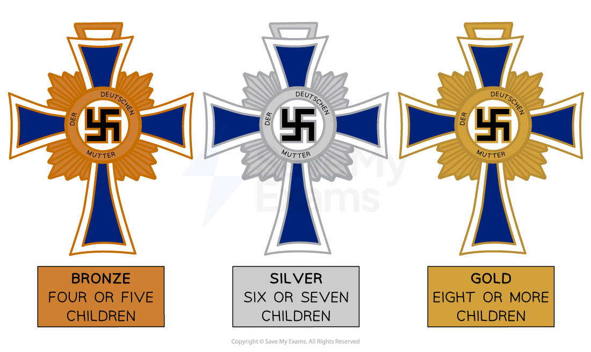

# Nazi Policies Towards Women and the Family

## How Did Life For Women Change Under the Nazis? - Summary

Before the outbreak of the Second World War in 1939, Nazi policy towards women was focused on ensuring they **stayed at home and cared for the family**.

Women were expected to** dress *****conservatively***, keep themselves **fit and healthy** and **marry **a strong** *****Aryan*** man. Part of this policy was directed towards **increasing the *****birth rate***, which had fallen significantly by the start of the 1930s.

With most sectors of society, the Nazis unified organisations under a ***figurehead***. The leading female Nazi politician, **Gertrud Scholtz-Klink**, was placed in charge of **all policies related to women**.

The Nazi Party developed laws relating to marriage and employment to varying degrees of success. Women who followed Nazi policy received ***financial incentives*** **and a boost to their social status**. The Nazis also **banned many women from pursuing careers**, such as doctors and lawyers.

**It is difficult to determine how effective policy was towards women in Nazi Germany**. By 1939, many laws intending to keep women at home had been reversed. The Second World War required women workers to keep pace with the ***Allies*****’** industrial production.

## Nazi Views on Women

> **Spec point** — `spcpt_kTKMcPMpbKV8Hw4M`

## Nazi Views on Women

- The Nazis saw **women as a fundamental part of the** **Third Reich**:

  - Goebbels said:

> **blockquote**
> the mission of the woman is to be beautiful and bring children into the home

- Nazi Germany had these expectations about women:

![An infographic titled “Nazi Views on Women and the Family”, with two illustrated women at the top and four categories below, each in a red box.

Categories and Content:
Marriage:
“Marriage was a part of establishing a strong family. Women should also marry ‘pure’ Aryan men.”

Family:
“Large families were encouraged, and it was the role of women to feed and support the family.”

Employment:
“Expected to stay at home and care for the family while the man earned money.”

Appearance:
“Blonde, plaited-hair, athletic, non-smoker, no make up, long skirt, flat heels.”](../../../assets/6793363e294f-2261-httpscdn-savemyexams-comuploads202402nazi-v.png)

*Nazi views on women and the family*

- The Nazis believed that a woman’s life revolved around the ‘**three Ks**’:

  - *Kinder* (children)
  - *Kirche *(church)
  - *Küche *(cooking)

## Nazi Policies Towards Women

> **Spec point** — `spcpt_8k9rYSSPdRhKCG6k`

## Nazi Policies Towards Women

- The Nazis wanted to:

  - **Reverse the** [changes to women’s roles ](https://www.savemyexams.com/igcse/history/cie/18/revision-notes/germany-1918-45/was-the-weimar-republic-doomed-from-the-start/what-were-the-achievements-of-the-weimar-period/)brought in by the ***Weimar Republic***
  - **Increase the birth rate**
  
    - **The First World War** caused a decline in the male population
    - **The birth rate had fallen **to one million births per year by 1933
- Gertrud Scholtz-Klink was appointed leader of the ***National Socialist Women's League***** **and oversaw all policies related to women

### The German Women’s Enterprise (DFW)

- All women-related organisations had to join the **German Women's Enterprise (DFW)**:

  - **Organisations that failed to join were banned**
  - The DFW enrolled members on courses about childcare, cooking and sewing

### 1933 - The Law for the Encouragement of Marriage

- Women could qualify for* ****loans***** of 1,000 marks **(equivalent to eight months’ wages) if they:

  - **Married**
  - **Quit their jobs** or stay ***unemployed***
- Mothers who gave birth to** four children did not have to pay the loan back**

  - Each child removed a quarter of the loan

### 1935 - The Lebensborn Programme

- Started by ***SS***** **leader,** *****Heinrich Himmler***
- Paired SS men with single women to create ‘genetically pure’ children

  - The programme only accepted women and men with a clear ‘Aryan’ ***ancestry***
- The Nazis created special **Lebensborn homes** for women to rest after giving birth

### 1938 - Divorce Laws

- Husbands could **legally divorce their wives** for:

  - **Failing or refusing to have children**
  - Having **abortions **

### 1938 - The Mother’s Cross

- **Awards presented on Mother’s Day** in Germany were available to women who had four or more children
- Mothers with **gold medals** received a public ***salute*** from the ***Hitler Youth***
- Families with **ten children had to name Hitler as the *****godfather*** of the tenth child

*The Mother’s Cross awards*

## Women and Employment

- With the focus on women staying at home and caring for the family, the Nazis introduced **laws to reduce the number of women at work**:

![An infographic showing Nazi restrictions on women’s roles and education, presented through three illustrated women with labels for each year and category of restriction.

Panels and Content:
1933 – Professional Jobs
A woman in a brown coat and hat.
Text:
“Women were banned from being teachers, doctors and other professional posts. Around 19,000 female civil servants were sacked in 1933.”

1936 – Legal Jobs
A woman dressed as a judge holding a gavel.
Text:
“Women were banned from becoming judges, lawyers or taking part in jury service.”

1937 – Grammar Schools
A woman in a graduation cap and gown.
Text:
“Schools preparing girls for university were banned. Around 11,000 fewer female students were starting university by 1939.”](../../../assets/a68c5b20cd63-17700-httpscdn-savemyexams-comuploads202402nazi-.png)

* Nazi policies to prevent women from employment*

## How Effective Were Nazi Policies Towards Women?

> **Spec point** — `spcpt_F7rXRqXZ3kJfy8Hf`

## How Effective Were Nazi Policies Towards Women?

- Before the Second World War, the Nazis achieved some success with their policies

  - The **number of marriages increased** from 500,000 in 1932 to 750,000 by 1934
  - The **birth rate gradually increased** from 15 per 1000 in 1933 to 20 per 1000 in 1939
- However, the build-up to and during the Second World War impacted Nazi policies towards women

  - By **1937**, Germany experienced a **national shortage of workers**
  - By **1939**, **women fulfilled factory jobs** but women's employment rates did not increase to 1930 levels
  - Over** 500,000** women worked in the ***Wehrmacht*** as nurses or other non-combat roles

![A three-column infographic titled "Success – Policy – Failure" explaining how Nazi policies towards women had mixed results. The layout links individual policies to their respective successes and failures.

Columns:
1. Success (Green Boxes)
The German Women's Enterprise (DFW) had 6 million members; 1.7 million women attended courses.

700,000 couples took out marriage loans in four years; marriage rates increased.

One Lebensborn home helped over 540 mothers give birth.

Divorce rates increased.

3 million women were eligible for medals in 1939.

360,000 women left their jobs by 1934, embracing the 'Three Ks' (Kinder, Küche, Kirche).

2. Policy (Purple Boxes)
The DFW (German Women’s Enterprise).

The Law for the Encouragement of Marriage.

The Lebensborn Programme.

Divorce Laws.

The Mother’s Cross.

Ban on Employment.

3. Failure (Red Boxes)
Many women disliked Scholz-Klink and found the DFW demeaning.

By 1937, women with marriage loans were allowed to work.

Only 7,000 children were born through Lebensborn.

Divorce laws contradicted Nazi rhetoric about family unity.

Few mothers had more than two children.

2.4 million women returned to work during WWII; some resented loss of professional roles.](../../../assets/bb4e453bb15b-29245-httpscdn-savemyexams-comuploads202402effec.png)

*Were the Nazi policies towards women successful?*

> **Worked Example**
> **How far do you agree that Nazi policies towards women were successful? Explain your answer**
> 
> **10 marks**
> 
> **Final answer:** **Partial answer:**
> 
> Some historians argue that Nazi policies towards women were successful **(1)**. This is because, before 1939, many women embraced their traditional role as housewives** (1)**. By the end of 1934, 360,000 women had left their jobs and by 1937, over 700,000 couples received loans from the Law for the Encouragement of Marriage **(1)**. This shows that many German women complied with the Nazi policy of leaving the workplace and getting married. This could be considered a success as, in peacetime, the Nazis achieved their aim of restoring the traditional family values of Germany** (1)**.

> **Exam Hint**
> A strong response for this Paper One question needs to **examine both sides of the argument**. The next paragraph would explain the unsuccessful elements of Nazi policies towards women. You could use the return to work of many women after 1939. Continue to use a clear** PEE structure **as shown above.
> 
> You would then need to write a **conclusion explaining how effective was Nazi policies towards women**. Remember to use phrases like ‘**fully**’ or ‘**partially**’ to explain if the Nazis achieved their aims for women.
