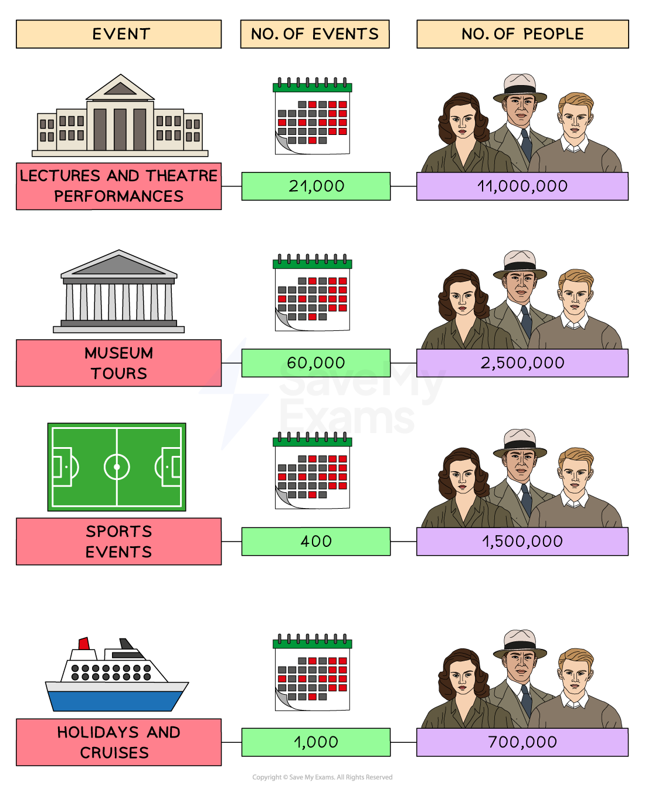

# Who Benefitted from Nazi Rule?

## How Did Living Standards Change in Nazi Germany? - Summary

***Unemployment*** was one of the factors that helped **Hitler gain popularity** during the impact of the ***Great Depression*****.** Many people voted for the Nazi Party because they had promised to **make Germany great again. **Hitler needed more workers for the production of** *****armaments***** **and the improvement of German ***infrastructure***. Hitler also needed to reduce unemployment.

By 1939, Hitler and the Nazis had **successfully reduced unemployment to low levels**. At first glance, it appeared that many Nazi employment policies were successful. However, they also **excluded certain groups from employment figures**, meaning that unemployment was in reality far higher. This is called invisible unemployment.

Hitler also wanted to** improve workers’ happiness**. The Nazis provided theatre performances and tickets to sports events. Improvements to work facilities were also designed to** boost *****morale***** and productivity**. **Wages increased** for most throughout the 1930s, **but so did working hours**.

**Many workers experienced better *****living standards***** under the Nazi regime**. For others, the soaring cost of food prices exceeded the amount of money they were earning.

## Businesses under Nazi Rule

> **Spec point** — `spcpt_QBJd4QVnqsn4hkmX`

## Businesses under Nazi Rule

### Impact of the Nazi Regime on Businesses

| **Benefits for businesses** | **Weaknesses for businesses** |
|---|---|
| The Nazis **reduced the threat** of workers turning to ***Communism***. The **banning of *****trade unions*** and strikes made the workforce more productive | The Nazis** increased their control** over businesses |
| The Nazis promised small business owners that they would **restrict larger *****department stores*** | The government **did not fulfil their promise**. Large businesses still dominated the market |
| ***Rearmament*** **created opportunities** for businesses. The Nazis offered large government contracts for war goods, for example, steel | During rearmament, **fewer** businesses produced **consumer goods** |

## Workers under Nazi Rule

> **Spec point** — `spcpt_4dX79xHF7gp9DQDg`

## Workers under Nazi Rule

## The Labour Front (DAF)

- Hitler disliked trade unions:

  - He felt they supported ***left-wing*** political groups like the Communist Party
  - Trade unions organised worker strikes, which** disrupted the economy**
- **Hitler **[banned all trade unions in May 1933](https://www.savemyexams.com/igcse/history/cie/18/revision-notes/germany-1918-45/why-was-hitler-able-to-dominate-germany-by-1934/how-did-hitler-consolidate-his-power-in-1933-34/)** **using the powers of the ***Enabling Act***
- Hitler replaced trade unions with the Labour Front (DAF)

  - It controlled the rights, hours and pay levels of workers

![A vertical infographic showing three key ways Nazi policies restricted workers' rights in Germany.

Panels:
1. Negotiation
Image: Two hands shaking with a red X over them.

Caption: "Workers lost the right to negotiate improvements such as pay and working conditions."

2. Working Week
Image: A hand holding a stopwatch, with red showing extra time.

Caption: "The maximum length of the working week increased by 6 hours."

3. Striking Banned
Image: A protest sign with the word "STRIKE" held by a hand.

Caption: "Workers were no longer allowed to go on strike. Those who disrupted production were punished."](../../../assets/abb55020836b-29893-httpscdn-savemyexams-comuploads202402chang.png)

*How did the DAF impact workers?*

- The Nazis realised that the removal of trade unions would anger many workers

  - They added **separate organisations within the DAF** to improve the standard of living. These organisations were:
  
    - Strength Through Joy
    - Beauty of Labour

## Strength Through Joy

- The Nazis established  Strength Through Joy (KdF) in **1933 **
- The KdF aimed to **make work seem more enjoyable** and **prevent unrest**
- By** 1936**, there were** 35 million members** of the KdF
- It provided out-of-work leisure activities, trips and holidays to workers

*Workers from Berlin who took part in KdF activities, 1933-39*

- The KdF ran a scheme so workers could purchase a new car:

  - The **Volkswagen - ‘people’s car’** - was an **affordable and fuel-efficient car**
  - Workers in the KdF gave **five marks per week **from their wages so they could eventually receive a Volkswagen
  - However, car factories switched to producing armaments after 1938 and **workers never received their Volkswagens**

## Beauty of Labour

- The Nazis created Beauty of Labour (SdA) programme in 1934
- The SdA aimed to **provide better facilities for workers** to improve their working environment
- It provided facilities such as** toilets, changing rooms, showers and canteens**
- By **1938**, around **34,000 companies** had improved their facilities
- The Nazis expected the workers to build and decorate the new facilities themselves:

  - For **no extra pay**
  - Outside of their typical working hours

> **Worked Example**
> **What was Strength Through Joy (KdF)?**
> 
> **4 marks**
> 
> **Final answer:** **Answers**
> 
> Strength Through Joy was created in 1933** (1)**. It provided out-of-work leisure activities, trips, holidays and even cars to workers **(1)**. By 1936, there were 35 million members of the KdF **(1)**. The Volkswagen scheme failed as no worker received their car** (1)**.

> **Exam Hint**
> For a ‘Describe’ question, you should aim to complete the question in **four minutes, one minute per point**. This will give you one minute to read through your answer.

### Impact of the Nazi Regime on Workers

| **Benefits for workers** | **Weaknesses for workers** |
|---|---|
| Strength Through Joy provided out-of-work leisure activities, trips and holidays to workers. The Beauty of Labour aimed to improve working conditions. The Nazis hoped that both policies would** make workers happier** | Workers were **still unhappy with their working conditions**. The DAF did not allow workers to strike or negotiate wages and the SdA increased workload |
| The Nazis introduced the Volkswagen scheme. The car only cost 999 Reichsmark, more **affordable than previously available cars**. This aimed to improve living standards for workers | Despite the promise of the Volkswagen scheme, **nobody received their car** |
| Most workers **earned more money under the Nazi regime**. Skilled workers such as those in the armaments industry earned higher wages | Wage increases were not as impactful due to higher food prices. **By 1939, food prices had increased by 20%**. As a result, unskilled workers were worse off |

> **Exam Hint**
> Rather than simply concluding whether ‘workers’ received higher wages under the Nazi regime, consider that many workers received higher rates of pay and could therefore pay increased prices, while other workers were worse off because their wages could not keep up with food prices. This level of analysis is useful if you answer the ten-mark “How far do you agree”  where you need to provide a balanced argument.

## Farmers under Nazi Rule

> **Spec point** — `spcpt_TmHnRsRVNHXMhS4D`

## Farmers under Nazi Rule

### Impact of the Nazi Regime on Farmers

| **Benefits for farmers** | **Weaknesses for farmers** |
|---|---|
| The Nazis believed in the ‘**Blood and Soil**’ mentality. Hitler spoke about how true ***Aryans**** *had farming ***ancestry*****.** This meant that the Nazis **valued farmers** much higher than urban workers | The Nazis increased their control over farmers. **They told farmers what produce they should grow**. This created anger in farming communities |
| The** Reich Food Estate **helped to ***regulate**** *the food market. It offered farmers guaranteed customers at fair prices | **Farming communities continued to be poor.** Many children of farmers moved to towns and cities for better wages |
| The **Reich Entailed Farm Law** gave farmers more protection. It did not allow banks to ***repossess*** property if farmers fell into debt | Banks became **reluctant to lend money** to farmers |

## The Unemployed under Nazi Rule

> **Spec point** — `spcpt_3QBQcthpzrctnzgy`

## The Unemployed under Nazi Rule

- Around** six million Germans were unemployed by 1932 **because of the Great Depression
- When Hitler became Chancellor in January 1933, five million Germans were still unemployed
- **Reducing unemployment was a key focus for the Nazi Party** because unemployed workers:

  - Could support other groups such as the ***KPD***
  - Were **not contributing to society** or the economy
- By 1939, the Nazi Party reduced unemployment to around half a million people:

### Decreasing Unemployment in Nazi Germany

| **Year** | **Unemployment** |
|---|---|
| 1933 | 4,800,000 |
| 1934 | 2,700,000 |
| 1935 | 2,100,000 |
| 1936 | 1,500,000 |
| 1937 | 900,000 |
| 1938 | 500,000 |
| 1939 | 300,000 |

- The Nazis created a number of policies to reduce unemployment

### National Labour Service (RAD)

- Set up in **1933**
- Provided** paid work** for the unemployed:

  - Workers carried out** public jobs** such as repairing roads and planting trees
- From 1935, it was made ***compulsory*** **for unemployed young men (18-25 years old) to join for six months**
- The** pay was poor** and many workers complained about the food, having to wear uniforms and working conditions
- There were **422,000 members in 1935**

### Autobahns

- The Nazis wanted to create an approximately ** 11,000 kilometres autobahn (motorway) system** to improve transport around Germany:

  - Hitler personally started the project in **September 1933**
  - By **1935**, the project had **125,000 workers**
  - Around **3,500 kilometres **had been completed by 1938
- The Nazis financed other ***public works*** in Germany:

  - These included roads, bridges and sports facilities such as the **Berlin Olympic Stadium**
  - **Spending on public works more than doubled** from 18 billion marks in 1933 to 38 billion marks in 1938

### The New Plan

- Hitler appointed **Dr Schacht as Minister of the Economy**

  - He was a well-respected banker
  - He had helped to resolve the hyperinflation crisis in 1923
- Hitler tasked Schact to:

  - **Reduce unemployment**
  - **Recover Germany’s economy **from the effects of the Great Depression
- In **1934**, Schact developed the **New Plan**. The plan consisted of:

  - Cutting** *****welfare*** spending
  - Investing in industry
  - Creating trade deals with other countries, for example, Hungary
  - By **1936**, the New Plan **recovered the economy** and reduced unemployment

### Rearmament

- Hitler wanted to **increase the size of the military** because it would:

  - Restore Germany’s pride
  - Make Germany stronger
  - Provide jobs for the unemployed
- The terms of the ***Treaty of Versailles*** **limited the army to 100,000 soldiers**

  - Hitler ignored this and** **announced** *****conscription***** in 1935**
  - By **1939**, there were around **1.4 million men in the German armed forces**
- The Nazis also needed to produce more weapons and armaments to supply their larger army

  - **Spending on armaments increased **from 3.5 billion marks in 1933 to 26 billion marks by 1939
  - Employment in aircraft construction increased from 4,000 people in 1933 to 72,000 people by 1935

### Invisible Unemployment

- **Invisible unemployment refers to people who do not have full-time jobs but are not counted in official unemployment statistics**

  - Nazi Germany did not include many people in their employment figures
  - Schemes to tackle unemployment were too expensive to become long-term policies
  - A focus on rearmament only created jobs if Germany was preparing for war

![A central grey box titled “Invisible Unemployment” is surrounded by six green text boxes, each identifying a group that was excluded from official unemployment statistics in Nazi Germany.

Surrounding Boxes:
Top Centre:
Part-Time Workers – People who worked part-time were considered fully employed.

Top Right:
The Armed Forces – In peace time, most of the armed forces would not need to be employed.

Bottom Right:
Rearmament – In peace time, armaments would not need to be produced in such large quantities.

Bottom Centre:
Prisoners – Political opponents and other prisoners were not considered unemployed.

Bottom Left:
Jewish People – They were forced to give up their jobs but were not considered unemployed.

Top Left:
Women – Those forced to leave their jobs and stay at home were not seen as unemployed.

](../../../assets/10170d106da9-1769-httpscdn-savemyexams-comuploads202402invisi.png)

*How did the Nazis ‘hide’ the real level of unemployment?*

> **Worked Example**
> **Describe Nazi measures to reduce unemployment**
> 
> **4 marks**
> 
> **Final answer:** **Answer:**
> 
> The Nazis created public work projects like the building of the autobahn **(1)**. All 18 to 25-year-olds had to join the National Labour Service for six months **(1)**. Rearmament meant more people employed in industries like armaments and engineering **(1)**. Women were encouraged to leave employment and were not counted as unemployed** (1)**.

> **Exam Hint**
> This style of question does not require you to explain your answer. The Cambridge IGCSE gives you a point for each relevant piece of information that you write in your answer.
