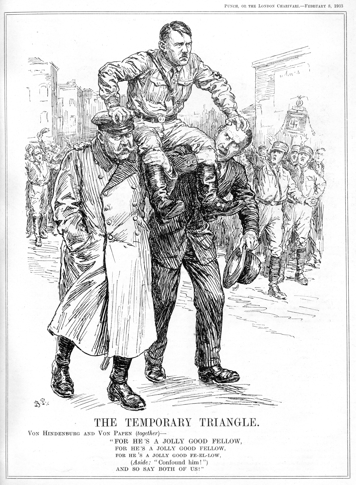

# How Did Hitler Become Chancellor?

## How Did Hitler Use the Political System to Become Chancellor in January 1933? - Timeline & Summary

Some Germans were ‘pushed’ towards** *****fascism*** because of the **Wall Street Crash**. Experiencing a second economic crisis within a ***decade*** made people lose hope in Weimar politicians. They** distrusted *****democracy*** as they could not see the Weimar Republic working in times of crisis. More Germans began to **wish for the return of a *****totalitarian***** government**. A strong government would take control of Germany and resolve the country’s issues.

In 1930, the ***NSDAP*** experienced some success in the elections. **The Nazi Party achieved 18.3% of the vote**, which corresponded to 107 of the 577 seats in the ***Reichstag***. At this stage, this was the** largest proportion **the NSDAP** **had achieved in its history. **By 1932, the NSDAP became the largest party in the Reichstag**. ***Chancellor***** **Brüning’s unpopular policies to combat unemployment and ***recession*** in Germany were failing. Many sectors of the German public had** lost faith in *****moderate***** political parties **resolving the crisis. Hitler and the Nazi Party took advantage of the situation by **increasing their production of *****propaganda***. Hitler became a national celebrity. His ***oration*** skills converted many sceptics of the NSDAP’s policies to back him.

Hitler’s plan to use the ***electoral system*** to become chancellor succeeded in January 1933.  ***President***** Hindenburg had very limited options **but to give the chancellorship to Hitler. Due to his ***right-wing*** beliefs, **Hindenburg could not accept a *****Communist***** government **under the ***KPD***. At the same time, Hindenburg could no longer ignore Hitler’s power over the German people. Historians agree that Hindenburg made a **serious misjudgement in believing he could control Hitler** by appointing von Papen as co-chancellor. Within a year of his chancellorship, Hitler combined the** powers of chancellor and president **to become the** *****Führer***** **of Germany.

## The Impacts of the Depression on Germany

> **Spec point** — `spcpt_mPxYwVrkwQFKkVqw`

## The Impacts of the Depression on Germany

- The Wall Street Crash created economic collapses across Europe, including Germany

  - The [Dawes Plan](https://www.savemyexams.com/igcse/history/cie/18/revision-notes/germany-1918-45/was-the-weimar-republic-doomed-from-the-start/did-the-republic-recover-after-1923/)[s Plan](https://cms-staging.savemyexams.co.uk/content/courses/crs_JxDSBWHvM9FFxDCg/syllabus-versions/slbvrs_mZjN5YmNKPZ6JrpR/sections/sec_zz238rMNZzWcMkHn/topics/top_hfRCHVRjNCcssmBZ/subtopics/sbt_96B8vFVBbnf3zSZS/revision-note) connected **Britain, France and Germany to the USA’s economy**. The USA's money allowed the payment of ***reparations***** **and First World War loans
  - The USA began to ***recall *****its loans to save its economy**. This jeopardised the economies in Europe

![24th–30th October 1929 – The Wall Street Crash takes place in the USA.
↓
German banks, which had shares in US businesses, lose a huge amount of money.
↓
Germans remember the 1923 hyperinflation crisis and fear losing their savings. Many rush to withdraw their money.
↓
German banks run out of cash. The German Civil Servant Bank collapses in 1929.
↓
To repay their customers, banks recall loans from German industrial and agricultural businesses.
↓
To repay these loans, German businesses cut production or shut down completely.
↓
Germany’s economy collapses.](../../../assets/7a750e3ba087-36625-httpscdn-savemyexams-comuploads202402wall-.png)

*A flow diagram explaining how the Wall Street Crash caused Germany's economy to collapse*

## The Effects of Unemployment

- The economic issues triggered an **employment crisis**

  - The USA’s crash affected other countries across the world. Other countries **stopped purchasing German goods**, which increased ***unemployment***
  - Unemployed workers **did not spend money on goods** or services. This resulted in even more** *****redundancies***
- By September 1931, 4.3 million German workers were unemployed

  - 40% were factory workers
  - Half of all 16- and 30-year-olds had no work
  - By **January 1933, unemployment hit 6.1 million people**

## The Impact of Goebbels

- Goebbels was a loyal member of the Nazi Party
- **Goebbels organised Hitler’s political campaigns in 1930 and 1932**

  - Financial support from big businesses funded Hitler’s tour around Germany. During the tour, Hitler:
  
    - Used his oration talents to make numerous speeches to the people
    - Hired aeroplanes for travel across the country
    - Organised impressive marches and ***rallies***
  - Goebbels also used the money to produce **posters, radio broadcasts and pamphlets to spread Nazi propaganda**
  
    - They criticised the government for its handling of the Depression
    - This allowed them to gain more public support

## Hindenburg and Hitler in Presidential Elections

- In 1932**,** Hindenburg’s seven years as president had come to an end

  - **Aged 84**, Hindenburg was becoming increasingly** *****frail***
  - Moderate politicians persuaded Hindenburg to** stand for re-election** to stabilise the Weimar Republic
  - Hitler decided to enter the presidential election
- In** March 1932**, the first round of presidential elections began

  - **Hindenburg achieved 49.6%**. This was not the 50% required to become president
  - **Hitler achieved 30% of the votes**
  - Ernst Thälmann, leader of the KPD, received 14% of the votes
- **In April, the government repeated the election**

  - Hitler and Goebbels had relentlessly campaigned in the run-up to the election
  - Political opponents fought in the streets across Germany
- The results of the election gave **Hindenburg the presidency**

  - **Hitler increased his share of the votes to 36%**
  - Thälmann fell in the ***polls***, showing a decline in the popularity of Communism

> **Exam Hint**
> Although Hitler lost the 1932 presidential elections, the margin of defeat was small. Many Weimar politicians assumed that Hindenburg would be easily re-elected. The fact that Hitler achieved 13 million votes scared many moderate parties in the Reichstag. An exam question may ask you to explain why Hitler became chancellor in 1933. You can use the 1932 presidential election as evidence of the amount of Germans who believed in Hitler’s ability to restore Germany’s economy and reputation.

## Brüning as Chancellor, April 1932

> **Spec point** — `spcpt_SY6hXKrRx3M95nYg`

## Brüning as Chancellor, April 1932

- The chancellor in 1932 was Heinrich Brüning

  - He **became chancellor in 1930**
  - He was the** leader of the Centre Party**
  - He **raised taxes** for workers
  - He reduced the monetary benefits to the unemployed
  - From 1930-1932, he implemented harsh policies in an attempt to control the economic and unemployment crisis in Germany
- **In April 1932, Brüning had lost the support of the Reichstag**

| **Bruning’s policy** | **Reaction towards the policy** |
|---|---|
| **Banning the *****SA***** and** ***SS***. Brüning argued that they caused public unrest | - The policy angered Hitler. He believed he was being unfairly targeted - Other political groups feared that Brüning would ban their ***paramilitary forces*** |
| The** breaking up of large land estates **in Germany. The land would provide space for the unemployed to live | - The landowning classes refused to give their land over to the government - President Hindenburg, a rich landowner himself, opposed the plan |

- **On 30th May 1932, Brüning** ***resigned***

  - He did not have majority support in the Reichstag
  - Hindenburg no longer supported Brüning’s government

## Von Papen Becomes Chancellor, May 1932

> **Spec point** — `spcpt_8fV47hZsHZ2h3zBP`

## Von Papen Becomes Chancellor, May 1932

- After Brüning’s** **resignation, Hindenburg considered who should be the new chancellor

  - **Von Papen was a personal friend of Hindenburg’s**
  - **Von Schleicher, a high-ranking soldier and ambitious politician**, wanted to create a new ***coalition***
  
    - The coalition would contain** right-wing landowners**, businessmen and officers under the leadership of ex-general von Papen
- The new government went against the principles of the Weimar Republic

  - The ***SPD***** held the most Reichstag seats**
  - Hitler only agreed to support the coalition if the SA were no longer banned
  
    - This was a clear abuse of ***Article 48***
  - **It did not have a majority in the Reichstag**
  
    - It required the support of Hitler to bring the public around to the coalition
  - **It passed policy primarily using Hindenburg’s presidential powers**
- Despite public criticism, Hindenburg announced that von Papen would be the new chancellor on 30th May 1932

  - The upper classes controlled the inner circle of the government and their** policies did not benefit the lower classes**
  - Von Schleicher believed that giving Hitler this small portion of power would keep him under control
  - The German public called the government ‘**the Cabinet of Barons**’
  - It marked the Nazi Party’s first involvement in government

## The July 1932 Elections

> **Spec point** — `spcpt_9nN7R26VKKY2N6mq`

## The July 1932 Elections

- The Reichstag **elections in July 1932** created chaos in the streets of Germany

  - During June and July, the SA and the KPD’s Red Front Fighters fought
  
    - These fights resulted in **7,000 injured** people and **over 100 deaths **
- The election results announced the NSDAP was the biggest party in the Reichstag

  - **The Nazi Party received 38% of the vote**
  
    - This was not the 50% needed to have a majority in the Reichstag
    - **The NSDAP’s share of the votes had increased from 18% in 1930**
- Hitler demanded that Hindenburg appoint him as chancellor
- Hindenburg ignored Hitler’s request and **kept von Papen as chancellor**. He called for another election in November 1932

  - Hindenburg did not like Hitler. Hitler was a corporal when he was in the First World War. Hindenburg believed he acted in an unsuitable way for a person of his lowly rank
  - Hindenburg was gambling on the public turning against the NSDAP
- In the **November 1932 Reichstag election**, the NSDAP retained their position as the biggest party

  - **Their share of the votes had reduced to 33%**
  
    - **Hitler lost some of the middle-class support by verbally attacking von Papen**
  - The **KPD **had grown their representation in the Reichstag, achieving **17% of the votes**
  
    - The increase in votes for the KPD **scared moderate and right-wing politicians**
- Von Papen could no longer remain chancellor of Germany

  - **Von Schleicher abandoned the coalition**
  
    - He went to Hindenburg arguing that, if von Papen remained chancellor, there would be *civil unrest* on the streets. The army would struggle to keep control
  - **Hindenburg persuaded von Papen to resign**

## Von Schleicher Becomes Chancellor, December 1932

> **Spec point** — `spcpt_C6GGpCfc8jFvRcxX`

## Von Schleicher Becomes Chancellor, December 1932

- Out of desperation to **avoid a Nazi government, Hindenburg appointed von Schleicher **chancellor on **2nd December 1932**

  - Von Schleicher told Hindenburg that the November 1932 election results proved that the NSDAP’s popularity was declining
- Von Schleicher's government could not function

  - It had **no majority in the Reichstag**
  - The people had not elected Von Schleicher
  - Hitler and the Nazi Party openly opposed von Schleicher at every opportunity
- Von Schleicher called for Hindenburg to** suspend the** [Weimar Constitution](https://www.savemyexams.com/igcse/history/cie/18/revision-notes/germany-1918-45/was-the-weimar-republic-doomed-from-the-start/germany-after-the-end-of-the-first-world-war/)

  - A suspension of the** *****constitution*** would allow von Schleicher to** form a *****military dictatorship***
  - Hindenburg refused
  - Von Papen heard about von Schleicher’s plans. **Von Papen contacted Hindenburg on 30th January 1933**
  
    - He stated that, if Hindenburg did not form a new government, von Schleicher would take control through a military ***coup***

> **Exam Hint**
> Students find Hitler’s path to becoming chancellor very confusing. Try to remember that, **from July 1932, Hitler had won the right to become chancellor**. However, Hindenburg’s hatred and distrust for the NSDAP meant he wanted to try any solution to avoid Hitler gaining power. By December 1932, Hindenburg had run out of choices. He was not willing to enact von Schleicher’s suggestion of a military dictatorship. Despite his right-wing tendencies, he did not believe in placing Germany under ***martial law***. He knew **he could not delay Hitler’s *****chancellorship***** any longer**.

## Hitler Becomes Chancellor, January 1933

> **Spec point** — `spcpt_db4r3d5rbvNHDH9s`

## Hitler Becomes Chancellor, January 1933

- On 30th January, von Papen suggested that he should be co-chancellor to Hitler’s chancellorship

  - Hindenburg and von Papen believed they had Hitler ‘in their hand’ and could make all the decisions about Germany
  - Von Papen’s plan succeeded in persuading Hindenburg to make Hitler chancellor

| **Factor ** | **How did this factor cause Hitler to become chancellor?** |
|---|---|
| Hitler’s personal appeal | Hitler’s **oration skills** persuaded more and more of the German public to vote for the NSDAP |
| The policies of the NSDAP | Hitler’s policies created ***national unity*** and common enemies of the German state. Hitler blamed Germany’s political and economic problems on minority groups like the Jewish people. |
| The weakness of the Weimar Constitution | ***Proportional representation**** *made it nearly impossible for political parties to gain a majority in the Reichstag. The chancellors continually **abused Article 48**. This turned the public away from democracy. It also made Hitler's actions look appropriate |
| The economic collapse of 1929-1933 | Germany had suffered **two depressions in a decade**. The people did not trust moderate parties in times of crisis. They looked to Hitler for an alternative solution |
| Von Hindenburg | Hindenburg allowed the abuse of Article 48. He **never fully supported the Weimar Republic**. His actions weakened the power of the Reichstag and people’s belief in democracy. The public looked to **Hitler for a strong ruler** |
| Von Schleicher and von Papen | Von Schleicher and von Papen** ignored election results** to favour a government controlled by the wealthy. This weakened the people’s trust in the Weimar Republic. Von Schleicher’s suggestion of a military dictatorship gave Hindenburg** no choice but to give the chancellorship to Hitler** |
| Underestimating Hitler’s power | Von Schleicher, von Papen and Hindenburg** believed they could control Hitler** and the NSDAP. Hitler used their naivety to his advantage. He used the Weimar legal system to manoeuvre himself to the position of Führer of Germany by 1934 |

![A flow diagram to show why each Weimar government failed. Brüning (1930 – April 1932): His unpopular economic policies led to a loss of support from the Reichstag and President.

Von Papen (May – November 1932): Not elected by the people. His leadership coincided with rising Nazi (NSDAP) votes in the July 1932 election. Von Schleicher leaves the coalition.

Von Schleicher (December 1932 – January 1933): Also not elected by the people. Sought to govern Germany through a military dictatorship.

Hitler (30th January 1933): Appointed Chancellor of Germany.](../../../assets/386694cc961e-2512-httpscdn-savemyexams-comuploads202402hitler.png)

*A flow diagram to show why each Weimar government failed and how this led to Hitler becoming Chancellor of Germany in January 1933*

*A cartoon called ‘The Temporary Triangle’ by the British political magazine Punch. It shows Hitler on the shoulders of President Hindenburg (on the left) and von Papen (on the right)*

> **Worked Example**
> **Why was the Depression important to the Nazis? **
> 
> **6 marks**
> 
> **Final answer:** **Partial answer:**
> 
> The Depression was important to the Nazis because it meant that Germany was in a terrible state **(1)**. The policies of Stresemann linked the German economy with the US economy. After the US economy collapsed, it created an economic and employment crisis in Germany. This resulted in widespread unemployment – it went up to 6.1 million **(1)**. This gave the Nazis a great opportunity to do well in the elections. They criticised the government for not dealing with unemployment. This gave them a lot of votes and they became the largest party in the Reichstag in the July 1932 election, which meant that they would have to be given a part in government **(1)**.

> **Exam Hint**
> In Paper One, ‘explain why’ questions are worth either six or ten marks. For full marks in this question, an examiner is looking for **two fully explained reasons **as to why the Depression was important for the Nazis. Use the PEE structure in your answer:
> 
> - **P - **Make a **p**oint about the question
> - **E -** Use **e**vidence that supports the point that you have made
> - **E - E**xplain why this evidence was important for the Nazis. Avoid repeating the point again. Explain how this factor caused an opportunity for Hitler and the Nazis to achieve power.
