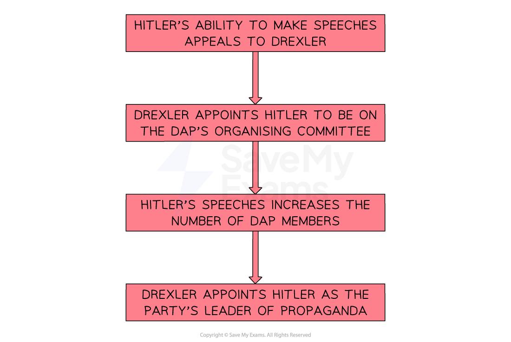

# What Did the Nazi Party Stand For in the 1920s?

## How Involved was Hitler in the Creation of the Nazi Party? - Timeline & Summary

![A horizontal timeline spanning from 1919 to 1922, showing key events in Hitler’s early involvement with the Nazi Party (NSDAP):

February 1919 – Anton Drexler creates the German Worker’s Party (DAP).

January 1920 – Hitler becomes head of propaganda for the DAP.

February 1920 – Drexler and Hitler write the Twenty-Five Point Programme; the party is renamed the NSDAP.

July 1921 – Hitler forces and wins a leadership contest for the NSDAP; he creates the SA (Stormtroopers) a month later.

January 1922 – At an NSDAP party conference, Hitler gains autocratic control of the party.](../../../assets/0b00253c7dd0-59229-httpscdn-savemyexams-comuploads202402dap-t.png)

**Adolf Hitler served as a messenger in the First World War**. His role was to pass messages between ***regiments***. Being a messenger was a dangerous job and Hitler was awarded two medals for his bravery. In **October 1918, a *****mustard gas***** attack injured Hitler**. He was temporarily blinded and required hospital treatment. It was in the hospital that Hitler learnt about the ***armistice*** of the First World War and Germany’s defeat. He, like many other soldiers, believed **that Weimar politicians committed a ‘*****dolchstoss*****’ by agreeing to the **[Treaty of Versailles.](https://www.savemyexams.com/igcse/history/cie/18/revision-notes/the-20th-century-international-relations-from-1919/was-the-treaty-of-versailles-fair/what-was-the-impact-of-the-treaty-of-versailles-on-germany/)

The ***abdication*** of the ***Kaiser ***in November 1918 led to the creation of many **new political parties**. The ***Weimar Republic*** became increasingly worried about the threat these new parties posed to public safety. As a result, the **government employed Hitler as part of their *****intelligence***** operation**. His job was to attend a meeting of a new political party and report back to the government how dangerous it was. This was when **Hitler discovered the DAP - The German Workers’ Party**.

Over the next two years, Hitler’s involvement in the party grew until he became leader. His **skill as an *****orator***** and his political vision** caused an increase in party membership. As a result, he rebranded the party to the NSDAP or the Nazi Party.

## The Development of the DAP

> **Spec point** — `spcpt_wcvy7vtTpwDHykrs`

## The Development of the DAP

- **Anton Drexler founded the DAP in February 1919**

  - Drexler was a railway mechanic from Munich
  - In September 1919, the DAP had **23 members**
  - It was a ***right-wing *****party **that targeted the working classes
- The government hired** Hitler to spy on political parties** in Munich

  - The Weimar Republic had struggled to survive threats from ***extremist*** parties
  - As an ex-soldier, Hitler desperately needed the work
  
    - The majority of Germany’s armed forces had been made ***unemployed ***after the ***Treaty of Versailles*** restricted the German army to 100,000 soldiers
- Hitler attended his first meeting of the DAP on **12th September 1919**

  - The ideas discussed at the meeting aligned with Hitler’s personal beliefs
  - On** 19th September 1919, Hitler signed up as a member**
  
    - This went against his government ***assignment***

## Changing the DAP to the NSDAP

> **Spec point** — `spcpt_VtvsCw8f2qKWKSCW`

## Changing the DAP to the NSDAP

- By **1920,** the DAP had changed its name to the **National Socialist German Workers’ Party (the NSDAP or Nazi Party)**
- Hitler implemented his takeover of the NSDAP by 1921 in five ways:

1. Changing the party’s policies to the **Twenty-Five Point Programme**
2. Hitler’s** personal appeal**
3. Developing the party’s ***organisational*** structure
4. Forcing a **change of leadership **and choosing members for key positions
5. Creating the NSDAP’s private army, the **SA** (Sturmabteilung)

*A flow diagram showing Drexler’s actions towards Hitler in the DAP*

> **Exam Hint**
> A common misconception that students have is that Hitler created the Nazi Party from nothing. **Hitler took over an existing party. **He changed the party’s name and formulated its policies. You will notice a recurring theme throughout this course of Hitler taking existing ideas and rebranding them as his own.

## The Twenty-Five Point Programme

- When Hitler became responsible for the **DAP’s *****propaganda***, he realised the party needed an official document stating its policies

  - The DAP already spoke on key issues such as:
  
    - Removing **Weimar politicians** who had signed the Treaty of Versailles
    - **Rewriting of the Weimar *****Constitution*** to increase restrictions on ***democracy***
    - **Blaming the Jewish people** for all of Germany’s issues
- In **January 1920, Hitler and Drexler wrote the Twenty-Five Point Programme**, which formalised the aims of the DAP

| **Point number** | **Summary of the point** | **Nationalist or Socialist?** |
|---|---|---|
| 1 | ***Anschluss***** **and the union of all German speakers into one German country | ***Nationalist*** |
| 3 | The return of Germany’s overseas ***colonies*** to provide extra food and space for the German people | Nationalist |
| 4 | The belief that Jewish people were not German ***citizens*** | Nationalist |
| 7 | The government’s top priority was to provide jobs for German citizens | ***Socialist*** |
| 9 | All citizens to have equal legal rights | Socialist |
| 17 | The banning of private ownership of land | Socialist |
| 25 | The implementation of a strong, ***centralised**** *government | Nationalist |

> **Exam Hint**
> The table above highlights which points were Nationalist or Socialist aims. This is important to understand as Hitler renamed the DAP the National Socialist German Workers’ Party. Nationalism is an extreme right-wing belief whereas socialism is a ***left-wing*** belief. The Twenty-Five Point Programme tried to deliver the best of both ***ideologies*** to increase the DAP’s popularity among the workers. ***Communism*** appealed to workers as they wanted social improvements, but the majority of voters considered it too extreme. Many male workers still held traditional, nationalist values. In an attempt to appeal to the masses, Hitler and Drexler had created a confused political identity with contradicting aims. For example, a centralised government (Point 25) would not give all citizens equal legal rights (Point 9).

> **Worked Example**
> **What was the Twenty-Five Point Programme? **
> 
> **4 marks**
> 
> **Final answer:** **Answers:**
> 
> This was the political programme of the Nazi Party, written in 1920 **(1)**. It had a mixture of socialist and nationalist ideas **(1)**. It opposed the Treaty of Versailles** (1)**. It said that Jews would not be allowed to be German citizens **(1)**.

> **Exam Hint**
> This style of question does not require you to explain your answer. The Cambridge IGCSE gives you **a point for each relevant piece of information** that you write. Therefore, do not spend any additional time trying to describe or explain each reason.

### The Appeal of Hitler

- The DAP experienced a** rapid increase in membership in 1920**

  - By June 1920, the DAP had **1,000 members**
  - By the end of the year, this increased to** 3,000**
- The main cause of this increase in membership was the appeal of Hitler
- Hitler spent a considerable amount of time practising his speeches

  - Hitler developed a **unique pattern of *****oration***, **increasing his tempo** of speaking until he reached a** frantic and aggressive** ***crescendo***. This made his arguments very persuasive
  - He would practice** hand gestures** to utilise in certain sections of his speeches. To ensure these had maximum impact, he took pictures of how he looked as he practised them
  - As propaganda minister, he **created images and posters** of himself speaking
- In the first year of his DAP membership, he delivered 31 speeches

> **Exam Hint**
> The power of Hitler’s oration skills cannot be underestimated. Historical sources state that, in a few sentences, Hitler could turn a room full of people who hated him into his supporters. You should use Hitler’s skills as an orator as evidence for why the Nazi Party became the biggest party in Germany by 1932.

## Nazi Party: Organisation and Leadership

> **Spec point** — `spcpt_kGrvjrmXG8Y6Hyzd`

## Nazi Party: Organisation and Leadership

- Hitler used his influence over Drexler to make key changes in the organisation of the party
- In **January 1920, the DAP created a headquarters** in Munich

  - Rudolf Schüssler, a friend of Hitler, took over the party’s ***administration***
  - Meetings became **better organised **and funds for the party increased
- Hitler suggested that the party be called the NSDAP to represent the nationalist and socialist elements

  - The intention behind the new name was to **appeal to multiple groups of people**
- The NSDAP adopted the** *****swastika***** **and ***straight-armed salute***** **to distinguish it from other nationalist parties

  - The swastika derived from Asia to symbolise ***prosperity***
  - The Nazi salute originated from Ancient Rome
- In **December 1920**, the NSDAP began producing a** newspaper called *****Völkischer Beobachter*** (the ‘People’s Observer’)

  - Within a year, the NSDAP was distributing** 17,000 copies** of the newspaper
  - The party’s influence was spreading beyond Munich
- In **July 1921, Hitler triggered a leadership contest **

  - Hitler’s popularity meant he** defeated Drexler** to gain control of the NSDAP
- Hitler needed to ***consolidate*** his position as leader of the party. He made some key changes to the inner circle of the NSDAP

#### The Structure of the NSDAP

![A relationship chart centring on Adolf Hitler:

At the top, a red box labelled "Hitler".

A blue arrow points right to a box labelled "Friends with General Ludendorff – Head of the German Army in First World War".

A downward arrow labelled "Appoints" leads to a red horizontal line connecting to four key figures:

Rudolf Hess – Hitler’s deputy.

Hermann Goering – Commander of the SA.

Julius Streicher – Creator of Der Stürmer, a Nazi propaganda newspaper.

Ernst Röhm – Linked the SA to the Reichswehr (German army).

The diagram visually shows how Hitler’s appointments and friendships helped build his leadership network in the early Nazi Party.](../../../assets/d222d0f7883f-47587-httpscdn-savemyexams-comuploads202402struc.png)

*A flow diagram showing how Hitler organised the leadership structure of the NSDAP*

## What was the SA?

- The Sturmabteilung (‘Stormtroopers’ or ‘SA’) was the **NSDAP’s private army**

  - The political violence in the streets of Weimar Germany made many political parties adopt a ***paramilitary force***
  - The SA was formed in** August 1921**
  - They gained the nickname ‘**Brownshirts**’ due to the colour of their uniform
- Hitler hired the unemployed,** students and ex-soldiers** into the SA

  - These groups were very angry with the Weimar government
  - Hitler offered them** money and a daily structure**
- Hitler used the SA to:

  - **Control crowds **at meetings
  - **Start fights** on the streets
  - **Disrupt the meetings** of opposition groups like the ***KPD***
  - Strengthen the image of the NSDAP
- The SA became problematic

  - By 1922, there were **800 Brownshirts**. This number was increasing
  - **Ernst Röhm became the leader of the SA in 1923**
  
    - The SA was not under Hitler’s direct control
    - Ernst Röhm was popular among the stormtroopers
  - To combat this, Hitler created the *Stosstrupp* or ‘Shock Troop’
  
    - These were Brownshirts specially selected by Hitler as his bodyguards

## The Impact of Hitler on the NSDAP

- In **January 1922, Hitler called a party conference**. Hitler established his ***autocratic***** **control of the party

  - He spoke for two and a half hours
  - He **persuaded the NSDAP members to surrender their right to elect** the leader of the party
  
    - This effectively made the NSDAP a dictatorship
- The popularity of the NSDAP accelerated in 1923

  - By **November 1923, the NSDAP had 50,000 members**
- The Weimar government was dealing with the ***hyperinflation*** crisis. Many Germans began to look at extremist parties like the NSDAP for solutions

> **Exam Hint**
> It is important to link parts of the course together to understand the historical context. The hyperinflation crisis caused a surge in popularity for the Nazi Party. Without this event, the NSDAP would have remained a small, extremist party. The party also benefited from the Wall Street Crash in 1929. This would eventually lead to them becoming the biggest political party in Weimar Germany in 1932.
