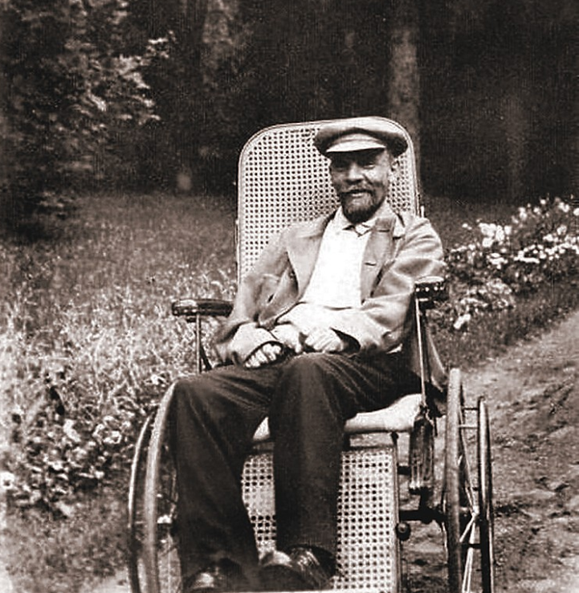

# How Did Stalin Succeed Lenin?

## Russia by 1924 - Timeline & Summary

![A timeline from 1922 to 1930 showing key events in Stalin's rise to power within the USSR:

December 1922 – January 1923: Lenin writes his testament, criticising key Bolsheviks.

May 1924: The Central Committee keeps Lenin’s testament a secret and decides not to dismiss Stalin.

November 1927: Trotsky and Zinoviev are expelled from the Communist Party; Kamenev is expelled from the Central Committee.

August 1928: Bukharin tries to form an alliance with Trotsky.

November 1929: Bukharin is removed from the Politburo. Stalin becomes the unopposed leader of the USSR.](../../../assets/790731912a1d-20472-httpscdn-savemyexams-comuploads2024031924-.png)

Under Lenin's leadership, the *Bolshevik* government had **secured control over the Russian *****Empire***. **1922** was a significant year in the Bolshevik *consolidation* of power. After the Russian Civil War, Lenin established a ***communist***** *****dictatorship***. Lenin refused to share power and used ***repression***** to eliminate his enemies**. As a result, Lenin developed an *autocratic* and *centralised* government.

In **December 1922**, Lenin led the creation of the Soviet Union, or the **Union of Soviet Socialist Republics (USSR)**. This was a formal union between Russia, Belarus, Ukraine, Georgia, Azerbaijan and Armenia under communist rule. The USSR created a ***constitution***** that promised *****human rights*** for its people. In reality, the Soviet people did not have these rights.

When **Lenin died in 1924 **after years of ill health, it left a **significant *****power vacuum*** in the USSR.

## Death of Lenin, 1924

> **Spec point** — `spcpt_v3TJ4hbh6cHCJ258`

## Death of Lenin, 1924

- From mid-1921, Lenin’s health declined

  - **He survived an *****assassination***** attempt in 1918**
  
    - **Fanya Kaplan**, a member of the *SRs*, **shot Lenin twice** outside a factory in Moscow
    - One of the **lead bullets was lodged in Lenin's head**. It was slowly poisoning his brain
  - He suffered a **massive stroke in May 1922**
- From then until his death in January 1924, Lenin became increasingly **paralysed**

  - Another stroke in **March 1923 left Lenin unable to speak**
  - From this point, he was unable to lead the Bolshevik Party actively
- **Lenin died on 21st January 1924**

  - The Bolsheviks *embalmed* Lenin's body and created a *mausoleum*

*A photograph of Lenin in 1923. Strokes had left Lenin paralysed and needing a wheelchair*

## Lenin's Testament

> **Spec point** — `spcpt_K3M4jFDCXmMHh8J5`

## Lenin's Testament

- Between **late 1922 and early 1923, Lenin dictated his last *****will***

  - It stated Lenin's aims for the Bolshevik Party after his death
  - It would become a ***controversial***** document**

### What did Lenin Say about Trotsky?

| "[Trotsky] is personally perhaps the most capable man in the present C.C. [Central Committee], but he has displayed excessive self-assurance and shown excessive preoccupation with the purely administrative side of the work" |
|---|

#### What Does this Mean?

- Lenin believed that **Trotsky was a capable member **of the party
- However, he thought Trotsky was:

  - **Overconfident and *****arrogant***
  - **Too focused on paperwork** rather than leading the party

#### What did Lenin Base his Opinion on?

- Lenin had given a lot of power to Trotsky

  - Trotsky had proved in the **October Revolution and the Russian Civil War** that he was a capable member of the Bolshevik Party
- Trotsky was a **gifted *****orator***** and writer**

  - As a result, many party members believed that Trotsky was arrogant
  - Trotsky believed he was **more intelligent and more devoted to communism **than many Bolsheviks
- **Trotsky was Jewish**

  - Although Trotsky did not practice *Judaism*, it turned many of the party against him

### What did Lenin Say about Stalin?

| "Comrade Stalin, having become Secretary-General, has unlimited authority concentrated in his hands, and I am not sure whether he will always be capable of using that authority with sufficient caution"  "Stalin is too rude... That is why I suggest that the comrades think about a way of removing Stalin from that post and appointing another man in his stead who [is] more tolerant, more loyal, more polite and more considerate to the comrades" |
|---|

#### What Does this Mean?

- Lenin believed that **Stalin could not be trusted with power**
- Stalin came across as **rude, disloyal, unpolite and argumentative **with his colleagues

#### What did Lenin Base his Opinion on?

- Stalin had **risen quickly** through the Bolshevik Party

  - Stalin had little to no role in the October Revolution
  - Lenin gave Stalin the position of *Commissar* for *Nationalities* in November 1917
  - Stalin **made his reputation during the Russian Civil War**. Lenin appointed  Stalin as a Political Commissar to several *generals*
  - In** 1922**, Stalin became ***General Secretary***** of the Bolshevik Party**
- **Lenin became suspicious of Stalin**

  - Stalin built a **support base** in the party that was** loyal to him**
  - Lenin viewed Stalin as cruel and uneducated
  
    - **Stalin came from Georgia**, which Lenin viewed as an *inferior* nationality
- **Stalin's anger became a serious issue**

  - In **March 1923**, Lenin discovered that **Stalin had shouted at Lenin's wife on the telephone**
  
    - Lenin saw this as an unforgivable act
  - Another stroke left Lenin **unable to remove Stalin** as General Secretary

> **Exam Hint**
> In an exam question, you do not necessarily have to remember quotes from Lenin's *Testament*.  An examiner would expect you to know Lenin's opinions on Trotsky and Stalin and why he had these opinions.

## Contenders by 1924

> **Spec point** — `spcpt_nNM2WwKQTv48wVgC`

## Contenders by 1924

- After Lenin's death, the party became **divided between the *****left-wing***** and the *****right-wing***

| Left-wing beliefs | Right-wing beliefs |
|---|---|
| Believed in **War Communism** | Believed in the **New Economic Policy** |
| Favoured the '**permanent revolution**'. This stated that the *USSR* needed to spread communism across the world. This was** unpopular** with the party | Favoured '***Socialism***** in One Country**'. This wanted to strengthen communism in the USSR before pursuing global communism. This was **popular **with the party |

- The main contenders for Lenin's position can be divided in this way:

*An illustration showing the political opinions of key members of the Communist Party*

- **Lenin did not name a *****successor***

  - The left and right of the Bolshevik Party** fought in a *****power struggle***
  - The result of the power struggle would give the USSR a leader

## How Did Stalin Become Leader?

> **Spec point** — `spcpt_FRGxBjvZkFJMWKRF`

## How did Stalin Become Leader?

- **Stalin played a clever political game** to become the leader of the USSR

![A vertical flowchart titled “1–6” explaining Stalin’s rise to power within the Communist Party:

Lenin’s Funeral – Stalin told Trotsky the wrong date, ensuring Trotsky missed it. Stalin gave a speech and posed as chief mourner.

Lenin’s Testament – Lenin criticised Stalin as dangerous and advised his removal, while also criticising Trotsky and others. The leadership suppressed the document.

First Party Congress (1924) – Stalin allied with Zinoviev and Kamenev to oppose Trotsky, using his role as General Secretary to gain support. Trotsky was sacked.

Siding with Bukharin (1926) – Stalin allied with Bukharin to expel Zinoviev and Kamenev. He promoted his “Socialism in One Country” policy.

Expulsion from the Party (1927) – Trotsky, Zinoviev, and Kamenev were expelled from the Communist Party.

Turning Against Bukharin – Stalin removed Bukharin and his NEP-supporting allies from their positions.](../../../assets/32a6d3eb8f78-43331-1924-power-struggle-main-events.png)

*An illustration showing how Stalin manipulated the party to become the leader of the USSR*

> **Exam Hint**
> Students often find the power struggle between 1924 and 1929 very confusing to understand. Try to remember that Stalin went:
> 
> - **To the left **of the party to win support and isolate Trotsky
> - **To the right** of the party to remove the left
> - **Back to the centre** to remove the right-wing threats of the party

- By **December 1929**,** Stalin was the undisputed leader** of the USSR

> **Worked Example**
> **‘Trotsky’s personality, rather than Stalin’s abilities, decided the leadership contest after Lenin’s death.’ How far do you agree with this statement? Explain your answer**
> 
> **10 marks**
> 
> **Final answer:** **Partial answer:**
> 
> Some people would not agree with this statement **(1)**. Stalin’s ability to win support allowed him to win the power struggle after Lenin’s death **(1)**. Stalin had built a support base before Lenin's death. Between 1924 and 1929, Stalin manipulated the left and right of the party to remove his political rivals **(1)**. This ability allowed Stalin to win the leadership contest. This is because he managed to isolate Trotsky, limiting his influence on other party members. Stalin's tactics meant that, by 1927, Trotsky was no longer a threat **(1)**.

> **Exam Hint**
> A strong response for this Paper One question needs to **examine both sides of the argument**. The next paragraph would explain why Trotsky's personality made him lose the leadership contest. You could use Trotsky's arrogance or his opinions on the 'permanent revolution' to argue this. Continue to use a clear** PEE structure **as shown above.
> 
> You would then need to write a **conclusion explaining if Trotsky's personality was key in the leadership contest.** Remember to use phrases like ‘**fully**’ or ‘**partially**’ to explain your opinion.
