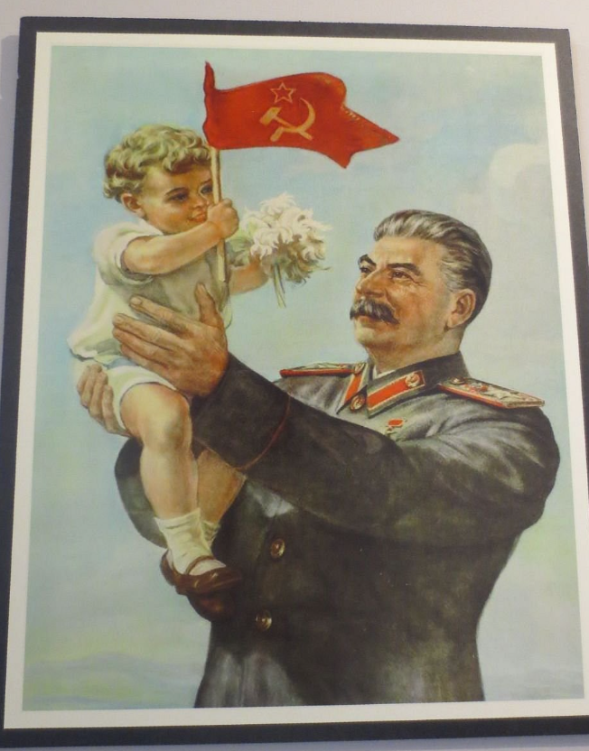
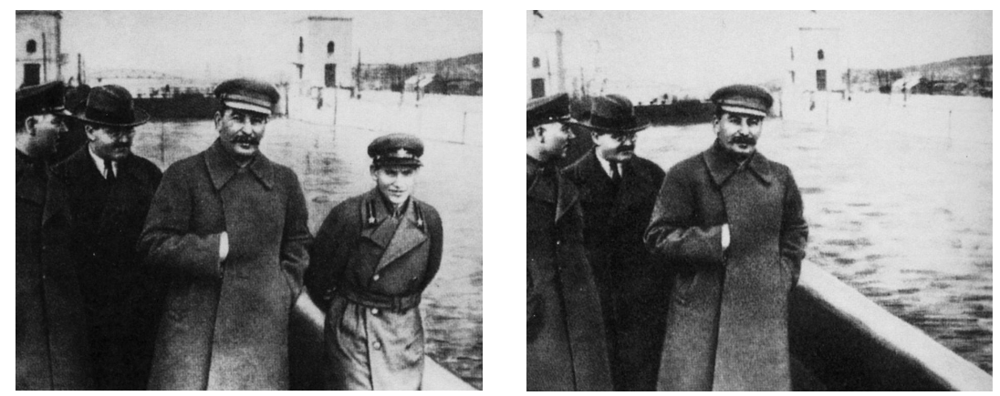

# Stalin's Methods to Control the Soviet Union

## Did Stalin Rule by Fear or Love? - Summary

Stalin ruled the *USSR* primarily **through fear rather than love**. He created a ***cult of personality*** and used *propaganda* to portray himself as a popular leader. However, his regime relied upon ***repression*****, intimidation and violence.**

Stalin also employed** fear tactics** to limit *dissent*. The state **arrested people with no evidence of a crime**, found them guilty in *show trials* and placed them into forced *labour* camps or executed them. These methods instilled a **climate of fear**. It ensured compliance with the regime's policies.

Stalin's propaganda machine portrayed him as a **beloved fatherly figure and saviour of the Soviet people**. The reality was that he ruled through fear and the elimination of perceived enemies.

## The NKVD

> **Spec point** — `spcpt_xdCCp3CfNsKSJmPT`

## The NKVD

- Communist Russia had a secret police

  - From 1917 to 1922, it was called the Cheka
  - From 1922 to 1934, it was called the OGPU
- **The NKVD was formed in 1934**

  - It **combined all forms of the military and general police** force into one organisation
  - Its full name was the People's *Commissariat* for Internal Affairs

### What was the Role of the NKVD?

- The government tasked the NKVD with **eliminating political enemies**

  - It carried out the [Great Purges](https://www.savemyexams.com/igcse/history/cie/18/revision-notes/russia-1905-41/how-did-stalin-gain-and-hold-on-to-power/why-did-stalin-launch-the-purges/) for Stalin
  - **It did not need evidence or witnesses **to make an arrest
  - From 1935, they could ***prosecute***** children as young as 12** as adults

### What Tactics did the NKVD use?

- If workers broke workplace rules, they could face:

  - Fines
  - Being fired from their job
- The NKVD used even harsher tactics to maintain control

![An illustrated vertical flowchart showing four key methods used during Stalin’s purges:

Mass arrests – Image of hands in handcuffs representing large-scale detainment of people.

Used torture to force confessions – Image of a bloodstained, dimly lit interrogation room with shackles and a chair.

Created a network of informants – Image of a person using a telephone to report information, symbolising secret surveillance and informant networks.

Quotas for arrests from July 1937 – Image of hands writing on a list, representing orders with quotas for how many people should be arrested.](../../../assets/fcaa5352d55f-22187-httpscdn-savemyexams-comuploads202403nkvd-.png)

*An illustration showing the methods that the NKVD used against 'enemies of the state'*

## The GULAG System

> **Spec point** — `spcpt_xG8zqjhpQZQWJWhv`

## The GULAG System

- The GULAG system was created in **1919**

  - GULAG is an *acronym* that translates to the **Chief Administration of Corrective Labour Camps**
  - It was an **organisation of forced labour camps**, which were called *lagery* in Russian
  - The state placed many of the *lagery* in **Siberia**
  - The secret police *administrated* the system
- The GULAG aimed to:

  - **Severely punish criminals**
  - **Deter** other citizens from committing crimes
  - Provide the state with **free labour**

> **Exam Hint**
> It is popular to call the labour camps 'gulags'. You may see this wording in an exam question.** As Cambridge uses the term 'gulags', you may use this in your exam answer.** However, *lagery* (or *lager* for a singular camp) is the technically accurate term.

### Prisoners in the GULAG System

- A range of people were prisoners in the GULAG system, including:

  - **Political opponents**
  - **Kulaks **and *NEPmen*
  - Workers accused of *sabotaging*
  - Members of the military
  - Artists who broke *censorship*

### How did the GULAG System Grow?

![A bar graph titled "Number of Prisoners in GULAG Camps (1929–1953)". The x-axis represents years from 1929 to 1953. The y-axis shows the number of prisoners, ranging from 0 to 2,500,000. Each red bar represents the prisoner population for that year.

Key trends:

The number of prisoners rises sharply from under 200,000 in 1929 to over 1 million by 1935.

A peak occurs around 1938 with over 2 million prisoners during the height of the Great Purge.

A decline follows but numbers remain high through the early 1940s.

A second peak occurs between 1948 and 1950, reaching close to 2.5 million.

The population gradually decreases by 1953, the year of Stalin’s death.](../../../assets/11d7c296b2de-3110-httpscdn-savemyexams-comuploads202403gulag-.png)

*A graph showing the number of prisoners in the GULAG system*

### What were Conditions Like in the GULAG System?

- The *lagery* had terrible living conditions

  - Prisoners lived in **overcrowded wooden lodges**
  - There was little *sanitation*
  
    - **Diseases spread** in these conditions
  - There was **no heating **
  
    - Many people died from the cold conditions of Siberia
- The prisoners completed **forced physical labour**

  - **Prisoners had to meet production targets**
  
    - These were unattainable
    - Many prisoners died of overworking
- The camp ***rationed***** food** for prisoners

  - Prisoners received more rations if they completed more work
  - If a prisoner did not meet their targets, the prisoner received less rations
  
    - **Prisoners died of starvation**

> **Worked Example**
> What were the ‘gulags’?
> 
> **4 marks**
> 
> **Final answer:** **Answer:**
> 
> They were labour camps** (1)**.  They were where criminals and political opponents were sent **(1)**. The conditions were very harsh and many prisoners died **(1)**. Many of them were in Siberia **(1)**.

> **Exam Hint**
> You should aim to complete the question in four minutes, one minute per point. This will give you one minute to read through your answer.

## Show Trials

> **Spec point** — `spcpt_fmj4k3bjjnR2RWDR`

## Show Trials

- A show trial was a **staged, public trial with a *****predetermined***** outcome**

  - In the Great Purge, Stalin placed high-profile *Bolsheviks* in show trials
  - The NKVD **tortured suspects so they would confess**, even if they did not commit the crime
  - The state ensured the judge knew the sentence before the trial

### The Trial of 16

| Date | Suspected crime | Who were accused? | Verdict and outcome |
|---|---|---|---|
| 1936 | - Disrupting *Five-Year Plans* - The murder of Kirov | 16 people, including Zinoviev and Kamenev | - Guilty - All 16 people were executed |

### The Trial of 17

| Date | Suspected crime | Who were accused? | Verdict and outcome |
|---|---|---|---|
| 1937 | - Disrupting Five-Year Plans - The murder of Kirov - Plotting to overthrow the government | Party officials | - Guilty - 13 people were executed - Four people were sent into the GULAG system |

### The Trial of 21

| Date | Suspected crime | Who were accused? | Verdict and outcome |
|---|---|---|---|
| 1938 | - Disrupting Five-Year Plans - The murder of Kirov - Plotting to overthrow the government | 21 people, including Bukharin and Yagoda, the head of the NKVD | - Guilty - All 21 people were executed - Bukharin spoke out about the *corruption* of the trial |

## Propaganda and the Cult of Stalin

> **Spec point** — `spcpt_6MbWWQyg9MhJYwtZ`

## Propaganda and the Cult of Stalin

- The Bolsheviks knew the importance of propaganda

  - The party used propaganda posters in the *tsarist* regime to win support
- The Soviet government **heavily censored information**

  - The communist newspaper **Pravda ** was **the only legal newspaper** in the USSR
  - **Western radio stations were banned**
  - The government controlled public events to ensure that the USSR looked good
- Stalin relied on propaganda to:

  - **Create portraits, photographs and statues** across the USSR of Stalin as:
  
    - A** god-like figure**
    - 'Uncle Joe' and the **father of the USSR**
  - Spread Stalin's image and ideas across the USSR
  
    - **Parades** celebrating the [October Revolution](https://www.savemyexams.com/igcse/history/cie/18/revision-notes/russia-1905-41/how-did-the-bolsheviks-gain-and-consolidate-their-rule/reasons-for-the-bolsheviks-seizure-of-power/) and May Day occurred annually
    - Participants held images of Stalin or performed in front of him in the Red Square, Moscow
  - **Re-write history**
  
    - The government **edited photographs** to remove Bolshevik Party members considered 'enemies of the state' under Stalin's regime
    - History textbooks wrote Lenin and Stalin, rather than Trotsky, as the key figures in the October Revolution

*A typical propaganda poster from Stalin's regime, depicting Stalin as a father figure*

*An example of a doctored photograph during Stalin's regime. Yezhov was removed after his execution in 1940*

> **Worked Example**
> **Why was Stalin’s ‘cult of personality’ important?**
> 
> **6 marks**
> 
> **Final answer:** **Partial answer:**
> 
> Stalin's cult of personality was important because it made him a god-like figure to his people **(1)**.  Portraits, photographs and statues of Stalin were placed across the USSR and depicted him as the father of the USSR **(1)**. This was important because it made people worship Stalin. This made it less likely for people to rebel against his regime **(1)**.

> **Exam Hint**
> In Paper One, ‘explain why’ questions are worth either six or ten marks. For full marks in this question, an examiner is looking for **two fully explained reasons **as to why Stalin's 'cult of personality' was important. Use the PEE structure in your answer:
> 
> - **P - **Make a **p**oint about the question
> - **E -** Use **e**vidence that supports the point that you have made
> - **E - E**xplain why this evidence made Stalin's 'cult of personality' important. Avoid repeating the point again. Explain how this factor impacted the day-to-day life and behaviour of the Soviet people.

## Culture in Stalin's Regime

> **Spec point** — `spcpt_4y8Dv8scdqqtcfmT`

## Culture in Stalin's Regime

- Stalin believed that controlling Soviet *culture* was important

  - **He wanted all artists, writers and musicians to strengthen**, **not challenge, the state**
  - Culture could be far-reaching and powerful in changing the opinions of Soviet citizens

![A flowchart titled "Stalin’s Control of the Arts and Culture in the USSR", showing three main areas of influence:

Religion (green box):

Communism opposed religion, viewing it as a threat to state power.

Churches were closed and priests arrested.

By 1939, only 1 in 40 churches remained active.

Islamic practices and mosques were banned.

Education (purple box):

Schools and youth groups like the Young Pioneers promoted propaganda.

The messaging glorified Stalin, socialist values, and loyalty to Stalin.

Music and Art (orange box):

Music, literature, and art were censored and monitored by the NKVD.

Artists and writers were forced to follow Soviet Realism, a style that praised workers and socialism.](../../../assets/fdc26cb3eb7a-59688-httpscdn-savemyexams-comuploads202403stali.png)

*A concept map showing Stalin's control of Soviet culture and the arts*
