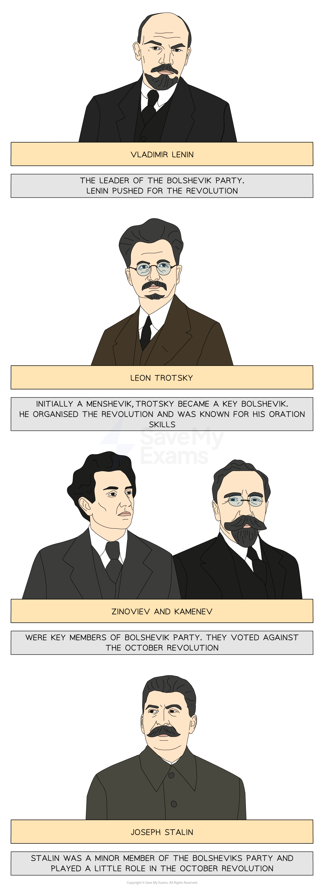

# Reasons For the Bolsheviks' Seizure of Power

## How was the October Revolution Different to Other Revolutions in Russia? - Timeline & Summary

![An illustrated infographic showing key figures in the Bolshevik Party during the October Revolution:

Vladimir Lenin – Shown with a bald head and goatee, wearing a black suit. Caption: "The leader of the Bolshevik Party. Lenin pushed for the revolution."

Leon Trotsky – Wearing glasses and a brown suit. Caption: "Initially a Menshevik, Trotsky became a key Bolshevik. He organised the revolution and was known for his oration skills."

Zinoviev and Kamenev – Two men in suits. Caption: "Were key members of the Bolshevik Party. They voted against the October Revolution."

Joseph Stalin – Depicted with a moustache in a plain coat. Caption: "Stalin was a minor member of the Bolsheviks Party and played a little role in the October Revolution."](../../../assets/2ef3e928a8fb-34197-httpscdn-savemyexams-comuploads202403bolsh.png)

*An illustration showing the key members of the Bolshevik Party*

The October Revolution was** very different **to the revolutions in 1905 and March 1917. In **1928**, the *Bolsheviks* *commissioned**** *****Sergei Eisenstein** **to create a film about the October Revolution**. The film, *October,  *shows masses of people storming the gates of the* Winter Palace* under heavy gunfire. **In reality, the gates of the Winter Palace were unguarded and open. **The Bolsheviks **faced little resistance** from the remaining members of the Provisional Government. Historians **consider the events of October 1917 a ***coup*. As a result, the only popular revolution in Russia was in March 1917. This is because the events of 1905 did not result in the overthrow of the *tsar*.

Many Russians considered the October Revolution as **a temporary change of government**.  Tsereteli, the leader of the *Mensheviks*, stated that the **Bolsheviks' power would not last three weeks**. At this point, the Bolsheviks were a small, *extremist* party. The Bolsheviks would end up establishing a *dictatorship* that **remained in power for over 70 years**.

## Key Members of the Bolshevik Party

> **Spec point** — `spcpt_T6pJYmpGbpkm6qQS`

## Key Members of the Bolshevik Party

*An illustration showing the key members of the Bolshevik Party*

> **Exam Hint**
> There were many more members of the Bolshevik Party. By early October, membership stood at 200,000. However, for your exam, try to remember these **five key figures**.

## Return of Lenin and the April Thesis

> **Spec point** — `spcpt_94bBGsQ3M29YkXKj`

## Return of Lenin and the April Thesis

- The Tsarist government had **exiled Lenin multiple times**

  - He was **not in the country during the March Revolution**
- In** April, Lenin returned to Russia**

  - **Germany funded his journey**
  
    - They believed that Lenin's presence in Russia would force Russia to surrender in the First World War
  - **Lenin travelled on the 'sealed train'**
  
    - This means that Lenin travelled through countries without passport checks
- When Lenin returned to Petrograd, he made a speech called the** 'April Theses'**

  - This outlined his key policies:

*Lenin's key statements in his April Theses*

- **The April Theses persuaded many workers to support the Bolsheviks**

  - The workers chanted these statements in the July Days
- Support for the Bolsheviks **declined after July**

  - Lenin did not support the July Days protest
  - He fled from Russia again

## Events in the October Revolution

> **Spec point** — `spcpt_w6gwNgp8tnd8g5jC`

## Events in the October Revolution

![A map of Petrograd with key locations and a timeline of events from the Bolshevik October Revolution in 1917. The map highlights important buildings and sites using letters A–I, with a legend showing:

A – The Winter Palace

B – Peter and Paul Fortress

C – Finland Station

D – Nicholas Station

E – Tauride Palace

F – General Post Office

G – Barracks

H – Smolny Institute

I – Cruiser ‘Aurora’

Below the map, a 9-step chronological narrative describes key events:

Smolny Institute, September – Bolsheviks gain a majority in the Petrograd Soviet; Trotsky becomes chairman.

7 October – Lenin returns to Petrograd; on 10 October he convinces the Bolsheviks to back a seizure of power.

Peter and Paul Fortress – Soldiers agree to arm the Bolsheviks; Trotsky says 15 of 18 units support the uprising.

23–24 October – Kerensky tries to close Bolshevik newspapers; soldiers push back his efforts.

24 October – Bolshevik ships led by the cruiser ‘Aurora’ arrive and aim guns at the city.

Night of 24–25 October – Bolsheviks seize bridges and the post office.

25 October, 10 a.m. – Lenin declares the Provisional Government is overthrown.

25 October, ~11 a.m. – Kerensky flees the Winter Palace to rally loyal troops.

25 October, ~11:30 p.m. – ‘Aurora’ fires on the Winter Palace; Bolsheviks storm it. The Provisional Government is captured at 2 a.m. with only six deaths reported.](../../../assets/70cbf9e8251a-24788-httpscdn-savemyexams-comuploads2024118964-.png)

*A map showing the events of the October Revolution*

> **Worked Example**
> **Describe how the Bolsheviks took power on 6th–8th November 1917**
> 
> **4 marks**
> 
> **Final answer:** **Answer:**
> 
> The Bolsheviks seized control of Petrograd **(1)**. The Red Guards stormed the Winter Palace **(1)**. Once inside the Winter Palace, the Bolsheviks arrested members of the government **(1)**.  Kerensky fled Petrograd **(1)**.

> **Exam Hint**
> This style of question does not require you to explain your answer. The Cambridge IGCSE gives you a point for each relevant piece of information that you write in your answer. Therefore, do not spend any additional time trying to describe or explain each reason. You should aim to complete the question in four minutes, one minute per point. This will give you one minute to read through your answer.

## Outcomes of the October Revolution

> **Spec point** — `spcpt_wbjtBy94QfzgVHGh`

## Outcomes of the October Revolution

- The Provisional Government was **no longer in charge of Petrograd**
- The Bolsheviks had control of Petrograd

  - This was a** key city in the Russian Empire**
- **The Bolsheviks did not have control over the whole of Russia**

  - The empire was large
  - The Bolsheviks had many enemies that did not want them to seize power
