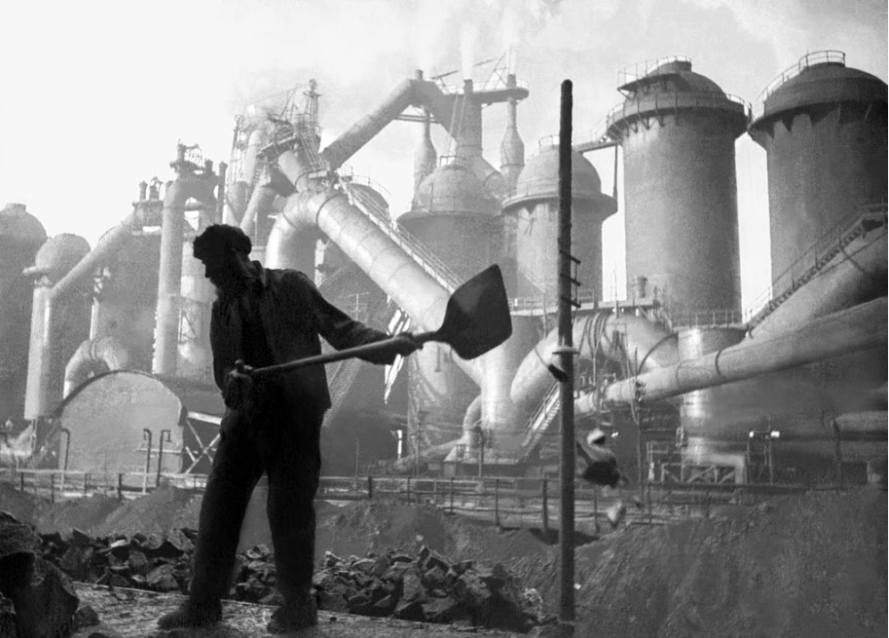

# Why Did Stalin Introduce the Five-Year Plans?

## How Important were the Five-Year Plans - Summary

The Five-Year Plans were pivotal in **shaping the economy and society** of the *USSR* under Stalin's rule.

Stalin aimed to rapidly *industrialise* the nation and achieve specific economic goals within five-year intervals. These plans played a significant role in **transforming the USSR from an *****agricultural***** society into a major industrial power**.

Stalin focused on the development of *heavy industry*, ***infrastructure***** and agriculture**. This resulted in impressive advancements in sectors such as steel production and transportation. However, the plans also resulted in **high social and human costs**, including **forced labour, *****famine***** and political *****repression***. The government set **unrealistic and unachievable targets** that could never be met.

Overall, while the Five-Year Plans helped to modernise the Soviet Union, their implementation came with significant costs.

## Reasons for the Five-Year Plans

> **Spec point** — `spcpt_vmB9zR4yjB4SRbX7`

## Reasons for the Five-Year Plans

- The Five-Year Plans aimed to **rapidly industrialise** the USSR
- Stalin introduced the concept in** 1928**

  - There were many motivations behind the Five-Year Plans

![An illustrated flowchart titled "Why did Stalin create Five Year Plans?" It outlines four key reasons:

Security (blue):

Heavy industry was needed to protect the USSR from western invasion.

More industrial centres were developed in the east.

Stalin could develop modern armaments.

Ideology (pink):

The plans helped establish "Socialism in One Country".

Becoming self-sufficient would remove the need for foreign goods.

A stronger economy would allow the USSR to catch up with the West.

Power and Control (green):

Stalin moved from supporting the NEP to state-owned industry during the power struggle.

This undermined Bukharin and the Right of the Party.

Political prisoners could be used for labour on state projects.

Personal Reputation (peach):

Stalin wanted to be seen as a great leader.

He gained the nickname "Man of Steel".](../../../assets/e8c4b5bb50ca-31805-httpscdn-savemyexams-comuploads202403five-.png)

*A concept map showing the motivations behind the Five-Year Plans*

## Details of Stalin's Five-Year Plans

> **Spec point** — `spcpt_sj4vBThK3MH6PCV3`

## Details of Stalin's Five-Year Plans

- **Stalin created Gosplan to organise the Five-Year Plan**

  - Gosplan stood for 'State Committee for Planning'
  - It set targets for:
  
    - Each region
    - Each factory
    - Each manager
    - Each worker
  - Targets were ambitious and usually unachievable
- Stalin** utilised foreign help** and investment from countries like Britain and the USA to help
- In Stalin's regime, there were three Five-Year Plans

### The First Five-Year Plan

| Dates | Targets | Outcomes |
|---|---|---|
| 1928-1932 | To develop heavy industry such as coal, iron, steel and electricity | The building of steelworks such as Magnitogorsk. Coal and iron *output* doubled |
| Increase production by 300% | Targets were unrealistic so they could not be met. There was a shortage of skilled workers |   |

*A photograph of Magnitogorsk Steel Works in 1930. It was the largest steel production complex in the world*

### The Second Five-Year Plan

| Dates | Targets | Outcomes |
|---|---|---|
| 1933 - 1937 | To further develop heavy industry | Heavy industry production more than doubled |
| To focus on lighter industries such as chemicals, railways and communication | The Moscow Railway was completed. However, targets were still too unrealistic and output was of poor quality |   |

#### The Stakhanovite Movement

- The movement began during the **second Five-Year Plan in 1935 **
- Its name came from Aleksei Stakhanov

  - Stakhanov reportedly **mined 102 tons of coal in less than 6 hours** (14 times his quota) on 31 August 1935
- The communist government embraced Stakhanov's achievement

  - **Stakhanov travelled the country as a national celebrity**
  - The government gave Stakhanov a home, extra pay and more holiday
  - The government** organised contests **all over the country to find the best worker in each industry
- The publicity **attracted people to follow Stakhanov's example**

  - On 1 February 1936, Nikita Izotov reportedly mined 640 tons of coal in a single shift
  - Stakhanovites were located in multiple industries in towns and the countryside
- Stakhanov and his followers **likely did not achieve these levels of output**

  - It only **increased expectations and pressure** on workers and managers

> **Worked Example**
> **Describe the Stakhanovite movement**
> 
> **4 marks**
> 
> **Final answer:** **Answer:**
> 
> Stakhanov was a worker who mined over 100 tons of coal in one shift **(1)**. Soviet propaganda encouraged all Soviet workers to be Stakhanovites **(1)**.  The movement spread from the coal industry to other industries across the Soviet Union **(1)**. The communists organised contests in many industries to find the best workers **(1)**.

> **Exam Hint**
> This question in Paper One requires you to state information you know about the Stakhanovite movement. The Cambridge IGCSE gives you **a point for each relevant piece of information** that you write. Therefore, do not spend any additional time trying to describe or explain each reason.

### The Third Five-Year Plan

| Dates | Targets | Outcomes |
|---|---|---|
| 1938 - 1941 | To mechanise and improve agriculture | The Second World War meant the plan had to be abandoned |
| To produce some *consumer goods* | There was a lack of good managers and specialists due to Stalin's [purges](https://www.savemyexams.com/igcse/history/cie/18/revision-notes/russia-1905-41/how-did-stalin-gain-and-hold-on-to-power/why-did-stalin-launch-the-purges/) |   |
