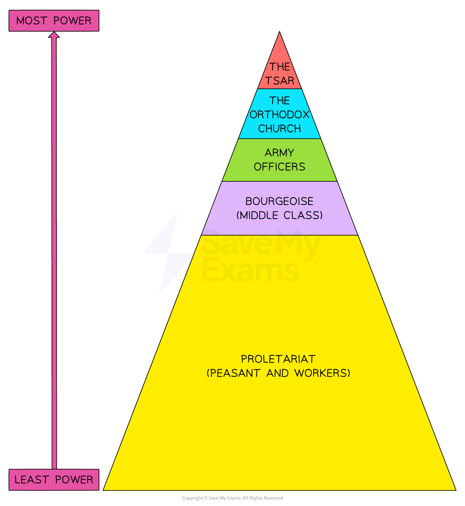

# The Difficulties of Ruling Russia up to 1914

## What was Nicholas II Like as a Tsar? - Summary

**Nicholas II became *****Tsar***** of Russia in 1897. **His father, Alexander III, was the traditional Russian tsar. Alexander III was 6 foot 4 inches tall, ***patriotic*** and ruled Russia through violence and fear. Nicholas II never achieved his father’s approval. When his father became ill in 1897, **Nicholas feared to *****succeed***** him**. He stated:

"I am not prepared to be a tsar. I never wanted to become one. I know nothing of the business of ruling."

This statement summarises Nicholas II’s** *****reign*** well. He attempted to **copy** **his father’s style of *****autocratic***** rule without having Alexander’s natural abilities**. Nicholas ignored his advisers yet showed indecision in key moments. He was a ***devout***** *****Russian Orthodox*** but resorted to ***repression*** to maintain control. Overall, Nicholas assumed that the** *****divine right of kings*** **would make his subjects obey him**. His **resistance to reform** and the changing political environment of Russia weakened his position.

People close to Nicholas took advantage of his personality. Unlike many royal marriages, Nicholas and his wife, Alexandra, truly loved each other. **Nicholas listened to Alexandra on key decisions rather than his trained advisers.** Nicholas’ trust in Alexandra would contribute to his downfall. The couple’s relationship with ***Rasputin*** made this worse.

## Geographical Difficulties

> **Spec point** — `spcpt_nyD5vyGdHCbGG2V5`

## Geographical Difficulties

- Tsar Nicholas ruled a [vast empire](https://www.savemyexams.com/igcse/history/cie/18/revision-notes/russia-1905-41/why-did-the-tsarist-regime-collapse-in-1917/tsarist-russia-by-1905/) 5,000 km wide

  - **The Ural Mountains divided the empire**
  
    - To the west of the Urals was the** majority of Russia’s industry and population**. Nicholas lived there in St Petersburg, the country’s capital city
    - To the east of the Urals was **Siberia and disputed territory that bordered China**. This was far away from Nicholas and had limited transport to West Russia
  - The empire contained **a mixture of *****nationalities*****, languages and religion**
  
    - Only **40% of the population was ethnic Russian**
    - Communication and legal enforcement were challenging
    - Many nationalities like the Poles wanted their independence from the empire
    - The Russian Empire forced Jewish people to live in the** *****Pale of Settlement***

#### The Largest Nationalities in the Russian Empire

| **Nationality** | **Amount of people in millions in 1897** |
|---|---|
| Russian | 55.6 |
| Ukrainian | 22.4 |
| Polish | 7.9 |
| Jewish (defined by faith) | 5.0 |
| Kirgiz/Kaisats | 4.0 |
| Tartar | 3.4 |

> **Exam Hint**
> Many other nationalities made up the Russian Empire. The exam is not testing you on knowing all of these. However, try to remember the core nationalities in the Russian Empire and how this would cause difficulties for the tsar.

## Social Difficulties

> **Spec point** — `spcpt_94xKtXTBVyjZ9Bs7`

## Social Difficulties

- Russia had a very challenging social structure

*A hierarchy showing who had power in the Russian Empire*

#### How Did Each Social Group Challenge the Stability of the Empire?

| **Social group** | **Challenges to the Russian Empire** |
|---|---|
| Peasants | Around **80% of the population** were peasants. They were poorly educated. After the ***Emancipation Edict**** *of 1861, peasants could **buy land through the Peasant Land Bank**. However, only a small number of peasants could do this. These were called ****kulaks****. **Many peasants hated *****kulaks***. The empire relied on peasants as soldiers for the army |
| Industrial workers | **Less than 5% of the population** worked in towns and cities. Russian cities had **terrible living conditions**. Workers lived in substandard housing with poor ***sanitation***. Diseases spread rapidly, such as ***cholera***. There was little that workers could do. The government had **no laws for working hours, pay or conditions**. ***Trade unions*** were illegal |
| The ***bourgeoisie*** | **Less than 2% of the population** but a growing class in Russia. The bourgeoise consisted of** *****industrialists*** and business owners. They had **a lot of money but very little power** |

> **Exam Hint**
> Students often struggle to understand the hierarchy in Russian society. Students find it useful to compare it to medieval England, where a king ruled and many people were peasants. This is exactly the same as Russia in 1905.

## Economic Difficulties

> **Spec point** — `spcpt_XQNkcQDf2hgYsFwt`

## Economic Difficulties

- Russia experienced some development of their economy

  - Russia’s Finance Minister **Sergei Witte caused the ‘Great Spurt’ of the 1890s**
  
    - Russia began the construction of the **Trans-Siberian Railway**
    - Production in ***heavy industry***** increased**
    - **The rouble became a** ***gold-standard *****currency**, which increased foreign trading
    - Witte** increased foreign investment** in Russian industry
    - Witte developed Russian ***infrastructure***** **through building roads and ***telegraph*** lines
  - Russia’s new industrialisation had some impact on the economy
- The economy continued to be backward

  - **Russia’s economy relied on its *****agricultural***** output**
  
    - Peasant farmers used medieval growing techniques that were not productive
  - **Only parts of Russia had suitable conditions for *****arable *****farming**, for example, European Russia
  
    - These places could experience famine, which would affect the economy and the empire’s food supply
  - **Russia’s industry relied on ‘quantity over quality’**
  
    - Despite investment, Russia’s industry was **outdated and needed modernisation**

#### What Did Russia Produce?

|   | **Annual production (in millions of tons)** |   |   |
|---|---|---|---|
| **Year** | **Coal** | **Pig iron** | **Grain** |
| **1880** | 3.2 | 0.42 | 34 |
| **1890** | 5.9 | 0.89 | 36 |
| **1900** | 16.1 | 2.66 | 56 |

- The table shows that Russia relied on its agriculture

> **Worked Example**
> **Describe Russia’s economic problems at the beginning of the twentieth century**
> 
> **4 marks**
> 
> **Final answer:** **Answer:**
> 
> Russia relied on its agricultural output **(1)**. Its industries were old-fashioned and needed modernisation **(1)**. Peasants who grew crops used outdated methods of production, which were not efficient **(1)**. Russia could experience economic issues if a part of the empire suffered from famine **(1)**.

> **Exam Hint**
> For a ‘Describe’ question, you should aim to complete the question in **four minutes, one minute per point**. This will give you one minute to read through your answer.

## Political Difficulties

> **Spec point** — `spcpt_6Ktd9r3gYnMCygmV`

## Political Difficulties

- The ***Fundamental Laws*** of the Empire stated that:

> **blockquote**
> The Emperor of all the Russias is an autocratic and unlimited ***monarch***

- In theory, the tsar had a government underneath him

*A diagram showing the government bodies in Tsarist Russia*

- The government had many weaknesses:

  - **No government bodies had any real power**
  
    - The tsar elected people to work in these bodies
    - Their role was only to advise or do administrative tasks
  - There was** no elected parliament or ******duma****
  - The tsar did not believe his people should have the right to vote
  
    - The upper classes believed that the **majority of Russians were uneducated and uncivilised**
    - *Tsarina* Alexandra stated that the Russian people should be :

> **blockquote**
> Under the whip

- Political parties existed but were not recognised by the tsar

#### Political Parties before 1905

| **Left** | **Centre** | **Right** |
|---|---|---|
| ***Narodniks *****(‘Populists’) - **Wanted **peasants to lead the way** in reforming Russia. Their policy to ‘go to the people’ by visiting peasants had little success. The terrorist section known as ‘**The People’s Will**’ ***assassinated***** **Tsar Alexander II in 1881 | The **growing middle classes** of businessmen and industrialists developed** *****liberal***** **ideas. They wanted reform but **did not want to destroy tsarism**. Political groups developed after 1905 | There was a variety of **right-wing** nationalist parties in the Russian Empire. An example of this is the **Union of the Russian People**. They were strongly ***nationalist***** **and supported the tsar |
| **The Social Revolutionaries (SRs) -** Developed from the Populist Movement in 1901 by **Victor Chernov**. They wanted to give the urban working classes more power. The **SR split into Left and Right**, with the Left committing terrorist attacks |   |   |
| **The Social Democrats (SDs) -** Formed in 1898 as a ***Marxist*** group. They wanted the people to overthrow the tsar. **In 1903, the SD split into two**. The **Mensheviks** (‘Minority’) were led by Martov and the **Bolsheviks **(‘Majority’) were led by Lenin |   |   |

- Many ****mirs**** had a** *****zemstvo *****(or *****zemstva *****in plural)**

  - They were **rural councils**
  - The people elected their representatives
  
    - This was not ***democratic*** as a landowner’s vote was worth more than a peasant’s
  - The *zemstvo* had responsibilities for:
  
    - Education
    - Medical services
    - Public ***welfare***
    - Food supplies
    - Maintaining roads
  - **Government officials initially liked the idea of *****zemstva***** **as they believed that:
  
    - It would **control the *****rural***** population** in *mirs*
    - It could **collect taxes**
  - **By 1905, *****zemstva***** began to demand *****constitutional reform***
  
    - Many members of the *zemstva* were middle and upper classes who wanted the right to vote

> **Exam Hint**
> **The *****zemstva***** and the *****mir***** are two different institutions.** An important, usually religious, leader would oversee the *mir*. They would settle land disputes and decide if a peasant could leave the *mir*. However, **when more places developed *****zemstva*****, the *****mir*****’s power declined**. The *zemstva* were more organised and held power and wealth from its middle class representatives.

## Rise in Extremism

> **Spec point** — `spcpt_j5MY5WGCqGnKGqbs`

## Rise in Extremism

### What is Marxism?

- **Karl Marx **was a German ***philosopher***
- He and **Friedrich Engels** developed the theory of ***Communism***** **through the books

  - **The Communist Manifesto (1848)**
  
    - The political and social viewpoint of Communism
  - **Das Kapital (1867)**
  
    - The economic viewpoint of Communism
- Marxism believed that all countries moved through** five ‘stages of history’**

*A diagram showing Marx’s idea about the development of all societies*

> **Exam Hint**
> Don’t confuse Communism with **socialism**. They share similar features and are both **leftist **beliefs. However, socialism has established classes, permits belief in religion and allows individuals to own their own property. True Communism has no government, no religion and no classes.

### Growth of Marxism in the Russian Empire

- Plekhanov translated Marx’s books into Russian in 1883
- **By the 1890s, the growth of industrialisation** led to the development of:

  - Workers’ organisations
  - Illegal **trade unions**
  - Marxist discussion circles - like the ***Tchaikovsky Circle***
- These **spread Marxist ideas more widely **around the Russian Empire
- The two key Marxist political parties in Russia were

  - The Mensheviks
  - The Bolsheviks

#### How did the Mensheviks and the Bolsheviks differ in their view of Marxism?

| **Mensheviks** | **Bolsheviks** |
|---|---|
| **Russia was not ready for a *****proletariat *****revolution**. According to Marx, a revolution from the bourgeoisie had to occur first | Both the proletariat and bourgeoisie revolutions could happen together to **‘fast-forward’ to Communism** |

### How did the tsar fight against extremism?

- ***Censorship***

  - The government censored all forms of the *arts*, including Marx’s works
- **The Okhrana**

  - The ***secret police*** in Tsarist Russia
  - The Okhrana had powers to:
  
    - **Investigate** Communists, socialists and trade unionists
    - Watch members of the government
    - **Arrest and torture suspects**
    - ***Exile*** political prisoners to Siberia
