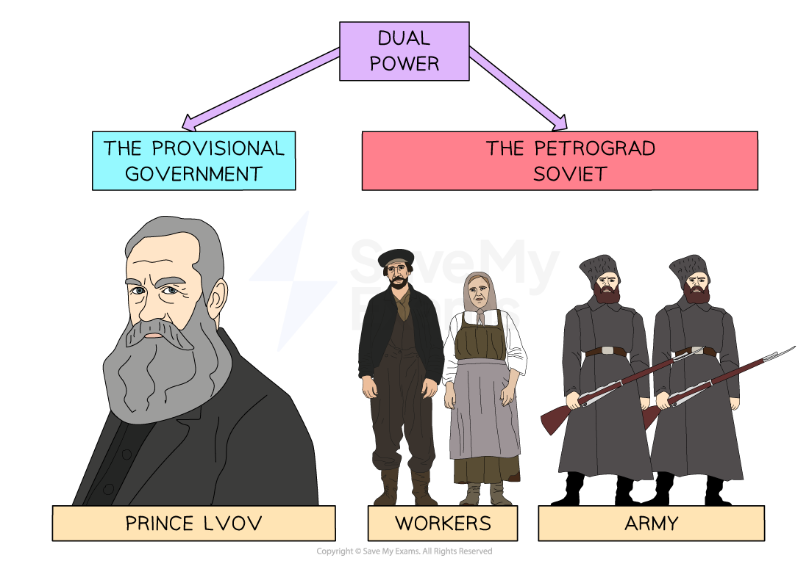

# Why was the Revolution of March 1917 Successful?

## Was the March Revolution Inevitable? - Summary

Historians debate whether it was *inevitable* that the *tsar* would *abdicate* in March 1917. A significant factor was the [First World War](https://www.savemyexams.com/igcse/history/cie/18/revision-notes/russia-1905-41/why-did-the-tsarist-regime-collapse-in-1917/did-the-first-world-war-weaken-the-tsar/). The conflict created **poor conditions** in Russia. **Food and fuel shortages caused mass protests in Moscow and Petrograd.** With a proper government, these issues may have been solvable. However, Tsar Nicholas' command of the army left Russia without a leader. *Tsarina* Alexandra and Rasputin ran a** chaotic government** with multiple changes of ministers. **Local needs were not being met. **The** ******zemstva******* *****took more responsibility **than the government for the health and safety of the Russian people.

Some historians argue that the First World War only dictated the timing of the March Revolution. They argue that **Tsarist Russia had unresolvable issues**. The misuse of the army, the empire's economic backwardness and the mix of *nationalities* would cause a revolution eventually. **The First World War sped up when this revolution would occur.**

> **Exam Hint**
> Students often get confused with the terms '**St Petersburg**'** and **'**Petrograd**'. Before 1914, students should refer to Russia's capital city in an exam question as St Petersburg. After 1914, students should use the term 'Petrograd' in their answers.

## Events of the March 1917 Revolution

> **Spec point** — `spcpt_bFRbFWVfB447HPyP`

## Events of the March 1917 Revolution

![A colour-coded timeline with five stages detailing events in early 1917 during the Russian Revolution. Events begin in January–February with strikes across the Russian Empire due to unemployment and shortages. From 7th–10th March, 40,000 Putilov steel workers strike alongside women on International Women’s Day, rising to 250,000 strikers. On 12th March, the Duma prepares to govern and the army is ordered to stop protests, but many soldiers join the strikers. The same day, the Petrograd Soviet takes over supply control in Petrograd. In September, Tsar Nicholas II tries to return but is blocked by railway workers; he abdicates and his brother Michael refuses the throne.](../../../assets/48a955d4dfbf-47188-httpscdn-savemyexams-comuploads202403march.png)

*An illustration showing the key events of the March 1917 Revolution*

> **Worked Example**
> **Describe what happened in Russia in March 1917**
> 
> **4 marks**
> 
> **Final answer:** **Answer:**
> 
> In Petrograd, thousands of women and workers went on strike **(1)**. Many Russians were unhappy with bread rationing and high unemployment **(1)**. The Petrograd Soviet took control of supplies **(1)**. On 15th March, Tsar Nicholas II abdicated **(1)**.

> **Exam Hint**
> For a ‘Describe’ question, you should aim to complete the question in **four minutes, one minute per point**. This will give you one minute to read through your answer.

## Popular Support

> **Spec point** — `spcpt_VT8KK7b7rvzBfXD6`

## Popular Support

- The March 1917 Revolution is known as a '**revolution from below**'

  - This means that the workers caused the revolution to happen
- The revolution had popular support because:

  - The First World War had caused **fuel and food shortages**
  
    - The people felt like they had no choice but to protest
  - Russia suffered** huge ***casualties *in the First World War
  
    - People felt less *patriotic*
    - They did not support the tsar's decisions** **as Head of the Army
  - **People began to turn against the Romanovs**
  
    - Tsarina Alexandra was called the 'German Princess'
  - **Industrial workers were less religious**
  
    - There was a lower belief in the *Divine Rights of Kings*. They were less afraid to challenge the tsar's authority
    - **More workers turned to the *****Marxist***** parties**
  - Twp groups could govern Russia instead of the tsar. These were:
  
    - The **duma *** *- supported by the **middle classes**
    - The *Soviets* - supported by the **workers and the military**

## Military Support

> **Spec point** — `spcpt_w8fqzybmYDjV3FGd`

## Military Support

- The **Russian Army** was a significant '*pillar*' for the tsar

  - Nicholas II over-relied on the army to *suppress* protests as he had done in [1905](https://www.savemyexams.com/igcse/history/cie/18/revision-notes/russia-1905-41/why-did-the-tsarist-regime-collapse-in-1917/how-did-the-tsar-survive-the-1905-revolution/)
- **The First World War turned the army against Tsar Nicholas**

  - They did not respect the tsar's military leadership
- Without the army, the tsar lost his power

  - He could not use his *autocratic* **power without the threat of violence**
  - Any future government would need the support of the army to rule
  - **Many soldiers joined the Soviets**, increasing their power in Russia

## Soviet Support

> **Spec point** — `spcpt_CdR7y2stJX9XZbCJ`

## Soviet Support

- After Nicholas' abdication, there was confusion about who would rule Russia

  - **Nicholas' brother refused the position, ending 300 years of the Romanov dynasty**
  - Both the *duma* and the Petrograd Soviet wanted power
- After the March 1917 Revolution, a system of **Dual Power** replaced the Tsarist government

*An illustration showing the concept of Dual Power*

- Both government bodies needed the other

  - The Provisional Government needed the **Petrograd Soviet for their influence over the Army and workers**
  - The Petrograd Soviet needed the **Provisional Government for their influence over the middle classes**

> **Exam Hint**
> Students often get confused between the Petrograd Soviet and the Provisional Government. Try to remember that:
> 
> - The Provisional Government represented the *duma*
> - The Petrograd Soviet represented the workers
