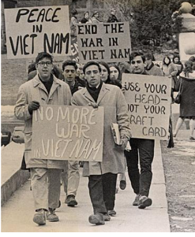
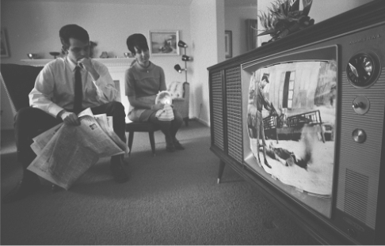

# American Involvement in Vietnam, 1955–75

## Why did the USA get Involved in Vietnam?

> **Spec point** — `spcpt_zjQCmWfZ3FP9QTp6`

## Why Did the USA get Involved in Vietnam?

![A map of Southeast Asia showing the division of Vietnam at the 17th Parallel. North Vietnam is shaded red and located above the 17th Parallel, with the capital area near the Gulf of Tonkin. South Vietnam is shaded blue and lies below the 17th Parallel, bordering the South China Sea. Surrounding countries are also labeled: China to the north, Laos and Cambodia to the west, Thailand and Myanmar to the southwest. The Gulf of Tonkin lies to the northeast of Vietnam, while the Gulf of Thailand is to the southwest. The 17th Parallel is marked with a dashed horizontal line across the map](../../../assets/20a1e77dc1ad-map-of-vietnam.png)

*A map showing how Vietnam was divided in 1954*

- Before the Second World War, **France owned Vietnam**

  - Vietnam was a** *****colony*** in the French ***Empire*** known as **Indochina**
- During the Second World War, **Japan occupied Vietnam**

  - In **1941,** a ***Communist*** armed force called the** Viet Minh** under the leadership of **Ho Chi Minh fought the Japanese**
  - In **1945, Vietnam declared independence**
- After the Second World War, France wanted to own Vietnam again

  - **France fought the Viet Minh**
  - Fearing Communism in Vietnam, the **USA funded the French involvement**
- **The Viet Minh defeated the French at the Battle of Dien Bien Phu in 1954**

  - The **Geneva Peace Accords** agreed to temporarily split Vietnam
  
    - The Communist **Viet Minh gained North Vietnam**
    - **South Vietnam created an *****anti-Communist***** government**
    - A **free election in 1956 **would decide who permanently governed Vietnam

![A visual comparison of North Vietnam and South Vietnam’s leadership during the Vietnam War. On the left, North Vietnam is represented by Ho Chi Minh, labeled as "respected" and "known as 'Uncle Ho'," and is backed by the Soviet Union (flag shown). On the right, South Vietnam is represented by Ngo Dinh Diem, who is labeled as "unpopular," "corrupt, he rigged elections," and "Catholic, he persecuted Buddhists." Diem is backed by the United States (flag shown). The image uses red for communist North Vietnam and blue for capitalist South Vietnam.](../../../assets/dcb4fc8d6101-leaders-of-vietnam.png)

*An illustration showing key information about the leaders of North and South Vietnam*

> **Exam Hint**
> Students often need clarification on the **divisions of Vietnam and** [Korea](https://www.savemyexams.com/igcse/history/cie/18/revision-notes/the-20th-century-international-relations-from-1919/did-the-united-states-contain-the-spread-of-communism/the-usa-and-events-in-korea-1950-53/). There are many similarities. For example, the **North of each country was Communist** and the division occurred as the result of war. However, the **Allies divided Korea on the 38th Parallel** while the Geneva Agreement split **Vietnam on the 17th**. Also, the split in Vietnam was** temporary** while the division of Korea was more permanent.

| **Reason** | **Why did this cause US intervention in Vietnam?** |
|---|---|
| ***Domino Theory*** | Eisenhower and his* ****Secretary of State*** **John Dulles** feared that Ho Chi Minh would win the election. This would make Vietnam Communist. They believed that if **Vietnam turned Communist, other countries in Southeast Asia would fall too** |
| ***Containment*** | Presidents Eisenhower, Kennedy and Johnson all believed in containment. They justified their actions in Vietnam as part of **their mission to stop the spread of Communism** |
| **Distrust **of the** *****USSR*** and China | The USA **blamed the USSR and China **for North Vietnam’s attempt to spread Communism |
| **Raw materials** | Vietnam had a wealth of useful raw materials like ***tungsten***, **tin and rubber**. If the USA could make Vietnam ***capitalist***, it could access these raw materials |

## The Development of War in Vietnam

> **Spec point** — `spcpt_4XXRJmpYZPQTSXz4`

## The Development of War in Vietnam

- In **1957**, the** **communist guerrillas (later known as the Viet Cong)** began attacking South Vietnam**
- **In 1959, the People's Army of Vietnam (PAVN) - popularly known as the North Vietnam Army (NVA) **established the ***Ho Chi Minh Trail ***to transport weapons to the South
- **Ho Chi Minh declared a full-scale war** against the **Army of the Republic of Vietnam (ARVN)**

  - He stated his intention to overthrow Diem’s government
- **Many South Vietnamese supported the actions of North Vietnam**

  - In** 1960**, Ho Chi Minh created the **National Liberation Front **(or the** *****Vietcong***)
  
    - Its members included Communists from North Vietnam and peasants from South Vietnam
    - In reaction, **President Kennedy sent more aid to support Diem’s government**
- Diem’s government became more unpopular

  - Diem introduced the **Strategic *****Hamlets***** programme in 1962**
  
    - It aimed to create **villages protected from the Viet Cong’s influence**
    - In reality, it **destroyed people’s homes **and forced them to move. This gained support for the Viet Cong
  - He treated his people poorly by:
  
    - **Discriminating against Buddhists**, the largest faith group in South Vietnam
    - Taking land from peasants to give to rich landlords
    - Running a ***corrupt***** government** and giving key positions to his family members
- The USA could no longer support Diem’s government

  - **Kennedy cut off aid to Diem**
  - In **November 1963, a *****coup***** overthrew and *****assassinated***** Diem**

## The Events of the Vietnam War

> **Spec point** — `spcpt_CZfQsM5fZbx82Y3Y`

## The Events of the Vietnam War

![A vertical timeline chart showing seven key events in the Vietnam War from 1964 to 1973. Each event is shown in a coloured box, numbered from 1 to 7, with arrows connecting them in chronological order.

August 1964 (orange box): The USA accuses North Vietnam of attacking two US ships in the Gulf of Tonkin. This incident prompts US Congress to authorise military action in Vietnam.

March 1965 (light green box): Operation Rolling Thunder begins — a large-scale US bombing campaign against North Vietnam. By the end of 1965, 20,000 US troops are in Vietnam.

January 1968 (purple box): The Tet Offensive begins. North Vietnam launches surprise attacks on over 100 towns and cities. US and ARVN counter-attacks kill 30,000–50,000 North Vietnamese.

March 1968 (yellow box): The My Lai Massacre. Lieutenant William Calley leads a US attack on a village suspected of hiding Viet Cong. Over 400 civilians are raped and killed. The US government covers it up for a year.

1969–1971 (pink box): President Nixon authorises bombing of Laos and Cambodia to improve the USA’s negotiating position in peace talks.

March 1972 (orange box): North Vietnam, Laos and Cambodia launch the Easter Offensive — a major attack on South Vietnam in response to US bombings.

January 1973 (blue box): The Paris Peace Accords are signed by the USA, North Vietnam, South Vietnam and the Viet Cong. All US troops are to withdraw from Vietnam by 1975.](../../../assets/4bda597ea881-49919-events-of-vietnam-war.png)

*A flow diagram showing the key events of US involvement in the Vietnam War, 1964-1973*

> **Worked Example**
> **What was the Gulf of Tonkin incident?**
> 
> **4 marks**
> 
> **Final answer:** **Answers:**
> 
> The Gulf of Tonkin incident took place in 1964 **(1)**. The US claimed that North Vietnamese ships attacked two US ships in the Gulf of Tonkin **(1)**. The Gulf of Tonkin incident caused the American Congress to give President Johnson authority to act** (1)**. After this incident, Operation Rolling Thunder began **(1)**.

> **Exam Hint**
> This question in Paper One requires you to state information you know about the Gulf of Tonkin incident. The Cambridge IGCSE gives you **a point for each relevant piece of information** that you write. Therefore, do not spend any additional time trying to describe or explain each reason.

## Vietcong Tactics

> **Spec point** — `spcpt_kt7g3ZT85qbM7384`

## Vietcong Tactics

| **Tactic** | **Explanation of tactic** |
|---|---|
| ***Guerrilla warfare*** | The Viet Cong knew that the **US would win in open warfare**. Instead, the Viet Cong:  - Set **traps** - ***Ambushed**** *soldiers - Used Vietnam’s forests to **attack and hide** - Dug **tunnels**  The USA struggled to fight against these tactics |
| Use of civilians | Many **South Vietnamese citizens helped the Viet Cong**. They attacked South Vietnamese government officials. The **Viet Cong did not wear a military uniform**. As a result, US soldiers struggled to identify troops from civilians |
| Ho Chi Minh Trail | The North Vietnamese used the Ho Chi Minh Trail to **transport supplies**. Despite **constant US bombing**, supplies continued to move southwards on this route |

![A map showing the Ho Chi Minh Trail during the Vietnam War. The map displays North Vietnam (in red), South Vietnam (in blue), Laos, Cambodia, and parts of neighboring countries. Red arrows represent the Ho Chi Minh Trail—a supply route used by North Vietnam to transport troops and supplies into South Vietnam through Laos and Cambodia. Several arrows point toward key cities and regions in South Vietnam, including Hue, Kontum, Pleiku, Buon Brieng, Bu Prang, and Saigon. Blue dots mark U.S. Special Forces camps throughout South Vietnam. The 17th Parallel, which divided North and South Vietnam, is also labeled. The map includes key geographical features such as the Gulf of Tonkin, South China Sea, and Gulf of Thailand.](../../../assets/a939584c6362-ho-chi-minh-trail-map.png)

*A map showing the Ho Chi Minh Trail*

## US Tactics

> **Spec point** — `spcpt_FPzKXgKnB2QfcD7c`

## US Tactics

| **Tactic** | **Explanation of tactic** |
|---|---|
| Bombing | The US undertook **large-scale bombing campaigns** on North Vietnam’s capital city, **Hanoi, key military bases and the Ho Chi Minh Trail**. During the war, the USA dropped **three million tonnes of bombs** |
| ***Chemical warfare*** | The USA had a huge **technological advantage** over the North Vietnamese. They used **chemicals like** ***Napalm*** and ***Agent Orange***. The aim was to **destroy the dense forest** that the Viet Cong hid in. This type of warfare caused high civilian** *****casualties*** |
| **Conscription** | From **1967, the US government introduced *****conscription*** (or ‘the draft’). A large proportion of the US Army were **young and Black Americans**. Most of these soldiers had no choice but to fight in Vietnam. This meant that the US soldiers had **low** ***morale*** and wanted to return to the USA |
| ***Search and Destroy*** | The US sent troops in helicopters to** find and attack Viet Cong bases**. This method caused many deaths. **Viet Cong traps killed US soldiers**. US troops **attacked innocent villagers** in the belief they were Viet Cong. Search and Destroy pushed many Vietnamese to support the Viet Cong |

## Why did Public Opinion Turn Against the Vietnam War?

> **Spec point** — `spcpt_t7NW8jzwqPzHTMd8`

## Why Did Public Opinion Turn Against the Vietnam War?

- The US public turned against the Vietnam War because:

  - **Conscription was unpopular**
  
    - Around 2.8 million US soldiers fought in Vietnam
    - The draft affected black Americans *disproportionately*
    - The police *prosecuted *over **9,000 young men for ‘*****draft dodging*****’ **
  - The** Tet Offensive (1968)** caused the media to** question if the war was worthwhile**
  - It was the **first televised war**
  
    - The US public saw **photographs and news reports** of the Vietnam War in graphic detail
    - **Scandals like the My Lai *****Massacre*** were uncovered, changing the public’s perception of the US Army
- **Anti-war protests peaked 1968-70**

  - Students were the key opposition group to the war
  
    - In **November 1969, 700,000 anti-war protesters** marched in Washington
    - In** May 1970, the *****National Guard***** **shot dead four student protestors at **Kent State University**
    - The media coverage of the shootings caused **2 million students in 400 schools to go on strike**

*A picture of a student protest at the University of Wisconsin-Madison, January 1965*

*A photograph showing an American man and woman watching footage of the Vietnam War on a television in their living room in 1968*

## The Consequences of the end of the Vietnam War

> **Spec point** — `spcpt_WYbNxKRsVXzFrGvf`

## The Consequences of the End of the Vietnam War

- **President Nixon won the 1968 presidential election** on the promise to end the Vietnam War

  - Nixon and his ***National Security Adviser***, **Henry Kissinger**, wanted to pull out of the war with dignity
- After the** unsuccessful bombing campaigns of Laos and Cambodia**, Nixon began the process of US withdrawal

  - In **January 1973**, the **US and the North Vietnamese** government signed the **Paris Peace Accords**
  
    - This **officially ended US involvement** in Vietnam
    - Nixon declared the US withdrawal was ‘**peace with honour**’
  - By 1973, only 30,000 US troops remained in Vietnam
  
    - **The conflict between North and South Vietnam continued**
  - On **30th April 1975**, the South Vietnamese capital, **Saigon, fell to North Vietnamese forces**

| **Positive consequences** | **Negative consequences** |
|---|---|
| The US public was **happy to see the end of the ‘unwinnable war’** | Containment had **failed militarily**. While the USA had stronger weapons, the communist **Viet Cong had better tactics** |
|   | Containment had **failed politically**. By **1975, Vietnam, Laos and Cambodia became Communist**. The USSR and China, who had given money and technology to North Vietnam, had gained new Communist** *****allies*** |
|   | Containment had **failed in the *****propaganda***** war**. The use of chemical warfare and disregard for Vietnamese civilians **ruined the USA’s international reputation**. Over 58,000 US soldiers died with millions of Vietnamese casualties |
|   | Containment had **failed economically**. The Vietnam War **cost the USA around \$168 billion** |

- As a result, the **US government abandoned the policy of containment**

  - Nixon pursued ***détente*** with the USSR and China

> **Worked Example**
> **Study Source D**
> 
> **How useful is this source as evidence about American involvement in Vietnam? Explain your answer using details of the source and your knowledge**
> 
> **7 marks**
> 
> | **Source D: **From ‘In Retrospect, The Tragedy and Lessons of Vietnam’ by Robert S McNamara, published in 1995. McNamara was Secretary of Defence in the governments of Kennedy and Johnson from 1961 to 1968 when he resigned over Vietnam  *By the time the United States finally left South Vietnam in 1973, we had lost over 58000 men and women, our economy had been damaged by years of heavy war spending, and the political unity of our society had been shattered. Were such high costs justified? Many conclude that without US intervention in Vietnam, Communism would have spread farther through South and East Asia. I seriously question such judgements. I question whether either Soviet or Chinese behaviour and influence in the 1970s and 1980s would have been different had we not entered the war or had we withdrawn from Vietnam in the early or mid-1960s.*  *By then it should have been clear that the two conditions underlying President Kennedy’s decision to send military advisers were not being met, and could not be met: political stability did not exist; and the South Vietnamese were incapable of defending themselves. I do not believe that US withdrawal in 1963 would have led West Europeans to question our support for NATO. On the contrary, it is possible we would have improved our credibility by withdrawing from Vietnam and saving our strength for more defensible stands elsewhere. * |
> |---|
> 
> **Final answer:** **Partial answer:**
> 
> Source B is useful for a historian because it shows that the US military had doubts about the value of US involvement in Vietnam **(1)**. McNamara states that he would ‘seriously question’ that Communism would have spread in South and East Asia without US intervention **(1)**. In the 1960s and 1970s, the US government was following a policy of containment in an attempt to stop the spread of Communism, causing the US military to become involved in a civil war in Vietnam **(1)**. However, McNamara made this judgement in 1995, many years after the US withdrawal from the conflict. His opinion may have been different if the USA succeeded in preventing Vietnam from becoming Communist **(1)**.

> **Exam Hint**
> All sources are, in some way, useful for a historian. To achieve full marks for this question, you need to comment on the nature, origin and purpose of the source
> 
> - **Nature - **The source is a published account by Robert McNamara. As a published account, it is intended for a worldwide audience. As a result, McNamara may be telling a less honest version of events as he would if this was a diary
> - **Origin -  **Robert McNamara was Secretary of Defence in the governments of Kennedy and Johnson from 1961 to 1968. This gives him useful inside knowledge of the government’s attitude during a key stage of the Vietnam War
> - **Purpose - **Written in 1995, the book may be an attempt by McNamara to repair his damaged reputation from the Vietnam War
> 
> This method of source analysis ensures you are using details from the source and your own knowledge in your answer.
