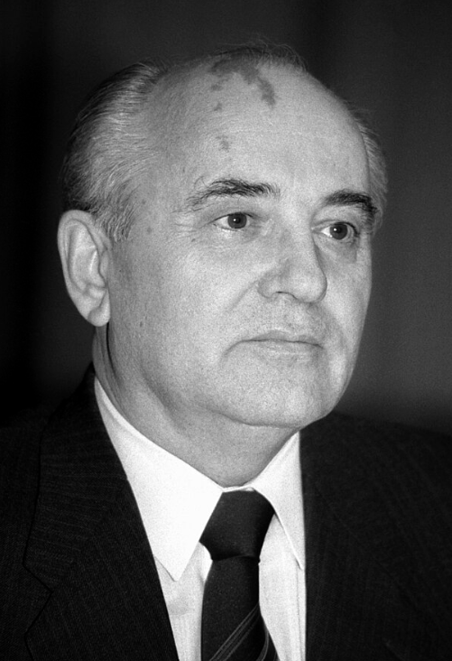

# Gorbachev & the Collapse of Soviet Control over Eastern Europe

## Who was Mikhail Gorbachev?

> **Spec point** — `spcpt_3dPCrNHdTcZy3jrc`

## Who was Mikhail Gorbachev?

*A photograph of Mikhail Gorbachev*

| - **On 10th November 1982, Leonid Brezhnev died**    - His cause of death was a heart attack   - Brezhnev *died in office* - Between **1982 and 1985**, there was **unstable leadership** in the ***USSR***    - Brezhnev's ***successor***, **Andropov**, died in **1984**   - Andropov's successor, **Chernenko**, died in **1985** - In **March 1985**, the Central Committee nominated **Mikhail Gorbachev** as the new leader of the USSR    - Gorbachev had risen through the Communist Party and held important roles like the party secretary of* ****agriculture *** - As leader of the USSR, he argued that the country needed to **introduce *****democratic***** reforms** |
|---|

### Why was There a Need for 'New Thinking'?

- By 1985, the USSR had **serious economic and social issues**

![A split flowchart showing the causes of social and economic problems in the USSR by 1985.

🔻 Economic Problems:

The USSR spent between 10% and 20% of its GDP on the military.

Brezhnev invested heavily in weapons to match the USA.

By 1980, the Soviet economy had stopped growing.

🔻 Social Problems:

Living standards in the USSR were worse than in the USA.

Life expectancy began to decline from 1970 onwards.

The USSR was a police state where citizens were monitored.

Poor living conditions triggered social unrest.

The Polish trade union Solidarity pushed the USSR to impose martial law in Poland.](../../../assets/b03b0b4155eb-soviet-union-conditions-1985.png)

*A concept map of the economic and social challenges in the USSR in 1985*

- When Gorbachev became leader, the USSR was close to economic collapse

  - He believed that reform would:
  
    - Save the ***Communist*** **economy**
    - **Increase the happiness of the *****citizens*** in the USSR and its ***satellite states***

## Perestroika - 'Restructuring'

> **Spec point** — `spcpt_8tcGmDXVGm7gD7Yk`

## Perestroika - 'Restructuring'

- To reform the economy, Gorbachev began the process of **perestroika **

  - Perestroika is the Russian word for '**restructuring**'
- The policies involved in perestroika were:

  - The **reduction of military spending**
  
    - The Red Army to became smaller
  - The **ending of the *****arms race*** with the USA
  - The introduction of more ***capitalist***** elements in the economy**
  
    - Gorbachev allowed the establishment of** small, privately-owned businesses**
    - The USSR removed the restrictions on foreign trade, allowing businesses to **trade more freely** with other countries
  - A reduction in the government control of businesses

## Glasnost - 'Openness'

> **Spec point** — `spcpt_dq5kd5QWkT9SZwdK`

## Glasnost - 'Openness'

- The second aspect of Gorbachev's reforms was **glasnost **

  - Glasnost is the Russian term for '**openness**'
- The policies involved in glasnost were:

  - **Less restrictions on *****censorship***** and freedom of speech**
  
    - The citizens of the USSR could discuss and criticise the government
    - There was less Soviet control of the media
  - The USSR **took responsibility for past *****repression***
  
    - For example, the Soviet government admitted that the [Hungarian Uprising ](https://www.savemyexams.com/igcse/history/cie/18/revision-notes/the-20th-century-international-relations-from-1919/how-secure-was-the-ussrs-control-over-eastern-europe-1948-c-1989/opposition-to-soviet-control-in-hungary-and-czechoslovakia/)and the Prague Spring were peaceful attempts at reform
  - The USSR would **allow opposition** to their government
  
    - In 1988, there were discussions about allowing elections
  - A commitment to **tackle *****corruption*** within the Soviet government
- This approach helped to improve relations with the West

  - Between **1985 and 1989**, Gorbachev attended a series of ***summits*** **with Reagan, the president of the USA**
  - In 1988, Gorbachev spoke at the ***UN***** **
  
    - Gorbachev's speech confirmed the USSR’'s commitment to reforms
    - Gorbachev and Reagan formed a **strong *****diplomatic***** relationship**

> **Exam Hint**
> Students often struggle to remember the definitions of glasnost and perestroika. To help you remember what these two terms mean, break down each word:
> 
> - Perestroika contains '**str**' - this can remind you of the word '**structure**'
> 
> Glasnost contains '**Glas**' - this can remind you of the word '**glass**'. You can see through glass, referring to the transparency of the USSR under glasnost.

## The End of Communism in Eastern Europe

> **Spec point** — `spcpt_7chZYrq2tjk23cTb`

## The End of Communism in Eastern Europe

| **Satellite state** | **When did Communism end?** | **Events leading to the end of Communism** |
|---|---|---|
| Hungary | May 1989 | The repressive **Kadar retired on 22nd May 1988**. Hungary **opened its border to Austria**. Free elections officially ended Communist rule in Hungary in October |
| Poland | June 1989 | **Widespread strikes** began in 1988. The government **legalised Solidarity** and agreed to free elections. Solidarity gained 99 out of the 100 seats on the Polish ***Senate*** |
| East Germany | November 1989 | East Germans **demonstrated **in huge numbers in October 1989 against the ***GDR***** **government. **A mistake in implementing a new travel policy** between East and West Berlin caused **thousands of East Berliners to cross to West Berlin** on 9th November. This caused the fall of the Berlin Wall |
| ***Czechoslovakia*** | December 1989 | The ‘**Velvet Revolution**’ showed the government violently **suppressing student protests**. By 20th November, there were 500,000 protestors in Prague. On 10th December, President** Husák *****resigned*** |
| Romania | December 1989 | After Husák's resignation, Ceausescu was the last repressive communist leader in Eastern Europe. On **21st December 1989, protests began**. The government had **lost the support of the army** by 22nd December. On Christmas Day 1989, **Ceaușescu and his family were executed** |
| Bulgaria | December 1989 | After the fall of the Berlin Wall, Petar Mladenov became the leader of Bulgaria. **Mladenov repealed the freedom of speech and assembly**. On 17th November, the Communist government was facing mass protests. **Mladenov resigned live on national televisio**n on 11th December 1989 |
| ***Yugoslavia*** | 1991-1992 | The Yugoslavian leader Tito died in 1980. By the late 1980s, Yugoslavia experienced an increased pressure to reform. In **1990, Slovenia voted to break away from Yugoslavia**. Between June 1991 and April 1992, Yugoslavia **split into seven separate states** |

### The End of the USSR

- Reform in Eastern Europe affected the ***Warsaw Pact***

  - The **USSR no longer had influence over Eastern Europe**. By early 1990, the USSR had to stop its military cooperation with Eastern Europe
  - The USSR** ended the Warsaw Pact in July 1991**
- The collapse of the** *****Eastern Bloc*** placed Gorbachev in a dangerous position in the USSR

  - *Devout* **Communists blamed Gorbachev** for weakening the USSR
  - The USSR **lost control of the *****Baltic States*** of Estonia, Latvia and Lithuania throughout 1990
- In **August 1991**, a group of Communist Party members called the '**Gang of Eight**' attempted a ***coup***** **against Gorbachev

  - The coup demanded **complete control of the USSR** and the declaration of a state of emergency in the country
  - **Gorbachev refused** and the 'Gang of Eight' kept him under ***house arrest***
- The coup against Gorbachev failed because:

  - **The coup lacked popular support**
  - Prominent Communists like **Boris Yeltsin spoke out **against the coup
  - Gorbachev was **able to continue to govern** the USSR
- The Communist Party no longer respected Gorbachev

  - The coup ruined Gorbachev's reputation across the USSR
  - **12 states of the USSR ** joined together to create the** *****Commonwealth***** **of Independent States
  
    - As a result, Gorbachev could no longer rule the USSR
    - **Gorbachev resigned **as ***General Secretary***** **of the USSR on 24th August 1991 and as President on 25th December 1991

IMAGE

***A map showing the dates when communist governments collapsed in Eastern Europe***

## Actions of the USA

> **Spec point** — `spcpt_rh6JYvhdqvq467VM`

## Actions of the USA

- The **USA contributed to the collapse of Communism** in Eastern Europe

  - US President **Reagan took a strong stance** against the USSR
  
    - The **Reagan *****Doctrine*** gave support to **anti-Communist** groups attempting to overthrow Communist governments
    - On **8th March 1983**, Reagan made a speech calling the USSR an ‘**evil *****empire***’
    - He developed an idea called the ***Strategic Defense Initiative**** (****SDI****)*. The USA was **forcing the USSR to collapse** its economy by **over-spending on its defence budget**
  - After seeing Gorbachev’s attempts at reform, Reagan pursued friendly relations with the USSR
  
    - **Summits from 1985 to 1989** improved relations between the USA and the USSR
    - In** December 1987**, the superpowers agreed to the **Intermediate-Range Nuclear Force (INF) treaty**. The treaty agreed to abolish all land missiles with a range of between 500km and 5,500km

## Events in the USSR 

> **Spec point** — `spcpt_Qbh27VkfdDPcgQMz`

## Events in the USSR

- By the 1980s, the USSR’s economy was failing
- The USSR could **no longer economically support the satellite states**
- The USSR had **invaded Afghanistan in 1979**

  - It was a **costly and unsuccessful war**
  - The Red Army could not fight against the ***guerrilla warfare*** tactics of the ***Mujahideen***
  - Gorbachev signed a ***treaty***** to end the war in 1988**
- Political control began to weaken

  - **Gorbachev’s reforms** **encouraged countries to speak out **against their Communist governments
  - Ukraine and Lithuania **demanded independence** from the USSR
- The USSR contained politicians who wanted to focus on strengthening Russia rather than Eastern Europe

  - **Boris Yeltsin **was the president of the Soviet Republic of Russia in May 1990
  - By 1990, Yeltsin** became the most influential political leader **in Russia

> **Worked Example**
> **‘Soviet control over Eastern Europe collapsed because of problems in the USSR.’ How far do you agree with this statement? Explain your answer**
> 
> ** ****10 marks**
> 
> **Final answer:** **Partial answer:**
> 
> Some people may argue that the problems within the USSR caused the end of Soviet control in Eastern Europe **(1)**. This is because the USSR had severe economic issues **(1)**. Gorbachev knew that the war in Afghanistan had cost a lot of money and harmed Russia’s economy. This encouraged him to pursue perestroika, the restructuring of the USSR’s economy **(1)**. Gorbachev needed to repair the damage that a Communist economy, the arms race and Afghanistan had done to Russia. This meant that Russia could no longer support the regimes in Eastern Europe. For example, it could not afford to keep the Red Army stationed across Europe **(1)**.

> **Exam Hint**
> A strong response for this Paper One question needs to **examine both sides of the argument**. The next paragraph would explain another perspective on the question, for example, the role of an individual satellite state or the actions of the USA. Continue to use a clear** PEE structure **as shown above.
> 
> You would then need to write a **conclusion explaining if problems within the USSR were the main reason why Soviet control over Eastern Europe collapsed**. Remember to use phrases like ‘**fully**’ or ‘**partially**’ to proportion the blame for the Cold War.
