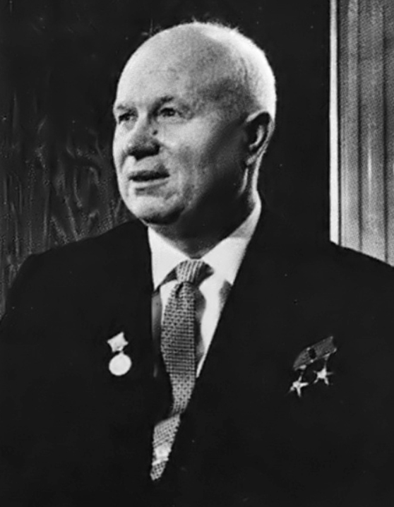
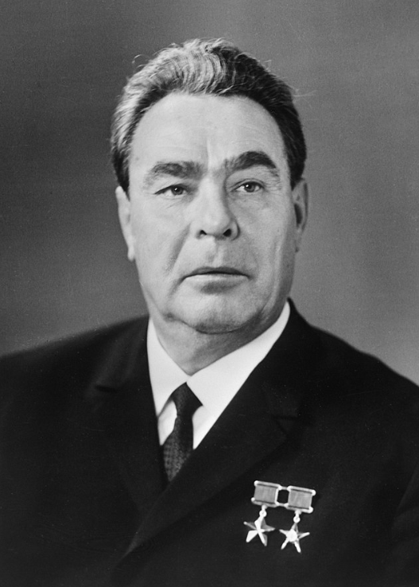

# Opposition to Soviet Control in Hungary & Czechoslovakia

## Nagy's Reforms in Hungary

> **Spec point** — `spcpt_X2xWR3NTgFZx79kq`

## Nagy's Reforms in Hungary

### Soviet leader: Nikita Khrushchev

*A photograph of Nikita Khrushchev*

| The ***USSR***'s ***dictator***** Joseph Stalin died on 5th March 1953**. After a three-year ***power struggle***, Khrushchev took the position of ***General Secretary***** **of the USSR **in 1956**. To the world, Khrushchev marked a change in the leadership style of the USSR.  - At the **20th Party Congress in 1956**, Khrushchev ***denounced*** Stalin's leadership    - The three-hour 'Secret Speech' **accused Stalin of abusing his power**   - Khrushchev stated the need for 'peaceful co-existence' with the West - Khrushchev began a process called '***De-Stalinisation***'    - He released a large number of political prisoners   - He lifted some ***censorship*** of information   - He increased the number of** consumer goods** in the USSR  In reality, Khrushchev could not implement too much ***capitalism*** and ***democracy*** into a ***communist*** dictatorship. |
|---|

> **Exam Hint**
> Students often struggle to spell 'Khrushchev.' Try to remember that his name contains three h's and that the root of the word spells 'rush'.

- Hungary's communist leader, Mátyás **Rákosi, harshly controlled the country**

  - He stated he wanted Hungary to become a 'country of iron and steel'
  
    - This was despite the fact that Hungary had no iron ***ore***
  - Hungary suffered from **fuel shortages and poor *****harvests***
- In **October 1956**, there were **violent protests** in Hungary's capital, Budapest

  - Hungarian students led a peaceful demonstration asking for more political and personal freedom
  
    - Hungary's ***secret police*** arrested protestors and used tear gas to end the march
    - When the students attempted to free the arrested, the police shot at the protestors
  - **Soldiers joined the student protestors**
  
    - The Hungarian Communist government requested military support from the USSR
  - By** 24th October, the USSR had restored order** in Budapest
- Khrushchev decided to change the leadership of Hungary

  - He replaced **Rákosi with Ernö Gerö**
  
    - Gerö was unpopular and demonstrations occurred in Hungary
    - The USSR allowed a new government to be created under **Imre Nagy  **
- Khrushchev believed that Nagy would resolve the unrest in Hungary

  - The people liked Nagy
  - Limited reforms would stop Hungarians from protesting

#### What Reforms Did Nagy Propose for Hungary?

![A flowchart showing key elements of Imre Nagy’s reforms in 1956 and their implications.

Central pink box:

Imre Nagy’s Reforms

Linked reforms (orange boxes):

Reorganising the government

Releasing political prisoners

Withdrawing Soviet troops from Hungary

Leaving the Warsaw Pact

Supporting details (grey boxes):

This would end the Communist one-party state in Hungary

He believed the government should include non-Communist politicians

The Communist government arrested many people for ‘crimes against the state.’ Many were innocent

Nagy persuaded Khrushchev to remove Soviet troops from Budapest. This was popular among the people

On 1st November 1956, Nagy announced that Hungary would withdraw from the Warsaw Pact](../../../assets/9e745e1ab829-nagys-reforms-mind-map.png)

*A concept map showing the areas of reform that Nagy attempted to introduce in October-November 1956*

- **Khrushchev allowed Nagy some freedom to reform**

  - The protests in Hungary made Communism look bad to the West
- Khrushchev **could not accept Hungary’s withdrawal from the *****Warsaw Pact***

  - The USSR needed Hungary to remain in the Warsaw Pact
  
    - Khrushchev may have needed Hungarian troops to ***suppress***** uprisings** in other satellite states
    - Hungary's withdrawal may have **prompted other *****satellite states*** to do the same
    - The USSR relied upon the ***collective security***** of pro-Communist states**. The satellite states would not protect the USSR if they did not have to
  - Khrushchev did not want any more independent Communist states in Eastern Europe
  
    - ***Yugoslavia***, under the leadership of Tito,** broke away from the USSR's** influence in 1948
    - Yugoslavia became closer to the West by accepting military support from ***NATO***. Tito explored different versions of Communism that undermined the USSR
    - Khrushchev did not want other satellite states to form alliances with Yugoslavia

## Khrushchev's Reaction to the Uprising

> **Spec point** — `spcpt_v8YF3vGDkKhJqcSP`

## Khrushchev's Reaction to the Uprising

![A flow diagram explaining Khrushchev's reaction and punishment of the Hungarian Uprising. The flowchart states "Khrushchev sent an invasion force of 1,00 tanks to Hungary on 4th November 1956. Nagy and his supporters fought the invasion force. This is called the Hungarian uprising. Nagy contacted the West, begging them to send military assistance to Hungary. The Soviet invasion force brutally attacked the Hungarians. Historians estimate that the invasion force killed 30,000 Hungarians. This ended the uprising. Khrishchev established a stronger communist government in Hungary under the leadership of Janos Kadar. Nagy and members of his government sought refuge in the Yugoslav embassy. Kadar promised Nagy's safety. When Nagy left the embassy, Soviet spies kidnapped him. In July 1958, the Soviet government announced that Nagy had been executed. " ](../../../assets/c1578e69d3d2-50649-hungarian-uprising-flow-diagram.png)

*A flow diagram explaining Khrushchev's reaction and punishment of the Hungarian Uprising*

#### Causes and Consequences of the Hungarian Uprising

![A flow diagram showing the causes and consequences of the Hungarian Uprising.

Central pink box:

The Hungarian Uprising, 1956

Causes (green boxes on the left):

Fuel shortages and poor harvests

Discontent and protest about the lack of freedom in Hungary

Imre Nagy’s reforms

Consequences (blue boxes on the right):

Khrushchev’s tighter control over the Eastern Bloc through the Warsaw Pact

The USA’s reputation as a protector of freedom is ruined

Worsening relations between the USA and the Soviet Union into the 1960s](../../../assets/567c137a0731-hungarian-uprising-multi-flow-diagram.png)

*A flow diagram showing the causes and consequences of the Hungarian Uprising on the USA and the USSR*

> **Worked Example**
> **Study Source A. **
> 
> **What is the cartoonist’s message? Explain your answer using details of the source and your knowledge**
> 
> **7 marks**
> 
> **Source A: **A cartoon published in Hungary in 1956. The words on the coat covering the horse say, ‘Democracy, freedom, independence, our own way’. The words at the bottom say, ‘And what’s beneath it’. The figure on the right is a Soviet soldier
> 
> 
> 
> **Final answer:** **Partial answer:**
> 
> I believe that the people organising the Hungarian Uprising should not be trusted **(1)**. The cartoon shows the revolutionaries hiding under the banners of ’‘Democracy, freedom, independence’ **(1)**. This shows that the cartoonist believes that the revolutionaries do not want to change Hungary but want power for themselves. As the cartoon is from Hungary, it is surprising that it is not more supportive of the uprising. However, the cartoonist may be a Communist and support the USSR’s control of Hungary **(1)**.

> **Exam Hint**
> This style of question in Paper Two needs you to consider:
> 
> - What the **message of the source** is. Identify the event it is referring to and if it is presenting the event positively or negatively. In this example, the cartoonist has drawn about the Hungarian Uprising in a negative way
> - **Knowledge of the event**. This cartoon assumes that the reader knows about Imre Nagy’s reforms and the protests in Hungary. Add relevant own knowledge of these events to support your answer
> - The **purpose** of the cartoon. The cartoon was published in Hungary in 1956 by an unknown cartoonist. This makes it harder to understand the purpose of the source. Considering it is against the uprising, it could be inferred that the cartoonist is pro-Soviet or does not believe in the causes of the uprising.

## The Prague Spring Reforms

> **Spec point** — `spcpt_3Zn4CtnwCvnT4dPj`

## The Prague Spring Reforms

### Soviet leader: Leonid Brezhnev

*A photograph of Leonid Brezhnev*

| In July 1964, Brezhnev became the Second Secretary. This role essentially placed Brezhnev as **Khrushchev's *****successor***. Brezhnev was next in line for the leadership of the USSR. In **October 1964**, Brezhnev led a ***coalition*** **against Khrushchev** to become the First Secretary of the USSR.  Brezhnev believed that **Khrushchev had weakened the USSR**  - Unlike Khrushchev, **Brezhnev discussed important decisions** with his colleagues - Brezhnev had an ***authoritarian*** **style** of rule, similar to Stalin  Brezhnev marked a change in leadership style. No longer would the USSR allow any type of reform |
|---|

- There was a **growing desire for change in *****Czechoslovakia***

  - Life in Czechoslovakia was hard. People had **limited freedoms and low living standards**
  - The Czech government under Gottwald was unpopular with the Czech public
- **In 1968, the Czech Communist Party elected Alexander Dubcek** as First Secretary

  - This title gave Dubcek the responsibility of leading the Czech government
  - The **USSR approved the appointment** of Dubcek
- Dubcek was a ***devout*** Communist. He believed in:

  - The** upholding of the Warsaw Pact**
  - '***Socialism*** **with a human face**’. People in a communist state should be able to:
  
    - Express their opinion about communism
    - Raise concerns about their government without facing punishment
    - Gain access to a better quality of life
- In** April 1968**, the Czech government released a **series of reforms**. This period of reform is known as the **Prague Spring**

  - Prague was the capital of Czechoslovakia
  - A 'spring' refers to a period of new beginnings and political reform

![A diagram showing the Prague Spring reforms of April 1968, with the central box labeled “The Prague Spring Reforms, April 1968.” Connected to it are multiple surrounding boxes describing the changes considered or introduced during this period. These include: multi-party elections were considered for the future with no date set, relaxation of censorship, freedom to criticise the government without punishment, more power to local governments, reduced government control on Czech industry, increased trade with the West, more opportunities for Czech citizens to travel abroad, more power given to trade unions, and Castro appointed communists into his government.](../../../assets/06d254ba7d56-prague-spring-mind-map.png)

*A concept map showing the reforms suggested by Dubcek in the Prague Spring, April 1968*

## Brezhnev's Reaction to the Prague Spring

> **Spec point** — `spcpt_dXYH9s3NKkQ6Yj4m`

## Brezhnev's Reaction to the Prague Spring

- **Brezhnev demanded that Dubcek reverse the Prague Spring reforms**

  - **Dubcek ignored his request**
  - Dubcek invited **Ceausescu and Tito**, the leaders of Romania and Yugoslavia, for talks
  
    - This appeared to be an aggressive action against the USSR
    - Brezhnev could not allow Czechoslovakia to ***unify***** **with non-Soviet Communist states
- Brezhnev believed that he needed to **take urgent action against Dubcek** and the Prague Spring reforms

![A vertical flowchart describing key events during and after the Soviet invasion of Czechoslovakia in 1968.

At the top, the first box states: "On 28th August 1968, 500,000 Soviet troops invade Czechoslovakia. The troops had been provided by members of the Warsaw Pact."

The next box reads: "The Czech public do not fight against the Soviet troops. They peacefully protest by standing in front of tanks and giving the Soviet troops flowers. A student protestor, Jan Palach, burns himself to death in the centre of Prague."

The third box says: "Dubcek is arrested and sent to Moscow. The Soviet Union order him to reverse the Prague Spring reforms."

The final box at the bottom states: "Dubcek returns to Czechoslovakia. The Czech Communist Party replace Dubcek with Husak as First Secretary. Husak’s government reinforce Soviet power in Czechoslovakia, arresting thousands of Czech protestors."](../../../assets/07169089969c-soviet-response-to-prague-spring-flow-diagram.png)

*A flow diagram depicting how the USSR  suppressed the Prague Spring*

- Brezhnev ensured that Czechoslovakia remained under Soviet control for the next 20 years

  - **Husak remained loyal **to the USSR
  - The Czech government punished any signs of ***dissent***

#### Causes and Consequences of the Soviet Reaction to the Prague Spring

![A flow diagram showing causes and consequences of the Prague Spring and Soviet reaction.

Central pink box:

The Prague Spring and Soviet Reaction, 1968

Causes (green boxes on the left):

Low living standards in Czechoslovakia

The influence of Romania and Yugoslavia

Dubček and the policy of ‘Socialism with a human face’

Consequences (blue boxes on the right):

Suppression of the Czech public and the appointment of Husak

No military action by the USA against the Soviet Union

The creation of the Brezhnev Doctrine in September 1968](../../../assets/6986c05776e6-prague-spring-multi-flow-diagram.png)

*A flow diagram showing the causes and consequences of the Soviet invasion of Czechoslovakia in 1968*

## The Brezhnev Doctrine

> **Spec point** — `spcpt_RKgYbZQhmrZPcbf4`

## The Brezhnev Doctrine

- The Prague Spring **reinforced Brezhnev's beliefs**

  - Satellite states should** not attempt to reform Communism**
- The Brezhnev Doctrine:

  - Became public knowledge when it was published in the Communist newspaper, ****Pravda****, on **26th September 1968**
  - Listed Brezhnev's expectations for the satellite states

![A vertical flowchart explaining the beliefs behind Brezhnev’s Doctrine.

Top box (red):

The core beliefs in Brezhnev’s Doctrine

Box 1 (grey):

The actions of one communist country affect the reputation of all communist countries

Box 2 (grey):

The Warsaw Pact means that it is the responsibility of all communist countries to protect against a single country’s actions.
They must be willing to take action to stop one country from damaging communism

Box 3 (grey):

Reform in one country would damage communism. Instead of allowing reform to spread, communist countries should be prepared to fight against reforms](../../../assets/57f61259849d-brezhnev-doctrine-flow-diagram-2.png)

*A flow diagram showing the Brezhnev Doctrine*

> **Worked Example**
> **What was the Brezhnev Doctrine?**
> 
> **4 marks**
> 
> **Final answer:** **Answers:**
> 
> The Brezhnev Doctrine was a policy introduced by Brezhnev, who was the leader of the USSR** (1)**. It stated that the USSR would intervene in countries where Communist rule was under threat **(1)**. This reinforced the Warsaw Pact **(1)**. The doctrine was a response to the Prague Spring** (1)**.

> **Exam Hint**
> This question in Paper One requires you to state information you know about the Brezhnev Doctrine. The Cambridge IGCSE gives you **a point for each relevant piece of information** that you write. Therefore, do not spend any additional time trying to describe or explain each reason.
