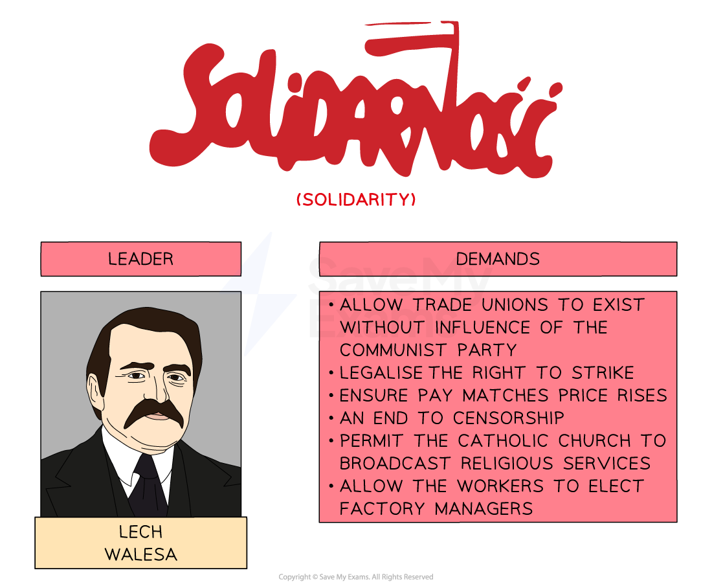
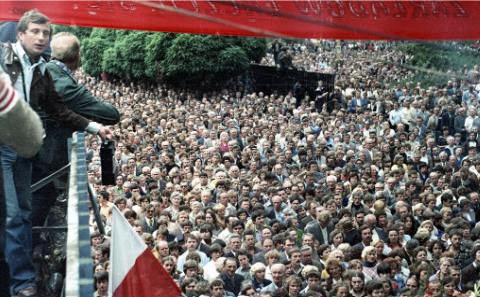
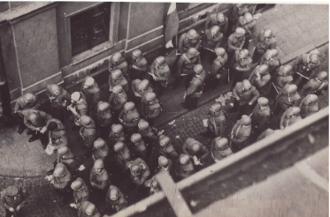
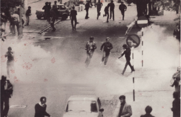

# Solidarity in Poland & the Decline of Soviet Influence

## Reasons why Poland Resisted Communist Rule

> **Spec point** — `spcpt_XTyPgFrV4j7gkbDJ`

## Reasons Why Poland Resisted Communist Rule

![A mind map centered on the question "Why did Poland resist communist rule?", with four key themes and supporting details:

Nationalism

Many people thought of themselves as Polish, not part of the USSR.

Poland had a strong national identity.

Hatred of Russia

Poland had been part of the old Russian Empire.

Russia had treated Poland poorly.

Religion

Communism believed in the abolition of religion.

Many people in Poland were Catholic.

Polish October

In 1956, Polish leader Władysław Gomułka introduced capitalist reforms to the economy.](../../../assets/d4723842188e-poland-and-communism-mind-map-1.png)

*A concept map showing why Poland did not accept Communism and Soviet rule*

## Who were Solidarity?

> **Spec point** — `spcpt_bWGKnsmsft7Wwcm4`

## Who were Solidarity?

- By the **late 1970s, Poland’s economy was struggling**

  - Poland's industry was **old-fashioned** due to a lack of funding
  - The Polish government hid the extent that the economy was failing
  - **Workers’ wages were much higher** than the workers’ productivity
- In **1980**, the government attempted to fix the economy by:

  - **Increasing the prices of *****consumer goods***
  - **Decreasing workers’ wages**
- The government’s measures resulted in:

  - Popular protest
  - Widespread strikes
  
    - The strike at **Lenin Gdansk Shipyard on 14th August 1980** led to the creation of **Solidarity**
    - Solidarity was a** *****trade union*** that developed into a protest movement

*An illustration showing the leadership and some of Solidarity’s demands*

- On **30th August 1980**, through negotiation, the **government agreed **to Solidarity’s demands

  - There were** 21 demands** in total

*A photograph showing the number of striking workers at the Lenin Gdansk Shipyard in August 1980*

*A photograph showing the number of striking workers at the Lenin Gdansk Shipyard in August 1980*

## Strengths of Solidarity

> **Spec point** — `spcpt_3JS9pmYDXKSMXffs`

## Strengths of Solidarity

| **Strength of Solidarity** | **Explanation** |
|---|---|
| Public support | By September 1980, Solidarity had **three million members**. By 1981, over **30% of Polish workers were members**, including one million from the Communist Party. The government could not ignore this amount of people |
| Organisation | Solidarity had a professional structure. It had a **newspaper called *****Solidarnosc***. Walesa was a popular and ***charismatic*** leader |
| Type of protest | **Walesa did not authorise the use of violent protest**. This meant that the ***USSR*** was less likely to intervene militarily as they had done in [Hungary and Czechoslovakia](https://www.savemyexams.com/igcse/history/cie/18/revision-notes/the-20th-century-international-relations-from-1919/how-secure-was-the-ussrs-control-over-eastern-europe-1948-c-1989/opposition-to-soviet-control-in-hungary-and-czechoslovakia/) |
| Popularity across industries | Solidarity had members across** all areas of Polish industry**. If Walesa called for a** *****general strike***, it could cause significant disruption in Poland |
| Attention from the West | Solidarity’s work was **well-reported in the West**. This gave widespread support for the movement. It also meant that the **USSR were cautious** about how to deal with Solidarity |

## Martial Law in Poland

> **Spec point** — `spcpt_rvVw9N7RD4Qjx8hK`

## Martial Law in Poland

![A flowchart showing the events leading to the suppression of the Solidarity movement in Poland:

February 1981: General Jaruzelski, head of the Polish Army, becomes Prime Minister of Poland.

He invites Lech Wałęsa to form a national government.

In reality, Jaruzelski and Soviet leader Brezhnev secretly plan to crush Solidarity.

13th December 1981: Jaruzelski announces that Solidarity is planning a coup and uses this as a pretext.

He arrests around 10,000 Solidarity members and declares martial law in Poland.](../../../assets/bbfd83489565-martial-law-in-poland-flow-diagram-1.png)

*A flow diagram showing the events that led to martial law in Poland*

### What Helped the Polish Government to Implement Martial Law?

- Solidarity was** fractured**

  - The Communist government had **encouraged *****factions***** to form** within Solidarity
  - People began to **argue over key policies** and aims of the movement
- The government implemented *martial law* because they had the **support of the USSR**

  - Brezhnev could not allow Solidarity to weaken Poland
  
    - The USSR relied on Poland for its ***metallurgy***
    - **Reforms would push Poland away from the USSR**
  - Brezhnev needed Poland to conform to the ***Warsaw Pact***
  
    - A government under Solidarity would want more freedom from the USSR
    - It may want to withdraw Poland from the Warsaw Pact

*A photograph showing the Polish Motorized Reserves of the Citizens' Militia (ZOMO) in action during martial law in Poland*

*A photograph showing disorder in Poland during martial law*

## How did Solidarity Show the Decline of Soviet Influence?

> **Spec point** — `spcpt_Q7Nt338qT67QftkS`

## How Did Solidarity Show the Decline of Soviet Influence?

- The actions of Solidarity showed that by the 1980s:

  - Millions of people were willing to** stand up against the *****Communist *****government**
  - The people **openly expressed** their desire for a better ***standard of living***
  - **Communist leaders continued** to be:
  
    - ***Corrupt***
    - Resistant to reform

> **Exam Hint**
> In your revision, it is helpful to consider** the ‘push’ and ‘pull’ factors **behind certain events.** **‘Push’ factors are events or motivations for someone to act. The Polish government were corrupt and did not want to reform. This ‘pushed’ people to support Solidarity and demand a better quality of life. ‘Pull’ factors are benefits from performing an action. If Solidarity gained power, Polish people hoped that they would improve the economy and introduce more freedoms. This ‘pulled’ millions of people to support Solidarity. Considering the ‘push’ and ‘pull’ factors will help you to **explain why Solidarity showed a decline in Soviet influence**.

> **Worked Example**
> **Describe the activities of ‘Solidarity’ in Poland during the 1980s**
> 
> **4 marks**
> 
> **Final answer:** **Answers:**
> 
> It organised strikes at the Gdansk shipyard in 1980 **(1)**. It made 21 demands to improve living and working conditions in Poland **(1)**. It won the support for its demands, having 3 million members **(1)**. It produced its own newspaper called *Solidarnosc ***(1)**.

> **Exam Hint**
> This question in Paper One requires you to state information you know about the Solidarity in Poland. The Cambridge IGCSE gives you **a point for each relevant piece of information** that you write. Therefore, do not spend any additional time trying to describe or explain each reason.
