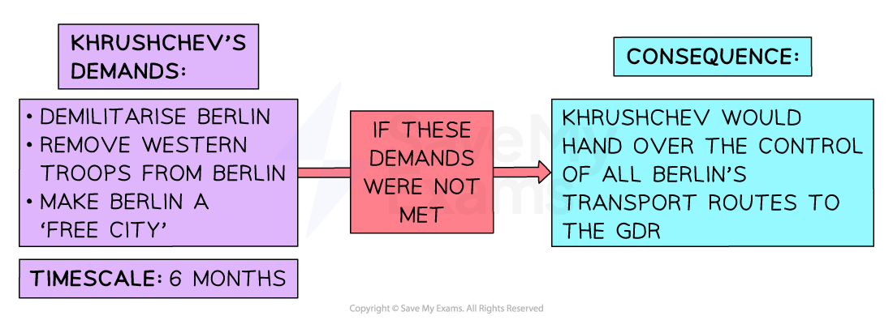

# Why was the Berlin Wall Built in 1961?

## The Refugee Crisis in Berlin by 1958

> **Spec point** — `spcpt_VFFJzXkXcHrwdbZc`

## The Refugee Crisis in Berlin by 1958

![A flowchart showing how World War Two led to the division of Germany and Berlin, which ultimately caused the Berlin Blockade and the formation of East and West Germany.

Top box (blue):

World War Two

Downward arrow labelled "Causes" leads to:

The division of Berlin into four zones

Arrow labelled "Causes" leads to:

Western powers to combine their zones (Trizonia)

Arrow labelled "Causes" leads to:

The Soviet Union to blockade Berlin

From here, the diagram splits into two branches:

Left-hand branch (West):

Causes → Western powers to create the FRG (Federal Republic of Germany)

Result: High living standards and freedom. Good economy

Right-hand branch (East):

Causes → Eastern powers to create the GDR (German Democratic Republic)

Result: Low living standards and restrictions. Poor economy](../../../assets/502328b01ff4-berlin-1945-50-flow-diagram.png)

*A flow diagram summarising the changes to Berlin from 1945 to 1950*

- The more formal division between East and West Germany had consequences for Berliners

  - The** *****FRG*** **gave access to more rights and freedom**
  
    - The FRG's** economy was strong** in the 1950s
    - The Western powers governed West Berlin as a ***democracy***
  - The ***GDR***** had many issues**
  
    - East Germans experienced **food shortages**
    - The ***USSR***'s economic policies had **not improved the East German economy**
    - Many East Berliners lived in **poor-quality houses **and **did not have freedom of speech or protest**
    - The ***secret police***,** the Stasi**, monitored ***dissent***. They arrested many East Germans, subjecting them to torture and imprisonment
- By the **1950s,** **many East Germans did not want to live under Soviet rule**

  - On **16th June 1953, East Berlin construction workers protested **against the East German government
  
    - The protest** spread across East Berlin** and multiple towns across the GDR
    - The USSR ***suppressed***** the revolt on 18th June 1953**
  - Many East Germans began to leave
  
    - There was ***free movement***** between East and West Berlin**
    - East Germans needed to reach East Berlin and travel to West Berlin
    - From **West Berlin, East Germans could fly to the FRG**
  - Fleeing East Germans created a ***refugee crisis***
  
    - This means that there were **too many people leaving East Germany**. West Germany struggled to house these new ***citizens***
    - East Germany had a significant **decline in its population**. There were not enough people to perform high-skilled jobs in the country

### How Serious was the Refugee Crisis?

- The number of people escaping the GDR through East Berlin became an increasing issue by the end of the 1950s
- **By 1958, approximately three million Germans had left the GDR**

  - This was a sixth of the population** **of East Germany at this time

![A line graph and a data table show the number of refugees leaving East Germany (GDR) each year between 1949 and 1961, according to both Western and Eastern sources.

Y-axis (vertical): Number of migrants/refugees (from 0 to 400,000)

X-axis (horizontal): Years from 1949 to 1961

Lines:

Purple (Western data)

Green (Eastern data)

Key trends:

Peak refugee movements occurred in 1953, with Western data showing over 330,000 and Eastern data over 270,000.

A second peak followed in 1956–1957.

Numbers fell sharply by 1959, reaching below 150,000 in Western estimates.

Small rise again in 1960–1961 before the building of the Berlin Wall.

Accompanying table (titled “Number of refugees leaving East Germany”) lists exact yearly figures from both sources. For example:

1953: 331,390 (West), 270,440 (East)

1956: 279,189 (West), 316,028 (East)

1959: 143,917 (West), 120,226 (East)

Data from Eastern sources is missing for 1949, 1950, and 1961.](../../../assets/c6580fea12dc-berlin-refugee-graph-and-table.png)

*A graph and table showing the number of East Germans leaving the GDR between 1949 and 1961. Data sourced from www.statista.com*

## Khrushchev's Ultimatum, November 1958

> **Spec point** — `spcpt_rNK9cFpbyTzwv67p`

## Khrushchev's Ultimatum, November 1958

### What is an Ultimatum?

- An ultimatum is when a person or country warns another that,** if they do not do or stop a certain action, an unpleasant consequence will happen**

  - The consequence is usually a **threat of physical violence or war**
- An ultimatum is usually delivered as a ***last resort***

  - Before delivering an ultimatum, a series of issues have to occur between the two countries
  - It indicates a **breakdown of effective communication** between two people or countries
- An ultimatum gives a** time limit** for a decision before the consequence occurs

  - The time limit is **usually short **to pressure the person or country to react

### What Did Khrushchev's Ultimatum Threaten?

- In October 1958, Khrushchev demanded that the** West recognise the GDR as an independent country** of the USSR

  - Since **1949**, many Western countries **refused to acknowledge that Germany had formerly split** into two nations
  - The USA hoped that Germany would become one country soon. It refused to accept Khrushchev's demand
- On** 27th November 1958**, Khrushchev issued his ultimatum to the West

*A diagram showing the demands and consequences Khrushchev threatened with his ultimatum on 27th November 1958*

- Khrushchev's ultimatum put the **USA in an awkward position**

  - Asking for Berlin to become a 'free city' showed the **USSR as a peaceful nation**
  
    - If the **USA refused**, it would make them look **power-hungry **
    - In reality, **Khrushchev had no intention to make Berlin independent**. He wanted to incorporate the whole of Berlin into the USSR
  - Giving control of Berlin's transport network to the GDR played a clever political tactic
  
    - To secure access to West Berlin, the West would have to enter into negotiations with the GDR
    - This would **force the USA to acknowledge that the GDR was an independent country** and Germany was not ruled as one nation

## Building the Berlin Wall, 1961

> **Spec point** — `spcpt_KjmvjQcpsSfw6TF7`

## Building the Berlin Wall, 1961

![A flowchart explains how tensions over Berlin led to the construction of the Berlin Wall:

By 1958, around 3 million Germans had left East Germany (GDR) for the West.

On 27th October 1958, Khrushchev issued an ultimatum demanding that Western troops leave Berlin and that the city be made a free city.

Peace talks between East and West took place from 1959 to 1961, but were largely unsuccessful.

Relations worsened due to President Kennedy’s election and the U-2 spy plane incident, which undermined trust.

In August 1961, Khrushchev gave up on negotiations and built the Berlin Wall to stop the flow of East Germans escaping to West Berlin.](../../../assets/9bfbfba0d672-49069-berlin-wall-flow-diagram.png)

*A flow diagram explaining the steps taken by the USA and the Soviet Union towards the building of the Berlin Wall in 1961*

- The situation in Berlin required Khrushchev to act quickly

  - The failure of the ***Vienna Summit*** **in June created fear among East Germans**
  
    - Over **40,000 East Germans **escaped the GDR through Berlin in one day in **August**
  - Walter Ulbricht, the leader of the GDR, urged Khrushchev to act quickly to prevent more East Germans from leaving
- On **12th August 1961**, under nightfall, the **East German government placed *****barbed wire***** between East and West Berlin**. They stationed guards near the divide
- The Berlin Wall developed from barbed wire to a **concrete structure during the 1960s**

![A labelled diagram showing the structure of the Berlin Wall during the Cold War, depicting the heavily fortified border between West Berlin and East Berlin. On the left side, representing West Berlin, there is a 3.6-meter-high wall designed to prevent people from climbing. Adjacent to the wall is a ditch and a sand bank. Further along is a patrol path where two border guards with a dog are walking. A tall watchtower stands nearby, providing a clear view over the area.

On the right side, representing East Berlin, there is a second fence that is electrified, behind which lies a row of metal spikes designed to prevent escape attempts. The area between the two sides includes multiple barriers and security features intended to deter and prevent crossing from East to West Berlin. The diagram uses text labels and a cutaway view of buildings to illustrate the layout and physical elements of the border security system.](../../../assets/b3ad56e4cfd7-berlin-wall-diagram.png)

*An illustration showing how the Berlin Wall had developed by 1983*

> **Worked Example**
> **Why was the Berlin Wall built in 1961? **
> 
> **6 marks**
> 
> **Final answer:** **Partial answer:**
> 
> One reason why the Berlin Wall was built was because of the refugee crisis **(1)**. Many East Germans were unhappy with living conditions and used the free movement between East and West Berlin to migrate to West Germany. By 1958, approximately three million Germans had left the GDR **(1)**. This motivated East Germany to build the wall. They could not allow more people to leave the GDR because it impacted the economy and the reputation of Communism. The wall made it harder for people to leave **(1)**.

> **Exam Hint**
> In Paper One, ‘explain why’ questions are worth either six or ten marks. For full marks in this question, an examiner is looking for **two fully explained reasons **as to why the Berlin Wall was built. Use the PEE structure in your answer:
> 
> - **P - **Make a **p**oint about the question
> - **E -** Use **e**vidence that supports the point that you have made
> - **E - E**xplain why this evidence caused East Germany to build the wall. Avoid repeating the point again. Explain how this factor caused the GDR to take the extreme measure of building a physical divide between East and West Berlin.

## Consequences of the Berlin Wall

> **Spec point** — `spcpt_T7nNfgBW6vCt7BYD`

## Consequences of the Berlin Wall

- The construction of the Berlin Wall had **devastating consequences for the people of Berlin**

  - As there had been free movement between East and West Berlin, many people travelled between the two sectors to **visit family and friends or for work**. As a result, many people became **stuck in East Berlin**
  
    - The wall **separated German families and friends for years**
  - Many East Germans continued to attempt **escape plans to West Berlin**
  
    - The **GDR killed over 130 people** attempting to go over, around or under the Berlin Wall between **1961 and 1989**. Escape plans included:
  - In **1962**, the failed escape attempt by** Peter Fechter** caused **international outrage**
  
    - The **GDR border guards shot Fechter** when he attempted to escape
    - Fechter fell into*** no-man's-land**** *between the GDR and FRG. **The FRG border guards could not go and rescue Fechter**. The GDR border guards did not attempt to treat Fechter's injuries
    - **Fechter died of his injuries 45 minutes after he was shot**. After he had died, the East German border guards removed Fechter's body. The nature of Fechter's death **damaged the GDR's reputation**

### Impact on US-Soviet relations

| **Negative outcomes of the Berlin Wall** | **Positive outcomes of the Berlin Wall** |
|---|---|
| The USSR authorised the construction of the Berlin Wall without consulting the US government. It demonstrated that the **USSR did not value the West's opinion** | **West Berlin remained independent of Communist influence**. It became a symbol of freedom across Europe |
| The possibility of **uniting Germany into one country seemed further away** than ever after the building of the Berlin Wall | **The Berlin Wall created a** ***stalemate***. Khrushchev had failed to incorporate Berlin into the USSR. Kennedy had shown that Khrushchev could not bully the USA out of Berlin |
| East Germans found it much **more difficult to escape the GDR**. The USSR gained a reputation for repressing its own people | The ***migration*** of millions of East Germans was **no longer an issue** between the two countries |
| The Berlin Wall created a physical divide to match the ***ideological*** divide between East and West. It became **a symbol of the Cold War until 1989** | The Berlin Wall meant there was** less chance of a nuclear war** developing over Berlin. Kennedy stated: "A wall is a hell of a lot better than a war.” |

### Kennedy's 'Ich Bin Ein Berliner' Speech

- ** President Kennedy visited West Berlin in June 1963**

  - Thousands of West Berliners gathered to see Kennedy
  - They placed flowers on his route through West Berlin and chanted his name
  - Kennedy was a symbol of freedom for the West Berliners
- On **26th June 1963**, Kennedy addressed the West Berliners in what is now known as the '**Ich bin ein Berliner**'** ('I am a Berliner') speech**

![An illustration of U.S. President John F. Kennedy delivering a speech at a podium, with three key quotes from his famous "Ich bin ein Berliner" address in 1963, condemning the Berlin Wall:

"All free men, wherever they may live, are citizens of Berlin. And, therefore, as a free man, I take pride in the words — 'Ich bin ein Berliner.'"

"[The wall is] an offense against humanity, separating families, dividing husbands and wives and brothers and sisters, and dividing a people who wish to be joined together."

"Freedom has many difficulties and democracy is not perfect. But we have never had to put a wall up to keep our people in — to prevent them from leaving."](../../../assets/5f0c5666053d-ich-bin-ein-berliner-quotes.png)

*An image showing the important messages from Kennedy's 'Ich bin ein Berliner' speech on 26th June 1963*

> **Worked Example**
> **Study Sources F and G**
> 
> **How far does Source F make Source G surprising? Explain your answer using details of the sources and your knowledge**
> 
> **8 marks**
> 
> | **Source F: **Instructions from the Soviet government to Soviet diplomats in East Germany in September 1953  **TOP SECRET**  *The proposals for the establishment of border security between East Berlin and West Berlin are politically unacceptable. You should meet with Ulbricht and tactfully explain the following.*   *These measures would place under suspicion the sincerity of the governments of the Soviet Union and East Germany, which consistently speak out for German unification and the conclusion of a peace treaty, and would bring serious harm to our political successes in West Germany. These measures would break down the order in city life, bring disorganisation to the city economy, and would negatively affect the interests of the inhabitants of East and West Berlin, causing anger toward the East German government and the Soviet authorities in Germany.*   *It should also be kept in mind that the establishment of border security along the border of East Berlin would worsen the Soviet Union’s relations with the USA, Britain and France, which would be a definite disadvantage to the countries in the camp of peace and democracy* |
> |---|
> 
> | **Source G: **From Khrushchev’s memoirs, published in 1971  *The establishment of border control in 1961 straightened things out at once. Discipline in East Germany increased. Factories began working better. So did collective farms. Comrade Ulbricht informed us that there were immediate improvements in the economy of East Germany. The population of West Berlin had been shopping for food in East Berlin, taking advantage of lower prices there. Thus, the West Berliners had been devaluing the East German mark, placing a heavy burden on the shoulders of East German peasants and workers, and therefore extracting political as well as economic gains from the situation. Once we established border control, we put an end to this.* |
> |---|
> 
> **Final answer:** **Partial answer:**
> 
> After looking at Source F, it does not make Source G look surprising **(1)**. This is because of the length of time between the production of both sources. Source F was written in 1953. This was when the refugee crisis was worsening but before Khrushchev issued his ultimatum in 1958. It is a secret document **(1)**. In comparison, Source G was written in 1971. This was ten years after the wall was built. Khrushchev’s memoirs were published **(1)**. As a result, it is unsurprising the two sources differ. Source F is a secret discussion expressing concerns about dividing Berlin whereas Source G publicly supports the decision to build the wall, knowing it was effective **(1)**.

> **Exam Hint**
> To answer this style of question in Paper Two, you should aim to:
> 
> - **State how surprising the information in Source F is to Source G**. To do this, you need to understand the different outlooks of both sources on a specific event. Ensure you clearly state in a sentence if Source F makes Source G surprising
> - **Use quotes from both sources**. This is needed to show where the sources differ
> 
> Compare the two sources, using your **own knowledge**. In this example, you could discuss how it is surprising because Source F states how dividing Berlin would ruin the economy whereas Source G shows how the wall bettered the GDR’s economy
