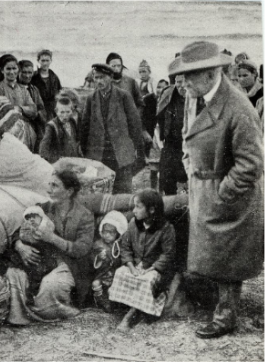
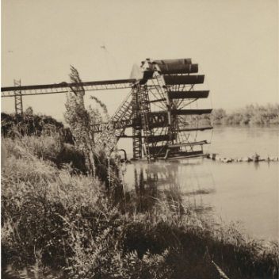
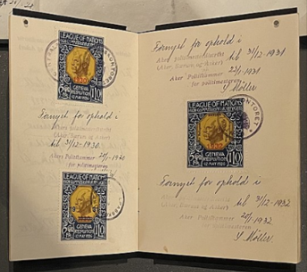
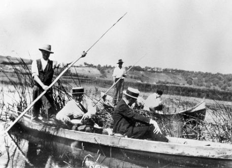

# How Important was the League’s Humanitarian Work?

## The League of Nations and Refugees: The Refugees Committee

> **Spec point** — `spcpt_qVzMGVVhrXq5ZrVq`

## The League of Nations and Refugees: The Refugees Committee

- One of the areas of success for the League of Nations was its humanitarian work

  - Humanitarianism refers to actions that **aim to improve people’s lives** and end world suffering
  - Improving people’s **working and living conditions** was a key aim of the League
- **The League established agencies **to deal with humanitarian issues

  - Each agency dealt with** one specific issue**
  - Some commissions were permanent while others were temporary

| **Reason for existence** | **Aims** | **Successes** | **Weaknesses** |
|---|---|---|---|
| - The First World War caused **thousands of people to flee their homes** to escape the conflict - The conflict destroyed some areas | - ***Repatriate**** ***citizens**, especially in the Balkans, Greece, Armenia and Turkey - **Improve standards in *****refugee *****camps** | - **425,000 *****displaced ***people returned to their homes or their country - **Reduced the number of refugees dying from diseases like *****cholera*** | - The Refugee Committee **lacked the funding **it needed to resolve the ***refugee crisis*** |

*Fridjof Nansen, head of the Refugees Commission, with Greek refugees (1922)*

*A steel irrigating wheel built by the League of Nations for Assyrian refugees (1939) Image courtesy of the Library of Congress*

*A Nansen passport, used by the League from 1922 to 1938, to allow stateless refugees to travel*

## The League of Nations and Health: The Health Committee

> **Spec point** — `spcpt_bmCg9V7zGpNxqJF5`

## The League of Nations and Health: The Health Committee

| **Reason for existence** | **Aims** | **Successes** | **Weaknesses** |
|---|---|---|---|
| - **The First World War **showed how different healthcare was around the world - **The Spanish Flu (1918-1920) **infected a third of the population and killed around 50 million people | - ***Eradicate**** ***dangerous diseases** - Educate the general public on **hygiene** - Working with charities to increase **disease prevention** - Created medical research projects and **institutes** | - Worked with non-League countries - **Prevented a typhoid *****epidemic***** in the *****USSR*** - Established research institutes in London, Copenhagen and Singapore - Introduced **vaccines for *****malaria***** **and killed infected mosquitoes | - Work impacted due to the **lack of funding in the *****Great Depression**** *(1930s) |

*The League’s Malaria Commission on the River Danube in 1929. The Commission is collecting mosquito larvae to reduce the spread of malaria. Image courtesy of Wellcome Trust*

## The League of Nations and Working Conditions: International Labour Organization

> **Spec point** — `spcpt_TtVx6QrTkXgqf2sg`

## The League of Nations and Working Conditions: International Labour Organisation

| **Reason for existence** | **Aims** | **Successes** | **Weaknesses** |
|---|---|---|---|
| - **Poor working standards **across the world - **A rise in *****communism ***due to the unhappiness of workers | - Place limits on working hours - **Collect data and publish advice** on working practices - **Improve health and safety** in the workplace | - Banned poisonous lead paint - The working week was **restricted to 48 hours** - In **1928**, 77 countries agreed to a ***minimum wage*** - ***Collaborated*** with workers, ***trade union***** **representatives and governments | - The ILO could only **recommend, not make laws** - Countries rejected the ILO’s suggestions, for example **banning children under 14** from working and the eight-hour working day |

## The League of Nations and Slavery: The Slavery Commission

> **Spec point** — `spcpt_chsDzSvnM29RK9Kc`

## The League of Nations and Slavery: The Slavery Commission

| **Reason for existence** | **Aims** | **Successes** | **Weaknesses** |
|---|---|---|---|
| - European *empires* were **not tackling the issues of slavery** in their colonies, especially in **East Africa** | - Abolish slavery worldwide | - **Freed 200,000 enslaved people **in Sierra Leone - Organised** raids** to disrupt Burmese slave traders - **Reduced the death rate **of workers on the Tanganyika Railway from 50% to 4% | - **No agreed procedures** for reviewing slavery in the countries of member states |

| ***Article 2***  *The High Contracting Parties undertake, each in respect of the territories placed under its sovereignty, jurisdiction, protection, suzerainty or tutelage, so far as they have not already taken the necessary steps:*  *(a)To prevent and suppress the slave trade;*  *(b)To bring about, progressively and as soon as possible, the complete abolition of slavery in all its forms.* |
|---|
| An extract from the League of Nations Convention to Suppress the Slave Trade and Slavery (25th September 1926) |

## Other Humanitarian Commissions

> **Spec point** — `spcpt_9CnT8fKmqZXPR823`

## Other Humanitarian Commissions

![A diagram showing some of the other commissions of the League of Nations, organised into three areas: Disarmament, Mandates, and Economic.

Centre title box: "Other League of Nations Commissions"

Disarmament Section:

Main aim: “Encouraged all countries to reduce their weapons and armed forces.”

Success (green): “The Washington Naval Agreement and Locarno Treaty embraced by League.”

Weakness (red): “The Disarmament Conference not held until 1932.”

Mandates Section:

“Supervised the former colonies of Germany and the Ottoman Empires.”

Economic Section:

Successes (green):

“Helped Austria (1922) and Hungary (1923) through loans.”

“Helped struggling economies after the First World War.”

Weakness (red): “Help stopped during the Great Depression.”](../../../assets/3eba761928ed-league-commissions-mind-map-1.png)

*A concept map showing some of the League’s other humanitarian commissions*

> **Worked Example**
> **Describe the humanitarian work of the League of Nations**
> 
> **4 marks**
> 
> **Final answer:** **Answers:**
> 
> The League attempted to repatriate victims of the First World War through the Refugees Committee **(1)**. The Health Committee aimed to eradicate diseases such as malaria by capturing and destroying mosquitoes **(1)**. The ILO attempted to improve workers' rights by restricting the working week to 48 hours **(1)**. The Slavery Commission freed 200,000 enslaved people in Sierra Leone **(1)**.

> **Exam Hint**
> This question in Paper One requires you to state information you know about the League’s humanitarian work. Try to make four specific comments about different aspects of the League’s humanitarian commissions.

> **Worked Example**
> **Study Source A. Are you surprised by this source? Explain your answer using details of the source and your knowledge**
> 
> **8 marks**
> 
> | **Source A:  **From a speech by Seán Lester, Secretary-General of the League of Nations. He was speaking to the Assembly during the last session of the League in 1946 when it dissolved itself  *It is common to speak of the failure of the League. Is it true that all our efforts for those twenty years have been thrown away? The work of the League is unmistakably printed on the social, economic and humanitarian life of the world. But above all that, a great advance was made in the international organisation of peace. For the first time an organisation was constructed to abolish war. An Assembly representing some fifty peace-loving nations. *  *For ten years the League advanced. Our balance-sheet is not altogether unfavourable. In the essential task of maintaining peace it succeeded during a number of years. It succeeded as long as the governments of the Great Powers supported it and as long as, in the background, there was the possibility that their force would be put at the service of its decisions. During a number of years the League of Nations settled various grave disputes such as the Aaland Islands, all of them involving areas which might have become battlefields if the League had not settled them.* |
> |---|
> 
> **Final answer:** **Partial answers:**
> 
> I am not surprised by Source A **(1)**. One reason for my opinion is because of the author of the source. Sean Lester was the Secretary-General of the League of Nations. Due to his position in the organisation, he would be more likely to defend against the accusation that the League of Nations failed **(1)**. Within his speech, Lester highlights the positive impact of the League’s existence by stating “The work of the League is unmistakably printed on the social, economic and humanitarian life of the world” **(1)**. This is an area of the League’s work that succeeded, for example, the International Labour Organization (ILO) reduced the working week to 48 hours **(1)**.

> **Exam Hint**
> This is a question that may appear on Paper Two. To answer this question fully, consider:
> 
> - Who created the source. Consider the person’s occupation and how much they would know about the event in question. Consider if this person has presented a **biased** opinion in the source due to who they are
> - The **strength of both sides** of the argument. In this example, you need to consider why this source may also be surprising. It was written in 1946, after the Second World War. Consider how the positive tone in this source may not have matched your expectations in this period of history
> 
> Concluding your thoughts with a reflection on the extent to which you are surprised by the source. Use words like '**partially**' or '**fully**' to explain this
