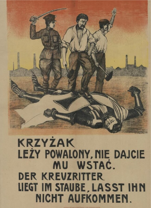

# The League of Nations Attempts at Peacekeeping in the 1920s

## Aims and Methods of Peacekeeping

> **Spec point** — `spcpt_GkmdJhwMGhfWCkVs`

## Aims and Methods of Peacekeeping

- There were several** border disputes** after the ***Versailles Settlement***

  - The end of the ***Ottoman*** **and Austro-Hungarian empires **caused the formation of new countries like Poland
  
    - These** new countries took land away **from previously powerful countries like Germany and Austria
  - Where the Allies drew new boundaries, it caused international tensions
  
    - Conflicts occurred in ***borderlands***
    - Some countries attempted to** invade other countries for land **
- The League of Nations promised to protect members from border disputes

  - Article 10 of the ***Covenant*** insisted on ‘**collective security**’. This meant that:
  
    - If an aggressive country attacked one League member, it attacked all members of the League
    - The League of Nations could create a **combined League army** to defend the country from the aggressor
  - Collective security aims to:
  
    - Make member countries feel **safer**
    - **Deter war**
- Other methods that the League of Nations could use for peacekeeping were:

  - **Moral *****condemnation***: Use their influence to disapprove of an action
  - **Trade *****sanctions***: Impose trade ***boycotts*** on aggressive countries
  - **Compensation**: Money paid to the innocent country from the aggressor as an apology for their actions
  - Use the **Conference of Ambassadors**: An organisation that oversaw the Versailles Settlement. It had ambassadors from Britain, France and Japan that worked with the League to resolve disputes
  - ***Plebiscites*****:** The population of a contested region decides who governs it
  - **Do nothing**: The League did not interfere with some disputes. For example, the French invasion of the Ruhr
- Overall, the League’s attempts to keep peace in Europe had **mixed results**

## Vilna, 1920

> **Spec point** — `spcpt_K2rvzvNTfXjXfrsY`

## Vilna, 1920

![A flow diagram explaining the Vilna dispute as a failure of the League of Nations:

Top box: “Under the Versailles settlement, Lithuania and Poland became independent countries.”

Second box: “Vilna was a large city in south Lithuania. The people of Vilna wanted to be a part of Poland instead.”

Third box: “In response, Poland sent an army to capture Vilna. Lithuania appealed to the League of Nations for help.”

Below this is an illustration of five suited men sitting at a desk with three of them raising their hands, representing the League's vote.

Response of the League (pink box): A speech bubble says: “Poland, you must withdraw your troops from Vilna!”

To the right:

A large red stamp-style label reads “FAILURE”.

Outcome (grey boxes):

“Poland refused to remove their troops”

“Vilna became part of Poland”](../../../assets/398d2120acae-vilna-dispute-1.png)

*A flowchart showing the reasons for the Vilna dispute, the League’s reaction and the eventual outcome*

### Significance of the Vilna Dispute

- **It undermined the League’s power**

  - It was the first time that an invaded country requested the help of the League
  - The League did not fulfil its *pledge* for *collective security*
- It showed the** reluctance of the permanent members to raise an army**

  - France did not want to upset Poland
  
    - They saw Poland as a potential** *****ally***
  - Britain did not want to act without the support of other members

## Aaland Islands, 1920–1921

> **Spec point** — `spcpt_MNmfYFvQYQvNVg34`

## Aaland Islands, 1920–1921

![A flowchart explaining the League of Nations’ successful handling of the Aaland Islands dispute:

Top box: “The Versailles Settlement changed countries’ borders in Europe.”

Second box: “Both Sweden and Finland wanted to own the Aaland Islands. Historically, they were Finnish but the population wanted to be a part of Sweden.”

Third box: “Both countries approached the League to investigate and come to a decision.”

Below is an image of five suited men (representing the League) at a desk with three of them raising their hands.

Response of the League (pink box): “The Aaland Islands should remain Finnish!”

To the right is a large green stamp-style label: SUCCESS

Outcome (grey box):

“The League insisted that the Aaland Islands have no soldiers or weapons. Both Sweden and Finland accepted the League’s decision.”](../../../assets/f0849d786182-aaland-islands-dispute-1.png)

*A flowchart showing the reasons for the Aaland Islands dispute, the League’s reaction and the eventual outcome*

### Significance of Aaland Islands Dispute

- One of the **biggest successes **of the League of Nations
- If both members respected the League of Nations, they:

  - Would ask the League for help in their dispute
  - **Accept the League’s decision**

## Upper Silesia, 1921

> **Spec point** — `spcpt_YgFVtkHZx8Zt4qbq`

## Upper Silesia, 1921

![A flowchart explaining the Upper Silesia dispute and how the League of Nations responded:

Top box: “Upper Silesia was an industrial region between Germany and Poland. Before the First World War, the land belonged to Germany. Many Poles were treated poorly.”

Second box: “The Treaty of Versailles gave the region to Poland but many Germans still lived there.”

Third box: “Both countries made claims on the region in 1921 because the region produced iron and steel.”

Below this is an illustration of five suited men at a table (representing League delegates), with two raising their hands.

Response of the League (pink box): “We will give Upper Silesia a plebiscite. Britain and France, ensure the vote is fair!”

To the right is a bold orange label: NEITHER

Outcome (grey boxes):

“Germany won with 60% of the votes.”

“Poland believed many German voters did not live in the region.”

“The League gave Poland the industrial areas of Upper Silesia and Germany the rural areas.”](../../../assets/40aeef00609b-upper-silesia-dispute-1.png)

*A flowchart showing the reasons for the Upper Silesia dispute, the League’s reaction and the eventual outcome*

### Significance of the Upper Silesia Dispute

- Initially, the Upper Silesia dispute was a success for the League

  - **Both countries accepted its ruling**
- When the League’s solution ended in 1925, relations between** Poland and Germany worsened**

  - Poland argued that half of the population of Upper Silesia was Polish yet they received only a third of the land
  - Germany stated that the agreement took away a quarter of its coal mines

*A Polish poster from the plebiscite in Upper Silesia. Workers are standing on a symbol of imperial Germany. The text is written in Polish and German and states “The Crusader is in the dust. Don’t let him rise”*

> **Worked Example**
> **Why was there a crisis in 1921 in Upper Silesia?**
> 
> **6 marks**
> 
> **Final answer:** **Partial answer:**
> 
> One reason why there was a crisis in Upper Silesia was that two countries claimed the area** (1)**. Before the First World War, Upper Silesia was in Germany. However, Poles also lived in the area **(1)**. This caused a crisis because Poland and Germany wanted to protect their citizens living in the area by bringing the area under their sole government **(1)**.

> **Exam Hint**
> In Paper One, ‘explain why’ questions are worth either six or ten marks. To achieve all marks for this question, an examiner is looking for **two fully explained reasons **as to why there was conflict in Upper Silesia. Use the PEE structure in your answer:
> 
> - **P - **Make a **p**oint about the question
> - **E -** Use **e**vidence that supports the point that you have made
> - **E - E**xplain why this evidence caused a crisis in Upper Silesia. Avoid repeating the point again. Explain how this factor caused an issue in Upper Silesia that needed the League’s interventions

## Corfu, 1923

> **Spec point** — `spcpt_B49YbCpNbsGXVpRw`

## Corfu, 1923

![A flowchart explaining the Corfu Crisis of 1923 and the League of Nations' response:

Top box: “Corfu is an island in the Mediterranean Sea. It is a part of Greece.”

Second box: “An Italian general was murdered on the border between Greece and Albania in 1923.”

Third box: “The Italian dictator, Mussolini, was furious. He demanded that Greece pay Italy 50 million lira in compensation and execute the murderer. Greece refused.”

Fourth box: “Mussolini invaded Corfu in retaliation. Greece appealed to the League of Nations for help.”

Below this is an illustration of League delegates at a table, with some raising their hands.

Response of the League (pink box): “Italy, you must leave Corfu immediately!”

To the right is a bold red stamp: FAILURE

Outcome (grey boxes):

“Mussolini demanded that the Conference of Ambassadors should decide the outcome.”

“The Conference ordered Greece to pay Italy compensation.”

“Italy left Corfu.”](../../../assets/3f73ebfb110d-corfu-dispute-1.png)

*A flowchart showing the reasons for the Corfu Dispute, the League’s reaction and the eventual outcome*

### Significance of the Corfu Dispute

- Without the USA, the League **could not stand up to powerful countries** like Italy

  - Britain and France preferred not to get involved in the conflict
  - Mussolini had successfully bullied the League into giving him what he wanted
  - It set the standard by which **other aggressive leaders could manipulate the League**
- It demonstrated that organisations like the Conference of Ambassadors could** overturn the League’s decisions**

## Bulgaria, 1925

> **Spec point** — `spcpt_8yHNpcBMYxKm8csr`

## Bulgaria, 1925

![A flowchart explaining the League of Nations' response to the Bulgaria Crisis of 1925:

Top box: “In October 1925, a shoot-out occurred on the border between Greece and Bulgaria. A Greek officer was killed in the incident.”

Second box: “In retaliation, Greece invaded Bulgaria.”

Third box: “The League reacted quickly to the news of the invasion. It called a meeting in Paris.”

Below this is an illustration of League delegates at a table, with some raising their hands.

Response of the League (pink box): “Greece, you need to leave Bulgaria and pay £45,000 in compensation.”

To the right is a large orange label: NEITHER (implying the outcome was mixed or disputed).

Outcome (grey boxes):

“Greece complained that the League were hypocrites. The League were much kinder to Italy in the Corfu incident.”

“Greece left Bulgaria.”](../../../assets/8d81922edc1a-bulgaria-dispute-1.png)

*A flowchart showing the reasons for the Bulgaria Dispute, the League’s reaction and the eventual outcome*

### Significance of Bulgaria Dispute

- It showed the **inconsistencies** of the League’s rulings

  - Both the Corfu and Bulgaria disputes:
  
    - Involved the death of a military officer
    - Resulted in an armed invasion of a country
  - The League **did not punish Italy **for invading Corfu,** yet punished Greece** for invading Bulgaria
- The League was desperate **not to *****antagonise***** certain countries** that could start a war

  - As a result, the League did not rule fairly in all disputes
  
    - This **undermined their reputation** as a peacekeeping force

> **Worked Example**
> **Study Sources A and B. How far do these two sources agree? Explain your answer using details from the sources.**
> 
> **8 marks**
> 
> | **Source A: **Adapted from Peter J. Yearwood’s Article *Consistently with honour *taken from the *Journal of Contemporary History, *1986, referring to the Corfu crisis  *The Italian occupation of Corfu on 31 August 1932 confronted the League of Nations with what was recognised as its first major test. Many people thought, both then and later, that the League failed this test and that this was also a failure for the policy of Great Britain, which had appeared as the strongest champion of the League during the crisis.* |
> |---|
> 
> | **Source B: **Adapted from E. Wright’s *A Dictionary of World History *(2.ed.), 2006  *Following the bombardment by Italy in which 16 people were killed, Mussolini issued an ultimatum, demanding a heavy indemnity [compensation]. Greece appealed to the League of Nations, which referred the dispute to the Council of Ambassadors. The Council ordered Greece to pay 50 million lire. Under pressure from Britain and France, Italian troops withdrew. The outcome of the dispute raised serious doubts about the strength and efficiency of the League.* |
> |---|
> 
> **Final answer:** **Partial answer:**
> 
> Both sources agree that the League of Nations was weak in its decision-making regarding the Corfu incident **(1)**. After Mussolini invaded Corfu in 1923, he forced the League to reverse its initial decision and rule that Italy should receive compensation from Greece **(1)**. In Source A, Yearwood states that “the League failed this test.” Similarly, in Source B, Wright states that “the dispute raised serious doubts about the strength and efficiency of the League”**(1)**. Therefore, both sources agree that the League was wrong to allow Mussolini to change its decision **(1)**.

> **Exam Hint**
> When answering this style of question on Paper Two, consider:
> 
> - The event that the sources are discussing
> 
>   - Spend five minutes reading each source
>   - Annotate the key events that each source mentions
>   - Write some knowledge about the key event in both sources
> - How the sources agree
> 
>   - Find a quote in each source that agrees
>   - Add the quote to your answer using quotation marks
> - How the sources disagree
> 
>   - Find a quote in each source that disagrees
>   - Add the quote to your answer using quotation marks
> - The main message of the author
> 
>   - What is each’s authors opinion?
>   - Do the authors’ attitudes match or are they different?
