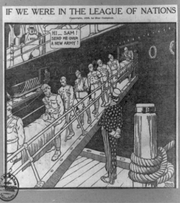
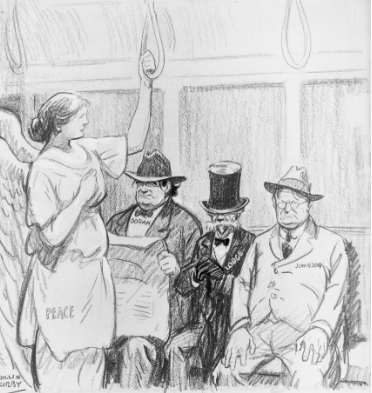

# Weaknesses of the League of Nations

## The Issues of Membership

> **Spec point** — `spcpt_SyX5z8RCrWBQryzV`

## The Issues of Membership

- The League of Nations went against Wilson’s vision

  - Wilson wanted **all nations to become members** of the League
  - He wanted the League to **work together** to improve the world

### Who Could Become Members of the League of Nations?

![A flowchart titled "Limitations of the League of Nations – Membership" in a red central box.

Above this are three grey boxes showing countries that did not join:

The USA: Senate blocked the bill to join

Germany: The Treaty of Versailles stated it could not join

The Soviet Union: Not allowed to join due to its communist beliefs

An orange box below those states:

The League did not contain key countries as members

Below the red central box is a beige box:

Britain and France

Beneath that, grey boxes explain limitations of Britain and France:

The most powerful members of the League

Both countries had been weakened by the First World War

Both countries had other priorities

Subpoints: France – the threat of Germany and Britain – its empire

To the right are two additional grey boxes:

Stopped using the League

Thought that the League was weak without the USA](../../../assets/5c15e9a79243-33225-league-membership-mind-map-2.png)

*A concept map showing the issues with the League of Nations’ membership in 1920*

### What Stopped the USA from Joining the League of Nations?

- The idea of the League of Nations was **unpopular** in the US

  - Many US citizens **did not want the USA to join the First World War**
  - US politicians were ***isolationists***
  
    - They believed that the League would **drag them into European conflicts**
- Americans did not want to help European nations:

  - In a war that caused ***casualties*** like the First World War
  - Maintain their ***empires***
  
    - Many Americans were against the idea of empires (anti-imperialist)
- Some Americans had **German** ***ancestry***

  - There was mass ***emigration*** from Europe to the US before 1914
  - German ***immigrants**** *felt sorry for Germany after the **Treaty of Versailles**
  
    - By supporting the League of Nations, Americans would be condoning the treaty
- US businesses feared the **League’s impact on trade**

  - If the League placed ***sanctions**** *on the USA, it would affect their ability to ***export***
- **Wilson became too ill to run for re-election in 1920**

  - Wilson undertook a 27-day train journey to win public support for the *Versailles Settlement* and the League of Nations
  - When he returned to Washington, he suffered a stroke
- The ***Republican*** candidate, **Warren Harding**, campaigned aggressively against the League of Nations

  - The ***Senate*** voted twice on the Treaty of Versailles and US membership to the League of Nations between November 1919 and March 1920
  - Wilson failed both times to get the Senate’s ***ratification*** of the bill
  - The public elected Harding as **president in 1921**

*A print created by Winsor Mccay in c.1920.  It shows Uncle Sam (a symbol of the USA) watching wounded and dead soldiers come off a ship. John Bull (a symbol of the UK) is asking for more soldiers Image courtesy of the Library of Congress*

*A cartoon by Rollin Kirby c.1920. It shows the figure of Peace being blocked from sitting by Senators Borah, Lodge and Johnson. The cartoon refers to the successful efforts of the Republican isolationists to block Senate ratification of the League of Nations*

## The Structure of the League of Nations

> **Spec point** — `spcpt_yRv8pmrj6zNBZnFV`

## The Structure of the League of Nations

- ***Contemporary*** critics argued that the structure of the League was its biggest weakness

![A flowchart showing the structure of the League of Nations.

At the top:
Assembly (purple box, left):

Each of the 42 founding members had one representative

Admitted new members

Policies needed full agreement

Met once a year

Council (purple box, right):

Smaller group

Met five times a year

Could sanction, condemn, or use military force against aggressive countries

In the centre:
Secretariat (light blue box):

Kept records

Managed all other League of Nations organisations

Below the Secretariat:
International Labour Organisation (ILO) (purple box, far left):

Improved working conditions

Worked with governments, businesses, and workers

Agencies (central purple box):

Included the Mandates Commissions, Refugees Committee, Slavery Commission, and Health Committee

Aimed to solve problems caused by WWI and the peace treaties

Permanent Court of Justice (purple box, far right):

Based in The Hague (Netherlands)

Settled legal disputes

Advised the Council on legal matters

Green arrows link the structure, showing relationships between the Assembly, Council, Secretariat, and committees.](../../../assets/f1c103556e31-organisation-of-the-league-1.png)

*A diagram showing the roles of the different bodies within the League of Nations*

#### Strengths and Weaknesses of the League’s Structure

| **Body** | **Strengths** | **Weaknesses** |
|---|---|---|
| Assembly | All members had **one vote**. This avoided the issue of one country dominating the assembly | - Only met **once a year** - All members had to agree on actions, making **decision-making slow** |
| Council | Met** five times** a year  They had three options for response:  - **Moral *****condemnation***: Use their influence to disapprove of an action - **Trade sanctions**: Impose trade ***boycotts*** on aggressive countries - **Military force**: Raise an army from membership countries  Made **quicker decisions** than the Assembly | - As permanent members, Britain, France, Japan and Italy used their ***veto***** powers** - Powerful members **blocked the actions** of other members - Without the power of the USA, the **Council’s decisions were weak** |
| Secretariat | Talented **experts** in multiple fields worked together in the Secretariat | **Expensive**  Grew **too large** as the League expanded its role |
| Permanent Court of International Justice | **Well-respected** in multiple countries  Member states contributed** legal experts** to this body | Could **not enforce** its judgements |

> **Worked Example**
> **What methods could the League of Nations use to deal with international disputes**
> 
> **4 marks**
> 
> **Final answer:** **Answers:**
> 
> The Council could use verbal moral disapproval for less serious actions **(1)**. The League could bring the two sides together for talks **(1)**. If a permanent member had an issue with another member, it could veto its decisions in the Council **(1)**. In serious cases, the League could ask its members to contribute to an army and use force to resolve a dispute **(1)**.

> **Exam Hint**
> This style of question does not require you to explain your answer. The Cambridge IGCSE gives you **a point for each relevant piece of information** that you write. Therefore, do not spend any additional time trying to describe or explain each reason.

## Why was the League's Failure Inevitable?

> **Spec point** — `spcpt_C4qFW2jkr26vZWKx`

## Why was the League's Failure Inevitable?

- **The absence of the USA weakened the League**

  - The League did not have one of the most powerful countries in the world as a member
  - The USA could ignore **any economic sanctions or military decisions** made by the Council
- **World leaders had different ideas about what the role of the League was**

  - **Wilson **believed that the League:
  
    - Would work like an **international parliament**
    - Should prioritise solving world issues rather than national issues
  - **Lloyd George **(British Prime Minister) believed that the League:
  
    - **Should only meet in emergencies**
    - Could help Britain build its empire using *mandates*
  - **Clemenceau **(French Prime Minister) believed that the League:
  
    - **Should protect France from invasion**
    - Should have a large army
