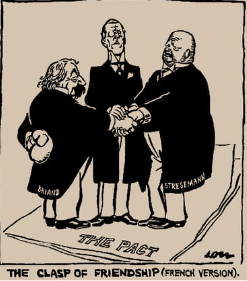

# What was International Diplomacy Like in the 1920s?

## The Washington Naval Agreement, 1922

> **Spec point** — `spcpt_NSkmXTVKrGXcCWwP`

## The Washington Naval Agreement, 1922

### What is International Diplomacy?

- International diplomacy is **how countries communicate **and work together

  - **This takes the form of negotiating alliances, treaties and agreements**
- When a country has a friendly *foreign policy*, international diplomacy is good
- When a country has an **aggressive foreign policy**, they do not want to make compromises, which affects diplomacy
- During the 1920s, international diplomacy was good
- However, countries **made agreements outside of the League’s influence**. This was because:

  - Important nations like the **USA, the *****USSR *****and Germany **[were not members](https://www.savemyexams.com/igcse/history/cie/18/revision-notes/the-20th-century-international-relations-from-1919/to-what-extent-was-the-league-of-nations-a-success/weaknesses-of-the-league-of-nations/)
  - The League was** slow at making decisions**

### The Washington Naval Agreement, 1922

| **Aims** | **Countries** | **Terms** | **Significance** |
|---|---|---|---|
| - Limit Japanese ***imperialism*** - **Ease tensions** in the Asia Pacific region - Work towards **naval *****disarmament*** | The USA,  Britain,  Italy and Japan  An additional agreement made with Belgium, the Netherlands, Portugal and China | - **Restrictions on the building of battleships**, ***battlecruisers**** *and aircraft carriers - **Britain and the USA** limited to ships weighing up to **533,000 tonnes** - **Japan** limited to ships weighing up to** 320,000 tonnes** | - The first treaty to **encourage disarmament** - Britain, France, Japan and Italy attended as **individual countries** rather than League representatives - **Did not restrict the number of ships. **This encouraged the development of lighter warships |

## The Rapallo Treaty, 1922

> **Spec point** — `spcpt_zNYH4KsGWTYwSGyB`

## The Rapallo Treaty, 1922

| **Aims** | **Countries** | **Terms** | **Significance** |
|---|---|---|---|
| - **Rebuild** both countries' **reputations** after the First World War - Resolve the USSR’s issues with the** Treaty of Brest-Litovsk** (1917) | Germany and the USSR | - **End of the USSR’s** ***reparations*** to Germany - **Trading agreements** between the two countries - The USSR would allow German soldiers to train secretly. The USSR also allowed German  **rearmament factories** - Friendly ***diplomatic *****relations** established | - **Angered the Allies** due to Germany making alliances without permission - The treaty was conducted secretly, **undermining the League of Nations** |

## The Locarno Treaty, 1925

> **Spec point** — `spcpt_nRfPG5QV85Y6hv58`

## The Locarno Treaty, 1925

| **Aims** | **Countries** | **Terms** | **Significance** |
|---|---|---|---|
| - Improve the **international reputation of Germany** - To** avoid conflict with France**. Their relationship had worsened after the French invasion of the Ruhr in 1923 | Germany, Britain, France, Italy and Belgium | - France and Germany promised to **keep peace** with each other - Germany **accepted its western borders** as stated in the 1919 Treaty of Versailles - All members promised to keep the Rhineland ***demilitarised*** - To explore the possibility of **admitting Germany into the League of Nations** | - The acceptance of the Treaty of Versailles **infuriated the *****extremist***** parties in Germany** - Germany entered into the treaty as **an equal** to the Allies. It was not a ***diktat*** - In **September 1926, Germany became a member of the League**. Additional countries in the League strengthened it as an organisation |

*A political cartoon called ‘Treaty of Locarno’ by David Low, 5th September 1925. It shows French Foreign Minister, Aristide Briand, with a boxing glove behind his back*

> **Exam Hint**
> Paper Two presents you with unseen sources and asks you a series of source analysis questions. Before the exam, study as many written and visual sources as you can on the specified core content topic. It may result in you knowing one of the sources that appears in the paper. David Low was born in New Zealand but worked in the UK. He created many political cartoons for *The Star* (1919 - 1927)* *and the *Evening Standard* (1927-1950). He is best known for his cartoons about Hitler and Appeasement, which are covered in [Hitler’s Foreign Policy](https://www.savemyexams.com/igcse/history/cie/18/revision-notes/the-20th-century-international-relations-from-1919/was-hitlers-foreign-policy-to-blame-for-the-second-world-war/context-of-the-second-world-war/).

## The Dawes Plan, 1925

> **Spec point** — `spcpt_Ggw6MszknDfwf7q2`

## The Dawes Plan, 1924

| **Aims** | **Countries** | **Terms** | **Significance** |
|---|---|---|---|
| - ***Hyperinflation***** in 1923** led the Allies to consider **reducing Germany’s reparation bill** - Improve German **industry and trading** | Germany and the USA  Created by Charles G. Dawes, an American banker | - The temporary reduction of reparations to **£50 million a year** - A guarantee of **US bank loans for German industry** | - Reparations became more manageable and trust between the Allies and Germany improved - Stresemann** called off the *****passive resistance***** in the Ruhr** and France agreed to leave - The US gave **\$25 billion** to German industry from 1924 to 1930 - Germany’s **industrial output increased by 50%** between 1923 and 1928 - Generally** accepted in Germany** but **infuriated the extremist parties** |

#### Diagram of the Dawes Plan

![A flow diagram showing the cycle of loans and payments between countries after World War I.

At the top: "Loans" is written with an arrow pointing to Germany, which has a German flag beneath it.

From Germany, an arrow labelled "Reparations" points to Britain and France, shown with their national flags.

From Britain and France, an arrow labelled "War Loans Repaid" points to the USA, shown with an American flag.

From the USA, an arrow labelled "Loans" loops back to Germany, completing the cycle.

This shows how money circulated: the USA loaned money to Germany, Germany paid reparations to Britain and France, and Britain and France used that money to repay their war debts to the USA.](../../../assets/d8ad520e7212-dawes-plan-flow-diagram.png)

*A diagram illustrating how the Dawes Plan economically connected Britain, France and Germany to the USA*

- The Dawes Plan was **risky**

  - Britain, France and Germany were **gambling their economies on the USA’s prosperity**
  - In 1929, Stresemann stated that Germany was** “dancing on a volcano”**. If the USA recalled the loans or experienced a depression, the ‘volcano’ would erupt and **destroy the stability of Weimar Germany**

## The Young Plan, 1929

> **Spec point** — `spcpt_PkShHfj6mWjGhFqC`

## The Young Plan, 1929

| **Aims** | **Countries** | **Terms** | **Significance** |
|---|---|---|---|
| - Provide **further assistance** to allow Germany to pay back its reparations | Germany and the USA  Created by Owen Young, an American banker | - Reduction of the total reparations bill from** £6.6 billion to £2 billion** - The Allies states that reparations had to be fully **repaid by 1988** | - The German government **reduced taxes**. Citizens could spend more, boosting German industry and creating more jobs - **Improved relations **between Germany and the Allies - France decided to **leave the *****Rhineland *****in 1930** - Outraged Germany's extremist parties. **Hitler **stated that the extension of the reparations deadline was** “passing on the penalty to the unborn”** |

### How Did International Diplomacy Impact the League of Nations?

- The League **encouraged other countries** to pursue better international relations

  - The number of treaties agreed upon shows a **positive political environment** in the 1920s
- Even in the 1920s, League members were ***bypassing***** the Assembly and Council**

  - The League of Nations discussed issues but rarely developed solutions
- League members entered the above treaties independently, not as representatives of the League

  - Wilson intended the League to lead the way in international agreements. Instead, it gained a reputation of **words over actions**
  - During the 1920s, countries began to** ignore the League** and pursue their own foreign policies

> **Worked Example**
> **‘It was the behaviour of member states, not the structure of the League, that led to its failure.’ How far do you agree with this statement? Explain your answer**
> 
> **10 marks**
> 
> **Final answer:** **Partial answer:**
> 
> I think the behaviour of member states was the main reason why the League failed **(1)**. This is because, from the beginning of the League in 1920, its members were bypassing it **(1)**. An example of this is the Washington Naval Agreement in 1922. The USA, Britain, Italy and Japan entered an agreement to restrict the building of battleships and ease naval competition **(1)**. The Washington Naval Agreement demonstrates a failure in the League of Nations because Britain, France, Japan and Italy were the League’s permanent members yet did not attend as League representatives. This shows that the member states were more worried about achieving their interests rather than embracing co-operation through the League’s Assembly. This mindset would make the League fail regardless of its structure **(1)**.

> **Exam Hint**
> In Paper One, a ten-mark question requires you to consider:
> 
> - Providing a balanced argument. You should have a minimum of three explanations (two on one side; one on the other)
> - The **strength of both sides** of the argument. The member states had their own ambitions, for example, Britain wanted to use the League to expand its empire. However, the previous revision note discussed the issues with the League’s structure. For example, the Assembly only met once a year so decision-making could be slow. Therefore, there are multiple reasons why the League of Nations failed.
> - Concluding your thoughts with a reflection on the extent to which you agree or disagree with the statement. Use words like '**partially**' or '**fully**' to explain this.
