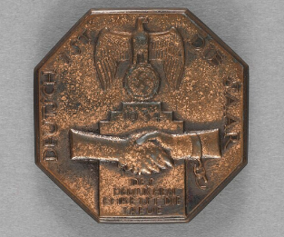
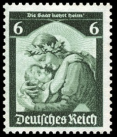
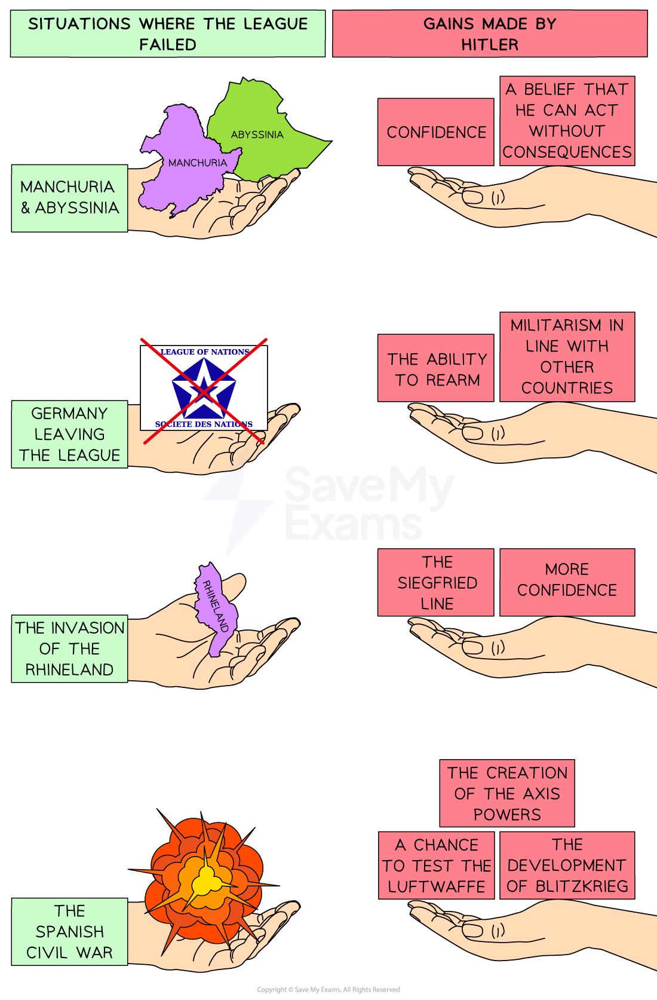

# Consequences of the Failures of the League of Nations in the 1930s

## The Impact of Manchuria and Abyssinia

> **Spec point** — `spcpt_SfZySNDWwRqRgxHV`

## The Impact of Manchuria and Abyssinia

- In **1931**, Japan invaded the Chinese province of [Manchuria](https://www.savemyexams.com/igcse/history/cie/18/revision-notes/the-20th-century-international-relations-from-1919/to-what-extent-was-the-league-of-nations-a-success/the-league-of-nations-and-the-manchurian-crisis/)
- In** 1935**, Italy invaded the African country of [Abyssinia](https://www.savemyexams.com/igcse/history/cie/18/revision-notes/the-20th-century-international-relations-from-1919/to-what-extent-was-the-league-of-nations-a-success/the-league-of-nations-and-the-abyssinian-crisis/)
- Both incidents** encouraged Hitler’s *****foreign policy***** **because:

  - Britain and France were selfish
  
    - The impacts of the ***Great Depression*** meant that **neither country wanted a war** with an aggressive nation
    - In both crises, they did not want to anger possible ***allies*** against Hitler
  - The League was **slow**
  
    - In the Manchurian Crisis, it took the League 18 months to react
  - The League was **weak**
  
    - **The USA was not a member**
    - Every time the League refused to act or reacted weakly, it damaged the League’s reputation
  - **Hitler knew he could act without the League stopping him**
  
    - In the Manchurian Crisis, Japan ignored the League and faced no consequences
    - In the Abyssinian Crisis, the League placed economic *sanctions* on Italy but did nothing to stop Mussolini’s use of *chemical warfare*

## Germany Leaves the League

> **Spec point** — `spcpt_nn8pnSkQcpdYf4wk`

## Germany Leaves the League

- Germany** **[left the League of Nations](https://www.savemyexams.com/igcse/history/cie/18/revision-notes/the-20th-century-international-relations-from-1919/to-what-extent-was-the-league-of-nations-a-success/the-impact-of-the-depression-on-the-league-of-nations/) in November 1933. This freed Hitler to pursue an aggressive foreign policy
- Hitler’s ***rearmament*** **programme** began

  - This gave Hitler the necessary military force to invade other countries
- Many people in Britain believed that **Germany was right to rearm** because:

  - The** Treaty of Versailles had been too harsh** on Germany
  - Other countries were rearming
- Hitler could **openly display his military strength**

  - Nazi Germany used ***rallies*** to:
  
    - Advertise the strength of the German army
    - Show Germany’s lack of respect for the military restrictions of the Treaty of Versailles
  - The **1935 ‘Rally of Freedom’** at Nuremberg reintroduced ***compulsory**** *military service
  
    - Celebrated Nazi film-maker Leni Riefenstahl made the film *Day of Freedom: Our Armed Forces* on the rally
- Hitler’s **early *****militarism *****was not successful**

  - In **1934, Hitler attempted to *****annex***** Austria**
  - **Mussolini sent troops **to the Austrian border to prevent this
- By **1939**, there were around **1.4 million men in the German armed forces**

  - Spending on ***armaments*** increased from 3.5 billion marks in 1933 to 26 billion marks by 1939
  - Employment in aircraft construction increased from 4,000 people in 1933 to 72,000 people by 1935

> **Exam Hint**
> The focus of this topic in the exam is whether Hitler’s foreign policy was to blame for the Second World War. Building up the military is usually done to prepare for war. However, Hitler’s rearmament programme may have just been a scare tactic. What is important is how the League allowed Hitler to break the Treaty of Versailles’ military restrictions openly. If the League had reacted more harshly to Hitler, it may have stopped his aggressive foreign policy.

## The Saar, 1935

> **Spec point** — `spcpt_pjvR4W7yD7S6jxhF`

## The Saar, 1935

![A diagram explaining the Saar plebiscite of 1935, with cartoon-style illustrations.

Top three blue boxes (timeline):

“The Saar was a coal-mining region on the French–German border.”

“Under the Treaty of Versailles, the League of Nations took control of the Saar for 15 years.”

“Both Germany and France wanted to claim the Saar due to its rich coalfields. Many opponents of Hitler lived in the Saar.”

Illustration:
Five men in suits sitting behind a desk, three with hands raised — representing the League of Nations.

Pink speech box labelled ‘Response of the League’:
“Allow a plebiscite in the Saar to decide who should govern the region!”

Big orange stamp over the League image says ‘NEITHER’, implying the League chose not to favour France or Germany.

Black ‘Outcome’ box on the right:

“The plebiscite was held on 13th January.”

“Over 90% of the population votes to re-join Germany.”

“Hitler promised to make no further claims on French territory.”](../../../assets/7c0c89b3da9d-saar-plebiscite-1.png)

*A flowchart showing the reasons for a dispute over the Saar region, the League’s reaction and the eventual outcome*

### What were the Impacts of the Saar Plebiscite?

- The plebiscite was a ***propaganda*** **victory for Hitler**

  - It showed the level of support for his policies, even in a region with Nazi opponents
- However, the League resolved a dispute legally

  - The League had stuck to the 15-year time limit set in the Treaty of Versailles
  - France and Germany had not gone to war
  - The people of the Saar achieved their aim of rejoining Germany
- Hitler wanted to use his popularity to** fulfil his idea of a ******Grossdeutchland***** *

  - To fulfil this, Hitler needed to capture land lost in the treaty
  - The League wanted to avoid war at all costs
- Hitler could **increase his rearmament programme**

  - The Saar provided Hitler with **key natural resources** for the rearmament industries
  - The League of Nations aimed to encourage disarmament

*A German badge created in 1934. The inscription states: “The Saarland is German”. The hand on the right represents the Saarland. The hand on the left represents Germany*

*A German stamp created three days after the Saar Plebiscite. The writing at the top of the stamp reads: “The Saar comes home!”*

## Remilitarisation of the Rhineland, 1936

> **Spec point** — `spcpt_mjMvc7FK7YzYdZGr`

## Remilitarisation of the Rhineland, 1936

![A diagram explaining the remilitarisation of the Rhineland in 1936.

Three light blue boxes at the top (in a vertical sequence):

“The Rhineland was an area in western Germany that bordered France.”

“Under the Versailles Settlement, the Rhineland was demilitarised. Germany had accepted this decision in the Locarno Treaty in 1925.”

“France and Russia signed the Franco–Soviet Treaty of Mutual Assistance in 1935. Hitler used this as evidence that Germany was surrounded by enemies. They invaded the Rhineland.”

Illustration beneath:
Five suited men seated at a bench — representing the League of Nations — with three of them raising their hands.

Large red ‘FAILURE’ stamp is placed next to them.

Pink box labelled ‘Response of the League’:
“...” (shows silence or inaction)

Black box on the right labelled ‘Outcome’:

“The League is too busy with the Abyssinian Crisis to react.”

“Britain believes that Germany has a right to the land.”](../../../assets/8e0be8cd76ec-invasion-of-the-rhineland.png)

*A flowchart showing the reasons for Hitler’s invasion of the Rhineland, the League’s reaction and the eventual outcome*

### How was the Remilitarisation of the Rhineland a Failure for the League of Nations?

- After the 1936 invasion, Hitler **built up his defences along the French border**

  - Germany constructed the** Siegfried Line**, a complex system of ***fortifications***
  - The League of Nations had allowed Hitler to get away with breaching the Treaty of Versailles
- Hitler **gained more confidence**

  - Hitler knew he could expand Germany without consequences
  - Historians believe that this was the **League’s last opportunity to stop Hitler** without a world war
- Hitler developed a strategy to **manipulate the League**

  - After the invasion, **Hitler signed a 25-year *****non-aggression pact*** with France and Britain
  
    - Hitler had **no intention of keeping the pact**
    - It made Germany seem **less aggressive** than it was

![A colour-coded political map of Europe highlighting key territorial developments in Germany during the 1930s.

Germany in 1933 is shaded dark green.

The Rhineland, along the French border, is shaded light green and labelled “Rhineland Remilitarised, 1936.”

The Saar region, on the border with France and Luxembourg, is shaded yellow and labelled “Saar Plebiscite, 1935.”

Surrounding countries and regions are also labelled, including:

France, Belgium, Netherlands, Luxembourg, Denmark, Poland, Czechoslovakia, Austria, Hungary, Yugoslavia, Romania, Lithuania, and East Prussia (part of Germany but geographically separated).

A legend in the bottom left explains the colours:

Dark green = Germany, 1933

Light green = Rhineland Remilitarised, 1936

Yellow = Saar Plebiscite, 1935](../../../assets/744b3cc6e60f-map-of-germany-1936-1.png)

*A map showing how far Hitler had extended Germany’s territory by 1936*

> **Worked Example**
> **Why was the remilitarisation of the Rhineland important to Hitler?**
> 
> **6 marks**
> 
> **Final answer:** **Partial answer:**
> 
> The remilitarisation of the Rhineland was important because it reversed part of the Treaty of Versailles **(1)**. The treaty insisted on the demilitarisation of the land to protect France from invasion. However, the Rhineland was German land that Hitler wanted to make German again** (1)**. Therefore the remilitarisation of the Rhineland was important for restoring Germany’s pride. Hitler believed that Germany had the right to put troops on its own territory **(1)**.

> **Exam Hint**
> In Paper One, ‘explain why’ questions are worth either six or ten marks. For full marks in this question, an examiner is looking for **two fully explained reasons **as to why the remilitarisation of the Rhineland was important for Hitler. Use the PEE structure in your answer:
> 
> - **P - **Make a **p**oint about the question
> - **E -** Use **e**vidence that supports the point that you have made
> - **E - E**xplain why this evidence made the remilitarisation of the Rhineland important. Avoid repeating the point again. Explain how this factor caused Hitler to place his troops on the Rhineland despite the risks of upsetting the League

## The Spanish Civil War

> **Spec point** — `spcpt_ChM3MPB6th7kwBNQ`

## The Spanish Civil War

- ***Civil war***** **broke out in Spain in **July 1936** between:

  - The ***left-wing*** Spanish **government**
  - ***Right-wing***** *****nationalist*** rebels led by **General Franco**

### European Reactions to the Spanish Civil War

| **Country** | **Reaction to the Spanish Civil War** | **Reason for reaction** |
|---|---|---|
| Britain | Created a **Non-Intervention Committee** to **avoid fighting** in the war | To **avoid** causing a **bigger European war** |
| France | Created a Non-Intervention Committee to **avoid fighting** in the war | Nationalist ***sympathisers*** in France could **cause a civil war** in the country |
| Germany | Sent weapons and aircraft to support **right-wing rebels** | To **test out the new** ***Luftwaffe***** **and form an** *****alliance***** **with Mussolini |
| Italy | Sent weapons and aircraft to support **right-wing rebels** | To **expand Italy’s power** and influence in Europe |
| ***USSR*** | Sent weapons and aircraft to support **left-wing government** | To **stop** the development of another ***fascist***** state** in Europe |

### How was the Spanish Civil War a Failure for the League of Nations?

- The conflict killed **750,000 people**

  - This went against the League’s mentality of stopping the use of war
- **General Franco won in 1939**

  - Fascism had won against *democracy*
  - Hitler and Mussolini formed a tighter bond
  
    - They signed the** Rome-Berlin Axis alliance in 1936**
- Germany developed **devastating military tactics**

  - Hitler tested the **concept of blitzkrieg, or ‘lightning war’**,** **in the conflict
  - The Luftwaffe developed new bombing techniques
  
    - On **26th April 1937**, German and Italian bombers bombed the city of **Guernica**
    - Over three hours, they destroyed the city and **killed hundreds of civilians**
  - The Nazi’s aerial bombing **shocked world leaders** and their populations
  
    - **Britain and France increased their rearmament programmes**
    - People worried about the consequences of war
    
      - Many civilians wanted to avoid war at all costs

> **Worked Example**
> **Study Source A.**
> 
> **Why was this photo published in 1937? Explain your answer using details of the source and your knowledge**
> 
> **7 marks**
> 
> **Source A: **A photograph taken of Guernica by an unknown photographer in 1937. The image is captioned: “Spain, Guernica.- Ruins of destroyed buildings after German air raid of the "Legion Condor"
> 
> 
> 
> **Partial answer:**
> The photograph may have been published to show the aggression of Germany and Italy **(1)**. In the Spanish Civil War, Hitler and Mussolini supported the right-wing nationalist rebels led by Franco. Hitler sent the Luftwaffe to experiment with new bombing techniques. Italian and German air forces bombed Guernica on 26th April 1937 **(1)**. The picture shows the devastation to the city with multiple buildings in ruins **(1)**. The picture highlights the dangerous nature of these two countries and how they purposefully attacked a civilian population **(1)**.

> **Exam Hint**
> This style of question in Paper Two needs you to consider:
> 
> - What the **message of the source** is. Identify the event it refers to and if it is presenting it positively or negatively. In this example, the photographer wants to show the devastation caused by the Italian and German aerial bombings.
> - **Knowledge of the event**. This picture assumes that the reader knows about the bombing of Guernica in 1937. Add relevant own knowledge of these events to support your answer.
> - The **purpose** of the picture. This source gives limited information on who took the picture and where it was published. However, a photographer would only take an image like this to show the public the reality of this event.

- The League’s actions in the 1930s unintentionally gave Hitler success and opportunities:

*An illustration showing what Hitler gained from each of the League of Nations’ failures in the 1930s*
