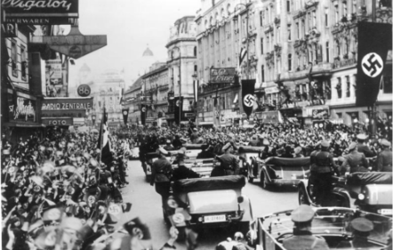
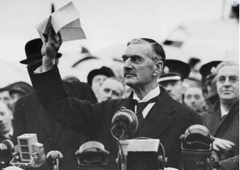

# How Did Appeasement Work in Practice?

## The Anglo-German Naval Agreement, 1935

> **Spec point** — `spcpt_87gC9F5MG9KWS9wN`

## The Anglo-German Naval Agreement, 1935

- In **April 1935**, Britain, France and Italy entered into an agreement called the **Stresa Front.**
- The nations agreed to:

  - **Oppose Hitler**’s *foreign policy*
  - Challenge Hitler if he attempted to break the *Treaty of Versailles*
- By June, the Stresa Front agreement had broken

  - The [Abyssinian Crisis](https://www.savemyexams.com/igcse/history/cie/18/revision-notes/the-20th-century-international-relations-from-1919/to-what-extent-was-the-league-of-nations-a-success/the-league-of-nations-and-the-abyssinian-crisis/) worsened Italy’s relationship with Britain and France
  - Britain and Germany signed the** Anglo-German Naval Agreement**
  
    - This agreement was the first attempt at ***appeasement***
    - It gave** *****concessions*** **to Germany’s navy** to limit Hitler’s aggression

| **Date** | **Terms** | **Impacts** |
|---|---|---|
| June 1935 | Germany to have a navy** 35% the size of the British Royal Navy**  Germany allowed to **develop submarines**. They can only have 45% of the submarines that Britain possesses  A guarantee of **Britain’s naval *****supremacy*** | The agreement broke the Treaty of Versailles and the Stresa Front  It showed that Britain wanted to** protect itself** rather than protect Europe from Hitler |

#### Was the Anglo-German Naval Agreement a Success for Appeasement?

![A diagram of a golden balance scale showing two different views on appeasement.

Left side of the scale (green background, titled “A Success for Appeasement”)

Text box reads: “Naval tensions between Britain and Germany were reduced”

This side of the scale is raised higher.

Right side of the scale (pink background, titled “A Failure for Appeasement”)

Text box reads: “Germany encouraged to rearm, breaking the Treaty of Versailles”

This side of the scale is lower, suggesting greater weight or negative impact.

The image visually represents both the short-term benefit and the long-term danger of appeasement.](../../../assets/2ad2cd198252-anglo-german-naval-agreement-scales-1.png)

*An illustration showing the positives and negatives of the Anglo-German Naval Agreement for appeasement*

## Anschluss, 1938

> **Spec point** — `spcpt_JwWBTj5m2SfKXW3T`

## Anschluss, 1938

- Many Austrians supported the idea of ***Anschluss*** because:

  - **The majority of Austrians, around 98%, spoke German**
  - They felt that Austria had a **weak economy** without Germany
  - There was a **strong Nazi Party** in Austria
- By **March 1938**, Hitler had united Austria with Germany unopposed

![A timeline flowchart explaining the Anschluss with Austria in 1938:

February 1938 – Hitler meets Austrian Chancellor Kurt Schuschnigg to discuss the “persecution of Austrian Nazis.”

Under pressure, Schuschnigg gives Arthur Seyss-Inquart, a Nazi, a ministerial role. Hitler tells Austrian Nazis to cause unrest and demand Anschluss (union with Germany).

Schuschnigg asks Britain and France for help. They do nothing. He calls a plebiscite (vote).

Hitler fears he’ll lose, so he orders Schuschnigg to resign. Schuschnigg does, and Seyss-Inquart replaces him.

12th March 1938 – Seyss-Inquart requests help from Germany to restore order. German troops invade Austria.

After the invasion, a plebiscite is held – 99.25% vote for Anschluss. Chamberlain supports the union, claiming the Treaty of Versailles was wrong to ban it.](../../../assets/06d7a1da156d-anschluss-flow-diagram-1.png)

*A flow diagram showing how Hitler achieved Anschluss in 1938*

*A photograph of Hitler's arrival in Vienna in March 1938. The original caption states: “The Führer's arrival in Vienna on Monday afternoon turned out to be a triumphal entry, the likes of which no statesman has ever experienced.”*

| *Crowds on that March 12 included the unconvinced and the skeptical, as well as the curious. People gathered as if drawn by a magnet; but their presence did not endorse the new political environment, nor did it contradict the findings of recent government polls [that between 65 and 70% of Austrians wanted to retain independence from Germany]* |
|---|
| An extract from *When Hitler Took Austria *(2008). The author of the book is Kurt von Schuschnigg, the son of the former Austrian Chancellor |

#### Was Anschluss a Success for Appeasement?

*An illustration showing the positives and negatives of Anschluss for appeasement*

> **Worked Example**
> **Study Sources F and G. After reading Source F, do you believe Hitler in Source G? Explain your answer using details of the sources and your knowledge**
> 
> **8 marks**
> 
> | **Source F: **From a speech by Churchill to the British Parliament, 14 March 1938  *The seriousness of the event on 12 March cannot be exaggerated. Europe is confronted with a programme of aggression, unfolding stage by stage, and there is only one choice open to us and to other countries – either to submit, like Austria, or to take effective measures while time remains to ward off the danger. If we were to delay, how much should we throw away of resources which are now available for our security and for the maintenance of peace?*  *We cannot leave the Austrian question where it is. We cannot accept as a final solution of the problem of Central Europe the event which occurred on 12 March. The public has been concentrated upon the moral and sentimental aspects of the Nazi conquest of Austria – a small country brutally struck down, its Government scattered to the winds, the oppression of the Nazi party doctrine imposed upon a Catholic population and upon the working classes of Austria. Nazi Germany, in its present mood, is in a position to dominate the whole of South East Europe. Over an area inhabited perhaps by 200 million people, Nazism and all that it involves is moving on to absolute control. Therefore, we await further statements from His Majesty’s Government with the greatest possible interest.* |
> |---|
> 
> | **Source G: **From a speech by Hitler during the campaign for the German parliamentary elections, 25 March 1938  *Certain foreign newspapers have said that we fell on Austria with brutal methods. I can only say that even in death they cannot stop lying. I have in the course of my political struggle won much love from my people, but when I crossed the former frontier into Austria I was met by such a stream of love as I have never before experienced. We have come not as tyrants, but as liberators: an entire people rejoiced. Here, not brutal violence, but our swastika has conquered. In truth it was the uprising of the people. Millions of our countrymen in Austria have held their banners high and have remained loyal to the Reich.* |
> |---|
> 
> **Final answer:** **Partial answer:**
> 
> After reading Source F, I do not believe Hitler in Source G **(1)**. This is because he lies about how Anschluss with Austria occurred. In Source G, Hitler states “when I crossed the former frontier into Austria I was met by such a stream of love*”. *However, in Source F, Churchill argues that it was a “Nazi conquest of Austria – a small country brutally struck down*” ***(1)**.* *It is untrue all Austrians welcomed Hitler. Hitler demanded the resignation of Schuschnigg, the Austrian Chancellor, using the threat of violence from the Austrian Nazi Party **(1)**. As a result, Hitler is not correct when he states that “an entire people rejoiced” when the country’s leader did not agree to the policy **(1)**.

> **Exam Hint**
> For this Paper Two question, ensure you have two paragraphs stating if you believe Hitler or Churchill’s assessment of Anschluss with Austria. Consider the purpose of each of the sources. For example, Hitler was speaking during the campaign for the German parliamentary elections, which may make his account of Anschluss ***biased***. Identify where the two sources disagree and who is the most trustworthy source.

## The Sudeten Crisis and the Munich Conference, 1938

> **Spec point** — `spcpt_gTzfz7mhbzW3hK75`

## The Sudeten Crisis and the Munich Conference, 1938

- Hitler wanted to gain the **Sudetenland, *****Czechoslovakia*** for Germany because:

  - After Anschluss, **Germany bordered Czechoslovakia on three sides**
  
    - Claiming Czechoslovakia would **protect Germany** from invasion
  - The Sudetenland had **rich mineral resources** and the Skoda ***armament***** **factory
  
    - This would help Germany’s armament industry
  - The Sudetenland had ***fortifications***** **
  
    - By claiming this area, it would make invading the whole of Czechoslovakia easier for Hitler
  - Over **3.5 million Germans** lived in the Sudetenland
  
    - The Sudeten Germans claimed that the Czech government mistreated them
    - Hitler would continue to achieve his foreign policy aims of** ******Grossdeutchland******* ***and ****Lebensraum****
- In **1938,** Hitler began his attempt to claim Czechoslovakia

#### What was the Sudeten Crisis?

![A timeline of the Sudeten Crisis (1938) showing the key events that led to the Munich Conference:

April: German troops gather at the Sudetenland border; Hitler uses propaganda to exaggerate the suffering of Sudeten Germans.

9th September: Czech government agrees to a plebiscite in the German-speaking areas, under British and French pressure.

12th September: Hitler delivers a speech encouraging Sudeten Germans to riot.

15th September: Chamberlain meets Hitler; offers parts of the Sudetenland, depending on French and Czech approval.

22nd September: Hitler rejects the offer, demands the whole Sudetenland; Chamberlain begins preparing Britain for war.

29th September: Germany meets with Britain, France, and Italy to resolve the issue — this becomes the Munich Conference.](../../../assets/4c578c51f119-sudeten-crisis-flow-diagram-1.png)

*A flow diagram showing the development of the Sudeten Crisis*

### The Munich Conference

- Representatives from **Italy, Britain, France and Germany** attended the conference

  - **Czechoslovakia was not invited** to the meeting
  
    - This made the meeting unfair from the start
  - **The *****USSR***** were not involved** in the conference
  
    - This created **distrust** between the USSR and the Western powers

### The Munich Agreement

- The four nations (Italy, Britain, France and Germany) developed the Munich Agreement on 30th September 1938

  - These were **terms **agreed by Hitler to** avoid war**
- The Munich Agreement stated that:

  - **Hitler would gain the Sudetenland**
  - Czechoslovakia would keep the rest of their territory
- The Munich Agreement was ***controversial**** *because:

  - **Czechoslovakia had to accept the terms**
  - Hungary and Poland also claimed areas of Czechoslovakia
  
    - Poland gained Teschen in October 1938
- Hitler marched into the Sudetenland on** 1st October 1938**

### Was the Munich Agreement a Success for Appeasement?

*A photograph taken on 30th September 1938. Chamberlain declared that the Munich Conference had guaranteed ‘peace for our time’ Image courtesy of the National Archive of Poland)*

| *The Munich agreement gives Hitler everything he wants (to begin with)  …*  *All the misery and outrage that followed the German occupation of Vienna are now certain to follow the German occupation of the Sudetenland. Prague has, even now, begun to fill with refugees – Sudeten German Socialists, Jews, not to speak of Czechs – which is natural enough, seeing that for months the German newspapers, wireless, and Hitler himself have referred to the Czechs in terms that have been one prolonged incitement to acts of violence and oppression.* |
|---|
| An editorial in the *Manchester Guardian* on 1st October 1938. It states a negative opinion of the Munich Agreement, especially due to its impact on Czechoslovakia |

*An illustration showing the positives and negatives of the Munich Agreement for appeasement*

> **Worked Example**
> **‘Anschluss was more important than the takeover of the Sudetenland in achieving Hitler’s aims.’ How far do you agree with this statement? Explain your answer**
> 
> **10 marks**
> 
> **Final answer:** **Partial answer:**
> 
> The Sudetenland was important to Hitler as he wanted to unite all German-speaking people **(1)**. In the Sudetenland, there were 3.5 million Germans living there. This land had been given to Czechoslovakia under the Treaty of St Germain, part of the Versailles Settlement **(1)**. This was important for Hitler’s aims as it helped to achieve *Grossdeutchland *and *Lebensraum* by uniting German speakers into one Reich and increasing Germany’s territory. This helped open Eastern Europe up to aggressive German expansion **(1)**.

> **Exam Hint**
> A strong response for this Paper One question needs to **examine both sides of the argument**. The next paragraph would explain how Anschluss was important to Hitler, for example achieving one of his key foreign policy aims. Continue to use a clear** PEE structure **as shown above.
> 
> You would then need to write a **conclusion explaining how far you agree **that Anschluss was more important than the Sudetenland to Hitler. Remember to use phrases like ‘**fully**’ or ‘**partially**’ to explain the level that you agree or disagree with the statement.

## Invasion of Czechoslovakia, 1939

> **Spec point** — `spcpt_nJdRYVwTrxDwv9DJ`

## Invasion of Czechoslovakia, 1939

- **By March 1939, Hitler gained the rest of Czechoslovakia**

  - Hitler demanded the Czech government *surrender* control of Czechoslovakia
  
    - Failure to do this would result in the *Luftwaffe* **bombing Prague**
  - **On 15th March, Hitler marched into Prague**
  - He succeeded in encouraging **Slovakia to declare independence**
- Hitler **could not defend his actions** to claim the whole of Czechoslovakia

  - There was **no German-speaking population** in the land he claimed
  - Hitler intended to increase Germany’s power
- The invasion of Czechoslovakia** ended the policy of appeasement**

  - **Chamberlain stated on 17th March that he could no longer trust Hitler**
  - Britain and France looked to protect vulnerable countries in Europe from Hitler

![A colour-coded historical map of Central and Eastern Europe showing German territorial expansion between 1933 and 1939. Germany in 1933 is shaded dark green. The Rhineland, shown in medium green, was remilitarised in 1936. Areas annexed by Germany in 1938 are shaded orange (including Austria and the Sudetenland). Purple marks the areas annexed in 1939 (the rest of Czechoslovakia), while Slovakia is shaded yellow and labelled as becoming a German protectorate in March 1939. Surrounding countries like France, Poland, Hungary, and Romania are also labelled, as are regions like East Prussia and the Saar.
](../../../assets/c8866ec43cd9-23176-map-of-germany-1939.png)

*A map showing how far Hitler had extended Germany’s territory by March 1939*
