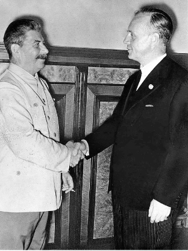
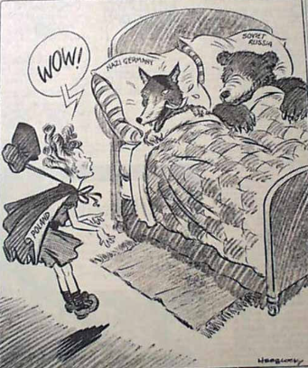

# The Importance of the Nazi–Soviet Pact

## The USSR's Aims for the Nazi-Soviet Pact

> **Spec point** — `spcpt_jmhDpwNqrxfRmjCs`

## The USSR's Aims for the Nazi-Soviet Pact

- The ***Versailles Settlement***** created the Polish Corridor**

  - This gave Poland access to the sea
  - It cut **Germany’s territory into two** separate areas
- After Hitler invaded [Czechoslovakia in March 1939](https://www.savemyexams.com/igcse/history/cie/18/revision-notes/the-20th-century-international-relations-from-1919/was-hitlers-foreign-policy-to-blame-for-the-second-world-war/how-did-appeasement-work-in-practice/), it was clear that Hitler would attempt to **gain the Polish Corridor for Germany**
- Hitler and Stalin (the leader of the ***USSR***) were enemies because:

  - They believed in **opposite *****ideologies***
  
    - Hitler was** *****Fascist***. This is a far ***right-wing***** **belief
    - Stalin was** *****Communist***. This is a far** *****left-wing*** belief
  - They had **different aims for Europe**
  
    - Hitler wanted Germany to dominate Europe
    - Stalin wanted to gain land to implement communism
  - They had **fought on opposite sides **in the [Spanish Civil War](https://www.savemyexams.com/igcse/history/cie/18/revision-notes/the-20th-century-international-relations-from-1919/was-hitlers-foreign-policy-to-blame-for-the-second-world-war/consequences-of-the-failures-of-the-league-of-nations-in-the-1930s/)
  
    - Hitler had supported General Franco and the right-wing rebels
    - Stalin had sent equipment to the left-wing government
- On **23rd August 1939**, Germany and the USSR formed the **Nazi-Soviet Pact**

  - It is also known as the **Molotov-Ribbentrop Pact**
  - The signing of the pact **shocked the world**

#### Why Did Stalin Sign the Pact?

![Title: Stalin’s Aims for the Nazi–Soviet Pact
Central box (red): Stalin’s aims for the Nazi–Soviet Pact
Surrounding aims (in yellow):

To annoy the West

To appear strong

Delay war

Gain land

Supporting reasons (in grey):

The USSR was excluded from the Munich Conference

He distrusted the Western powers

The policy of appeasement made the Western powers look weaker than Hitler

A war between Britain, France and Germany would give Stalin time to prepare for war

Poland had been taken from Russia in Treaty of Brest–Litovsk](../../../assets/7d4beb49fb24-stalins-aims-for-the-nazi-soviet-pact-1.png)

*A concept map showing what Stalin hoped to achieve from the Nazi-Soviet Pact*

> **Worked Example**
> **Explain why Stalin entered the Nazi-Soviet Pact in 1939**
> 
> **6 marks**
> 
> **Final answer:** **Partial answer:**
> 
> One reason why Stalin entered the Nazi-Soviet Pact was to give him time to rearm** (1)**. The pact would mean Germany would focus on fighting with Britain and France rather than the USSR **(1)**. This was a big motivation for Stalin to sign the pact. This is because he could focus Soviet industry on producing armaments. He knew that Hitler would break the pact to pursue *Lebensraum ***(1)**.

> **Exam Hint**
> In Paper One, ‘explain why’ questions are worth either six or ten marks. For full marks in this question, an examiner is looking for **two fully explained reasons **as to why Stalin entered the Nazi-Soviet Pact. Use the PEE structure in your answer:
> 
> - **P - **Make a **p**oint about the question
> - **E -** Use **e**vidence that supports the point that you have made
> - **E - E**xplain why this evidence caused Stalin to sign the pact. Avoid repeating the point again. Explain how this factor motivated Stalin to side with Hitler rather than stand up against him.

## Germany's Aims for the Nazi-Soviet Pact

> **Spec point** — `spcpt_GFFQh7XdrNvvGfx8`

## Germany's Aims for the Nazi-Soviet Pact

- Hitler sent a ***telegram***** to Stalin on 20th August** asking for the pact. This was surprising because:

  - The USSR had a **large Jewish population**
  
    - It was a common, but incorrect, belief that many Soviet communists were  Jewish
  - Hitler considered the** Slavs**, people who lived in Eastern Europe, as** *****subhuman***
  - **Taking the USSR’s territory** was necessary to fulfil Hitler’s foreign policy aim of ****Lebensraum****

#### Why Did Hitler Sign the Pact?

![Title: Hitler’s Aims for the Nazi–Soviet Pact
Central box (red): Hitler’s aims for the Nazi–Soviet Pact

Key Aims (in yellow):

Avoid upsetting the USSR

Stop an alliance against him

Avoid a two-front war

Gain land

Supporting Context (in grey):

Opposition from the USSR could slow down invasion of Poland

Stalin had a ruthless reputation

Britain and France had attempted to form an alliance with the USSR against Hitler

Britain and France could declare war over Poland. Hitler did not want to split his troops to fight the USSR as well

Hitler wanted the return of the Polish Corridor](../../../assets/f462c9ba045b-hitlers-aims-for-the-nazi-soviet-pact-1.png)

*A concept map showing what Hitler hoped to achieve from the Nazi-Soviet Pact*

## Terms of the Nazi-Soviet Pact

> **Spec point** — `spcpt_YB4n5fBNdZTgPMTx`

## Terms of the Nazi-Soviet Pact

| **Date** | **Terms** | **Impacts** |
|---|---|---|
| August 1939 | - A ***non-aggression pact**** *between Germany and the USSR for **10 years** - The **secret *****partitioning***** of Polish territory**. Stalin to gain control of Latvia, Lithuania, Estonia and Finland. Germany to gain half of Poland and the city of Danzig | - The public agreement **shocked **the world, especially Britain and France - **Germany invaded Poland nine days** after the signing of the pact |

![Map Title: Nazi–Soviet Pact: Division of Poland and Eastern Europe
Key Features:

Dark grey: Nazi Germany (west of Poland)

Red: Soviet Union (east of Poland and the Baltic states)

Poland: In the centre, shown in both grey and red, split between Nazi Germany and the USSR

East Prussia: A small German area separated from the rest of Germany

Baltic States (Estonia, Latvia, Lithuania): All highlighted in red, part of the USSR’s influence

Other labelled countries:

To the west: Sweden, Denmark, Netherlands, Belgium, Luxembourg, France

To the south: Slovakia, Hungary, Kingdom of Romania

To the east: Belarus, Ukraine (part of the USSR)

Key (bottom of map):

Dark grey = Germany

Red = The Soviet Union](../../../assets/b2df7b5305b4-nazi-soviet-pact-map.png)

*A map showing the partition of Poland and the territory gains agreed in the Nazi-Soviet Pact*

*A picture of Joseph Stalin shaking hands with the German Foreign Minister Joachim von Ribbentrop after signing the Nazi-Soviet Pact*

*A cartoon in an American newspaper the day after the Nazi-Soviet Pact. It uses the story of Little Red Riding Hood to show the danger of the Nazi-Soviet Pact to Poland*

## Other Alliances - Anti-Comintern Pact

> **Spec point** — `spcpt_bCS3n2xgVJzVWGK8`

## Other Alliances - Anti-Comintern Pact

- By the time of signing the Nazi-Soviet Pact, Hitler had entered into **other *****alliances***** that strengthened his position**

  - In **1936**, Germany and Japan signed the **Anti-Comintern Pact**

| **Date** | **Terms** | **Impacts** |
|---|---|---|
| November 1936 | - An agreement between Japan and Germany to help each other in the** fight against communism** | - **Italy joined **the Anti-Comintern Pact in 1937 - Japan, with its large military, was a** powerful *****ally***** to Hitler** |

## Other Alliances - The Pact of Steel

> **Spec point** — `spcpt_ThTNG5gk8XPqZyr8`

## Other Alliances - The Pact of Steel

- Germany and Italy entered into a** formal alliance **called the **Pact of Steel in 1939**

  - Its formal name is the **Pact of Friendship and Alliance**
  - The two countries had signed a friendship treaty in **1936** dubbed the **Rome-Berlin Axis**

| **Date** | **Terms** | **Impacts** |
|---|---|---|
| May 1939 | - A military alliance that promised to help each other** in times of war** - To agree peace with another country, both **Germany and Italy must agree to the terms** - To work together in **war planning and *****armament*** | - Triggered the** Tripartite Pact in 1940**, uniting Japan, Italy and Germany - Made Italy a formal** **ally** **to Germany,** increasing Hitler’s military strength** in Europe |

### How Did Other Alliances Influence the Nazi-Soviet Pact?

- Stalin became increasingly worried about the **power of Fascism**

  - **Japan was an old enemy of Russia**
  
    - Japan had beaten Russia in a war in 1904
    - Japanese-controlled Manchuria bordered the USSR
  - The Nazi-Soviet Pact would give Stalin **temporary protection** from Japan and Germany
- The pact was **doomed to fail**

  - The Anti-Comintern Pact made it clear that **Hitler did not support Communism**
  - In 1941, Hitler broke the Nazi-Soviet Pact by invading Russia in *Operation Barbarossa*

> **Worked Example**
> **Study Source A. What impressions does Source A give of the relationship between Hitler and Mussolini? Explain your answer using details of the source**
> 
> **7 marks**
> 
> | **Source A: **From a history book published in 1981  In March 1938, Hitler marched into Austria after notifying Rome only at the very last moment. Italy thus lost the immense advantage of having only a weak buffer state on her northern frontier. Having often promised that he would fight to defend Austrian independence, now in March Mussolini protested he had never said anything so foolish. Hitler had been careful not to tell Mussolini of his plans to extend Germany’s living space and calculated that, as Italy had its hands full in Spain, he could meanwhile take Austria and Czechoslovakia, possibly without offering his partner anything in return. He had gradually been displacing Italy in the commerce of south-eastern Europe. Mussolini was seriously worried and occasionally he spoke of changing sides in Europe. He still hoped to ride several horses at once but such behaviour was irresponsible, unrealistic and hardly that of a potential ally. |
> |---|
> 
> **Final answer:** **Partial answer:**
> 
> Source A suggests that Mussolini was worried about his relationship with Hitler **(1)**. The source discusses that, when Hitler enacted Anschluss, he did not inform Mussolini until “the very last moment”. Italy bordered Austria and had promised to protect Austrian independence from Hitler** (1)**. Therefore, the source proves that Anschluss made Mussolini question their relationship with Hitler. He may have needed more reassurance from Hitler which may have motivated Mussolini to enter the Pact of Steel with Germany in 1939** (1)**.

> **Exam Hint**
> In this style of question in Paper Two, ensure you read the source carefully. You need to understand the source to discover what the source suggests about Hitler and Mussolini’s relationship. To help you, highlight and annotate important sections of the source. You can also add key knowledge around the quote to plan how you will answer the question.
