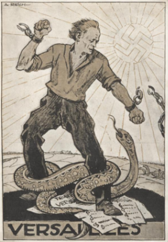
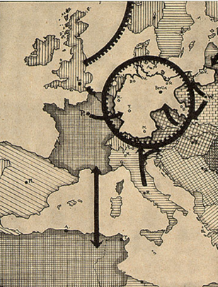

# The Long-Term Consequences of the Treaty of Versailles

## Europe's Reaction to the Treaty

> **Spec point** — `spcpt_TypVVHCKdb2TB73v`

## Europe's Reaction to the Treaty

- There was a **mixed reaction** in Europe to the *Versailles Settlement* in 1919

![A diagram showing how different countries reacted to the Treaty of Versailles.

Centre box (red): "Reactions to the Versailles Settlement"

Germany (angry face emoji):

Hated the harsh military, economic, and territorial terms of the Treaty of Versailles.

France (unhappy face emoji):

Many French citizens thought the treaty was too soft on Germany. They did not feel protected.

Britain (happy face emoji):

The majority of the British public was happy with the treaty.

Italy (neutral face emoji):

Expected to be granted more colonies from Turkey and Germany.](../../../assets/09009729bc76-reactions-to-the-versailles-settlement-1.png)

*A concept map showing the initial reactions of European countries to the Versailles Settlement*

- **By 1923**, Europe’s reaction to the Treaty of Versailles began to change

  - In Britain, the public thought that the treaty was **too harsh on Germany**
  
    - People began to **fear the *****USSR ***more than Germany
    - Britain wanted a strong Germany to **defend Europe from *****communism***

## November Criminals and the 'Dolchstoss'

> **Spec point** — `spcpt_KC2CczprXzWjj2r6`

## November Criminals and the 'Dolchstoss'

- Many Germans argued that the ***Weimar Republic*** **should not have signed the Treaty of Versailles**

  - They believed that German politicians committed a ‘**dolchstoss**’ - or a ‘stab in the back’
  - The politicians who signed the Treaty of Versailles were called ‘**November Criminals**’. This was because November was the month the government signed the ***armistice***
  - Many Germans felt **humiliated and weaker **than the rest of Europe
  - The [Treaty of Versailles’ territorial terms](https://www.savemyexams.com/igcse/history/cie/18/revision-notes/the-20th-century-international-relations-from-1919/was-the-treaty-of-versailles-fair/compromises-by-the-big-three-at-versailles/) increased ***nationalism*** in Germany
  
    - The ***Polish Corridor**** ***separated Germany **into two
    - Around** 4 million Germans lived in the Sudetenland**, ***Czechoslovakia***

## The Rise of Hitler

> **Spec point** — `spcpt_g2XZXNnMQ7tWJbdY`

## The Rise of Hitler

- The Treaty of Versailles had a [devastating impact on Germany](https://www.savemyexams.com/igcse/history/cie/18/revision-notes/the-20th-century-international-relations-from-1919/was-the-treaty-of-versailles-fair/what-was-the-impact-of-the-treaty-of-versailles-on-germany/)

  - ***Reparations**** *caused **two economic *****depressions*** **in a *****decade***
  - The German government **continued to follow the treaty’s terms**
  
    - This caused public resentment
  - ***Extremist**** *parties like the ***KPD**** ***and the *****NSDAP***** gained support**
- The government arrested Hitler after he attempted the ***Munich Putsch***

  - While in prison, **Hitler wrote *****Mein Kampf *****(‘My Struggle’)**

| **A key belief in *****Mein Kampf*** | **Summary of the belief** |
|---|---|
| The superiority of the ***Aryan***** **race | - Hitler believed the **German race was the best in the world** - He was against Germans marrying Jewish people as he stated this weakened the Aryan race |
| *Lebensraum* | - ‘**Living space**’ in German - A theory that Germany needed more territory so that the population could grow - Germany should **expand into Eastern Europe to destroy communism** |
| Revise the Treaty of Versailles | - Hitler wanted to** recover all of the land** that Germany lost in the treaty - Germany deserved a strong military. Hitler wanted to **ignore the treaty and** ***rearm*** |
| *Grossdeutschland* | - ‘**Greater Germany**’ in German - The idea that Germany should unite under one Reich (state) - **All German speakers** should live together. This included ***Anschluss*** with Austria |

- Hitler believed that, when he gained power, it was **right to break the Treaty of Versailles** because:

  - Some of the **terms had already been reversed**
  
    - For example, the **Allies changed Germany’s reparations **in the [Dawes and Young plans](https://www.savemyexams.com/igcse/history/cie/18/revision-notes/the-20th-century-international-relations-from-1919/to-what-extent-was-the-league-of-nations-a-success/what-was-international-diplomacy-like-in-the-1920s/)
  - Other countries had **not kept promises made** at the Paris Peace Conference
  
    - The ‘***Big Three***’ agreed to the **creation of the League of Nations**
    
      - The League aimed to encourage worldwide** *****disarmament***
      - Countries like France **refused to disarm**
  - Hitler feared the **power of the countries bordering Germany**
  
    - France had already invaded the Ruhr in 1923
    - Germany had **no air force and 100,000 soldiers**. It could not defend itself
  - Hitler had **public support**
  
    - In July 1932, the Nazi Party received** 38% of the vote**
    - It became the biggest party in the ***Reichstag***

*A Nazi postcard, date unknown. It shows a ripped version of the Treaty of Versailles. The sun contains a swastika, the symbol of the Nazi Party. Image courtesy of the University of Wisconsin–Madison*

*A map in a 1935 book titled Army, Navy and Air Force by Hans Riegler. The map’s caption stated:  “With an insufficient military, Germany can be blockaded both by land and sea.”*

> **Worked Example**
> **Describe the main aims of Hitler’s foreign policy**
> 
> **4 marks**
> 
> **Final answer:** **Answers:**
> 
> Hitler wanted to create a Grossdeutchland **(1)**. He wanted to incorporate all German speakers into Germany including through achieving Anschluss with Austria **(1)**. He wanted to revise the terms of the Treaty of Versailles **(1)**. He wanted to expand eastwards to achieve Lebensraum **(1)**.

> **Exam Hint**
> This style of question does not require you to explain your answer. The Cambridge IGCSE gives you **a point for each relevant piece of information** that you write. Therefore, do not spend any additional time trying to describe or explain each reason.

## How did Hitler Break the Treaty of Versailles?

> **Spec point** — `spcpt_8PPnHrm39MfchCYr`

## How Did Hitler Break the Treaty of Versailles?

![A timeline showing key steps in Hitler’s foreign policy leading to the Second World War.

1933 – Germany leaves the League of Nations after the World Disarmament Conference. Hitler secretly starts rearming Germany.

1934 – Attempt to unite with Austria fails due to opposition from Mussolini.

1935 – Hitler brings back conscription. German troops move into the Rhineland.

1937 – Hitler helps Franco in the Spanish Civil War and uses the Luftwaffe (German air force).

1938 – Anschluss (union) with Austria. Hitler prepares to invade the Sudetenland.

1939 – Hitler takes over all of Czechoslovakia. Germany invades Poland, starting the Second World War.](../../../assets/bf3662fcab8a-germanys-actions-to-break-versailles-4.png)

*A flow diagram showing the steps that Hitler took to reverse the Treaty of Versailles*

> **Worked Example**
> **Describe how Hitler broke the terms of the Treaty of Versailles**
> 
> **4 marks**
> 
> **Answers:**
> 
> When Hitler became Chancellor in 1933, he broke many terms of the Treaty of Versailles. In 1933, he began to secretly rearm **(1)**. In 1937, he tested out the Luftwaffe in the Spanish Civil War** (1)**. In 1938, he successfully captured the Sudetenland **(1)**. In 1939, he captured the whole of Czechoslovakia **(1)**.

> **Exam Hint**
> In four-mark questions, ensure each detail you select is as specific as possible. The worked example above provides dates for each of Hitler’s actions that broke the Treaty of Versailles.
