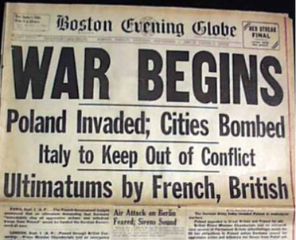

# Why Did Britain & France Declare War on Germany?

## British-French Guarantee of Poland, March 1939

> **Spec point** — `spcpt_kCz4KNkKnbHjtqwR`

## British-French Guarantee of Poland, March 1939

- After Hitler invaded Czechoslovakia, Britain and France believed that **Hitler’s next move was to retake Poland**

  - The ***Versailles Settlement*** established the Polish Corridor from German land
  
    - **Poland cut Germany’s territory into two** separate areas
    - The free city of **Danzig** lay in Poland
    
      - It had been made free in the Versailles Settlement
      - It **used to be a German city **and contained many Germans
      - Hitler had already** demanded the return** of Danzig
  - Hitler was **expanding eastwards**
  
    - Czechoslovakia bordered Poland
- Britain and France **abandoned the concept of** ***appeasement*** by March 1939

  - They did not believe that Hitler would stop his aggressive *foreign policy*
  - Britain and France had made significant progress in ***rearmament***

![A colour-coded historical map of Central and Eastern Europe showing German territorial expansion between 1933 and 1939. Germany in 1933 is shaded dark green. The Rhineland, shown in medium green, was remilitarised in 1936. Areas annexed by Germany in 1938 are shaded orange (including Austria and the Sudetenland). Purple marks the areas annexed in 1939 (the rest of Czechoslovakia), while Slovakia is shaded yellow and labelled as becoming a German protectorate in March 1939. Surrounding countries like France, Poland, Hungary, and Romania are also labelled, as are regions like East Prussia and the Saar.
](../../../assets/c8866ec43cd9-23176-map-of-germany-1939.png)

*A map showing how far Hitler had extended Germany’s territory by March 1939*

- On 31st March 1939, Britain and France made a formal agreement with Poland

  - The two countries promised that they would protect Poland’s borders

## The Polish Crisis and the Outbreak of War

> **Spec point** — `spcpt_B9w2ZBQStVmDYqft`

## The Polish Crisis and the Outbreak of War

*A flow diagram showing how the Polish Crisis caused the outbreak of the Second World War*

- **Hitler was surprised that Britain declared war **because:

  - Britain and France had allowed Hitler to **get away with similar invasions**
  - Hitler believed he could **negotiate with Britain**
  
    - Hitler thought that, if he promised not to invade Britain and its ***colonies***, Britain would allow Hitler to control Europe
  - Hitler believed that he had ***legitimate***** reasons** to invade Poland
  
    - Germans lived in the *Polish Corridor*
    - Danzig was originally a German city
  - He did not think Britain was prepared for war

| *This morning the British ambassador in Berlin handed the German government a final note stating that unless we heard from them by 11 o'clock that they were prepared at once to withdraw their troops from Poland, a state of war would exist between us. I have to tell you now that no such undertaking has been received, and that consequently this country is at war with Germany* |
|---|
| A section of Chamberlain’s radio broadcast, declaring the outbreak of the Second World War, 3rd September 1939 |

*The front page of the Boston Evening Globe on 1st September 1939 explaining Britain and France’s ultimatum to Germany. It shows the belief that Hitler’s invasion of Poland would result in war*

> **Worked Example**
> **Are you surprised that Germany invaded Poland in September 1939? Explain your answer **
> 
> **10 marks**
> 
> **Final answer:** **Partial answer:**
> 
> On one hand, I am not surprised that Hitler invaded Poland in September 1939 **(1)**. Germany and the USSR signed the Nazi-Soviet Pact in August. A key term in this pact was the division of Poland between the two powers **(1)**. This meant that Hitler knew that if he invaded Poland he would not be attacked by the USSR. As a result, it should have been very clear to the world powers that Hitler intended to invade Poland quickly to expand his territory **(1)**.

> **Exam Hint**
> A strong response for this Paper One question needs to **examine both sides of the argument**. The next paragraph would explain why it was surprising that Hitler invaded Poland. You could use the British-French guarantee to Poland. Continue to use a clear** PEE structure **as shown above.
> 
> You would then need to write a **conclusion explaining how surprised you are **that Hitler invaded Poland in September 1939. Remember to use phrases like ‘**fully**’ or ‘**partially**’ to explain how surprised you are about Hitler’s actions.

## Causes of the Second World War

> **Spec point** — `spcpt_Tgww3zN23WnXjjHd`

## Causes of the Second World War

| **Cause** | **Why did this cause the Second World War?** |
|---|---|
| [The Treaty of Versailles](https://www.savemyexams.com/igcse/history/cie/18/revision-notes/the-20th-century-international-relations-from-1919/was-the-treaty-of-versailles-fair/compromises-by-the-big-three-at-versailles/) | The harsh terms of the treaty caused significant **political and economic issues in Germany**.** Lloyd George **warned that the terms would cause a** future conflict**. The resentment for the treaty was one of the causes of the **election of Hitler in 1933** |
| [The failure of the League of Nations](https://www.savemyexams.com/igcse/history/cie/18/revision-notes/the-20th-century-international-relations-from-1919/was-hitlers-foreign-policy-to-blame-for-the-second-world-war/consequences-of-the-failures-of-the-league-of-nations-in-the-1930s/) | In the 1920s, the League of Nations had proven itself to be **weak and ineffective**. The League’s lack of action against the **Manchurian and the Abyssinian Crises encouraged Hitler** to take risks in his foreign policy. Britain and France favoured their own interests over the League’s |
| [Hitler’s foreign policy](https://www.savemyexams.com/igcse/history/cie/18/revision-notes/the-20th-century-international-relations-from-1919/was-hitlers-foreign-policy-to-blame-for-the-second-world-war/the-long-term-consequences-of-the-treaty-of-versailles/) | Hitler’s aims were **aggressive and *****expansionist***. Ideas about ****Grossdeutchland***** *and** ******Lebensraum****** **meant expanding eastwards into other countries. Hitler invested heavily in **rearmament and the Luftwaffe**. Possessing this much military power made war more likely |
| [Appeasement](https://www.savemyexams.com/igcse/history/cie/18/revision-notes/the-20th-century-international-relations-from-1919/was-hitlers-foreign-policy-to-blame-for-the-second-world-war/was-the-policy-of-appeasement-justified/) | The policy gave Hitler Austria and the Sudetenland **against their governments and the Treaty of Versailles**. Hitler viewed Britain and France as weak. This encouraged him to make increasingly **outrageous demands** that would lead to war |
| [The Nazi-Soviet Pact](https://www.savemyexams.com/igcse/history/cie/18/revision-notes/the-20th-century-international-relations-from-1919/was-hitlers-foreign-policy-to-blame-for-the-second-world-war/the-importance-of-the-nazi-soviet-pact/) | The USSR had many reasons to avoid breaking the pact. As a result, **Britain and France were weaker without the *****USSR***. The pact gave Hitler the perfect conditions to invade Poland. He knew that, if his actions triggered a war, he would **only fight this with Britain and France** |

![a horizontal timeline showing five key causes that led to the outbreak of the Second World War, arranged in chronological order from left to right. Each cause is represented as a separate colour-coded box, building up towards a large explosion graphic labelled “THE SECOND WORLD WAR” on the far right.

1919 – The Treaty of Versailles (Yellow box)
➤ Represents the peace treaty that ended WWI. It imposed harsh terms on Germany, leading to widespread resentment.

1920–1939 – The Failure of the League of Nations (Large yellow box above the central timeline)
➤ Shows that international cooperation collapsed during this period, weakening peacekeeping efforts.

1933–1939 – Hitler’s Foreign Policy (Orange box)
➤ Refers to Hitler’s aggressive expansionist aims, including rearmament, remilitarisation, and territorial demands.

1936–1939 – Appeasement (Dark orange box beneath Hitler’s policy box)
➤ Highlights how Britain and France allowed Hitler to break the Treaty of Versailles without consequences.

1939 – The Nazi–Soviet Pact (Red-orange box)
➤ Marks the agreement between Germany and the USSR to divide Poland, clearing the way for Hitler’s invasion.

To the right of all the boxes, a large explosion graphic is shown](../../../assets/a178bc21ce36-causes-of-second-world-war.png)

*An illustration showing a build-up of events that caused the Second World War in 1939*

> **Worked Example**
> **Study Sources A and B. How far do these two sources agree? Explain your answer using details of the sources**
> 
> **7 marks**
> 
> | **Source A: **From a history book published in 1992  The Czech crisis brought Europe very close to war. Hitler wrote at this time, ‘It is my unalterable decision to smash Czechoslovakia by military action.’ The effects of the Munich Agreement had profound implications for European diplomacy and the balance of power, since with hindsight it is clear that Hitler was now prepared to pursue a policy of war, although he wanted to fight any conflict on his terms. His ultimate objective was still the creation of Lebensraum at the expense of the USSR, but hopefully this could be achieved by Britain’s appeasement policy developing into a more general acceptance of Germany’s dominant position in central and eastern Europe. In March 1939 Germany had secured the self-dissolution of the Czech state. Some historians have pointed to the various military orders Hitler gave at this time for the establishment of long-range bomber squadrons and the construction of a large navy as evidence that he was willing to take on Britain. This may well have been his long-term intention, but in the short term Hitler most definitely did not want a war with Britain and France. How could he avoid such a conflict while pursuing his claims against Poland? It was the hope of neutralising Britain and France which drove Hitler into the arms of Stalin. After the Nazi-Soviet Non-Aggression Pact was signed, Hitler was confident that western military involvement would not follow a German invasion of Poland. But by 3 September Germany was at war with Britain and France. How did Germany find itself in this position? The cause was Hitler’s desire for continental hegemony* and Lebensraum which could only be achieved (as he well knew) by military force  *hegemony = the dominance of one group over another |
> |---|
> 
> | **Source B: **From a history book published in 1960  The main thrust of Hitler’s foreign policy was eastwards. He wanted a German empire in eastern Europe but no more. He hoped to achieve this without war. Germany posed no threat to Britain. Chamberlain caused German hostility towards Britain by unnecessarily intervening in the Sudeten crisis of May and September 1938.  Hitler may have directed his generals to prepare for war but this was only to make Germany stronger, not to fight a war. Hitler believed that Germany was most likely to make gains in eastern Europe if it was strong. He also believed that Communism might break down without a war, allowing him to get what he wanted with no effort at all. However, he had no firm plans and was willing to improvise and take what was offered to him by circumstances. He wanted no more than to make Germany a great power, an aim which all countries have. Hitler’s speech in August 1939 tells us the importance of the Pact with the Soviet Union, ‘Now the probability is great that the West will not intervene.’ His promise to Britain in August that Germany’s frontier in the West was final and that he would not threaten the British Empire, shows he had no ambitions directed against Britain and France. By the end of August the breach between Poland and its allies Britain and France was widening and could soon be wide open. However, it also gave Hitler a chance and he gambled on it by ordering the attack on Poland. This decision, based as it was on Hitler supposing that Britain and France would not go to war, was a mistake, a miscalculation. |
> |---|
> 
> **Final answer:** **Partial answer:**
> 
> Sources A and B disagree on whether Hitler was prepared for a world war **(1)**. Source A states that Hitler planned for the possibility of war. It states that his foreign aim policies “could only be achieved (as he well knew) by military force” **(1)**. Hitler began an aggressive and expensive rearmament programme in 1933. By 1939, there were around 1.4 million men in the German armed forces and a total cost of 26 billion marks on rearmament **(1)**. However, Source B states that Hitler was improvising and did not have a war plan. Source B states that Hitler  “hoped to achieve [a German empire] without war” and “gambled” on attacking Poland **(1)**.

> **Exam Hint**
> For written sources in Paper Two, use a quote directly from the source to provide evidence. You can use square brackets [...] to replace words like ‘it’ with the event referred to in a previous sentence. This ensures that your quotes are short and to the point. Do not be afraid to take quotes from multiple parts of the source (as the worked example does for Source B). This helps you show the examiner that you understand the overall message of the source.
