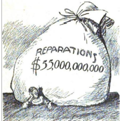
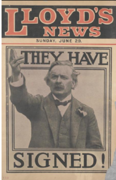

# Justification for the Treaty of Versailles

## The Post-War Treaties

> **Spec point** — `spcpt_34Z735Jpn55X7g6J`

## The Post-War Treaties

- **Four other treaties** created the Versailles Settlement. These are:

  - The Treaty of St Germain
  - The Treaty of Neuilly
  - The Treaty of Trianon
  - The Treaty of Sevres
- Representatives of each country were forced to sign the treaty

### The Treaty of St Germain

| **Date** | **Format** | **Terms** | **Impacts** |
|---|---|---|---|
| September 1919 | The Allies' dictated peace treaty with **Austria** | - Ending of the **Austro-Hungarian empire** - **Loss of land** to Hungary, Czechoslovakia and Yugoslavia - ***Anschluss*** with Germany **forbidden** - Austria limited to **30,000 troops** - ***Reparations***** ** - **Accept blame** for starting the First World War - Recognition of the ***League of Nations*** | - Land given to Czechoslovakia housed most of **Austria’s industry** - Austria experienced a **financial crisis in 1921** - **Never paid reparations** - The small states created from the old  Austro-Hungarian empire caused conflict and** instability in Eastern and Central Europe** |

> **Exam Hint**
> An exam question could ask you why the Treaty of St Germain was important. In Paper One, this would be worth 6 marks. You would have to fully explain two reasons why the treaty was important using the PEE structure:
> 
> - **P - **Make a **p**oint about the question
> - **E -** Use **e**vidence that supports the point that you have made
> - **E - E**xplain why this evidence caused the treaty to be important. Avoid repeating the point again. For example, the treaty ended the Austro-Hungarian empire, which had been one of the most powerful empires before the First World War.
> 
> Apply these skills to any of the treaties mentioned below

### The Treaty of Neuilly

| **Date** | **Format** | **Terms** | **Impacts** |
|---|---|---|---|
| November 1919 | The Allies' dictated peace treaty with **Bulgaria** | - **Loss of land** to Yugoslavia, Greece and Romania - Recognise the existence of the** Kingdom of Serbs, Croats and Slovenes** - Bulgaria limited to **20,000 troops** - Reparations set at **£100 million** - **Accept blame** for starting the First World War - Recognition of the **League of Nations** | - Loss of access to the Aegean Sea - The Allies** cancelled 75% of Bulgaria’s reparation bill** - Bulgaria continued to claim their right to Macedonia - Continued **unrest in the** ***Balkans*** |

### The Treaty of Trianon

| **Date** | **Format** | **Terms** | **Impacts** |
|---|---|---|---|
| June 1920 | The Allies' dictated peace treaty with **Hungary** | - Ending of the **Austro-Hungarian empire** - Loss of **two-thirds** of its **land **and **a third** of its **population** - Hungary limited to **35,000 troops** - **Reparations** - **Accept blame **for starting the First World War - Recognition of the **League of Nations** | - The **collapse of its economy**, which resulted in not paying reparations - The treaty forced many ethnic Hungarians, called **Magyars**, out of Hungary - **Conflict within Hungary **during the 1920s |

### The Treaty of Sevres

| **Date** | **Format** | **Terms** | **Impacts** |
|---|---|---|---|
| August 1920 | The Allies' dictated peace treaty with ***Ottoman *****Türkiye **(Turkey) | - Ending of the** Ottoman Empire** - **Britain** and **France** to take control of land in the **Middle East** - Loss of control of the **Dardanelles Strait**, an important waterway - Türkiye limited to **50,000 troops** - Allied control of Türkiye’s **tax system and budget** - **Reparations** - **Accept blame** for starting the First World War - Recognition of the **League of Nations** | - The people of Türkiye **threatened to overthrow** the government - The Allies negotiated a **new treaty** with Türkiye in 1923 called the **Treaty of Lausanne** - The new treaty gave Türkiye    - **Land back** in Europe   - Control of the **Dardanelles Strait**   - **No reparations or restrictions** of the army |

> **Worked Example**
> **What features of the Treaty of Versailles were shared by the other peace treaties of 1919–20? **
> 
> **4 marks**
> 
> **Final answer:** **Answers:**
> 
> All five of the post-war treaties made countries accept a War Guilt Clause** (1)**. All allies of Germany had an obligation to pay reparations **(1)**. Each losing nation had to restrict its army **(1)**. The defeated countries all lost territory **(1)**.

> **Exam Hint**
> Other potential answers to this question include:
> 
> - Recognition of the League of Nations
> - All the treaties were *diktats*

### Impact of the peace treaties of 1919-1920

## Key Opinions on the Treaty of Versailles

> **Spec point** — `spcpt_jFG7mKNKKhmQmxRR`

## Key Opinions on the Treaty of Versailles

![A pair of coloured maps titled "Europe Pre–World War I" (top) and "Europe Post–World War I" (bottom), showing changes in national borders.

In the top map (Pre-WWI), large countries like Germany, Austria-Hungary, Russia, and the Ottoman Empire dominate central and eastern Europe. Ireland is part of Great Britain, and Poland, Czechoslovakia, and Yugoslavia do not yet exist.

In the bottom map (Post-WWI), Europe is divided into more countries. Austria-Hungary is split into Austria, Hungary, Czechoslovakia, and Yugoslavia. Poland, Estonia, Latvia, and Lithuania appear as new independent countries. Russia becomes the Soviet Union, and Ireland is shown as separate from Great Britain. The Saar region is separated from Germany.](../../../assets/b52c8d9cc6a1-postwar-europe-maps.png)

*A map showing how the postwar treaties affected Europe*

| **The Treaty of Versailles can be justified** | **The Treaty of Versailles cannot be justified** |
|---|---|
| Some journalists in Britain insisted that **Germany could afford the reparations** | Due to economic crashes, Austria’s and Hungary’s reparations were cancelled. When Germany’s economy collapsed, the Allies **reduced but did not stop reparations** |
| The **French** claimed that Germany’s** diktat** on Russia in 1917, **the Treaty of Brest-Litovsk**,** was much harsher** than the Treaty of Versailles | **The Treaty of Lausanne undermined the Treaty of Versailles**. It indicated that the Allied politicians knew the Versailles Settlement was unfair |
| ***Marshal**** ***Foch**, the French commander of the Allied forces, stated that the treaty **did not protect France from invasion** | Some British politicians and journalists believed that the** treaty’s terms** would cause Germany to start **another world war** |
| Some politicians in the USA believed the treaty was the **best solution**, given the political context in 1919 | The Allies had [different motives and aims](https://www.savemyexams.com/igcse/history/cie/18/revision-notes/the-20th-century-international-relations-from-1919/was-the-treaty-of-versailles-fair/motives-and-aims-of-the-big-three-at-versailles/). They were more interested in **achieving their own aims** rather than creating a fair treaty |
| Some people in **Britain and France** thought that the **treaty was too** ***lenient***. As long as Germany existed as a country, they were still a threat to world peace | Forcing Germans to live under foreign rule and its exclusion from the League of Nations isolated Germany. This** increased support for extremist groups in Germany** |

### Contemporary Opinions of the Treaty of Versailles

*A cartoon published in a US newspaper, 1921. Germany is saying, ‘Let’s see you collect it.’*

*Placard for Lloyd's News on 29th June 1919. It is announcing the signing of the Treaty of Versailles*

| “If we aim at the impoverishment of Central Europe, vengeance, I dare say, will not limp. Nothing can then delay for very long the forces of Reaction and the despairing convulsions of Revolution, before which the horrors of the later German war will fade into nothing, and which will destroy, whoever is victor, the civilisation and the progress of our generation.” |
|---|
| A quote from the British economist John Maynard Keynes in *The Economic Consequences of the Peace* (1919) |

> **Worked Example**
> **Study Sources E and F. Whose account can be trusted more, Wilson’s or House's? Explain your answer using details of the sources and your knowledge. **
> 
> **8 marks**
> 
> **Source E: ** From a speech by President Wilson during a tour across the US, 8 September 1919
> 
> *I want to say that I did not find any of my colleagues in Paris reluctant to do justice to Germany. But I hear that this treaty is very hard on Germany. When a country has committed a criminal act, the punishment is hard, but the punishment is not unjust. Germany permitted itself, through an unscrupulous government, to commit a criminal act against mankind, and it is to undergo the punishment, not more than it can endure but up to the point where it can pay it. But the terms of this treaty will not be fully carried out if any one of the great influences that brought that result about is withheld from its implementation. Every great fighting nation in the world is on the list of those who are to constitute the League of Nations. I say every great nation, because America is going to be included among them, and the only choice, my fellow citizens, is whether we will go in now or come in later with Germany.*
> 
> **Source F: **A diary extract from Edward House, a member of the USA's delegation to the Paris Peace Conference
> 
> *June 29, 1919: I am leaving Paris, after eight fateful months, with conflicting emotions. Looking at the conference in retrospect there is much to approve and much to regret. It is easy to say what should have been done, but more difficult to have found a way for doing it…*
> 
> *How splendid it would have been had we blazed a new and better trail! However, it is to be doubted whether this could have been done, even if those in authority had so decreed, for the peoples back of them had to be reckoned with. It may be that Wilson might have had the power and influence if he had remained in Washington and kept clear of the Conference. When he stepped from his lofty pedestal and wrangled with representatives of other states upon equal terms, he became as common clay.*
> 
> *To those who are saying that the Treaty is bad and should never have been made and that it will involve Europe in infinite difficulties in its enforcement, I feel like admitting it.*
> 
> **Final answer:** **Partial answer:**
> 
> I believe that House’s account is more trustworthy than Wilson’s** (1)**. This is because of the type of source it is. House was writing in his diary at the time of the Paris Peace Conference. This allowed House to be more honest about his unhappiness with the Versailles Settlement **(1)**. In comparison, Wilson’s source is a speech on his tour of the US. Wilson had to be more positive about the outcome of the Treaty of Versailles to satisfy the American public. Therefore, House is more likely to represent how the US government truly felt about the Treaty of Versailles **(1)**.

> **Exam Hint**
> This question would be worth 8 marks in Paper 1. To complete this answer successfully, you should:
> 
> - Evaluate the nature, origin and purpose of both sources
> - Explain how the two sources differ
> - Consider the author of each source and the knowledge of the historical event, in this case, the Treaty of Versailles
> - Come to a conclusion about which source is more trustworthy
