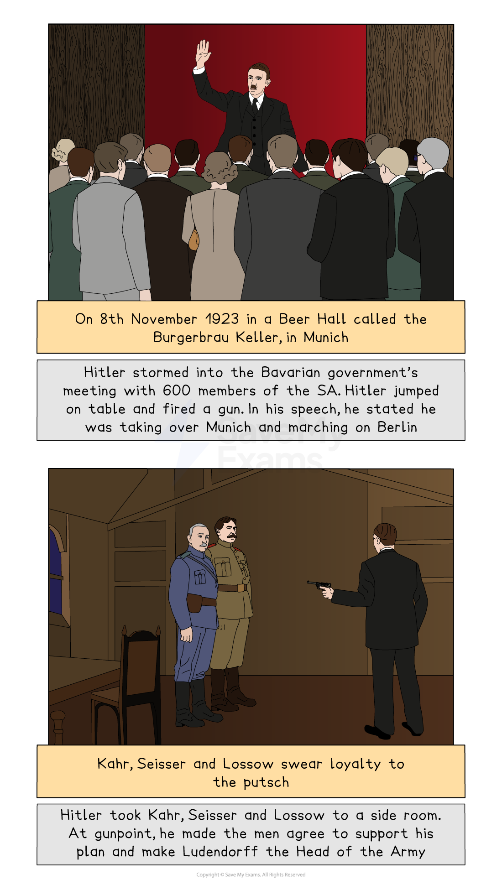
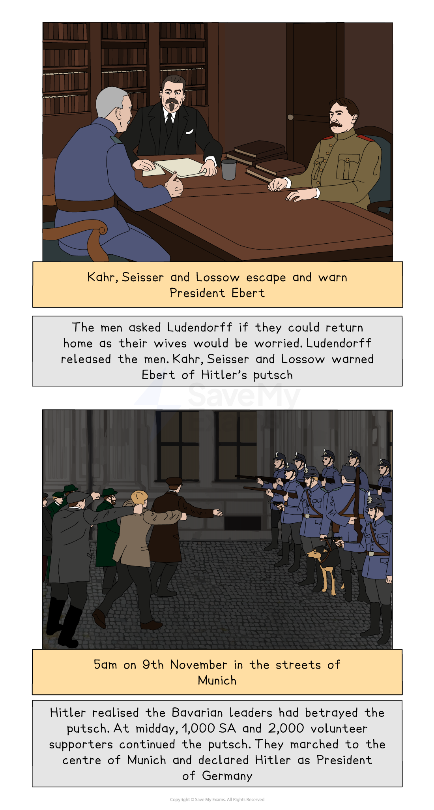
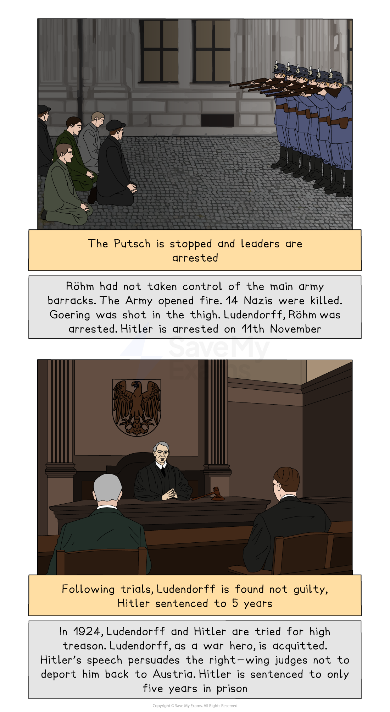

# What was the Impact of the Treaty of Versailles on Germany?

## The 'Diktat'

> **Spec point** — `spcpt_sDWw85FgjXbXtjqK`

## The 'Diktat'

- The Treaty of Versailles took force on **10th January 1920**
- Many Germans argued that the ***Weimar Republic*** **should not have signed the Treaty of Versailles**

  - They believed that German politicians committed a ‘**dolchstoss**’ - or a ‘stab in the back’
  - The politicians who signed the Treaty of Versailles were called ‘**November Criminals**’. This was because November was the month the government signed the ***armistice***
  - Many Germans felt **humiliated and weaker **than the rest of Europe
  - German people and politicians called the treaty a **‘*****diktat*****’**
  
    - German representatives were** not allowed to attend the peace talks**
    - Germany had to** accept the terms of peace** otherwise the Allies would take control of the country

### What Sections of the Treaty of Versailles Angered the German People?

| **Area of the treaty** | **Why did this anger the German people?** |
|---|---|
| The War Guilt Clause | The German public did not think it was fair that** they had to take all of the blame for the First World War**. Other countries were planning for war in the 1910s |
| Restrictions on armed forces | The armed forces were a **source of pride** for the German people. Many Germans felt humiliated and **vulnerable to attack**. They were bitter that the rest of Europe was not forced to** *****disarm*** |
| ***Reparations*** | Many Germans believed that the reparations were **set too high**. Germany had already been **financially ruined by the First World War**. From 1922, Germany could not pay its reparations bill |
| Territorial losses | The Treaty of Versailles placed German citizens under the rule of other countries. Many Germans felt that the Allies had **taken away their cultural identity** |

## Rise of Extremism: The Kapp Putsch

> **Spec point** — `spcpt_JhrTNbsVPKKH6kCV`

## Rise of Extremism: The Kapp Putsch

- The ***Spartacist ***Revolt in January 1919 came close to overthrowing the new Republic

  - The Weimar Republic used the** Freikorps to stop the *****communist *****uprising**
  
    - The Freikorps was a ***right-wing*** group
    - They were** armed ex-soldiers** who became unemployed after the Treaty of Versailles restricted the German Army
- In March 1920, President Ebert planned to ***disband*** the Freikorps units in Berlin
- **5,000 Freikorps** members and their leader, **Wolfgang Kapp**, attempted to **overthrow the government in a *****putsch***
- Kapp and the Freikorps invited the ***Kaiser*** back to govern Germany

  - Many of the lower classes would not support the Kaiser returning to Germany
  
    - They had achieved more rights and freedoms since the Kaiser’s ***abdication***
- The workers, with the Weimar government’s encouragement, called for a ***general strike***

  - **Berlin lost gas, electricity and water supplies**
  - There was no public transportation
- After four days, Kapp left Berlin
- The Freikorps continued to cause issues in the Weimar Republic after the Kapp Putsch

  - Within the first three years of the Weimar Republic, there were **376 political *****assassinations***
  
    - In** August 1921**, two members of the Freikorps shot and killed **Matthias Erzberger**. Erzberger signed the armistice

## Occupation of the Ruhr

> **Spec point** — `spcpt_nkxgcnwsTrXJYSTy`

## Occupation of the Ruhr

- In **December 1922**, France accused Germany of not sending the amount of coal required by the Treaty of Versailles
- **French and Belgian troops entered the Ruhr in January 1923**

  - **The soldiers seized coal, manufactured products and machinery**
- Chancellor Cuno urged the coal workers to use** *****passive resistance***

  - The workers:
  
    - Went on ***strike***
    - ***Sabotaged**** *machinery
  - The French responded by bringing their own workers into the Ruhr
  - The Weimar government **could not force the soldiers out **of the Ruhr because the Treaty of Versailles:
  
    - **Restricted Germany’s army to 100,000 men**
    
      - **The French had 750,000 soldiers**
    - Contained terms that **legalised France’s actions**
  - The French occupation of the Ruhr destroyed Germany’s economy because **the Weimar government**:
  
    - Insisted on **paying wages to the striking workers**
    - Began ***importing***** coal **from other countries to meet demand
    - Could not provide factories with enough coal
    
      - Germans experienced **shortages** in everyday items. This increased the prices of these products

## Hyperinflation, 1923

> **Spec point** — `spcpt_YDs7bjWpQxkMJsPm`

## Hyperinflation, 1923

- The term inflation means the **increase in prices **

  - Inflation happens in an economy **over time**
  
    - For example, a loaf of bread in January 1971 cost 10p. The average price of bread in January 2023 was £1.06
  - Inflation is measured as a **percentage**
- Hyperinflation is when prices rise rapidly and become **out of control**

  - Wages struggle to match the cost of living
- In extreme cases, a country’s **currency loses its monetary value**

> **Exam Hint**
> Inflation can be a tricky concept to understand, especially how it can cause money to lose all its value. Imagine that you have a rare diamond necklace. It would cost a lot of money to purchase the necklace because it is so rare. Now imagine that someone made 100 more diamond necklaces. The necklace is now not as rare, meaning it would not be worth as much as it was previously. Applying this concept to money, the more currency there is in circulation, the less it is worth. As a result, printing money can limit the impact of inflation but overprinting money can be dangerous to an economy.

- To pay the striking Ruhr workers and purchase coal, the Weimar government decided to **print more money**

  - In 1923, there were 300 paper mills and 2,000 printers whose sole purpose was to print currency
  - The decision to print an excessive amount of money** caused the hyperinflation crisis**
- **By November 1923, the German currency (the mark) had become worthless**

  - Some workers received pay twice a day so they could purchase essential goods before their wages became worthless
  - People filled wheelbarrows full of money to buy a loaf of bread

#### Causes and Consequences of Hyperinflation

![A cause-and-consequence diagram explaining hyperinflation in Weimar Germany.

Centre box:

"Hyperinflation" in a central red box, with arrows pointing to and from it.

Causes on the left (in green):

The Treaty of Versailles

France’s invasion of the Ruhr

Printing more money

These causes are linked with arrows pointing towards the "Hyperinflation" box.

Consequences on the right (in blue):

Unemployment

Loss of savings and pensions

Debts from loans decreased

Increased support in extremist parties

These consequences are linked with arrows pointing outward from the "Hyperinflation" box.](../../../assets/651efcf6c27c-multi-flow-diagram-hyperinflation.png)

*A diagram illustrating the causes and consequences of hyperinflation*

> **Worked Example**
> **Study Source A. How useful is this source to a historian studying the Treaty of Versailles? Explain your answer using details from the source and your knowledge**
> 
> **7 marks**
> 
> **Source A: **A satirical cartoon by German cartoonist Erich Schilling in 1921 entitled “The monstrosity of the Paris Conference”. The bottom caption reads “If only she didn't crush her parents!”
> 
> 
> 
> **Final answer:** **Partial answer:**
> 
> Source A is useful to a historian studying the Treaty of Versailles **(1)**. This is because it shows a typical view of how the German public felt about the Treaty. The cartoonist, Erich Schilling, the drew the Treaty of Versailles as a monster on top of skulls (**1)**. The German public believed that the 132 billion marks reparations bill set in the treaty would ruin their economy and, as a result, their lives **(1)**. The occupation of the Ruhr and the resulting hyperinflation crisis of 1923 proved that Schilling was correct in being afraid of the treaty’s ability to destroy people’s lives **(1)**.

> **Exam Hint**
> **Exam tip**
> 
> All sources are, in some way, useful for a historian. To achieve full marks for this question, you need to comment on the nature, origin and purpose of the source
> 
> - **Nature - **The source is a cartoon produced in 1921. Cartoons are useful for understanding the zeitgeist, or the mood of the time. A limitation of cartoons as historical sources is that events are often exaggerated
> - **Origin - **The cartoonist is from Germany. He is likely to have a negative view of the Treaty of Versailles. Therefore, the source is typical of the period
> - **Purpose -** Cartoons are often drawn to entertain or to provide an opinion. Consider key events in Germany before 1921 that would motivate Schilling to produce this image
> 
> This method of source analysis ensures you are using details from the source and your own knowledge in your answer.

## Rise of Extremism: The Munich Putsch

> **Spec point** — `spcpt_tW8m9SwYt27SVMV6`

## Rise of Extremism: The Munich Putsch

| **Causes of the Munich Putsch** |   |   |
|---|---|---|
| **Long-term** | **Mid-term** | **Short-term** |
| The people were angry with the Weimar government from its beginnings. The **Treaty of Versailles in 1919 was a **‘**dolchstoss**’ for many Germans | **Mussolini**, the fascist leader of Italy, **inspired Hitler**. Mussolini led his successful ‘March on Rome’ in 1922. He implemented a putsch using his ***paramilitary force*** | The **French invasion of the Ruhr **caused many shortages of goods in Germany |
| From 1920, the ***NSDAP**** *was **growing in popularity** in Munich and Bavaria | The hyperinflation crisis reached its worst state towards the end of 1923.** People resented the Weimar government** for how they handled the crisis |   |

- In November 1923, Hitler decided that the Nazi Party was ready to take control of Germany

  - The putsch relied upon the support of **Kahr, Seisser and Lossow**
  
    - These were key officials in ***Bavaria***
  - Hitler knew that, if he established control of Bavaria, it would be easier for him to take over Berlin

### What Happened in the Munich Putsch?

- The Munich Putsch failed and Hitler was arrested for high treason

*A storyboard about the Munich Putsch*

#### Causes and Consequences of the Munich Putsch

![A flowchart showing the causes and consequences of the Munich Putsch. On the left side, under the heading “Cause,” there are three green boxes linked to a central red box labelled “The Munich Putsch.” The causes are:

Mussolini’s ‘March on Rome’

The hatred of the Treaty of Versailles

The hyperinflation crisis

On the right side, under the heading “Consequence,” four blue boxes are connected to “The Munich Putsch.” The consequences listed are:

Hitler is arrested. In prison, he writes Mein Kampf

The Nazi Party is banned

Hitler gains national attention for his beliefs

A desire to make the Nazi Party electable](../../../assets/f4a9c164b8f6-multi-flow-diagram-munich-putsch-1.png)

*A flow diagram to show the causes and consequences of the Munich Putsch*
