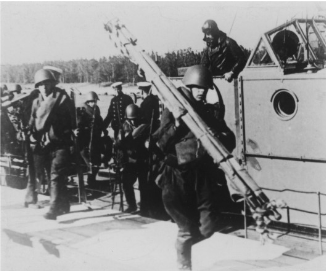
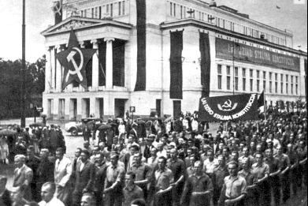
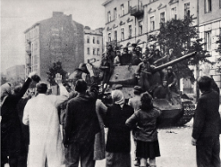
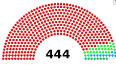
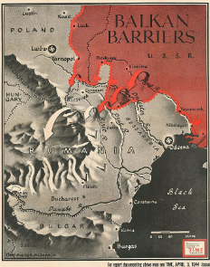
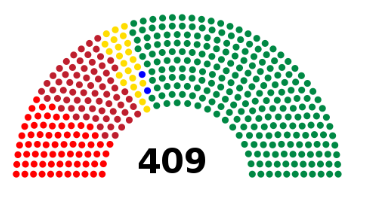
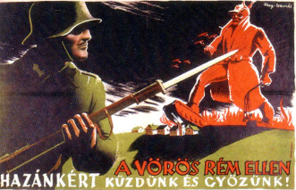
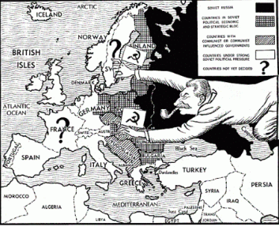
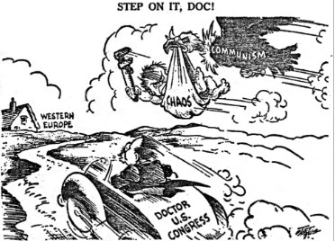

# How had the USSR Gained Control of Eastern Europe by 1948?

## Why did Stalin Want Control of Eastern Europe?

> **Spec point** — `spcpt_c99vNSWsbhhY4PwR`

## Why Did Stalin Want Control of Eastern Europe?

- From 1943 to 1945, the Soviet** *****Red Army**** ****liberated***** many countries in Eastern Europe from Nazi control**
- After 1945, Stalin wanted to keep control of these countries

  - He wanted them to act as a ***buffer zone*** **between the East and West**
  - These countries were called ***satellite states***
  
    - They had to stay in the ***orbit***** **of the ***USSR***, meaning**:**
    
      - They relied on the  USSR
      - The USSR influenced the countries’ actions and politic
- As each Eastern European country fell to ***communism***, it

  - **Confirmed Truman’s concern** about the spread of communism
  - Heightened US ***anti-communis****t *attitudes
  - Encouraged [Churchill’s ‘Iron Curtain’ speech](https://www.savemyexams.com/igcse/history/cie/18/revision-notes/the-20th-century-international-relations-from-1919/who-was-to-blame-for-the-cold-war/the-breakdown-of-the-us-soviet-alliance/)

## The ‘Baltic States’, 1940

> **Spec point** — `spcpt_dMRRmdWftvKrYYTn`

## The ‘Baltic States’, 1940

- The Soviet Union took over the ‘***Baltic States***’ during the Second World War
- The Soviet Union saw them as** *****legitimate*** Soviet states
- **The Baltic States wanted independence**

  - They stated that the USSR’s actions were illegal

*A photograph showing the arrival of the Soviet Red Army in Naissaar, Estonia in the summer of 1940*

*A photograph showing a Soviet-organised rally in Riga, Latvia in 1941*

## Poland and The Warsaw Uprising, 1944-45

> **Spec point** — `spcpt_x66wZF47TdhmJzdD`

## Poland and The Warsaw Uprising, 1944-45

- In 1944, Poland attempted to overthrow their Nazi German occupiers

  - The event is called the Warsaw Uprising
- Germany defeated the Warsaw Uprising

  - The Red Army waited until the defeat to occupy Poland
- At the Yalta Conference, the **Grand Alliance agreed to free elections in Poland**

  - Stalin did not want Poland to have** a non-communist government**
- In June 1945, Poland had a** *****coalition***** government **

  - It contained** communist supporters** and a few members of the ***London Poles***
- During the 1947 elections, the USSR led a campaign** of violence and intimidation**

  - The communists gained 80% of the vote
  
    - The election was either ***rigged***** **or people voted for the communists out of fear

*A photograph showing the Polish reaction to Soviet troops in Warsaw*

*A diagram showing the 1947 election results. The red dots represent the pro-communist "Democratic Bloc.” These results were likely fraudulent*

> **Worked Example**
> **Describe how the USSR** **consolidated its hold over Poland from 1945**
> 
> **4 marks**
> 
> **Final answer:** **Answers:**
> 
> Soviet troops stayed in Poland after the Warsaw Uprising **(1)**. Stalin did not follow the terms agreed at Yalta **(1)**. He was worried that allowing free elections would mean a non-Communist government in Poland **(1)**. As a result, the USSR rigged the elections in 1947 to ensure the Communists won a huge victory **(1)**.

> **Exam Hint**
> This style of question does not require you to explain your answer. The Cambridge IGCSE gives you **a point for each relevant piece of information** that you write. Therefore, do not spend any additional time trying to describe or explain each reason.

## Romania, Bulgaria and East Germany, 1944-45

> **Spec point** — `spcpt_p8ZcK2wgrgktbrsD`

## Romania, Bulgaria and East Germany, 1944-45

- At the Yalta Conference, the Grand Alliance agreed that** East Germany would fall under the USSR’s influence**
- Romania and Bulgaria both lost their ***monarchies***, which were replaced by **Communist governments**

*A map produced by Robert M. Chaplin Jnr in 1944 for TIME magazine. It shows the advance of the Soviet Red Army into Romania and Bulgaria*

## Hungary 1945-49

> **Spec point** — `spcpt_cJ4ktgDnWXg9dqjH`

## Hungary 1945-49

- **Non-Communists won the 1945 election** in Hungary
- A Communist politician called Rakosi took control of the ***secret police***

  - He** imprisoned political opponents**
  - **This pressure forced the *****resignation***** of the Hungarian Prime Minister**
- The Communists won the 1947 election

  - All other political parties were banned in 1949

*A diagram showing the 1945 election results. The green dots show the votes for the right-wing FKgP. The red dots represent the Communist Party*

*An anti-Communist poster from Hungary in 1945. It states: ‘Against the red menace, we fight and triumph for our homeland!’*

## Czechoslovakia, 1948

> **Spec point** — `spcpt_8mypvJpVmsSQdDmK`

## Czechoslovakia, 1948

- Czechoslovakia was a ***democracy*** from **1919 to 1938 **

  - Nazi Germany occupied the Sudetenland and then the whole of Czechoslovakia in 1938
- After 1945,** a non-Communist **called **Edward Benes **led a **coalition government**
- Stalin saw this as a **threat to his buffer zone **and wanted a Communist government in power
- In 1948, **pro-communist Klement Gottwald led **a ***coup ***

  - He took over the government with **support from the USSR**

> **Worked Example**
> **Study Source A**
> 
> **How useful is this source as evidence about the Cold War? Explain your answer using details of the sources and your knowledge**
> 
> **7 marks**
> 
> | **Source A: **From a broadcast by Moscow Radio, 1949  *Every now and again the USA and Britain accuse Hungary, Romania and Bulgaria of violating the peace treaties which bound them to safeguard the human rights of their citizens. These accusations are absolutely groundless.*   *All these countries are strictly observing the terms of the peace treaties and are not violating human rights. Political freedom is secured for all citizens. These rights are embodied in the new constitutions. Racial discrimination is a crime punishable by law. Women enjoy the same rights as men. There is full freedom of conscience. Freedom of assembly, organisation and the press is secured. The overwhelming majority of the working people of these countries is organised in political trade unions on a democratic basis. There is no censorship.*   *When the US and Britain speak of these countries violating the peace treaties, they are obviously not thinking of honest citizens of these countries who enjoy full political freedom, but of their own spies such as reactionary Fascist groups who have been convicted of terrorist activities designed to overthrow the people’s democratic governments of these countries. But the governments of Romania, Hungary and Bulgaria in no way violated the peace treaties when they adopted measures to frustrate those anti-democratic reactionaries. These governments acted in full accordance with the treaties, which bind them not to suffer the existence of Fascist organisations.* |
> |---|
> 
> **Final answer:** **Partial answer:**
> 
> Source A is useful to a historian studying the Cold War **(1)**. This is because it shows how the  USSR wanted to present its satellite states. Moscow Radio states that “Political freedom is secured for all citizens” in Hungary, Romania and Bulgaria **(1)**. The reality was that, during the 1940s, the USSR implemented Communist governments in Eastern Europe using force and rigging elections **(1)**. The USSR releasing this statement on behalf of these countries shows historians the level of control they had over the satellite states **(1)**.

> **Exam Hint**
> All sources are, in some way, useful for a historian. To achieve full marks for this question, you need to comment on the nature, origin and purpose of the source
> 
> - **Nature - **The source is a broadcast released on Moscow Radio in 1949. Radio broadcasts are intended to reach a wide audience. Therefore, it is useful for highlighting what the USSR wanted their people to hear and believe
> - **Origin - **Moscow Radio was government-owned. It is useful in showing the official opinion on issues. However, the USSR censored information meaning this broadcast is likely to be inaccurate. Therefore this is a typical source from the USSR
> - **Purpose - **Radio broadcasts are meant to inform people. *Censored* broadcasts like this are also made to persuade their audiences. As a result, they are very unreliable
> 
> This method of source analysis ensures you are using details from the source and your own knowledge in your answer.

## Communism in Yugoslavia and Albania

> **Spec point** — `spcpt_4H9Dk9BGZwVnxtzs`

## Communism in Yugoslavia and Albania

- The Soviet Union viewed** *****Yugoslavia**** *and Albania as **satellite states**

  - They were never occupied by the Soviet Red Army
  - They had **established their own Communist governments**
- They were **given more independence** than countries neighbouring the USSR

### The Satellite States of the USSR

![Map of Eastern Europe showing countries under Soviet influence after World War II.

Dark blue: Full USSR territory, including Estonia, Latvia, Lithuania (joined in 1940).

Light blue: Satellite states controlled by the USSR with years of alignment marked, e.g. East Germany (1945), Poland (1947), Hungary and Czechoslovakia (1948).

Green: Yugoslavia, aligned with the USSR until 1948.

Purple: Albania, aligned until 1960.

A key in the bottom-left corner distinguishes categories. The map emphasises the expansion of Soviet control across Eastern Europe in the early Cold War.](../../../assets/3f959c5efc65-satelitte-states-map.png)

*A map showing the creation of the USSR’s satellite states in Eastern Europe*

## The USA’s Reaction to the Satellite States

> **Spec point** — `spcpt_HRwrMXwM2WMYbGNM`

## The USA’s Reaction to the Satellite States

- In 1945, Roosevelt and Churchill had accepted that the USSR would influence Eastern Europe

  - They still saw the** importance of allowing free elections**
- Truman saw the creation of satellite states as a** deliberate attempt to spread Communism**
- **Churchill’s ‘Iron Curtain’ speech** in 1946 worsened relations between East and West
- The satellite states challenged Truman’s policy of ***containment***

  - This prompted Truman to establish the** Truman Doctrine and Marshall Plan**

*A cartoon by Welsh cartoonist Leslie Illingworth in 1947. It shows Stalin stretching from the USSR to place communist flags in Eastern Europe*

*A cartoon by American cartoonist Roy Justus for the Minneapolis Star  in 1947. It portrays the USA as a doctor trying to prevent the stork of communism delivering chaos to Western Europe*
