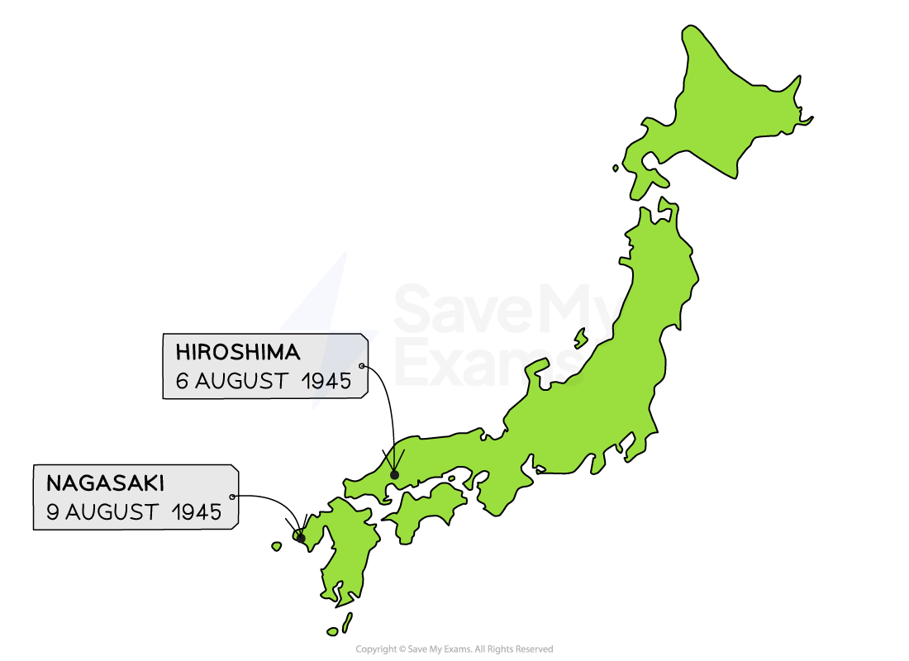

# The Breakdown of the US–Soviet Alliance

## The Grand Alliance in the Second World War

> **Spec point** — `spcpt_Zs5J8cKwhthtp73N`

## The Grand Alliance in the Second World War

- The **Grand Alliance** was also called the ‘***Big Three***’

  - Its members were the **USA, the *****USSR***** and the UK**
  - They **united** **in the Second World War** to defeat the** *****Axis***** powers** of Germany and Japan
- The members of the Grand Alliance were **suspicious** of each other:

  - ***Communism*** and the strength of the USSR concerned UK and the USA
- Historians call the Grand Alliance a ‘**marriage of *****convenience***’

  - The members worked together to defeat a common enemy
  - When they had achieved this, there was **nothing to keep the Grand Alliance together**
- After the defeat of the Axis powers by **August 1945**, the political atmosphere changed

  - ‘Old powers’ like UK and France decreased in power
  - The new ‘***superpowers***’ of the USA and the USSR increased in power

![This diagram shows key world leaders involved at the start of the Cold War.
Top Row: Wartime Leaders (Before 1945)
Each leader is shown with a portrait, their country’s flag, name, and political attitude:

Franklin D. Roosevelt (USA) – Wanted to accept the USSR as a superpower and work together to prevent future war.

Winston Churchill (UK) – Believed in the British Empire and was suspicious of Stalin and Communism.

Joseph Stalin (USSR) – Wanted to strengthen one-party Communist rule and believed the West wanted to destroy Communism.
Bottom Row: Post-War Leaders (After 1945)
Harry S. Truman (USA) – Replaced Roosevelt. Took a much tougher approach toward the USSR.

Clement Attlee (UK) – Replaced Churchill. Focused on rebuilding Britain and making domestic reforms rather than foreign policy.](../../../assets/be8832e3caa4-grand-alliance.png)

*Members of the Grand Alliance, 1941-45*

## The Yalta Peace Conference

> **Spec point** — `spcpt_hW8FFSzRXg8JgC93`

## The Yalta Peace Conference

- The Grand Alliance met** two years later** at **Yalta **

  - Yalta was a city in the USSR
  - The meeting occurred in the final few months of the Second World War

![This diagram shows the main aims of each of the Big Three leaders at the Yalta Conference in February 1945. The top of the image explains the overall aim: "Winning the Second World War and governing post-war Europe."
Franklin D. Roosevelt (USA)
Portrait of Roosevelt with the American flag.

Wanted Soviet support in the war against Japan.

Wanted the USSR to join the new United Nations.
Winston Churchill (UK)
Portrait of Churchill with the British flag.

Wanted free elections to be held in Central and Eastern Europe after the war.
Joseph Stalin (USSR)
Portrait of Stalin with the Soviet flag.

Wanted to keep the territory the USSR had gained between itself and Germany.](../../../assets/f2ed9769e31e-yalta-aims.png)

*Aims of the ‘Big Three’ at Yalta*

![This diagram presents key outcomes of the Yalta Conference. 
 Agreements:
Germany would pay $20 billion in reparations and be split into four occupation zones after its defeat.

The Soviet Union agreed to join the war against Japan.

The Soviet Union agreed that free elections would be held in Eastern Europe.

Poland – The USSR would gain land from Poland, and free elections would decide Poland’s post-war government.
This is highlighted with a red label: “Main area of disagreement.”

The United Nations (UN) would be created, but only some Soviet republics would receive individual membership.](../../../assets/2bcf9f26ede2-yalta-agreements.png)

*A list of the agreements made by the Grand Alliance at the Yalta Conference*

### How Did Yalta Affect the US-Soviet Alliance?

- The Yalta Conference had a **positive impact** on the US-Soviet alliance because:

  - The USSR **declared war against Japan** in August 1945
  - The USSR would gain **half of the \$20 billion** ***reparations***
  - The three main states of the **USSR** -  Russia, Ukraine and Belarus - joined** the *****United Nations***
  - Stalin agreed to** free elections in Eastern Europe**

## The Potsdam Peace Conference

> **Spec point** — `spcpt_pQXFHjNJyYXQsrNP`

## The Potsdam Peace Conference

- The Grand Alliance met a** few months later at Potsdam**, a city in **Germany**
- Several events had happened between the conferences at Yalta and Potsdam:

  - Roosevelt had died and** Harry S. Truman** replaced him as president
  
    - Truman wanted a tougher approach to Stalin
  - **Clement Attlee** replaced Churchill following a general election
  - Germany had ***surrendered***** **in May 1945
  - The** USA **had developed a new, devastating weapon - the ***atomic bomb***
  - 51 members had joined the United Nations

![This educational diagram presents the three main leaders at the Potsdam Conference of 1945: Truman (USA), Attlee (UK), and Stalin (USSR). Each leader is shown with their national flag and a summary of their aims for post-war Europe.

Top Banner:

Title: "Potsdam, July–August 1945"

Subtitle: "Aim – Finalise agreements on post-war Europe"

Leaders and Aims:

Harry S. Truman (USA):

Portrait shown with the US flag.

Aim: "The USA wanted to both ensure peace in Europe and prevent the spread of communism."

Clement Attlee (UK):

Portrait shown with the British flag.

Aim: "The UK wanted free elections to be held in Central and Eastern Europe after the war."

Joseph Stalin (USSR):

Portrait shown with the Soviet flag.

Aim: "The Soviet Union wanted to ensure that they remained powerful in Eastern Europe."](../../../assets/da59a994db18-potsdam-aims.png)

*Aims of the ‘Big Three’ at Potsdam*

![A revision-style infographic summarising the key agreements made at the Potsdam Conference in 1945. It includes a green title bar and four agreement boxes, each accompanied by a green check mark indicating consensus among the Allies.

Header:

Title: "Agreements at Potsdam" (on a pale green banner)

Agreements Listed:

Germany's Zones

"Germany’s four zones would be controlled by the Soviet Union, USA, UK and France."

Berlin’s Division

"Berlin would also be divided into four zones."

Industrial Equipment Sharing

"The Soviet Union would receive 25% of industrial equipment from the other three zones in Germany."

Nazi Party and War Crimes

"The Nazi Party was banned and war criminals were to be prosecuted."](../../../assets/fb9811964bc0-potsdam-agreements-1.png)

*A list of the agreements made by the Grand Alliance at the Potsdam Conference*

### How Did Potsdam Affect the US-Soviet Alliance?

- The Potsdam Conference had a negative impact on the US-Soviet alliance because:

  - The ***Trinity test***** increased *****tensions***** between both countries**
  - Stalin wanted harsher reparations against Germany
  
    - Truman wanted to protect the German economy
  - The USSR’s control over Eastern Europe concerned Truman
  
    - He believed that Stalin was spreading communism
  - Stalin wanted to keep his ***Red Army*** in Eastern Europe as protection against future threats

> **Worked Example**
> **Why was it harder for the Allies to reach an agreement at Potsdam than it had been at Yalta? **
> 
> **6 marks**
> 
> **Final answer:** **Partial answer:**
> 
> One reason why it was harder to reach an agreement at Potsdam was a change in leadership **(1)**. Roosevelt had died and was replaced by Harry S. Truman. Truman did not trust Stalin and wanted to take a tougher stance against him **(1)**. As a result, Truman began to stand up against Stalin at Potsdam. The two countries disagreed on issues such as German reparations. Due to Truman’s negative opinion of Stalin and Communism, fewer agreements were made at Potsdam **(1)**.

> **Exam Hint**
> In Paper One, ‘explain why’ questions are worth either six or ten marks. For full marks in this question, an examiner is looking for **two fully explained reasons **as to why there were disagreements between the USA and the **USSR** at Potsdam
> 
> To complete this answer, you could discuss Stalin’s reaction to the atomic bomb or the presence of the Red Army in Eastern Europe.

## The Atomic Bomb

> **Spec point** — `spcpt_wymbtsSmmSkcCTqJ`

## The Atomic Bomb

- The USA dropped **two atomic bombs **on **Japan** in August 1945:

  - The first exploded in **Hiroshima**
  - The second exploded in **Nagasaki**
- Both bombs killed roughly **120,000 Japanese civilians**

*Location of the atomic explosions in Japan*

- The USA had several justifications for using the atomic bombs on Japan:

![A flowchart-style infographic exploring the official and unofficial reasons for the United States’ use of atomic bombs on Japan during World War II. The content is divided into two sections, with a central light blue box posing the main question.

Central Question (Blue Box):

"WHY DID THE USA USE ATOMIC BOMBS?"

Left Side – Official Reasons (Labelled in beige and grey):

Reduce Deaths

"Atomic bombs would avoid an invasion of Japan by US troops, preventing millions from being killed."

Force Surrender

"Atomic bombs would force Japan to surrender, which they had previously refused to do."

Boost Morale

"Atomic bombs would boost the morale of troops because they would no longer need to fight."

Each of these reasons is paired with a corresponding beige label showing the motive (e.g. "REDUCE DEATHS").

Right Side – Unofficial Reason (Labelled in red):

Demonstrate Power

"Atomic bombs would send a message to the Soviet Union of how technologically advanced and powerful the USA were."](../../../assets/d933d8ef8a8e-9627-reasons-for-atomic-bomb-mind-map.png)

*Why did the USA use atomic bombs?*

- President Truman believed that the use of atomic bombs on Japan would:

  - **Persuade Western European countries to support the USA**
  - **Encourage Eastern European countries to resist Soviet expansion** and ***ally***** **themselves with the USA

### Why Did the Atomic Bomb Damage the US-Soviet Alliance?

- Stalin heard about the success of the ***Manhattan Project***** **during the **Potsdam conference in July 1945**
- After the bombing of Hiroshima, Stalin:

  - Wanted to create a** *****buffer zone***** **between Germany and the USSR
  
    - The communist countries would **protect the USSR from any potential invasions from the West**
  - Accelerated the USSR’s atomic bomb project
  
    - **The USSR successfully tested an atomic bomb on 29th August 1949**

![A split image shows President Harry S. Truman (USA) on the left and Joseph Stalin (USSR) on the right, with their national flags below them. A fraying rope between the two flags symbolizes rising tensions.

Under Truman, three blue boxes list U.S. aims:
– Ensure the USA is the leading superpower
– Deter European countries from becoming communist
– Prevent future wars

Under Stalin, three red boxes show Soviet aims:
– Ensure the USSR is the leading superpower
– Spread communism to protect Soviet interests
– Develop atomic weapons for potential war](../../../assets/3cdbed796bd2-increased-tension-atomic-bomb.png)

*How did the atomic bombs increase tension between both sides?*

- The atomic bomb increased Cold War** tensions** because:

  - **Truman** wanted to show his power to the USSR
  
    - He hoped that this would **prevent wa**r and protect Eastern Europe from Communism
  - **Stalin saw the USA’s actions as aggressive**
  
    - He believed the USA wanted to destroy Communism
    - He became willing to do whatever it took to protect the USSR, including Eastern Europe

## The Telegrams and the Iron Curtain  The Long Telegram

> **Spec point** — `spcpt_SstrvnkRFTPMgxbn`

## The Telegrams and the Iron Curtain

### The Long Telegram

- George Kennan was the USA’s ***ambassador***** **in ***Moscow***:

  - His opinion on the USSR was highly respected
- In February 1946, **Kennan sent a telegram from Moscow back to President Truman**:

  - Its name refers to the length of the telegram
  
    - It contained around 8,000 words, far more than a typical telegram message
- The telegram contained **Kennan’s assessment of Soviet attitudes towards the USA**:

  - Stalin wanted to **destroy capitalism** as it was a threat to Communism
  - The USA should aim to ‘**contain**’ the USSR and Communism
  - Peace would not be possible between the USSR and the USA

*The Long Telegram, February 1946*

### The Novikov Telegram

- Nikolai Novikov was the Soviet ambassador in ***Washington***:
- In September 1946, **Novikov sent a telegram from Washington back to Stalin**:

  - The USSR were aware of the Long Telegram and wanted to make a similar report on the USA
- The telegram contained **Novikov’s assessment of American attitudes towards the USSR:**

  - The USA wanted to build up its military strength to achieve **world domination**
  - Following Roosevelt’s death, the USA **no longer wanted to cooperate** with the USSR
  - The American people would support a war against the USSR

*The Novikov Telegram, September 1946*

### How Did the Telegrams Impact the US-Soviet Alliance?

- Both sides believed the other was **untrustworthy and planning their destruction**

  - The telegrams confirmed these fears
- The telegrams led to both sides adopting policies toward the other:

*How did the telegrams influence US and Soviet policy?*

### A British Perspective: Churchill’s ‘Iron Curtain’ Speech

- Winston Churchill was no longer the British Prime Minister

  - He was still a **very influential figure**
- In **March 1946**, Churchill **delivered a speech** about the threat of the USSR:

> **blockquote**
> From Stettin in the Baltic to Trieste in the Adriatic, an iron curtain has descended across the continent.

*The ‘Iron Curtain’ and divide between East and West*

- The ‘Iron Curtain’ refers to the ***impenetrable***** divide **between capitalism in the West and Communism in the East
- Churchill gave the speech in the USA

  - Stalin believed that Churchill’s speech** reflected the beliefs of the US government **

- The ‘Iron Curtain’ speech increased **tensions** further between the USA and the USSR

  - Both countries built up their military forces, leading to an ***arms race***

> **Worked Example**
> **Study Source A.**
> 
> **What is the cartoonist’s message? Explain your answer using details of the source and your knowledge**
> 
> ** 8 marks**** **
> 
> **Source A: **A cartoon published in the USA in 1947 by J.N. (Ding) Darling. The figures on the left represent the USA, Britain and France. "Ding" Darling Wildlife Society owns the copyright of "Ding" Darling cartoons.
> 
> 
> 
> **Partial answer:**
> 
> I believe that the cartoonist’s message is that the USSR was wrong to start the Cold War **(1)**. The cartoon shows the capitalist countries of Britain, France and the USA with the United Nations attempting to pull up the ‘Iron Curtain.’ The curtain has a communist symbol **(1)**. This shows that the cartoonist believes that the USSR  is to blame for the divide between capitalism and Communism. The depiction of the United Nations trying with all of its might to lift the curtain shows that, in the cartoonist’s opinion, the USA is still open to better relations with the USSR **(1)**.

> **Exam Hint**
> This style of question in Paper Two needs you to consider:
> 
> - What the **message of the source** is. Identify the event it is referring to and if it is presenting the event positively or negatively. In this example, the cartoonist had drawn about the Iron Curtain in a negative way
> - **Knowledge of the event**. This cartoon assumes that the reader knows about the establishment of the UN, the collapse of the US-Soviet alliance and Churchill’s Iron Curtain speech. Add relevant own knowledge of these events to support your answer
> - The **purpose** of the cartoon. The cartoon was published in an American newspaper in 1947. The cartoon is likely to be biased by blaming the USSR for worsening US-Soviet relations. The cartoon is typical of this, showing how Americans viewed the beginning of the Cold War.
