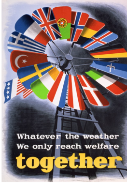
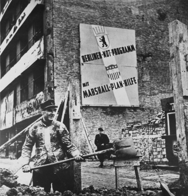
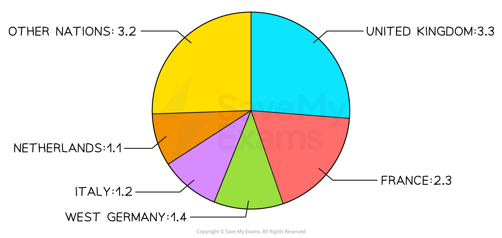

# The US Reaction to Soviet Expansionism

## The Truman Doctrine

> **Spec point** — `spcpt_zJtnzk6TZTgQSC9x`

## The Truman Doctrine

- Greece and Turkey were struggling to** prevent a *****Communist***** takeover of their governments**

  - They faced a ***civil war*** between ***monarchists*** and Communists
- In **1947, Britain** announced it could **no longer provide military support **to the Greek government

  - Truman worried about the spread of Communism
  - He decided to take action
- On **12th March 1947**, **Truman** announced that the USA would **send \$400 million to both Greece and Turkey**

  - Truman spoke about how nations have** two alternative ways of life**:

![Diagram showing the Truman Doctrine’s contrast between two systems:

Left side (The First Way – Capitalism): Linked to free institutions, free elections, freedom of speech, and freedom of religion.

Right side (The Second Way – Communism): Linked to terror and oppression, fixed elections, controlled press and radio, suppression of freedoms.

The Truman Doctrine label sits centrally above, with arrows pointing to each ideology.
The image visually reinforces Truman's belief that the USA had to support countries resisting communism.](../../../assets/77cf525a449a-truman-doctrine.png)

*What was the ‘Truman Doctrine’?*

- **The Truman Doctrine promised to provide any country vulnerable to Communism**

  - Money
  - Supplies
  - Weapons
  - Advice
- By **1949,** the Greek government **defeated the Communists **
- This was a new approach to US ***foreign policy***

  - Before the Second World War, the USA had followed a policy of ***isolationism***** **
  
    - They refused to get involved in other countries' affairs
  - The Truman Doctrine replaced **isolationism with *****containment***

> **Worked Example**
> **What was the Truman Doctrine?**
> 
> **4 marks**
> 
> **Final answer:** **Answers:**
> 
> The Truman Doctrine was an American policy of containment **(1)**. It meant that the USA would help any country threatened by communist aggression **(1)**. The USA sent military and economic aid to Greece and Turkey, which was under threat from Communism **(1)**. The USA wanted to promote democracy through following capitalism rather than Communism **(1)**.

> **Exam Hint**
> This question in Paper One requires you to state information you know about the Truman Doctrine. The Cambridge IGCSE gives you **a point for each relevant piece of information** that you write. Therefore, do not spend any additional time trying to describe or explain each reason.

## Marshall Aid

> **Spec point** — `spcpt_FrkfYC4QmY9f9tNF`

## Marshall Aid

- Truman hoped that countries would choose the** ‘first way’ of his *****doctrine***
- **US *****General***** George Marshall visited Europe. **He told Truman that:

  - **‘Every’ country in Europe was at risk of turning to Communism**
  
    - The Second World War had caused significant destruction
    - **Many people saw Communism as a way to redistribute wealth and improve their lives**
  - The USA should **provide these countries with *****economic aid***
  
    - Aid would persuade these countries away from Communism
- Truman enacted Marshall’s proposals

  - The US *Congress* passed the **Marshall Plan** after *Czechoslovakia* became communist in 1948

*A poster created by the Economic Cooperation Administration, an agency of the US government, in 1950. Each blade of the windmill represents a country that accepted Marshall Aid*

*A picture captured by the US Department of State International Cooperation Administration. The caption states: ‘West Berlin, Germany. Marshall Plan aid to Germany totaled $1,390,600 and enabled that country to rise from the ashes of defeat, as symbolized by this worker in West Berlin. Even a year before the end of the Marshall Plan in 1951, Germany had surpassed her pre-war industrial production level’*

### What Economic Benefits Did the Marshall Plan Provide?

- Before the plan, the USA gave** \$12.7 billion **to other countries
- The Marshall Plan gave away** \$13 billion to 16 European countries** in Western Europe:

*The amount of money given to each country ($ billion)*

- The **amount of Marshall Aid** was based on a country’s

  - Population
  - Pre-war economy
- British Foreign Secretary Ernest Bevin described the Marshall Plan as a:

> **blockquote**
> Lifeline to sinking men

- The Marshall Plan was offered to the** *****satellite states*** of Eastern Europe

  - Truman knew that** Stalin would not allow them to accept the money**

### The Impact of the Truman Doctrine and Marshall Aid

- Stalin believed that the Truman Doctrine and Marshall Plan was

  - **A threat to communism and the *****USSR***
  - **Taking the role away from the *****United Nations***, which should be the group providing money to other countries
- Stalin called the Marshall Plan** ‘*****dollar imperialism*****’**

  - The USSR believed that the USA was **using money to expand its** ‘**empire**’
  - The USA wanted Europe to embrace ***free market***** *****capitalism*** and ***democracy***
  
    - Marshall Aid would make European countries wealthy enough to buy US exports
    - Building European economies would prevent another ***Great Depression***
- The **Marshall Plan had divided the West from the East:**

  - Satellite states were in support of the USSR
  - Recipients of the Marshall Plan supported the USA
- The Truman Doctrine and Marshall Plan** increased Cold War** ***tensions***

> **Worked Example**
> **Study Source A. **
> 
> **Are you surprised by this source? Explain your answer using details of the source and your knowledge**
> 
> **7 marks**
> 
> | **Source A:** A speech delivered by General George Marshall at Harvard University on 5 June 1947  I need not tell you gentlemen that the world situation is very serious.... The truth of the matter is that Europe's requirements for the next three or four years of foreign food and other essential products — principally from America — are so much greater than her present ability to pay that she must have substantial additional help or face economic, social, and political deterioration of a very grave character...  Aside from the demoralizing effect on the world at large and the possibilities of disturbances arising as a result of the desperation of the people concerned, the consequences to the economy of the United States should be apparent to all. It is logical that the United States should do whatever it is able to do to assist in the return of normal economic health in the world, without which there can be no political stability and no assured peace. Our policy is directed not against any country or doctrine but against hunger, poverty, desperation, and chaos. Its purpose should be the revival of a working economy in the world so as to permit the emergence of political and social conditions in which free institutions can exist...  An essential part of any successful action on the part of the United States is an understanding on the part of the people of America of the character of the problem and the remedies to be applied. Political passion and prejudice should have no part. With foresight, and a willingness on the part of our people to face up to the vast responsibility which history has clearly placed upon our country, the difficulties I have outlined can and will be overcome... |
> |---|
> 
> **Final answer:** **Partial answers:**
> 
> I am surprised by Source A **(1)**. One reason for my opinion is that General Marshall does not mention Communism. George Marshall was the Secretary of State and created the Marshall Plan. Due to his position in the US government, he would likely have anti-Communist opinions and follow containment** (1)**. Within his letter, Marshall explicitly states “Our policy is directed not against any country or doctrine” and that “Political passion and prejudice should have no part” **(1)**. This shows that Marshall’s vision was to offer American economic aid to any country, regardless of their political outlook **(1)**.

> **Exam Hint**
> This is a question that may appear on Paper Two. To answer this question fully, consider:
> 
> - Who created the source. Consider the person’s occupation and how much they would know about the event in question. Consider if this person has presented a ***biased*** opinion in the source due to who they are
> - The **strength of both sides** of the argument. In this example, you need to consider why this source may also not be surprising. Consider the condition of Europe in 1947 and Truman’s motivation to create a free European market. Discuss how these may have influenced Marshall’s speech
> 
> Concluding your thoughts with a reflection on the extent to which you are surprised by the source. Use words like '**partially**' or '**fully**' to explain this.
