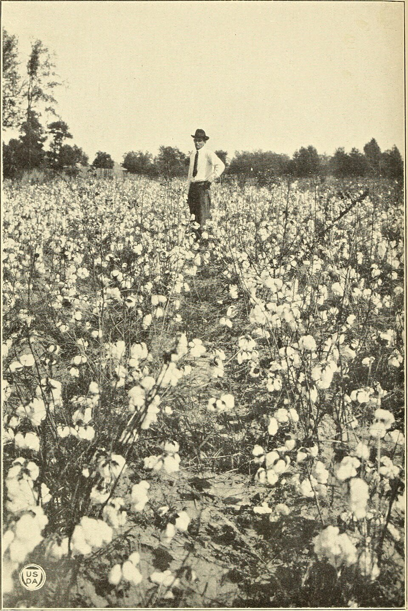

# Issues With Agriculture in the Boom

## Summary

America’s economic boom during the 1920s was concentrated in its major cities and *urban *areas. The* **rural *areas of the countryside did not benefit from the prosperity in the cities, and the gap in wealth between town and country increased during the 1920s.** *****Overproduction*** at the end of the First World War led to a collapse in prices for farmers. The introduction of machinery into* **agriculture *made things even worse for unskilled farm workers, as these machines often took their jobs.

## Problems with the farming industry

> **Spec point** — `spcpt_nBDT3fZ5TGg8vGcv`

## Problems with the farming industry

- Once the First World War ended, European nations were able to grow their own crops

  - As a result, **demand** for **American corn** and **wheat fell dramatically **
  - More crops were being produced in the US than were needed
  - In addition, countries such as Canada and Argentina were also trying to sell their crops on the world markets

- The combined effect **drove down the price of crops**

  - Corn and wheat** prices fell by nearly 50 per cent** between 1920 and 1921
- American farmers suffered further because many European countries refused to buy US produce in response to the tariffs America had placed on imports

- Cotton farmers also struggled due to the *boll weevil*,* *which devastated many crops during the 1920s

*A Texas farmer in 1921 surveying his field of cotton that had been destroyed by the boll weevil parasite*

## Unskilled workers in rural areas

> **Spec point** — `spcpt_MTQQ5K3v3xx5jYFh`

## Unskilled workers in rural areas

- Just like in industry, agriculture became increasingly mechanised during the 1920s

  - Machines such as *harvesters* and tractors did many of the jobs that were previously done by unskilled workers
- Unlike for unskilled workers in cities, there were few opportunities to find work elsewhere

  - The lack of schools and general infrastructure in rural areas meant people in the countryside were more likely to be trapped in low-paying jobs
- When prices fell in the 1920s, unskilled workers were the first to lose their jobs or were offered drastically reduced wages
- Black American unskilled workers in the South also suffered from prejudice and discrimination

> **Worked Example**
> **Describe the problems faced by American agriculture during the economic boom of the 1920s.  **
> 
> **[4 marks]**
> 
> **Final answer:** **Answer:**
> 
> One problem faced by American agriculture during the economic boom of the 1920s was overproduction. European farms started to grow their own crops after the war ended, which meant more crops were being produced than were needed. This caused prices to collapse.
> 
> Another problem faced by American agriculture during the economic boom of the 1920s was the mass unemployment of unskilled agricultural workers. The introduction of machines such as tractors and harvesters took many of the jobs normally filled by unskilled workers, and there were few, if any, alternative sources of employment available in the countryside.

> **Exam Hint**
> For the ten-mark judgement questions, make sure you reach a supported conclusion after you outline both sides of the argument. You will lose marks if you sit on the fence!
