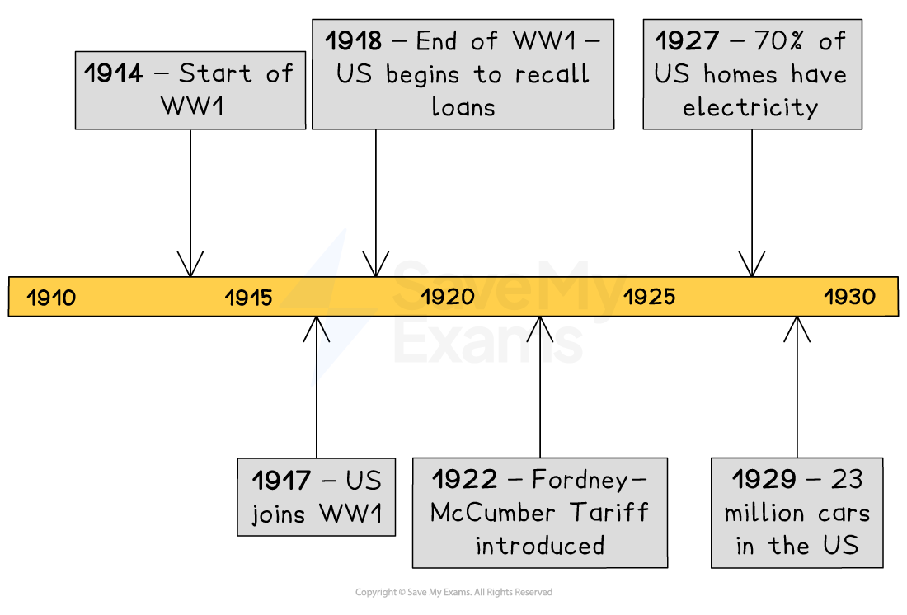
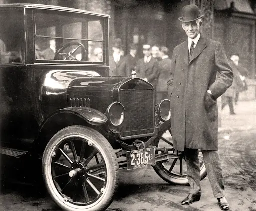

# Reasons For the Economic Boom

### Timeline & Summary

An **economic boom** is a period of **rapid economic growth** and *prosperity* within a country. During the 1920s, the US experienced an economic boom. Many factors contributed to this growth. One key factor was the emergence of new industries and technologies — such as cars, radios and consumer *appliances* — due to *innovation* and investment.

In the 1920s, there was also an increase in consumer spending. Workers had more *disposable income* than ever before due to rising wages and increased access to *credit.* This allowed more US citizens to purchase goods and services. Businesses had to produce more to meet this demand, further increasing their profits.

*Republican* government policies also helped the economy boom. They cut taxes and allowed businesses to operate without government intervention. This promoted business investment and *entrepreneurship.*

The economic boom of the 1920s had a significant impact on the US. It led to a rising *standard of living*, increased *urbanisation* and the emergence of a modern *consumer culture*. The widespread availability of consumer technology transformed daily life for many US citizens. New products and wealth offered an opportunity for leisure and entertainment.

## The First World War

> **Spec point** — `spcpt_F5HGx7X74B5HvP9J`

## The First World War

- Many American citizens did not want the US to join the First World War

  - They believed that the US should remain *neutral*
  - The US eventually entered the war in 1917
- The US did not suffer as much as European countries in the First World War

  - **No fighting** occurred on US soil
  - The US suffered fewer *casualties*
- Before entering the First World War, the US gave** loans** to *Allied* countries
- At the end of the conflict, the US began to *recall* the loans to Europe, which** increased American wealth**

  - The** UK repaid \$4.7 bn **to the US
- The First World War did not destroy US industry or *infrastructure*

  - European countries needed goods to rebuild their infrastructure and economies
  - The US began selling goods to overseas markets that were unable to make their own

## Mass production

> **Spec point** — `spcpt_stVbDDhz4GCQb4qX`

## Mass production

- **Mass production** is a way of making lots of products quickly. This can involve:

  - Machinery
  - Improving the manufacturing process
- Many US industries embraced mass production in the 1920s

  - The **car industry** was one of the key industries to use mass production
- In 1913, Henry Ford developed the concept of the *moving assembly line* with the **Ford Model T car**

  - The car moved through the factory on a conveyor belt
  - Each **worker** and **machine** only **focused on one task **in the car’s production; for example, attaching the front bumper
  - The car moved through each stage until it was fully assembled
- Each Model T was the same colour (black) and had the same engine size, which reduced costs
- In the 1920s, one Model T was made every **ten seconds**

  - By 1929, there were** 23m cars** in the US
  - The mass production of cars led to improvements in the US road network, as well as the development of cities and suburbs

*A photograph showing Henry Ford standing next to a Ford Model T car in 1921*

- The expansion of the car industry also led to the growth of other industries

  - Steel, rubber, glass, leather and oil manufacturers all *boomed* because they supplied parts to the car industry
- Other American industries soon adopted the **assembly line**

  - This made more and more goods affordable for US citizens

## New technology

> **Spec point** — `spcpt_2GGy6WS4QVrVxVCW`

## New technology

- In 1916, only **15 per cent** of American homes had **electricity**

  - By **1927**, this had **increased to 70 per cent**
- New electrical gadgets such as **refrigerators, vacuum cleaners** and **washing machines** were bought in huge numbers by Americans in the 1920s

  - The number of **radios** owned by Americans increased from **60,000 **in 1919 to** 10m **by 1929

## Hire-purchase schemes

> **Spec point** — `spcpt_XyMyBsQ39XmFSHBT`

## Hire-purchase schemes

- **Hire-purchase** is a small loan that enables a person to purchase goods without having the money needed to buy them outright

  - Consumers can buy a product such as a vacuum cleaner on ***credit***
  - Consumers then pay for the product in **monthly instalments** over many months
- Hire-purchase became very popular in 1920s America

  - It meant that people could buy a lot of products without needing to pay for them on the day of purchase
  - This encouraged people to **buy more new goods** than they could necessarily afford
  - This, in turn, encouraged **mass production** and increased profits for businesses

## Republican policies

> **Spec point** — `spcpt_JC99BvCmcK9WVGd7`

## Republican policies

- The Republican Party tried to help American business in the 1920s in a number of ways

  - **Reducing taxes**
  
    - By giving less money to the government, businesses made more profits
    - The businesses could then invest their profits back into the company. For example, they could build new factories and employ new workers
  - Having a laissez-faire approach to business
  
    - This is French for “allow to do”
    - It meant that the Republican government did not interfere with how businesses were run
- In addition to this, *Congress* passed the Fordney–McCumber *Tariff* in 1922

  - This placed a tariff or tax on foreign goods entering the US
  - This made foreign-made goods more expensive and encouraged American consumers to buy goods made in the US

## Confidence in the economy

> **Spec point** — `spcpt_WSB3CwSTjbWdg2SP`

## Confidence in the economy

- Many US citizens believed that the economic boom would last forever

  - This led to more workers purchasing *shares* in companies than ever before
- Many workers bought shares “**on the margin**”

  - This meant that they borrowed money using low-interest loans and used it to buy the shares
- The demand for shares caused prices to rise and led to many working class people making large profits on the *stock market*

  - They used these profits to pay off their loans and then buy **consumer goods**, such as cars and refrigerators, or invest in more shares
- This all helped to boost the US economy

> **Worked Example**
> **What policies did Republican Governments follow in the 1920s to encourage industrial growth? **
> 
> **[4 marks]**
> 
> **Final answer:** **Answer:**
> 
> Republican governments attempted to encourage industrial growth in a number of ways. One way was by lowering taxes. This led to businesses making higher profits, as they did not have to pay as much in tax. The idea was that the business owners would invest these profits in their business and expand it. This would lead to an ever bigger and more profitable business that, even though it paid a lower rate of tax, would eventually give more money to the government because it was making bigger profits.
> 
> Another attempt to encourage industrial growth was the Fordney–McCumber Tariff of 1922. This placed a tax or tariff on goods imported into the US. The idea was that, by making foreign goods more expensive, US consumers would buy American goods and boost American businesses.

> **Exam Hint**
> Many of the factors that led the American economic boom in the 1920s are connected to each other. It is important that you are able to explain how developments such as mass production led to increased consumer confidence, which increased wealth and led to more sales of consumer goods etc. Remember, none of these developments occurred in isolation from each other, but they combined to create the boom.
