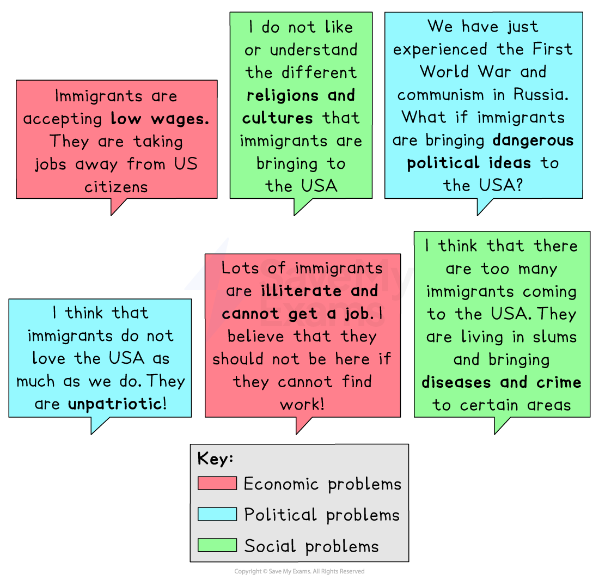
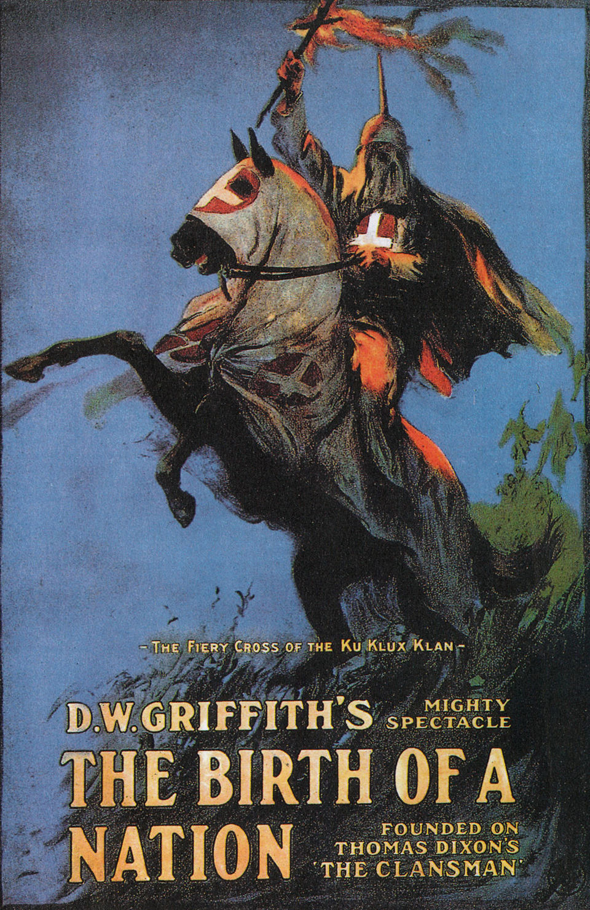

# What was America Like in 1919?

### Summary

American society was undergoing several** significant changes** in 1919. The First World War led to a significant improvement in the US economy, but that had come to a sudden end when peace was declared in November 1918. This coincided with attempts by American politicians to end the **mass immigration** to the US that had been happening for over 50 years. Around 40m people had arrived in the US during that time, and this had increased racial tensions. This, in turn, led to the passing of several laws intended to stop migration to the US. It also led to an enormous increase in the popularity and membership of the racist Ku Klux Klan (KKK) organisation.

## Impact of the First World War

> **Spec point** — `spcpt_QhBncQ8r6SjdVQpW`

## Impact of the First World War

- The First World War had both positive and negative impacts on the people of the United States

### Positive impacts

- Enormous industrial growth by supplying the* Allies** *with weapons, food and other supplies
- Loans given to other nations helped increase the country’s wealth when they were paid back
- New York replaced London as the world’s financial centre

### Negative impacts

- *Inflation* during and after the war caused large increases in the cost of living
- Many soldiers returning from the war struggled to find jobs
- *Veterans* were not helped by the government to reintegrate with society
- The employment surge experienced during the War disappeared once peace was declared
- The drop in demand led to a drop in employment, both in factories and on farms

## Immigration into the US

> **Spec point** — `spcpt_qTxxHSWPqRNYjDKW`

## Immigration into the US

- Between 1850 and 1914, approximately 40m people *emigrated* to the United States

  - Most of the immigrants came from Southern and Eastern Europe
  - It was the largest recorded movement of people in history
- The arrival of millions of immigrants angered many Americans

  - In the 1600s, their ancestors had emigrated to America from North-Western Europe
  - They became known as White Anglo-Saxon Protestants or WASPs

*An illustration showing the opinions of WASPs and second-generation immigrants on immigration in the 1920s*

- The fears, frustrations and prejudices of the WASPs led to a number of laws being passed that were designed to limit migration to the US

### Laws to limit immigration to the US

- **1917 Immigration Law**

  - All immigrants had to prove that they could read English
  - Immigrants from Asia were not allowed to enter the US
  - Each immigrant had to pay an immigration fee of \$8
- **1921 Emergency Quota Act**

  - The number of immigrants from the eastern hemisphere could not be more than 3% over the number of migrants from this region already living in the US by 1910
  - The maximum number of immigrants entering the US each year was set to 357,000
- **1924 Reed–Johnson Act **

  - The maximum number of immigrants entering the US in any year was reduced to 154,000
  - The quota from the eastern hemisphere was reduced to 2% of those already in America in 1890

## Racial tensions in the US 

> **Spec point** — `spcpt_wJzBs2FzyPXxw66m`

## Racial tensions in the US

- Millions of Africans were enslaved and transported to the US from the 17th century onwards
- Once in the US, they were bought and sold and forced to work for White slave owners

  - Although slavery was abolished in the US in 1865, it left a *legacy* of racial tension
- Tensions were worst in the *South*,* *where most of the large cotton and tobacco farms that used slave labour had been located

  - White Americans were in the minority in these states, but White politicians passed the *Jim Crow Laws*,* *which discriminated against Black Americans
  - These laws forced Black Americans to use different schools, libraries, swimming pools, taxis, etc from White Americans
  - They also prevented many Black Americans from voting by introducing literacy tests that were impossible for uneducated people
  - Some states also introduced a tax on registering to vote, which most Black Americans could not afford
- In the North, tensions had increased due to the arrival of many Black Americans who were trying to escape racial persecution in the South and find job opportunities in the factories

  - The Black American populations of both Chicago and New York doubled between 1900 and 1920
  - Although Jim Crow Laws did not exist in the North, racist attitudes did, and many Black Americans:
  
    - Struggled to find work
    - Were paid less than White Americans
    - Were forced to live in the most *deprived* areas of town
- A resurgence in the popularity of the racist KKK also increased tensions

  - Its growth in popularity was, in part, down to the 1915 Hollywood movie, *The Birth of a Nation*

*This movie was a huge success all across the US and glorified the actions of the KKK whilst portraying Black Americans as violent thugs*

- The KKK was a highly secretive organisation, and its members kept their faces covered under white robes whilst in public

  - It was founded immediately after the abolition of slavery in 1865, but its popularity had declined
  - The success of *The Birth of a Nation* led to an enormous revival and a membership of around 5 million people
- Although the KKK primarily targeted Black Americans, they were also highly prejudiced against the Jewish and Catholic communities

> **Worked Example**
> **Describe two ways in which racial tensions affected life in the United States in 1919.**** **
> 
> **[4 marks]**
> 
> **Final answer:** **Answer:**
> 
> One way in which racial tensions affected life in the United States in 1919 was through the increased popularity of the Ku Klux Klan (KKK). This was a highly secretive and extremely racist organisation which primarily targeted African Americans, and it is thought to have had as many as 5 million members. The KKK sought to uphold the racist Jim Crow Laws.
> 
> Another way in which racial tensions affected life in the United States in 1919 was in the increased demands for an end to immigration to America. 1917 had seen the Immigration Law passed, but demands for more action led to the Emergency Quota Act and the Reed–Johnson Act. Both of these acts put specific limits on people from the eastern hemisphere but not from Western Europe.

> **Exam Hint**
> Using terms such as WASP or KKK in an exam is fine as long as you use White Anglo-Saxon Protestant (WASP) or Ku Klux Klan (KKK) first.
