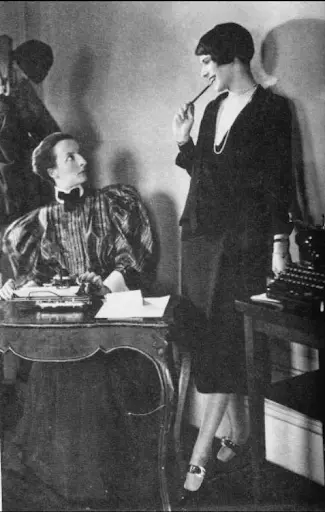

# Changes to the Roles of Women During the 1920s

## Summary

The 1920s were a decade of enormous change for some women. All women were granted the right to vote thanks to the passing of the 19th* Amendment *to the American *Constitution* in 1920. In addition to this, more women than ever before entered the workforce. By earning their own wages, women became **economically independent** from their husbands and fathers. This led to them making their own decisions and life choices. The short-haired, short-skirted “**flapper**” seemed to sum up this new spirit of independence in American women. In reality, the lives of many women remained unchanged from those of their mothers and grandmothers.

## Life for women before the First World War

> **Spec point** — `spcpt_5NmXXYFvT79v7bPN`

## Life for women before the First World War

- Before the First World War, society expected women to be:

  - *Modest*
  
    - Women had to **wear long dresses**
    - Women were not able to flirt with a man in public
  - Respectable
  
    - An older or married woman would accompany a single woman in public
    - Behaviours such as **smoking **and** drinking** would be regarded as **unacceptable for a woman**
  - A housewife
  
    - Most women did not work outside of the household
    - If women did work, they had *stereotypical *jobs, such as being a *seamstress* or a maid
    - Regardless of employment status, women were expected to **look after children **and the **men** of the household
- The First World War changed the lives of women

  - From 1917, *conscription *meant that American men left the US to fight in the conflict
  - In their absence, women had to take on male-dominated jobs, such as:
  
    - Working in ***munition *****factories**
    - Working in *heavy industry*
    - Bus and tram conductors
    - Police officers and firefighters
  - This work was **vital in keeping the US functioning** during the First World War
  - It convinced some men that women were valuable US citizens

## Positive changes for women during the 1920s

> **Spec point** — `spcpt_MSc8xNtCbSQJ3R5D`

## Positive changes for women during the 1920s

- In 1920, American women won the **right to vote** in general elections

  - Politicians soon began to introduce laws and changes to appeal to female voters
  - One example was the** Maternity and Infancy Protection Act** (1921)
  - This provided federal and state funds to prevent the deaths of mothers and babies during childbirth
- By 1929, 25% more American women had jobs than in 1920

  - The **economic boom** created more jobs
  - Many women gained employment in offices as *telephonists, *secretaries and typists
  - In 1929, around 10.9 million women worked in jobs outside of the home
- Earning their own money led to many women feeling** less dependent **on their husbands

  - They took more control of their own lives and began to make their own decisions
  - The **divorce rate doubled **during the 1920s
- The independent attitude of many women seemed to be perfectly illustrated by the **flappers**, who emerged in American society in the 1920s

  - **Flappers** rejected the traditional expectations of women by:
  
    - Cutting their hair short
    - Wearing short skirts or men’s clothing, or making themselves look flat-chested
    - Using bold makeup
    - Smoking cigarettes
    - Drinking alcohol
    - Dancing suggestively to jazz
    - Being sexually active with men they weren’t married to
    - Having same-sex relationships in the open

*A photograph from New York in the early 1920s. It shows a woman dressed traditionally (on the left) looking shocked at a flapper (on the right)*

## Why did some women not experience change?

> **Spec point** — `spcpt_nS6n8G8Xcw2myVWx`

## Why did some women not experience change?

- Although flappers became a symbol of the changes and new opportunities available to women in the 1920s, they did not reflect the lives of most women
- Most employed women were in** low-skilled jobs**, where they were **paid less than men** for completing the same tasks

  - **Management positions** were very **rarely given to women**
- Almost all politicians were men
- **Flappers** were almost all **white, wealthy, upper-class women** from cities in the northern states

  - There was a backlash against the flapper lifestyle by groups that campaigned for “decent” behaviour by women
  - Women continued to have children early and bear nearly all of the burden of childcare

> **Worked Example**
> **Describe how the roles of women in the United States changed during the 1920s. **
> 
> **[4 marks]**
> 
> **Final answer:** **Answer:**
> 
> One way in which the role of women in the United States changed during the 1920s was through political participation. Before the 19th Amendment was passed in 1920, women had been unable to vote. Once women had won the right to vote, they began to influence the policies of politicians and elected officials.
> 
> Another way in which the role of women in the United States changed during the 1920s was in employment outside the home. By 1929, the number of women employed outside the home had increased by 25%, which led to a larger number of financially independent women.

> **Exam Hint**
> It is important to remember that there was no such thing as a “typical” 1920s woman — any more than there was a typical 1920s man. Although flappers got a lot of attention and newspaper headlines, their appearance, attitudes and life experiences were not those of the majority of American women. If you are asked in an exam question about changes to the lives of American women during the 1920s, don’t fall into the trap of limiting your answer to a description of a flapper.
