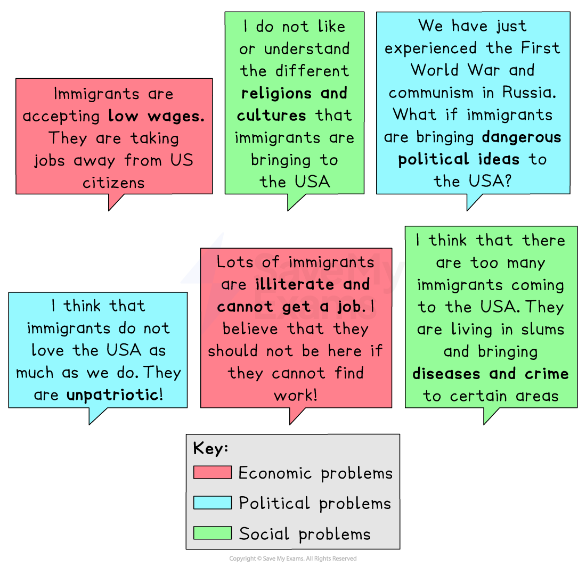
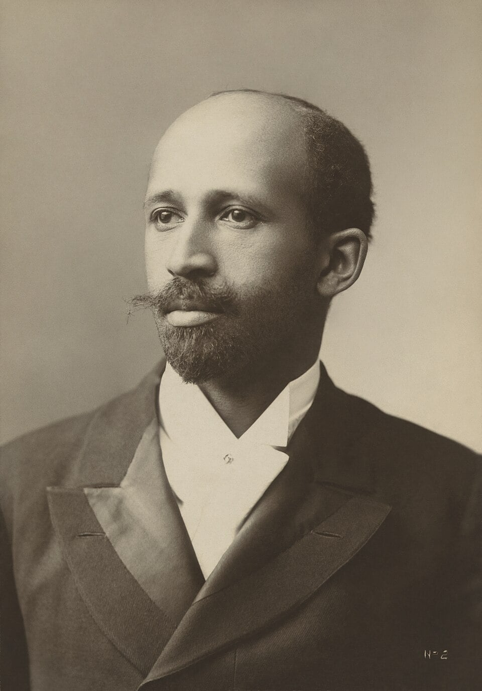

# Intolerance in US Society

## Summary

At the start of the 20th century, the most powerful people in the United States were the descendants of migrants from countries in Western Europe, such as Britain and Germany. Collectively, they became known as White *Anglo-Saxon **Protestants* (**WASPs**). Many of them were eager to maintain their positions of power and influence. This resulted in recent *immigrants* to the US and the descendants of enslaved African people suffering from prejudice, discrimination and racist violence from WASPs in positions of authority.

New laws were passed, which are viewed by many as racist, that put specific limits on people migrating to the US from Asia and the *eastern hemisphere*.

The racist Ku Klux Klan’s (KKK) popularity grew enormously during the 1920s, and the secretive organisation launched a campaign of murder and terror against Black Americans in the South. Black Americans routinely suffered from *discrimination*, both in terms of laws and racially motivated murders known as** lynchings**. In response to this treatment, the National Association for the Advancement of Colored People (NAACP) was formed. It campaigned to end racial injustice on a nationwide scale.

## Reactions to immigration

> **Spec point** — `spcpt_kMBxg8vnnRnNzfnY`

## Reactions to immigration

- Between 1850 and 1914, approximately **40m people** *emigrated* to the United States

  - Most of the immigrants came from Southern and Eastern Europe
  - It was the largest recorded movement of people in history
- The arrival of millions of new immigrants angered many existing Americans

  - The White Americans already living in the US were the *descendants* of immigrants themselves
  
    - In the 1600s, their ancestors had emigrated across the Atlantic from North-Western Europe
  - These Americans became known as **WASPs**

*An illustration showing the opinions of WASPs and second-generation immigrants on immigration in the 1920s*

- WASPs were extremely powerful and influential in America at the start of the 20th century
- The fears, frustrations and *prejudices* of WASPs led to a number of laws being passed that were designed to limit migration to the US

### Laws to limit immigration to the US

- **1917 Immigration Law**

  - All immigrants had to prove that they could read English
  - Immigrants from Asia were not allowed to enter the US
  - Each immigrant had to pay an immigration fee of \$8
- **1921 Emergency Quota Act**

  - The number of immigrants from the eastern hemisphere could not be more than three per cent over the number of migrants from this region already living in the US by 1910
  - The maximum number of immigrants entering the USA each year was set to 357,000
- **1924 Reed–Johnson Act **

  - The maximum number of immigrants entering the USA in any year was reduced to 154,000
  - The quota from the eastern hemisphere was reduced to 2% of those already in America in 1890

## The KKK and the NAACP

> **Spec point** — `spcpt_FGpqFjPBMy3ywDR3`

## The KKK and the NAACP

### The KKK

- The KKK was a racist organisation formed in the Southern US after the end of the American Civil War in 1865

  - After its formation, the popularity of the organisation declined
- In 1915, the release of a film, *The Birth of a Nation,* led to an enormous revival of the KKK
- By 1925, its membership had grown to around 5 million people
- The KKK believed in *white supremacy*

  - They wore white robes and hoods and marched with burning crosses
  - They attacked, tortured and killed Black Americans
  
    - Many members of law enforcement were KKK members, which meant these crimes were not investigated
    - In the 1920s, they also attacked Roman Catholics, Jews, new immigrants and communists
  - Some KKK members held key government positions
  
    - David Bibb Graves was the governor of Alabama and a KKK leader

### The National Association for the Advancement of Colored People (NAACP)

- The NAACP was founded in 1909

  - It was formed after the Springfield Race Riot, when a racist mob of white people attacked the homes and businesses of Black people in Springfield, Illinois
  - The riot left at least two people dead and many hundreds homeless
- The NAACP was created to combat racial injustice on a national scale

  - It fought racism through the law courts, by raising public awareness of civil rights issues and by mobilising local communities for collective action

*W. E. B. Du Bois was one of the founding members of the NAACP and became one its most important members*

## Treatment of Black Americans in the Southern US states

> **Spec point** — `spcpt_qwpV3YckKJvn5S6R`

## Treatment of Black Americans in the Southern US states

- Much of the NAACP’s work was focused in the Southern US states, where *lynchings* and *Jim Crow Laws* were common

  - Although slavery was abolished in America in 1865, it left a *legacy* of racial tension
- Tensions were worst in the *South*,* *where most of the large cotton and tobacco farms that used slave labour had been located

### Jim Crow Laws

- White Americans were in the minority in these states, but White politicians passed the Jim Crow Laws,* *which discriminated against Black Americans

  - These laws forced Black Americans to use different schools, libraries, swimming pools, taxis, etc from White Americans
  - They also prevented many Black Americans from voting by introducing literacy tests that were impossible for uneducated people
  - Some states also introduced a tax on registering to vote, which most Black Americans could not afford
- Black Americans in the South were also routinely subjected to violence and murder

  - Mobs of White Americans lynched Black Americans that they suspected of committing a crime
  
    - In 1919, there were 70 lynchings
    - These murders were usually not investigated by the police, and the murderers went unpunished

> **Worked Example**
> **Describe the impact of intolerance in American society in the 1920s. **
> 
> **[4 marks]**
> 
> **Final answer:** **Answer:**
> 
> One impact of intolerance in American society in the 1920s was the dramatic growth in popularity of the Ku Klux Klan. This racist and secretive organisation mainly targeted Black Americans with violence and murder but were also prejudiced against any non-WASP groups. The KKK had a membership of 5 million in 1925.
> 
> Another impact of intolerance in American society in the 1920s was the passing of immigration laws that prevented migration from specific parts of the world. The 1921 Emergency Quota Act limited the number of immigrants from the eastern hemisphere to no more than 3% over the number of migrants from this region already living in the USA by 1910.

> **Exam Hint**
> Make sure you pay close attention to any specific dates mentioned in questions. For example, you would receive no marks for mentioning the Immigration Law when answering the question above because it was passed in 1917 and the question enquires about the 1920s.
