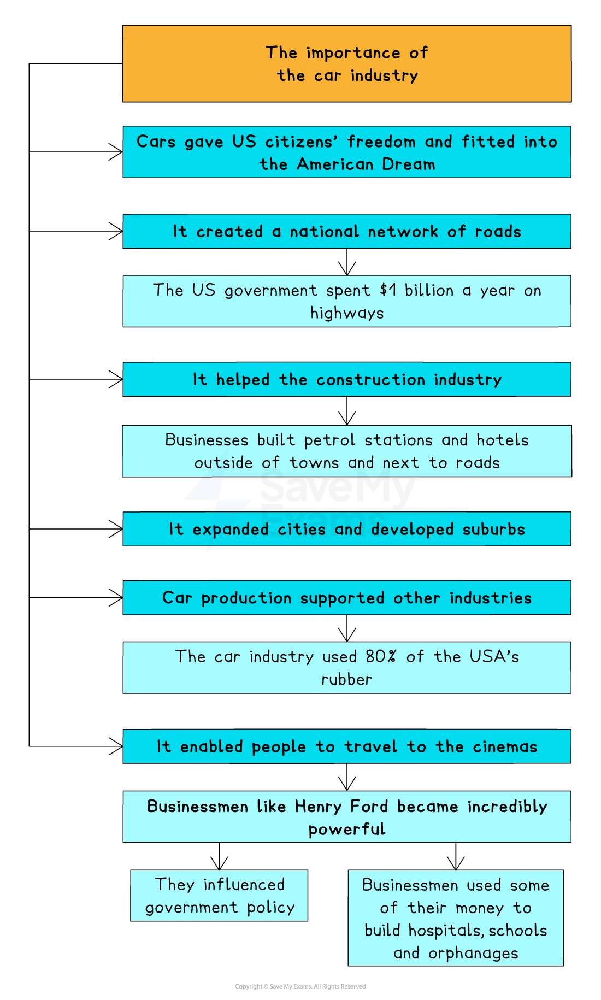
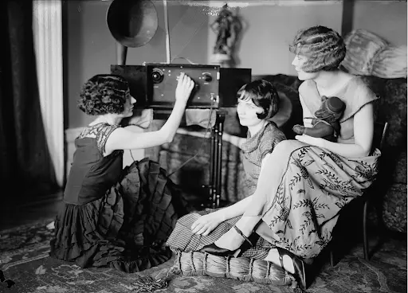
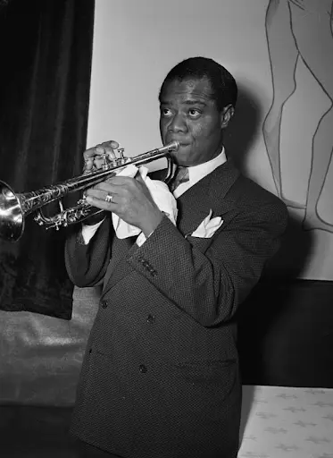
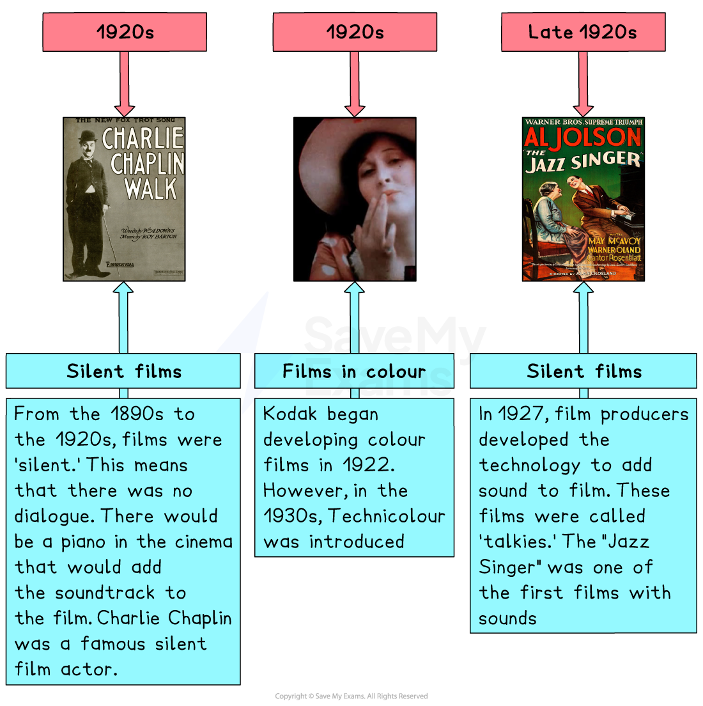

# What were the ‘Roaring Twenties’?

## Summary

The term “Roaring Twenties” captures the essence of a decade that witnessed enormous and, for many Americans, exciting changes. The booming economy, dramatic increase in car ownership, developments in technology, arts and culture and changes to traditional values led to life in the US becoming unrecognisable from the previous decade. The changes occurred so often and so quickly, it felt like they were roaring past.

## What does the “Roaring Twenties” mean?

> **Spec point** — `spcpt_2YYPRsSQxMKYrYzT`

## What does the “Roaring Twenties” mean?

- The Roaring Twenties was a period of rapid cultural, social and economic change in the US during the 1920s.

  - During the Roaring Twenties, the US experienced **rapid***  ***economic growth**
  - This was driven by technological innovation, increased consumer spending and government policies
  - This *economic boom* led to rising living standards and the emergence of a modern consumer culture
  - Many more US citizens enjoyed wealth and access to various goods and services

- The Roaring Twenties was also a time of social freedom and experimentation

  - People began to challenge traditional values, and new forms of expression emerged
  - The* decade *saw the rise of jazz music and the emergence of new forms of entertainment, such as radio and cinema

## Impact of the motor car

> **Spec point** — `spcpt_Rtw9RdwpdzTWmTc4`

## Impact of the motor car

- The motor car was invented in 1885

  - Before the First World War, the price of motor cars meant that only the wealthy could afford them
- *Mass production* meant that the car industry grew significantly in the 1920s

  - By 1929, there were around 23 million cars in the US
- The car industry was important for the US for several reasons. For example, it:

  - Improved the road network
  - Enabled people to travel further
  - Supported other industries, due to the parts and materials needed for car production
  - Led to the expansion of cities and the development of suburbs
  - Created wealth, particularly for business owners

*A concept map showing how important the US car industry was in the 1920s*

## Impact of the radio

> **Spec point** — `spcpt_gPDgQNJ6F8mGdVk3`

## Impact of the radio

- During the 1920s, radio became the most popular entertainment medium in the US

  - By the end of the 1920s, there were hundreds of radio stations
- Radio coverage was able to reach across much of the vast US

  - There was radio coverage to the smallest and most remote settlements, which meant that:
  
    - News travelled more quickly
    - New and different ideas spread across all of the US
  - Many people were* illiterate* in the US in the 1920s
  
    - Radio enabled communication to all citizens, regardless of whether they could read and write
- Radio improved the day-to-day life of people in the US

  - Companies sponsored radio programmes or created radio adverts
  
    - This contributed to the** economic boom** of the 1920s, encouraging people to buy new products
  - Radio encouraged the growth of sport as a hobby
  
    - There was radio coverage of live sporting events, such as baseball
    - People could support teams without having to travel to sporting arenas
- By 1929, around 10million homes in the US had a radio

*A photograph showing three women listening to the radio in the mid-1920s*

## Impact of jazz

> **Spec point** — `spcpt_Prkf7wFHnZ9t755Q`

## Impact of jazz

- Jazz originated from the southern states of the US

  - It is a high-tempo music that was developed by Black American blues and ragtime musicians
- During the 1920s, jazz music became more popular outside of the South

  - Radios, *gramophones* and movies helped it to spread right across the US
  - It was particularly popular with young people, and new dances were developed, such as the Charleston
- Some jazz musicians, such as Louis Armstrong, became internationally famous despite the prejudice and discrimination Black Americans suffered during the 1920s

*A photograph of famous jazz musician Louis Armstrong*

- To many older Americans, jazz was the music of drinking, nightclubs and immoral behaviour

  - Some cities, such as Detroit and New York, banned jazz music because of its association with criminal behaviour
  - Others objected to it for racist reasons and the fact that it was a Black American art form

## Impact of the cinema

> **Spec point** — `spcpt_8wzvyGRd7WcgtcHx`

## Impact of the cinema

- The technology of cinema developed significantly during the 1920s, which helped increase its popularity

*An illustration showing the development of film technology in the Roaring Twenties*

- Television had not been invented in the 1920s, and this decade has become known as the **Golden Age of Hollywood**

  - By 1929, Americans were making **110million visits** to the cinema every week
- There are several reasons why cinema became so popular:

  - Tickets were **cheap**, at less than 25 cents
  
    - This made it affordable for all social groups to go to the cinema
  - Cinemas became places where people socialised, and the movies provided a distraction for people who lived tough and mundane lives
  
    - Films showed a more **glamorous world**
    - People idolised film stars such as Rudolph Valentino and Clara Bow
    - *Picture palaces* were warm and comfortable places
  - There were lots of different types of films, such as:
  
    - Romance
    - Comedy
    - Cartoons — Mickey the Mouse’s *Steamboat Willie *was released in 1928

> **Worked Example**
> **Describe the developments in American society during the Roaring Twenties. **
> 
> **[****4 marks]**
> 
> **Final answer:** **Answer:**
> 
> One development was the growth of mass entertainment and media in the form of radio and cinema. The rapid expansion of radio ownership and the increase in the number of radio stations led to the spread in popularity of jazz music and sports.
> 
> Another development was the dramatic increase in car ownership. Owning cars meant that people could live further away from their place of work, and this led to the development of the suburbs in most American cities and a completely new way of life.
