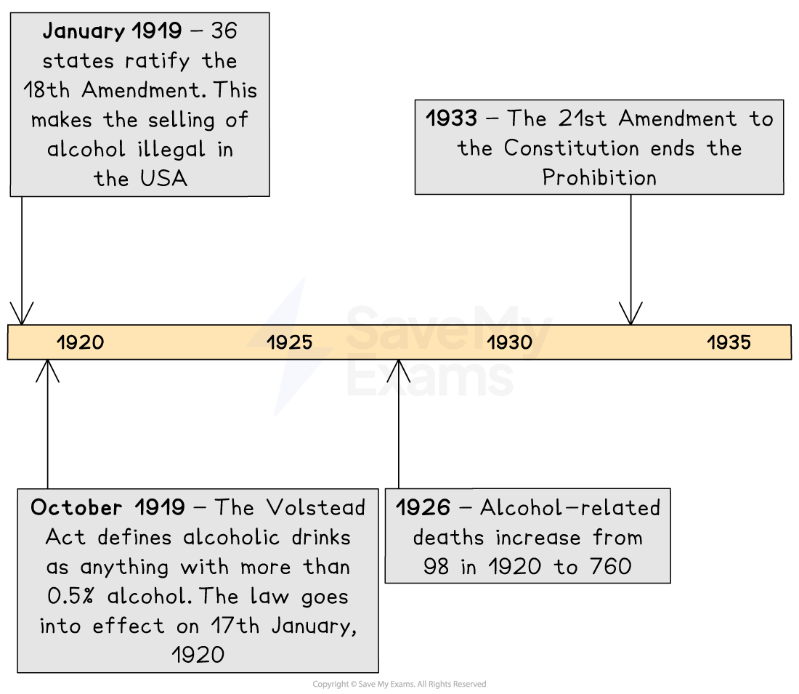
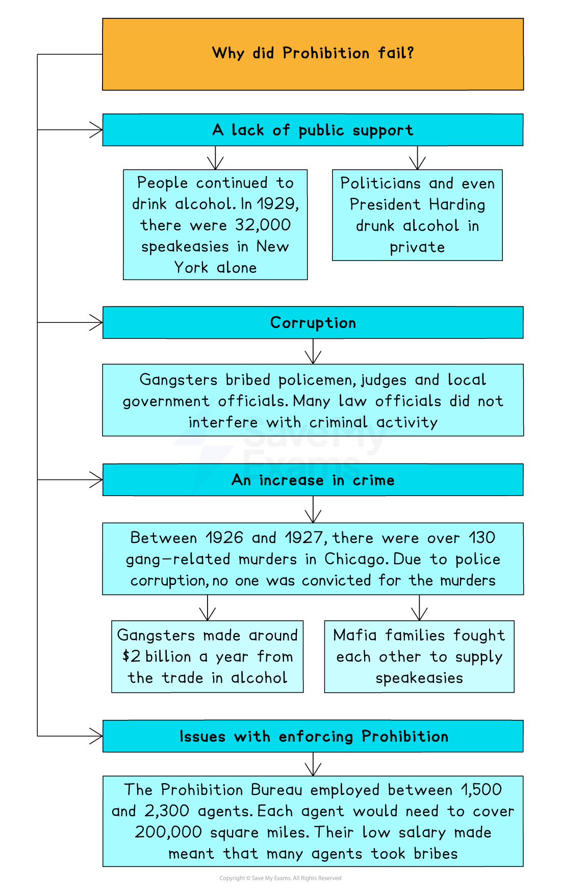

# Why was Prohibition Introduced & Repealed?

## Timeline & Summary

In the 1920s, the US introduced a law known as** prohibition**. This was a nationwide **ban** on the production, sale and transportation of **alcoholic drinks**. The US government introduced prohibition because many people believed alcohol was causing **social problems**,** **such as crime, poverty and family issues. They hoped that, by banning alcohol, society would become healthier and more law-abiding.

Prohibition did not work out as planned. Instead of reducing alcohol consumption, it led to a rise in** illegal activities**, such as *bootlegging*,* *which involved people making and selling alcohol secretly. Gangsters such as Al Capone became powerful figures by *smuggling* and distributing alcohol. Every city in the USA had an issue with gangs, which created a lot of violence and crime in cities across the country. Prohibition also led to *corruption* among law enforcement officials. Bootleggers *bribed* police officers to turn a blind eye to their illegal activities, which undermined the rule of law and eroded public trust in the government.

Prohibition had unintended consequences and caused more problems than it solved. While it aimed to improve society, it instead fuelled crime, corruption and *social unrest* in the US* *throughout the 1920s. As a result, the government *repealed* the act in 1933.

## What was prohibition?

> **Spec point** — `spcpt_CJKjGQ4GJvcC9Shv`

## What was prohibition?

- **Prohibition** made the production, selling and distribution of alcohol illegal

  - This was a *federal* law
  
    - As a result, it **applied to all states** in the US
- Prohibition took some time to come into law

  - Discussions about prohibition began in 1917
  - In 1919, the government passed two acts to legalise prohibition
  
    - The 18th *Amendment* made the sale of alcohol illegal
    - The **Volstead Act** classified alcohol as any drink that had ever contained more than 0.5%t alcohol
- Prohibition began in 1920 and lasted until 1933

## Why was prohibition introduced?

> **Spec point** — `spcpt_5h2jWF7pvBTdMp3b`

## Why was prohibition introduced?

### Pressure from religious groups

- The *Methodists* and *Baptists* did not agree with drinking alcohol. They believed that drinking alcohol was a **sin**

### Pressure from temperance groups

- The Anti-Saloon League (ASL) and the Women’s Christian *Temperance* Union (WCTU) campaigned for prohibition
- They blamed alcohol for causing many social issues in the US, including poverty, crime and broken marriages

### The First World War

- Many German immigrants owned alcohol companies, especially breweries

  - The public viewed buying alcohol from German immigrants as unpatriotic

### Attitudes of business men

- Powerful *industrialists* did not like their workers drinking

  - For example, Henry Ford believed it decreased *efficiency* and led to his workers taking sick days
  - Ford influenced federal politics

### Anti-immigrant feelings

- Immigrant communities such as the Irish, Germans and Eastern Europeans had a reputation for drinking a lot of alcohol
- Support for prohibition was linked to a dislike for these communities in the US

## Why did prohibition fail?

> **Spec point** — `spcpt_hGQvpKGQD9GB3MqT`

## Why did prohibition fail?

- There were several reasons why prohibition failed, including:

  - An increase in crime
  - The lack of public support
  - Corruption
  - Problems enforcing prohibition

*A concept map showing the reasons why prohibition was a failure for the USA from 1920 to 1933*

## The end of prohibition

> **Spec point** — `spcpt_mPn96MN5psbyS9m4`

## The end of prohibition

- By the 1930s, the US government could no longer justify prohibition

  - **Enforcing prohibition **cost the US government **\$13.4 million  **
  - The government was losing out on \$11billion of *revenue* from taxing alcohol sales
  - US citizens’ opposition to prohibition increased
  
    - Businessmen no longer wanted prohibition due to the **increase in crime**
    - The *Great Depression* led to mass *unemployment*
    
      - Legalising alcohol production would create more jobs
    - Campaign groups such as the Women’s Organisation for National Prohibition Reform protested for the end of prohibition
    
      - They hated the social impact of prohibition, especially the number of arrests
- In 1933, President Roosevelt repealed the 18th Amendment

  - The banning of alcohol was now a state decision rather than a federal law
  - This meant that the ban remained in some states and not others

> **Worked Example**
> **Describe the impact of prohibition on American society in the 1920s **
> 
> **[4 marks]**
> 
> **Final answer:** **Answer:**
> 
> One impact of prohibition on American society in the 1920s was the rise of organised crime and gangsters in cities across the United States. With legal alcohol banned, people turned to criminals such as Al Capone to provide bootlegged alcohol. Criminal gangs made millions in profits by smuggling and bootlegging alcohol.
> 
> Another impact of prohibition on American society in the 1920s was that it damaged public trust in law enforcement. Gangsters were incredibly rich and could afford to pay the police, and even judges, enormous bribes to turn a blind eye to their criminal activities.

> **Exam Hint**
> You should look to spend no more than five to seven minutes on the four-mark questions on this paper. On the six-mark question, you should spend between 10 and 12 minutes. For the ten-mark question, you should take between 20 and 25 minutes to answer it.
