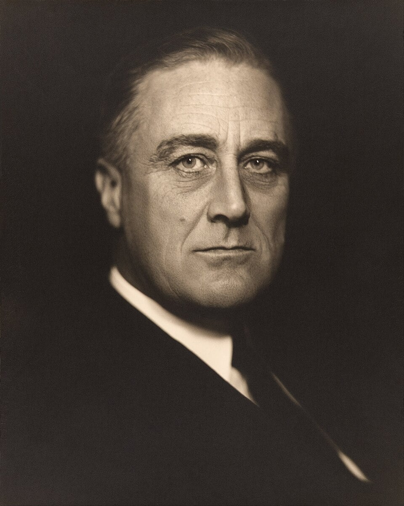

# Changes to the New Deal After 1933

## How Far Did the Character of the New Deal Change After 1933?

*Roosevelt introduced the Second New Deal in 1935*

### Summary

In 1935, **Franklin D. Roosevelt (FDR)** introduced the **Second New Deal**. This was necessary for a number of reasons. First, the *Supreme Court* had blocked some aspects of the First New Deal by ruling that FDR had *overreached* his powers. Second, he was being criticised by wealthy businessmen who believed the First New Deal was too expensive. Finally, there was to be a presidential election in 1936, and FDR wanted to ensure he won it.

The Second New Deal strengthened workers’ rights, created a national *welfare state* and enforced a national *minimum wage*, which raised the earnings of hundreds of thousands of Americans.

## Why did the New Deal change?

> **Spec point** — `spcpt_HW3qbDkWFNZjCfGR`

## Why did the New Deal change?

### The ruling of the Supreme Court

- The **Supreme Court **ruled that** FDR** had done things that he had no right to do as president
- It ruled that:

  - The **National Recovery Administration (NRA)** had tried to set prices and wages that only* Congress*, not the president, could do
  - The **Agricultural Adjustment Administration (AAA)** had paid farmers to not grow food, which the Supreme Court ruled was the role of the state governments — not the president

### Unemployment

- There were still 11 million unemployed Americans in 1935
- Many workers continued to strike and be in dispute with their employers

### Business leaders

- Many business leaders felt the New Deal was too expensive and was interfering with their ability to do business

### The 1936 election

- 1936 was an election year, and the American people would get to decide whether to keep FDR as president or replace him

## Features of the Second New Deal

> **Spec point** — `spcpt_h5qqJqzh8ytDJ5jm`

## Features of the Second New Deal

### National Labor Relations Act of 1935

- The National Labor Relations Act (NLRA) of 1935 replaced the NRA and encouraged workers to join a trade union:

  - The NLRA increased union membership — by the end of the 1930s, over eight million people belonged to unions
- It created the National Labor Relations Board (NLRB) to protect the rights of workers
- The Republican Party and businessmen opposed the NLRA:

  - Some employers refused to let their workers join unions

### Soil Conservation Act of 1935

- The Soil Conservation Act of 1935:

  - Encouraged the planting of grasses, trees or vegetables by subsidising farmers not to grow crops
  - Helped to resolve issues of soil erosion caused by the Dust Bowl
- By 1939, soil erosion had been reduced by 65%
- Farmers used more sustainable farming practices
- This helped farmers and the environment

### Social Security Act of 1935

- The Social Security Act of 1935 created a national social welfare system, which included:

  - Old-age pensions
  - Disability payments
  - Unemployment payments (dole money)
- It also supported widows and orphans
- The Second New Deal meant that the US had a welfare system:

  - This brought the US in line with other Western countries in looking after their citizens
- The welfare system was an improvement, but:

  - Pension payments were low at \$85 a month
  - The system only covered a third of workers
  - The system did not support farmers or workers in private households

### The Resettlement Administration (1935)

- The Resettlement Administration of 1935 aimed to move 500,000 families to areas of better land
- It only managed to resettle about 5,000 families
- Many families did not want to move or were unhappy with where they were being told to go

### Works Progress Administration

- The Works Progress Administration (WPA) employed 2 million workers a year
- The WPA became the US’s biggest employer, and it created jobs in many professions, including acting, writing and photography
- Some of this work was only temporary

### United States Housing Act of 1937

- The United States Housing Act of 1937:

  - Provided loans to encourage people to buy houses
  - Reduced rent prices
  - Improved living conditions for low-income families
  - Gave money to local housing agencies to destroy or improve unsafe housing
- Banks offered more generous mortgage deals:

  - This meant low- and middle-income families could own houses
- The federal government let the local governments decide where and how to use the funding:

  - As a result, Black American housing remained substandard, as local governments were predominantly run by White Americans

### Fair Labor Standards Act of 1938

- The Fair Labor Standards Act of 1938:

  - Enforced a minimum wage
  - Limited working hours
  - Improved working conditions
- More than 700,000 workers achieved higher pay
- More than 1.5 million people worked fewer hours in a week than before the Act

> **Worked Example**
> **Describe the reforms introduced as part of the Second New Deal in the United States **
> 
> **[4 marks]**
> 
> **Final answer:** **Answer:**
> 
> One of the reforms introduced as part of the Second New Deal was the National Labor Relations Act (NLRA) of 1935. The NLRA helped protect the rights of workers and increased trade union membership, which reached 8 million by the end of the 1930s.
> 
> Another one of the reforms introduced as part of the Second New Deal was the Works Progress Administration (WPA). The WPA helped people to find employment in the arts such as theatre, photography and writing, and it employed more than 2 million people — becoming the biggest US employer.

> **Exam Hint**
> It is completely fine (and saves you precious time in exams) to use abbreviations such as AAA and NRA in exams. Just make sure you use the full term and abbreviation — such as Agricultural Adjustment Adminstration (AAA) — the first time you refer to it. Then just use the abbreviation after that.
