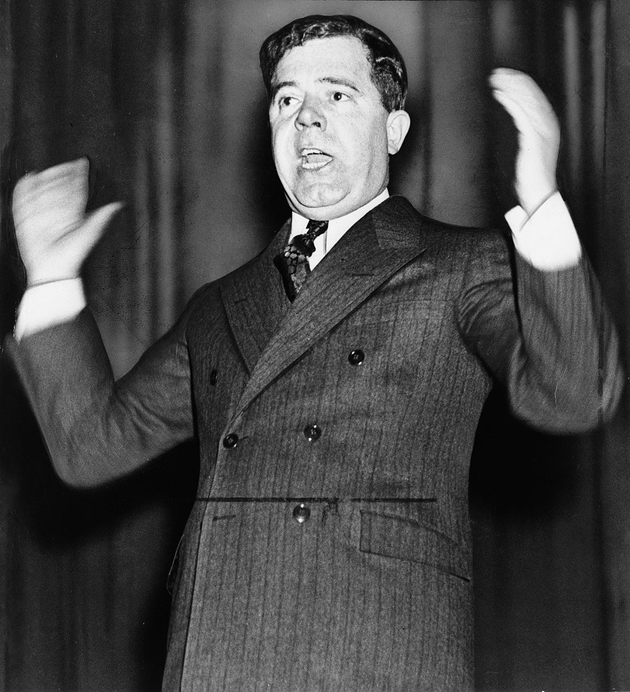

# Opposition to the New Deal

## Summary

Although **President Roosevelt **had been elected on an enormous* landslide*, his New Deal was not popular with everybody. It came under fierce criticism from many different groups in American society. Some argued it went too far and interfered with business and the American way of life. Others argued it did not go far enough and that the wealth of the super-rich should be confiscated. The* Supreme Court* even ruled that some aspects of the New Deal were *unconstitutional.*

## Republican opposition to the New Deal

> **Spec point** — `spcpt_sfKD6GFyPkx72MPK`

## Republican opposition to the New Deal

- The New Deal went against everything that the supporters of the **Republican Party** believe in:

  - Republicans believe in a “**small government**” that stays out of people’s lives and leaves them to succeed — or fail — on their own
  - Republicans believed that the New Deal would make Americans lazy and cause them to wait for *government “handouts”*
  - Republicans also believed that Roosevelt had *overreached* his powers and was becoming too powerful

## Wealthy opponents to the New Deal

> **Spec point** — `spcpt_X6FRf9ZzcKfVP3HH`

## Wealthy opponents to the New Deal

- The New Deal was **expensive**
- To help pay for it, Roosevelt **increased the amount of tax** that wealthy people paid

  - Wealthy people deeply resented their money being used to plant trees or being given to homeless people

## Business opponents to the New Deal

> **Spec point** — `spcpt_VWhWKkvsgkKS9d46`

## Business opponents to the New Deal

- Many business leaders were **supporters of the Republican Party** and did not want the government to interfere in their lives or the way they ran their companies

  - The **National Recovery Administration (NRA)** forced business leaders to:
  
    - Improve working conditions
    - Pay a **minimum wage **
    - Set limits on the number of hours a person could work
  - Business leaders believed this impacted how much money they could make and how competitive they could be

## Radical opposition to the New Deal

> **Spec point** — `spcpt_N4ykQ8KcGMb3sqmt`

## Radical opposition to the New Deal

- Roosevelt also faced criticism from people at the other end of the political spectrum from the Republicans
- **Huey Long **argued that every penny a person owned over \$5 million should be confiscated by the government

  - The money should then be distributed amongst the American people
  - Long believed this would get the government enough money to enable it to give every family in America a house, a radio and a car

*Senator Huey Long of Louisiana was a radical who argued that the reforms of the New Deal did not go far enough*

## The reaction of the US Supreme Court

> **Spec point** — `spcpt_Vks4ZrSWGW4BzTDS`

## The reaction of the US Supreme Court

- The Supreme Court ruled that **Roosevelt** had broken the rules over how much power a president has
- It ruled that:

  - The **NRA** had tried to set prices and wages that only* Congress*, not the president, could do
  - The **Agricultural Adjustment Association (AAA) **had paid farmers to not grow food, which the Supreme Court ruled was the role of the state governments — not the president

> **Worked Example**
> **Describe the reasons why there was opposition to the New Deal **
> 
> **[4 marks]**
> 
> **Final answer:** **Answer:**
> 
> One reason why there was opposition to the New Deal was that most Republicans believed in a small government that stayed out of people’s lives. The New Deal meant that the government had become more involved in the American people’s lives than ever before.
> 
> Another reason for the opposition to the New Deal was that some people did not believe it went far enough in correcting the problems in American society. *Radicals *such as Huey Long argued that the extreme wealth of the super-rich should be taken from them by the government and shared amongst the American people. Under Long’s plans, nobody could own more than \$5 million.

> **Exam Hint**
> When answering the 6 mark “Why…?” question, make sure you use the PEEL format.
> 
> - **P **— Point
> - **E** — Evidence
> - **E** — Explain
> - **L** — Link your explanation back to the question
