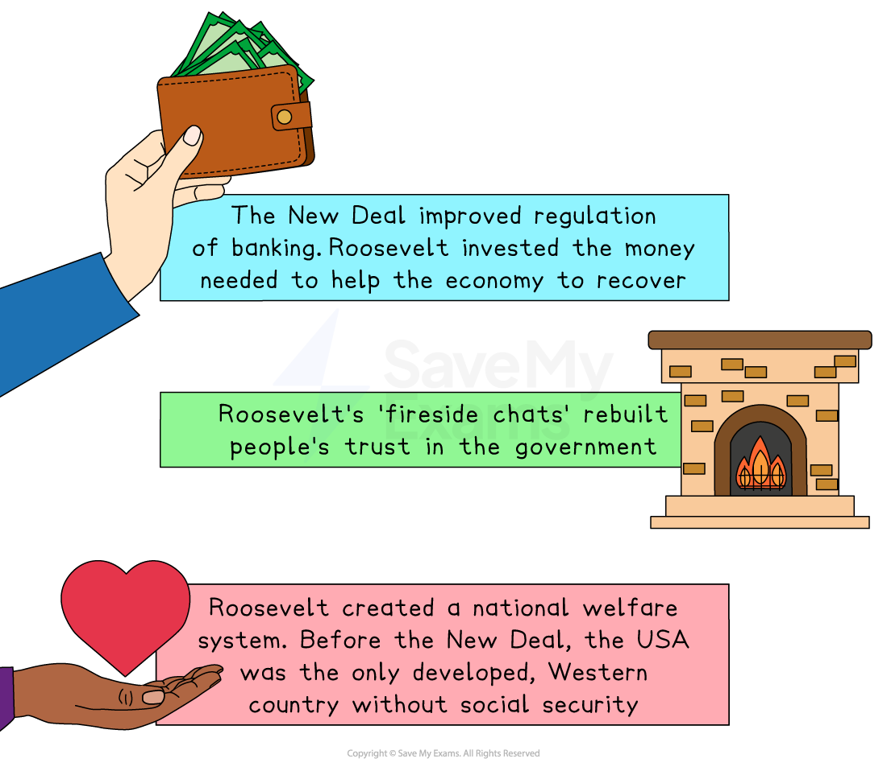

# Was the New Deal a Failure?

## Summary

For some people, the New Deal was a huge success. They believe that it rescued America from the catastrophe of the **Wall Street Crash **and the **Great Depression**, created a **welfare state **and restored the American people’s faith in both the banking system and their government.

Others believe that the New Deal failed to find work for millions of unemployed people and expanded the role of the government so that it interfered in the lives of the American people and the economy. This interference, they believed, undermined individual freedoms and prevented businesses from making money.

The success, or failure, of the New Deal is a debate that continues to divide historians.

## Success of the New Deal

> **Spec point** — `spcpt_skqYj7mkMdzy5xsk`

## Success of the New Deal

- Some aspects of the New Deal are widely accepted as being a success

*An illustration showing the nationwide successes of the New Deal*

### Which groups benefitted from the New Deal?

- The New Deal had benefits for specific groups within US society, including:

  - The unemployed and the poor
  - Male workers
  - Women
  - Farmers
  - Black Americans

#### The unemployed and the poor

- The US government gave millions of dollars to support those facing *poverty*, homelessness and hunger
- The **Tennessee Valley Authority (TVA)** created work and improved the *standard of living* in poorer parts of the US
- After 1935, many **vulnerable people **in society benefitted from the *Social Security Act*

#### Male workers

- The *[Alphabet agencies](https://www.savemyexams.com/gcse/history/aqa/16/aqa-the-period-study/revision-notes/america-1920-1973/recovery-the-new-deal/the-new-deal-1933/)** *created millions of new jobs for workers
- The **National Recovery Administration (NRA)** improved workers’ pay and hours
- The **National Labor Relations Act **encouraged *trade unions*

  - It attempted to stop employers from treating their workers unfairly

#### Women

- The **Works Progress Administration (WPA)** in the *[Second New Deal](https://www.savemyexams.com/gcse/history/aqa/16/aqa-the-period-study/revision-notes/america-1920-1973/recovery-the-new-deal/changes-to-the-new-deal-after-1933/)** *employed women
- Roosevelt appointed** Frances Perkins** as the Secretary of Labor

  - She was the first woman in history to have a *cabinet* job in the US government

#### Farmers

- Large-scale farmers received support
- The **Agricultural Adjustment Administration (AAA) **reduced the number of farmers losing their land and improved profits
- The TVA **improved productivity** in the Tennessee Valley, which helped the area recover from the *Dust Bowl*

#### Black Americans

- The New Deal gave jobs to Black Americans
- After 1935, Black Americans received relief cheques from the government
- Before the Depression, many Black Americans supported the *Republican* Party

  - It was the political party of Abraham Lincoln that *abolished* slavery
- After the New Deal, more Black Americans supported the *Democrats*

## Failures of the New Deal

> **Spec point** — `spcpt_xxJphWp99NsKK5P7`

## Failures of the New Deal

### How were people failed by the New Deal?

#### The unemployed and the poor

- By 1939, 9.5m US citizens remained **unemployed**
- Some people became **reliant on government support**

#### Male workers

- The New Deal benefitted skilled workers more than unskilled workers

  - People became annoyed at *boondoggle* jobs
- Some employers did not respect the New Deal and blocked workers from joining trade unions

#### Women

- Agencies such as the Civilian Conservation Corps (CCC) only helped young men
- The WPA mainly gave women unskilled jobs
- The NRA purposefully set wages lower for women than for men

#### Farmers

- Smaller farmers did not receive much benefit from the New Deal
- The **AAA** encouraged farmers to produce less:

  - This forced many *sharecroppers* to leave farming and head for industrial cities to find work
- Despite the **TVA** bringing electricity, farmers continued to have a low standard of living

#### Black Americans

- Many Black Americans continued to work in low-paying jobs
- The **NRA** paid Black workers less than white workers
- The **CCC **had *segregated* camps for Black workers
- Support for an anti-*lynching* bill increased when 63 Black people were lynched in the South:

  - Roosevelt refused to pass this bill
  - He needed the support of southern Democrats who supported *White supremacy*
- A third of all Black Americans became reliant on the government’s relief payments

> **Worked Example**
> **Describe the reasons why some people believe the New Deal was a failure **
> 
> **[4 marks]**
> 
> **Final answer:** **Answer:**
> 
> One reason why some people believe the New Deal was a failure is that it did not end the problem of unemployment. In 1939, 9.5 million Americans remained unemployed.
> 
> Another reason why some people believe the New Deal was a failure is that it interfered with the American economy. Under the Agricultural Adjustment Administration, farmers were paid to produce less food. Critics argued that this damaged businesses and the free market.

> **Exam Hint**
> Balance is critical when answering Part C questions. Using the New Deal as an example, you **must **be able to explain why it is seen as a success by some and a failure by others. You can then go on to explain which side of the argument you agree with in your substantiated conclusion.
