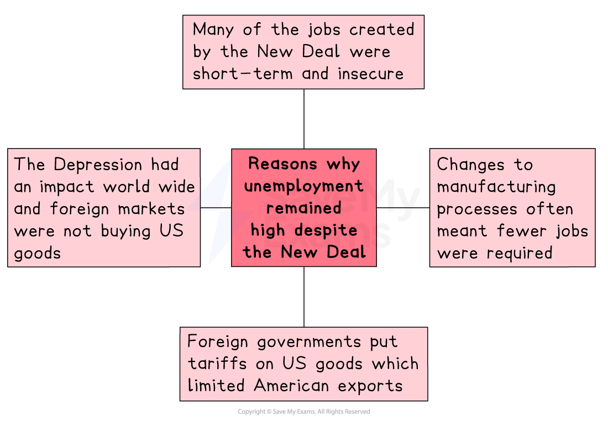

# Why Did Unemployment Continue?

## Summary

The New Deal was very **expensive** and was fiercely criticised by its opponents. However, Roosevelt was still *reelected* by a large margin in 1936. Despite this, concerns about the New Deal and its failure to conquer unemployment continued to grow.

It was the outbreak of the Second World War in 1939 that finally dragged America completely out of the Great Depression and secured its economic recovery.

## Limitations of the New Deal

> **Spec point** — `spcpt_KS2VWpGTY8XK5SMh`

## Limitations of the New Deal

- When Roosevelt became president in 1933, there were **12.8 million unemployed Americans**

  - By 1941, that number had been slashed to **5.6 million**
- Considering the expense and effort of the New Deal, 5.6 million was still a large number

  - Unemployment **never fell below 10 per cent **during the 1930s
  - There are several reasons for this including:
  
    - Short-term and insecure jobs
    - Improvements in manufacturing meant that fewer workers were needed
    - The Depression meant that fewer goods were purchased
    - Tariffs on US goods affected exports

*A diagram showing the reasons why unemployment continued after the New Deal*

## Consumer spending

> **Spec point** — `spcpt_6sQxH3yx58RbSCxJ`

## Consumer spending

- Unemployment remained high, and wages remained low

  - This meant that many American workers did not have the *disposable income* to purchase consumer goods
  - As a result, sales of **consumer goods** such as cars, radios, vacuum cleaners and refrigerators were low
  - This led to the closure of businesses that made these goods and contributed to the *persistently* **high unemployment figures**

## The Second World War

> **Spec point** — `spcpt_pSHMzJnWw2yQZB5t`

## The Second World War

- By the late 1930s, many people were beginning to fear that the New Deal had failed

  - They worried that the US would soon return to an **economic depression**
- The** outbreak of war** in 1939, and the US’s entry into the war in 1941, changed all that

  - Factories that had been built to make cars were soon making thousands of planes, tanks and guns
- Farmers who had been struggling to sell their crops suddenly found there was a rapid increase in the demand for food to feed the soldiers and sailors

  - Farmers were also able to sell their produce to countries such as Britain and the Soviet Union that were most affected by the war
- Coal and oil were in enormous demand, and the iron and steel industries also boomed

  - The combined effect of booming industry and agriculture and the large number of people joining the armed forces **almost eliminated unemployment**
  - By 1944, there were just 670,000 unemployed Americans

> **Exam Hint**
> The three question types on this paper require you to write specific things. Make sure you give the examiner what they ask for!
> 
> **Describe** → Give key facts in short, clear sentences. No explanation needed.
> 
> **Explain** → Show *why* or *how*, with cause–effect links.
> 
> **How far do you agree? / Do you agree?** → Present both sides, then give a supported judgement.
