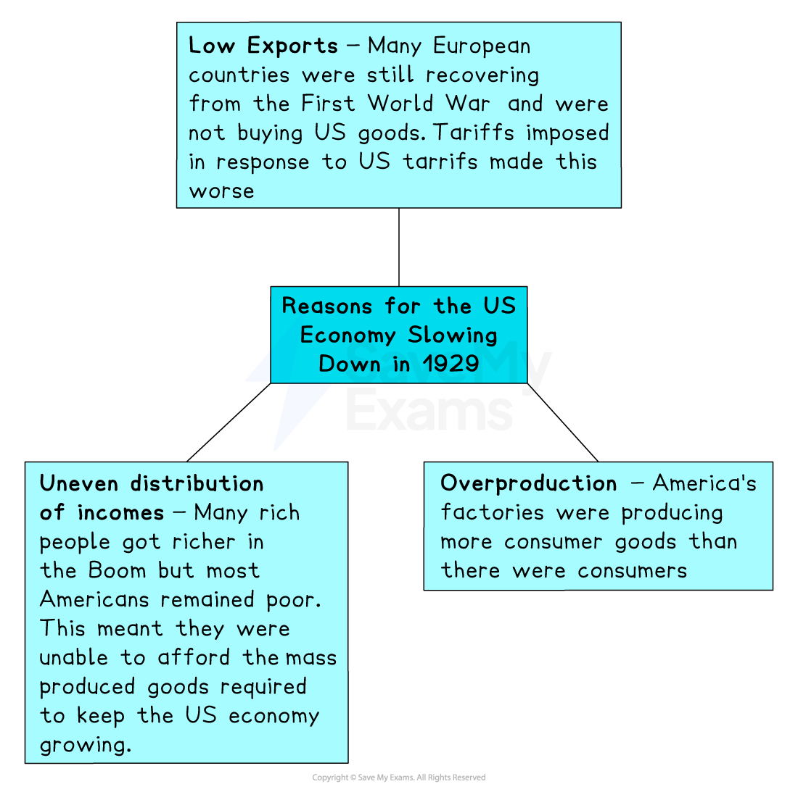
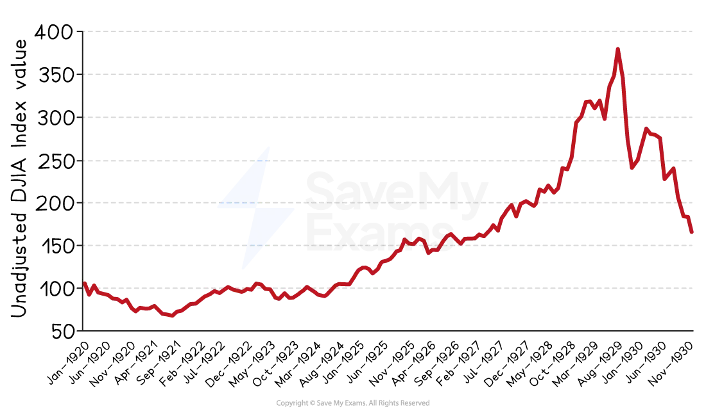

# Speculation & the Wall Street Crash

## How Far Was Speculation Responsible for the Wall Street Crash?

### Summary

The **Wall Street Crash of 1929** triggered the *Great Depression*. Wall Street is the name given to the US *Stock Exchange*, and in the 1920s, many Americans had grown wealthier by speculating on ***shares***. This meant that they purchased shares on the stock market and sold the shares after they increased in value. A decade of *economic growth* led to seemingly endless increases in share prices; people bought more and more shares and took ever greater financial risks. 

Once the US economy began to slow down, fears of a drop in share prices caused people to sell their shares. Panic gripped the market, and mass selling of shares triggered a collapse or** crash **in the stock market in October 1929.

## What does speculation mean?

> **Spec point** — `spcpt_4JXk5dHTHbjVyrrx`

## What does speculation mean?

- **Speculation **is when a person buys something with the hope that its value will increase

  - They then try and sell the item at a higher price to make a **profit**
- Speculation on the stock market became very popular in America in the 1920s

  - *Share* prices had boomed during the first half of the decade
  
    - Many people assumed that this would continue
  - Many working-class people joined in buying shares in the hope of getting rich
  
    - Many purchased shares “**on the margin**”
    
      - This meant that they only paid for about 10 per cent of the shares and borrowed the money to pay for the rest
      - They hoped and expected that the value of the shares would be greater than the debt when they came to sell them
- Speculation was incredibly risky — especially “on the margin”

  - There was no guarantee that shares would increase in value
  - If they decreased in value, people could be in serious financial trouble

## Reasons for the Wall Street Crash

> **Spec point** — `spcpt_jrrh53bBdp8Yrb2h`

## Reasons for the Wall Street Crash

- If people had faith that the US economy would continue to grow and therefore continued to *invest *in the stock market, shares would continue to rise

  - But if enough people started to doubt the strength of the US economy, they would sell their shares, and prices would start to fall
- In 1929, some *investors* began to see signs that the US economy was slowing down

  - As a result, they started to sell rather than buy shares

*A concept map showing reasons why the US economy slowed down in 1929*

- What started as a trickle of investors selling their shares soon turned into a flood

  - Panic led many investors to try and sell their shares before they lost all value
- On 24th October 1929, **13 million shares **were sold on the New York Stock Exchange on Wall Street

  - Nearly all companies saw the value of their shares collapse
  - It became known as **Black Thursday**

## Events in the Wall Street Crash

> **Spec point** — `spcpt_9XSfWJnZNNKgN7WS`

## Events in the Wall Street Crash

- Share prices continued to fall after 24th October

  - Approximately, 16 million shares were sold on the 29th of October
- Many people had purchased shares “on the margin” with money they had borrowed from banks

  - Many thousands of investors were unable to pay these loans back because their shares had suddenly become worthless
  - The result was 659 American banks going* bust* in 1929
- Millions of Americans had savings in these banks

  - When the banks disappeared, so did people’s savings
  - This led to the financial ruin of many Americans and forced the closure of more businesses

*A graph from Statista.com showing the monthly valuations of stocks between January 1920 and November 1930. *

> **Worked Example**
> **Describe the causes of the Wall Street Crash of October 1929. **
> 
> **[4 marks]**
> 
> **Final answer:** **Answer:**
> 
> One cause of the Wall Street Crash of October 1929 was speculation and investors buying “on the margin”. This meant that shares were purchased with borrowed money in the expectation that they would increase in value. However, when prices stopped increasing or started to drop, it triggered speculators to sell quickly, as they could not cover the debt they had taken on to buy the shares.
> 
> Another cause of the Wall Street Crash of October 1929 was overproduction. America’s factories were mass-producing more goods than there were consumers to buy them. This led to a drop in profits and then a drop in share prices, which triggered speculators to start selling.

> **Exam Hint**
> The causes of the Wall Street Crash could be the topic of a 10-mark judgement question and might take the form: “Speculation was responsible for the Wall Street Crash.” How far do you agree with this statement?
> 
> To achieve a Level 5, you must explain what speculation is and how it created the conditions for a crash — particularly with so many shares being bought “on the margin”.
> 
> You must then explain how underlying issues with the US economy, such as overproduction, a lack of exports and uneven distribution of wealth, caused it to slow and share prices to drop.
> 
> Finally, you must reach a conclusion about whether you agree with the statement and explain your reasoning.
