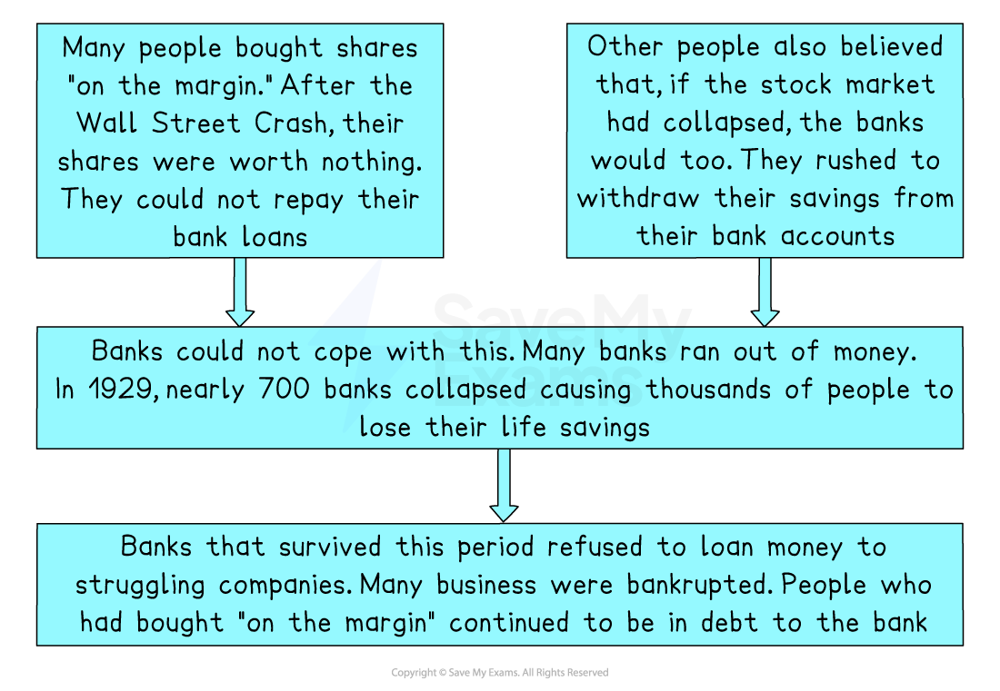

# What Impact Did the Crash Have on the Economy?

## Summary

The **Wall Street Crash** had a catastrophic *knock-on effect* on the rest of the US economy. With so many people suddenly in serious financial trouble, there was a huge drop in the number of potential customers for businesses. This meant they cut back on production or, in many cases, went *bust*. The banking industry struggled because too many loans had been given to people to buy shares “**on the margin**” before the crash. In the aftermath, many savers rushed to withdraw all their savings before the bank went bust, making a terrible situation for banks even worse. The farming industry had not benefitted from the boom but was still hit hard by the crash. A drop in food prices and an increase in *interest rates* after 1929 meant many farmers could not afford to repay their loans. As a result, their farms were *seized* by the banks that had lent them money. The consequence for workers in all these industries was job losses, and by 1933, a **quarter of all Americans were unemployed**.

## Impact on businesses

> **Spec point** — `spcpt_rpN2PdCS6CmQBFm7`

## Impact on businesses

- The stock market crash of October 1929 was just the start of an economic disaster that had terrible consequences for millions of Americans:

  - Share prices did not stop falling for** three years**
  - Industrial production had fallen by 45% by 1932
  - Car production had fallen by 80% by 1932
  - Over 100,000 businesses went *bankrupt* between 1929 and 1932

## Impact on banking

> **Spec point** — `spcpt_s7Fvrj5XzmppKK73`

## Impact on banking

- Banks suffered particularly badly in the *aftermath* of the crash

*A flow diagram showing how the Wall Street Crash caused a banking crisis*

## Impact on agriculture

> **Spec point** — `spcpt_bs93P2NYsHrNSc2g`

## Impact on agriculture

- American farmers were already struggling during the Boom years, and many had taken out** loans** to buy machinery to make their farms more efficient:

  - **Food prices fell **after the crash, and they continued to struggle to sell to overseas markets due to tariffs on US goods
  - The farmers’ problems were made worse when *interest rates* increased between 1929 and 1932
  - This meant the repayments the farmers had to make to pay their loans off became more expensive
  - Many could not afford the increase in loan payments, and around 750,000 farmers lost their land during the *Great Depression*

## Impact on workers

> **Spec point** — `spcpt_283qHyxMhqbTt3bF`

## Impact on workers

- The closure of so many businesses led to a **massive increase** in **unemployment:**

  - By 1933, around one in four (14 million) US citizens were unemployed

- There were** no welfare** or* unemployment benefits** *for those who had lost their jobs, but rent and mortgages still had to be paid

  - Many people were *evicted* or had their homes *repossessed*
  - Some people travelled from state to state looking for work and became known as “**hobos**”
- “Hobos” became seen as a social problem, and prejudice against them made it even more difficult for them to find work

  - The impacts of the Depression were **not felt equally** across the states, which is what caused many employed people to travel in search of work
  - Demand for coal fell as fewer factories required power and heating
  
    - Many mines closed, and the miners lost their jobs

> **Exam Hint**
> When explaining the consequences of an event in an exam, using connectives is an excellent way to highlight to an examiner that one thing happened as a result of the other. Make sure you use terms such as “As a result”, “This led to” and “Consequently” in your answers.
