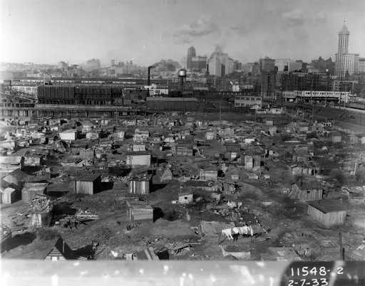
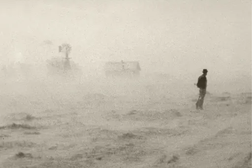

# What were the Social Consequences of the Crash?

## Summary

The consequences of the **Wall Street Crash** were felt by communities across the US. In cities, **high levels of unemployment **and **reduced wages** led to extremely difficult living conditions,** evictions **and home **repossessions**. Large areas of temporary housing, or **Hoovervilles**, became a feature of many American cities.

In the countryside, increased interest rates led to many farmers who had taken out loans losing their farms to the banks. In the Midwest and on the Great Plains, **soil erosion**, winds and **drought **led to farmland becoming *infertile.* The result was the **migration** of thousands of farm workers to California in search of employment.

In the South, large numbers of Black American *sharecroppers* were made redundant by landowners and journeyed north to try and find jobs in the cities. Recently arrived **immigrants**, who had already faced prejudice and discrimination, were treated even more harshly after the crash. In California, some immigrants were even deported.

## Consequences for people in towns and cities

> **Spec point** — `spcpt_RyMb9vCPNKRdQnkw`

## Consequences for people in towns and cities

- The Wall Street Crash caused many American businesses to close

  - As a result, **unemployment rose **from 3% in 1929 to 25% in 1933
- The US had no *social security *in the 1920s
- The *Republican *government expected unemployed workers to resolve their own problems
- **Charities** and local governments organised social and economic support for those in need

  - People were forced to queue for hours for food
  - Such was the level of demand that some *state governments *went **bankrupt**
  - Government employees, such as teachers, did not receive a salary when this happened
- Workers who kept their jobs still struggled because:

  - Their employers **reduced wages** and **increased working hours **
  - Bosses were able to hire someone else very easily if a worker refused to work more hours for less money
- Many US citizens could not afford basic necessities

  - People suffered from *malnutrition* due to a lack of food

- By 1932, over 250,000 Americans were unable to repay their mortgages

  - Banks** repossessed houses **from those who could not afford their repayments
  - Landlords **evicted **people who could not pay their rent
  - This led to **homelessness** becoming an increasing problem in many American cities

- People began to create temporary housing on wasteland out of whatever materials they could find

  - These settlements became known as “**Hoovervilles**”
  
    - The name was an attack on **President Hoover** for his government’s failure to help people during the Depression

*A photograph of a Hooverville in Seattle*

## Consequences for people in the countryside

> **Spec point** — `spcpt_zTsTJDVs39G3YxhZ`

## Consequences for people in the countryside

- The **economic crash** caused the price of food to fall, which hit farmers’ profits

  - American *agriculture* had not benefited from the boom in the same way American industry did
  - During the 1920s, many farmers had** borrowed money** to** buy machinery **to make their farms more efficient
  - This had caused many unskilled farm labourers to lose their jobs
- Between 1929 and 1933, *interest rates ***increased**, which made loan repayments more expensive

  - Many farmers could no longer afford the loan repayments, and 750,000 American **farms were repossessed **by the banks during the Great Depression
  - This caused many farm workers to lose their jobs
- In the *Midwest*, the problems were intensified by soil erosion that was caused by *overcultivation*

  - In 1930, drought conditions combined with strong winds on the *Great Plains* to blow away the *topsoil*
  - The event, which became known as the **Dust Bowl**, decreased the fertility of millions of acres of farmland
- As a result of these issues, many farm workers headed to the *citrus farms of California *in search of jobs

  - Life in California was tough for the migrant workers, who were often housed in large, unhygienic camps where illness quickly spread
  - Californian labourers also resented the arrival of so many **migrant workers**, as they** **felt the migrants were taking their jobs

*A photograph showing the Dust Bowl in the 1930s in the USA*

## Consequences for immigrants & Black Americans

> **Spec point** — `spcpt_RTcpMZgQQHq7Yx85`

## Consequences for immigrants & Black Americans

- In the *South*, many Black Americans were sharecroppers, which meant they had to give part of their crop to a landowner as rent

  - After the **Wall Street Crash **happened and the price of food fell, many landowners made the sharecroppers on their land **redundant **
  - As a result, the former sharecroppers moved to northern cities, such as** Chicago **and **New York**,** **in search of work
  - Unfortunately, job opportunities were rare in these cities, too, and the former sharecroppers faced **racial discrimination**
- Immigrant workers faced discrimination and accusations of driving wages down

  - Some white American workers viewed immigrants as a threat to their jobs and resented them
  - In California, some immigrant workers were *deported* from the US and repatriated to Mexico

> **Worked Example**
> **Describe the impact of the Wall Street Crash on American society in the early 1930s **
> 
> **[4 marks]**
> 
> **Final answer:** **Answer:**
> 
> The American people were affected by the Wall Street Crash because it triggered an enormous rise in homelessness. Banks began to repossess houses, as people could not afford to pay their mortgages. This caused thousands of people to create temporary housing out of cardboard and corrugated iron, called Hoovervilles.
> 
> Another impact of the Wall Street Crash on American society was its impact on agriculture. The drop in the price of food meant many sharecroppers in the South were made redundant by landowners. This led to many Black Americans from the South moving to northern cities such as Chicago and New York in search of jobs. This changed the demographics of the US.

> **Exam Hint**
> Using subject-specific vocabulary helps to give your answers extra authority and allows you to give more accurate and insightful answers. For example, you can use the term sharecroppers instead of farmers. Although both terms are technically correct, using the term sharecropper allows you to explain why giving a proportion of crops to a landowner in exchange for farming land left some people vulnerable when Wall Street crashed.
